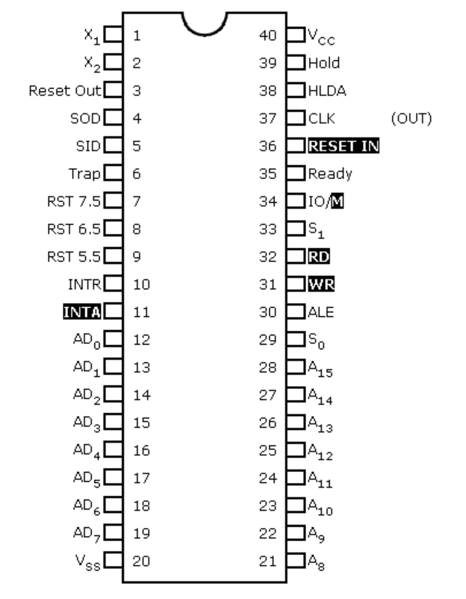
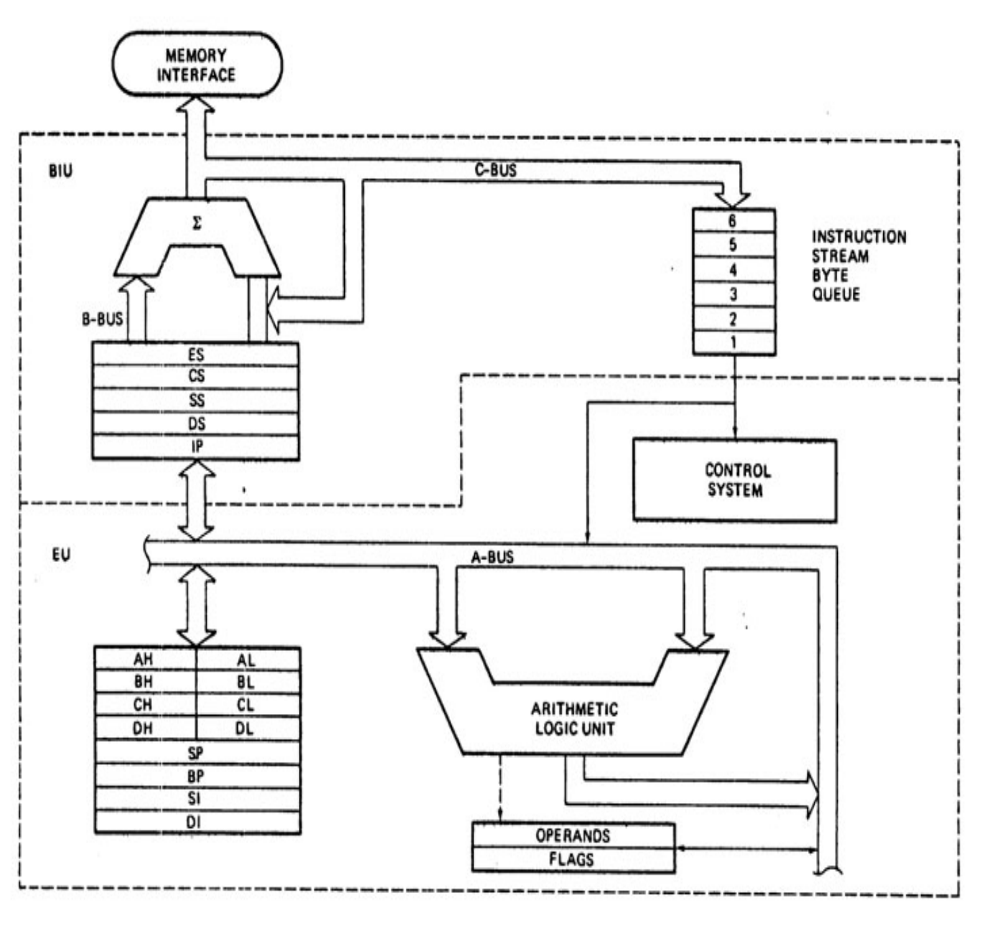
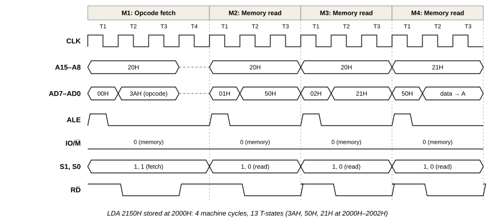
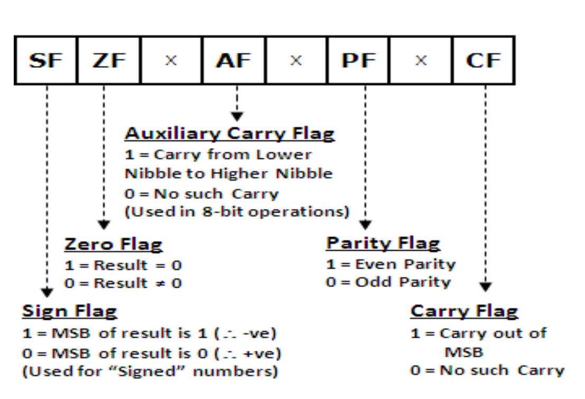
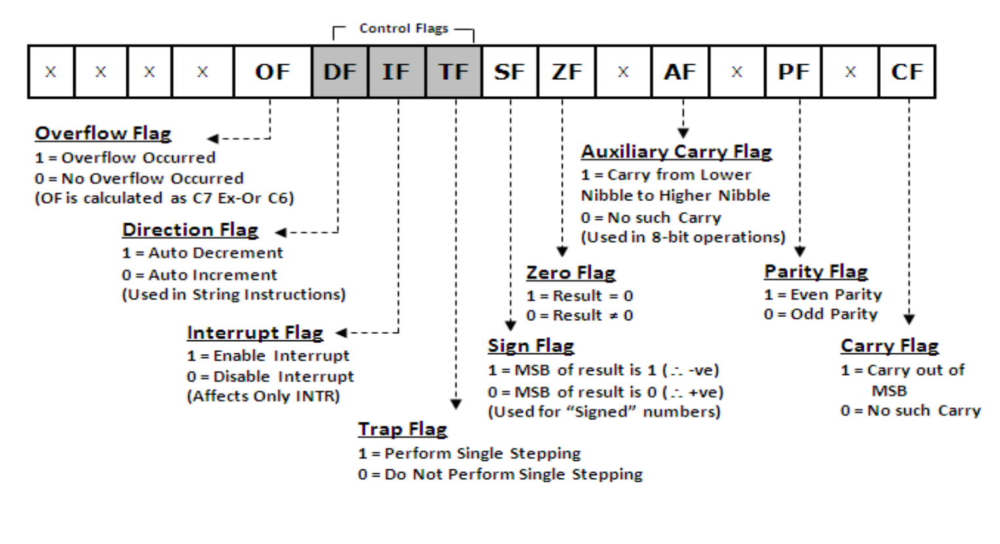
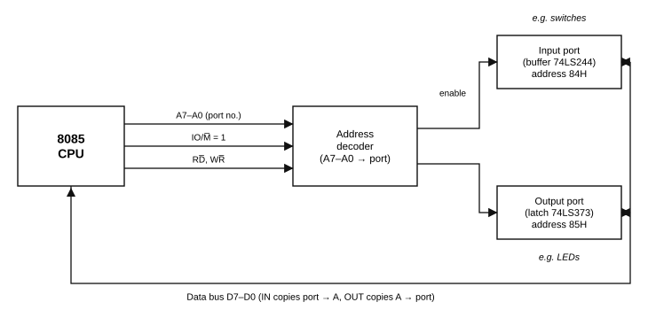

# Microprocessor Endsem 2025, Solved

**Paper:** B.Tech (CE) Sem V, Microprocessor (CSC-502 / CEN-503 Old), 2025, 3 hours, 45 marks. Attempt any two parts from each question; each part is 4.5 marks (Q2(b) has three parts of 1.5). Every program here was run on a simulator.

Every question of the 2025 endsem paper, solved. The same answers sit inside the unit docs at the topic they belong to; the unit is named under each question so you can jump there for the explanation.

---

## Question 1

> **Endsem 2025 · Q1(a) · 4.5 marks**
> Draw and explain the pin diagram of the 8085 microprocessor.

**Answer.**

The 8085 is a 40-pin DIP chip running on a single +5 V supply. Its pins fall into seven groups.

**Figure: 8085 pin diagram** (black boxes mark active-low pins).



| Group | Pins (number) | What they do |
| --- | --- | --- |
| **Power and clock** | Vcc (40) +5 V, Vss (20) ground, X1, X2 (1, 2), CLK OUT (37) | A crystal on X1–X2 sets the clock; the chip runs at **half** the crystal frequency. CLK OUT supplies the clock to other chips |
| **High address** | A15–A8 (21–28) | Upper byte of the address; output only |
| **Multiplexed address/data** | AD7–AD0 (12–19) | The **low address byte first, then the data byte**, on the same 8 wires |
| **Control and status** | ALE (30), RD̅ (32), WR̅ (31), IO/M̅ (34), S1 (33), S0 (29), READY (35) | Say what kind of bus operation is happening |
| **Interrupts** | TRAP (6), RST 7.5 (7), RST 6.5 (8), RST 5.5 (9), INTR (10), INTA̅ (11) | Devices ask for attention; INTA̅ acknowledges INTR |
| **DMA** | HOLD (39), HLDA (38) | Another chip requests the buses; the 8085 grants them |
| **Reset and serial** | RESET IN̅ (36), RESET OUT (3), SID (5), SOD (4) | Restart the chip; serial data in and out |

**The control pins:**

- **ALE** (Address Latch Enable) goes high at the start of every machine cycle: "AD7–AD0 hold an address right now".
- **RD̅** low = the CPU is reading; **WR̅** low = writing.
- **IO/M̅** = 1 for I/O, 0 for memory. With **S1, S0** it names the cycle:

| Operation | IO/M̅ | S1 | S0 |
| --- | --- | --- | --- |
| Opcode fetch | 0 | 1 | 1 |
| Memory read | 0 | 1 | 0 |
| Memory write | 0 | 0 | 1 |
| I/O read | 1 | 1 | 0 |
| I/O write | 1 | 0 | 1 |

- **READY:** a slow device holds it low and the 8085 inserts **wait states**.
- **RESET IN̅:** low → PC = 0000H, interrupts disabled. **RESET OUT** resets other chips.
- **Interrupts:** TRAP is non-maskable and highest priority; RST 7.5, 6.5, 5.5 are maskable and vectored; INTR is maskable and non-vectored.

**Demultiplexing AD7–AD0.** Sharing pins saves pins, but memory needs the low address held for the whole cycle, so a **latch** (74LS373) copies it while ALE is high and keeps it after ALE drops; the same pins then carry data.

```
AD7-AD0 ──┬──> [74LS373 latch] ──> A7-A0  (held all cycle)
          │          ^
ALE ──────┼──────────┘  (latches while ALE is high)
          └──> D7-D0  (data, after ALE drops)
A15-A8  ───────────────────> A15-A8
```

**40 pins in groups: power and clock, A15–A8, multiplexed AD7–AD0 (split by ALE and a latch), control and status (ALE, RD̅, WR̅, IO/M̅, S1, S0, READY), 5 interrupts with INTA̅, HOLD/HLDA, reset, and SID/SOD.**

*Taught in Unit 1.*

> **Endsem 2025 · Q1(b) · 4.5 marks**
> Draw and explain the block diagram of the 8086 microprocessor.

**Answer.**

The 8086 is internally divided into two units that work in parallel: the **Bus Interface Unit (BIU)** and the **Execution Unit (EU)**.

**Figure: 8086 architecture** (Bharat Acharya's notes). The top dashed box is the BIU, the bottom one the EU.



**BIU (Bus Interface Unit): handles all bus activity with memory and I/O.**

- **Segment registers CS, DS, SS, ES** (16-bit): the start of the code, data, stack and extra segments.
- **Instruction Pointer (IP):** offset of the next instruction (the 8086's PC).
- **Address adder (Σ):** builds the 20-bit physical address = segment × 10H + offset. E.g. CS = 4321H, IP = 1000H → 43210H + 1000H = **44210H**.
- **6-byte instruction queue:** instruction bytes prefetched in advance, first in, first out.

**EU (Execution Unit): decodes and executes instructions.**

- **General registers AX, BX, CX, DX** (16-bit, each split into high and low bytes: AX = AH + AL). AX: accumulator (MUL/DIV, I/O); BX: base (memory offsets); CX: count (LOOP, REP); DX: data (I/O port, high word of MUL/DIV).
- **Pointer and index registers SP, BP, SI, DI:** offsets for the stack (SP, BP) and for string operations (SI source, DI destination).
- **16-bit ALU** and the **flag register** (9 flags: CF, PF, AF, ZF, SF, OF + TF, IF, DF).
- **Control unit / decoder:** takes the next instruction from the queue, decodes it and drives the ALU and registers.

**Pipelining:** whenever 2 or more bytes of the queue are free, the BIU fetches the next instruction bytes **while** the EU is still executing the current one. So fetch and execute overlap, and the EU rarely waits for memory. On a **jump or call**, the prefetched bytes are useless, so the queue is **flushed** and refilled.

**BIU (segment registers, IP, address adder, 6-byte queue) fetches and addresses; EU (AX–DX, SP/BP/SI/DI, ALU, flags, decoder) executes; they work in parallel through the queue (pipelining).**

**Segmentation** in one paragraph: 1 MB needs 20-bit addresses but every register is 16 bits, so memory is used in **segments** of up to 64 KB. An address is `segment:offset`, and **physical address = segment × 10H + offset**. Segments let programs be relocated just by changing a segment register, and keep code, data and stack apart.

**Memory banks:** 1 MB is split into an **even bank** (A0 = 0, data on D7–D0) and an **odd bank** (BHE̅ = 0, data on D15–D8), so a word at an even address is read in one bus cycle (at an odd address, two).

**Minimum vs maximum mode:** pin **MN/MX̅** = 1 → minimum mode (single processor, the 8086 makes its own control signals); = 0 → maximum mode (multiprocessor with an 8087, an **8288 bus controller** makes the control signals; pins become S2̅–S0̅, RQ̅/GT̅, LOCK̅, QS1–QS0).

*Taught in Unit 1.*

> **Endsem 2025 · Q1(c) · 4.5 marks**
> Draw and explain the timing diagram of the instruction LDA 2150H of the 8085, stored at address 2000H.

**Answer.**

`LDA 2150H` means "load A with the byte at memory address 2150H". It's a 3-byte instruction, stored **little-endian** (low address byte first):

| Address | Content | Meaning |
| --- | --- | --- |
| 2000H | 3AH | Opcode of LDA |
| 2001H | 50H | Low byte of 2150H |
| 2002H | 21H | High byte of 2150H |

It needs **4 machine cycles = 4 + 3 + 3 + 3 = 13 T-states**:

1. **M1, opcode fetch (4 T)** from 2000H: the CPU reads 3AH and decodes it as LDA. IO/M̅ = 0, S1 S0 = 11.
2. **M2, memory read (3 T)** from 2001H: reads the low address byte 50H (into the internal Z register). S1 S0 = 10.
3. **M3, memory read (3 T)** from 2002H: reads the high address byte 21H (into W).
4. **M4, memory read (3 T)** from **2150H** (the address now in WZ): reads the data and places it in A.



Reading the diagram:

- **A15–A8** carries 20H in M1–M3 (all three bytes of the instruction live in page 20H), then **21H** in M4 (the operand's page). In T4 of M1 it is unspecified.
- **AD7–AD0** carries the low address first (00H, 01H, 02H, then **50H**), and then the data byte (3AH, 50H, 21H, then the content of 2150H).
- **ALE** pulses high in **T1** of every machine cycle, to latch the low address.
- **IO/M̅ = 0** throughout (all memory operations); **S1 S0 = 11** in the opcode fetch and **10** in the three memory reads.
- **RD̅** goes low in **T2 and T3** of each cycle, when data is read in.

Total time at a 3 MHz clock (T = 0.33 µs): 13 × 0.33 = **4.33 µs**.

**LDA 2150H = opcode fetch (2000H) + memory read (2001H → 50H) + memory read (2002H → 21H) + memory read (2150H → data into A): 4 machine cycles, 13 T-states.**

(The same method works for any instruction: list its bytes, then one machine cycle per byte fetched plus one per data read or write. For example, STA = fetch + read + read + **write** (WR̅ low, S1 S0 = 01); OUT = fetch + read + **I/O write** (IO/M̅ = 1); SHLD = fetch + read + read + write + write = 16 T.)

*Taught in Unit 1.*

---

## Question 2

> **Endsem 2025 · Q2(a) · 4.5 marks**
> Explain the various flags of the 8085 microprocessor with their significance, with suitable examples.

**Answer.**

The 8085's **flag register** is an 8-bit register in which five bits are flip-flops set or reset by the ALU according to the result of the last arithmetic/logic operation:

| Bit | D7 | D6 | D5 | D4 | D3 | D2 | D1 | D0 |
| --- | --- | --- | --- | --- | --- | --- | --- | --- |
| Flag | **S** | **Z** | x | **AC** | x | **P** | x | **CY** |



| Flag | Set to 1 when | Significance / used by |
| --- | --- | --- |
| **S**, sign | Bit D7 of the result is 1 (negative in signed form) | Signed arithmetic; `JM`, `JP` |
| **Z**, zero | The result is 00H | Loops and equality tests; `JZ`, `JNZ` |
| **AC**, auxiliary carry | A carry goes from bit D3 to D4 | Only used internally by `DAA` (BCD maths); no jump on AC |
| **P**, parity | The result has an **even** number of 1s | Error checking; `JPE`, `JPO` |
| **CY**, carry | An addition carries out of D7, or a subtraction needs a **borrow** | Multi-byte maths, comparisons; `JC`, `JNC` |

**Example** that sets several at once:

```
MVI A, 9BH     ; A = 1001 1011
MVI B, 75H     ; B = 0111 0101
ADD B          ; A = 9BH + 75H = 110H -> A = 10H, carry out
```

| S | Z | AC | P | CY |
| --- | --- | --- | --- | --- |
| 0 (D7 of 10H is 0) | 0 (not zero) | 1 (BH + 5H = 10H carries out of the low nibble) | 0 (one 1: odd) | 1 (110H doesn't fit in 8 bits) |

Second example: `MVI A, 25H`, `SUI 25H` → A = 00H, so **Z = 1**, P = 1 (zero 1s is even), CY = 0, S = 0.

**Which instructions affect flags** (a classic trap): arithmetic and logic set all five; data transfer (MOV, MVI, LDA, LXI) affects **none**; `INR`/`DCR` affect all **except CY**; `INX`/`DCX` affect **none**; `DAD` and rotates affect **only CY**. **CMP** is a subtraction that keeps only the flags: after `CMP B`, A < B → CY = 1; A = B → Z = 1; A > B → both 0.

**S = sign of the result, Z = result zero, AC = carry from D3 to D4 (for DAA), P = even number of 1s, CY = carry/borrow out of D7; set by arithmetic/logic, tested by conditional jumps, calls and returns.**

**8086 flags** (16-bit register, 9 used): the same five as **CF, PF, AF, ZF, SF**, plus **OF** (overflow: a *signed* result out of range, e.g. 7FH + 01H = 80H gives OF = 1), and three **control** flags set by the programmer: **TF** (trap, single-step), **IF** (interrupt enable: `STI`/`CLI`), **DF** (direction for string instructions: `CLD` up, `STD` down).



*Taught in Unit 2.*

> **Endsem 2025 · Q2(b)(i) · 1.5 marks**
> Explain the function of: `MVI A, Byte; ORA A; JM NEXT; OUT 68H; HLT; NEXT: CMA; ADI 01H; OUT 68H; HLT`.

**Answer.**

`ORA A` leaves A unchanged but sets the sign flag from bit 7. If S = 0 (positive), the byte goes straight out to port 68H. If S = 1 (negative), `JM` jumps to NEXT, where `CMA` + `ADI 01H` take the **two's complement**, turning −x into +x, which is then output. E.g. 05H → 05H; FBH (−5) → 04H → **05H**.

**It outputs the absolute value (magnitude) of a signed byte to port 68H.**

*Taught in Unit 2.*

> **Endsem 2025 · Q2(b)(ii) · 1.5 marks**
> What is the output at PORT1? `MVI A, 9FH; ADI 82H; JC Display; OUT PORT1; HLT; Display: XRA A; OUT PORT1; HLT`.

**Answer.**

```latex
9F_H + 82_H = 159 + 130 = 289 = 121_H \;\Rightarrow\; A = 21_H,\; CY = 1
```

The sum overflows 8 bits, so CY = 1 and `JC` jumps to Display, where `XRA A` clears A.

**PORT1 shows 00H.**

*Taught in Unit 2.*

> **Endsem 2025 · Q2(b)(iii) · 1.5 marks**
> Explain the range of bytes displayed at PORT2: `MVI A, BYTE1; MOV B, A; SUI 60H; JC NEXT1; MOV A, B; SUI 90H; JC NEXT2; NEXT1: XRA A; OUT PORT1; HLT; NEXT2: MOV A, B; OUT PORT2; HLT`.

**Answer.**

B keeps a copy because SUI destroys A. Each `SUI` + `JC` asks "is it smaller?", since a borrow sets CY:

- Byte < 60H → borrow → NEXT1 → 00H to PORT1.
- 60H ≤ byte < 90H → first SUI no borrow, second SUI borrows → NEXT2 → the byte to **PORT2**.
- Byte ≥ 90H → no borrow either time → falls into NEXT1 → 00H to PORT1.

**PORT2 shows bytes from 60H to 8FH (96 to 143 decimal); all other bytes send 00H to PORT1.**

*Taught in Unit 2.*

> **Endsem 2025 · Q2(c) · 4.5 marks**
> Explain the meanings of the following instructions of the 8085/8086 after writing their syntax, and illustrate each with an example: (i) XTHL, (ii) SPHL, (iii) LOOP, (iv) MOVSB.

**Answer.**

**(i) XTHL (8085).** Syntax: `XTHL` (1 byte, no operands). **Exchanges HL with the two bytes on top of the stack:** L ↔ [SP], H ↔ [SP + 1]. SP itself doesn't change; no flags change. Used to swap a value with the stack top, e.g. to pass parameters to a subroutine.

```
LXI SP, 2700H     ; stack top at 2700H; suppose [2700H] = 0AH, [2701H] = 20H
LXI H, 1234H
XTHL              ; HL = 200AH, [2700H] = 34H, [2701H] = 12H, SP still 2700H
```

**(ii) SPHL (8085).** Syntax: `SPHL` (1 byte). **Copies HL into the stack pointer:** SP ← HL. No flags change. Used to set up or switch to a new stack area computed at run time.

```
LXI H, 3000H
SPHL              ; SP = 3000H: the stack now starts at 3000H
```

**(iii) LOOP (8086).** Syntax: `LOOP label` (2 bytes, short jump within −128 to +127 bytes). **Decrements CX by 1, and jumps to label if CX ≠ 0**; otherwise continues. No flags change. It replaces the 8085's `DCR C` + `JNZ`. (Variants: `LOOPE/LOOPZ`, `LOOPNE/LOOPNZ` also test ZF.)

```
        MOV CX, 0005H     ; repeat 5 times
        MOV AX, 0000H
AGAIN:  ADD AX, 0002H
        LOOP AGAIN        ; ends with AX = 000AH, CX = 0
```

**(iv) MOVSB (8086).** Syntax: `MOVSB` (often with the prefix: `REP MOVSB`). **Copies one byte from DS:SI to ES:DI**, then updates SI and DI by **+1 if DF = 0** (after `CLD`) or **−1 if DF = 1** (after `STD`). With `REP`, it repeats CX times, copying a whole block in one instruction. (`MOVSW` copies a word and steps by 2.)

```
        CLD               ; DF = 0: move upward
        MOV SI, 0100H     ; source DS:0100H
        MOV DI, 0200H     ; destination ES:0200H
        MOV CX, 0005H     ; 5 bytes
        REP MOVSB         ; copies DS:0100H-0104H to ES:0200H-0204H
```

**XTHL swaps HL with the stack top; SPHL loads SP from HL; LOOP decrements CX and jumps if non-zero; MOVSB copies a byte from DS:SI to ES:DI and steps SI and DI.**

(Other instructions asked in past years: **STAX rp**: [BC or DE] ← A. **SHLD addr**: [addr] ← L, [addr+1] ← H. **LHLD addr**: the reverse. **DAD rp**: HL ← HL + rp, only CY changes. **XCHG**: 8085 swaps HL and DE; 8086 swaps any two operands.)

*Taught in Unit 2.*

---

## Question 3

> **Endsem 2025 · Q3(a) · 4.5 marks**
> Write a well-documented 8085 assembly program to perform 8×8 multiplication without shifting the multiplicand.

**Answer.**

**Memory map:** multiplicand at 2500H, multiplier at 2501H; the 16-bit product goes to 2502H (low byte) and 2503H (high byte). (8 bits × 8 bits can need 16 bits: 255 × 255 = 65,025 = FE01H.)

**Algorithm:**

1. Load the multiplicand into DE (D = 00H), so it can be added as a 16-bit number.
2. Load the multiplier into C as the loop counter; clear HL (the product).
3. If the multiplier is 0, the product is 0: skip the loop.
4. Repeat: HL ← HL + DE (`DAD D`); C ← C − 1; until C = 0.
5. Store HL at 2502H–2503H.

```
        LDA 2500H       ; A = multiplicand
        MOV E, A        ; E = multiplicand
        MVI D, 00H      ; DE = 00:multiplicand (16-bit)
        LDA 2501H       ; A = multiplier
        MOV C, A        ; C = multiplier = number of additions
        LXI H, 0000H    ; HL = product = 0
        MOV A, C
        CPI 00H         ; multiplier = 0 ?
        JZ STORE        ; yes: product stays 0
LOOP:   DAD D           ; HL = HL + multiplicand (carries into H automatically)
        DCR C           ; one addition done
        JNZ LOOP        ; repeat until C = 0
STORE:  SHLD 2502H      ; [2502H] = L (low byte), [2503H] = H (high byte)
        HLT             ; stop
```

**Sample run:** [2500H] = 05H, [2501H] = 03H → HL = 0005 + 0005 + 0005 = **000FH** → [2502H] = 0FH, [2503H] = 00H. With FFH × FFH the result is **FE01H** (65,025). Both checked on the simulator, along with 0 × 7 = 0.

**Repeated 16-bit addition (DAD D) of the multiplicand, multiplier-many times, gives the 16-bit product in HL.**

*Taught in Unit 3.*

> **Endsem 2025 · Q3(b) · 4.5 marks**
> Write a well-documented 8085 assembly program to arrange 300 integers stored at consecutive memory locations starting at 2200H in descending order.

**Answer.**

**The catch:** 300 is more than 255, so an 8-bit register can't count it. Both counters must be **16-bit** (299 = **012BH** comparisons per pass, 299 passes), and 16-bit counters need `DCX` + `ORA` to test for zero, because `DCX` doesn't set flags.

**Memory map:** the 300 bytes occupy 2200H to 232BH (2200H + 299). The outer (pass) counter is kept at 2100H–2101H, because all the registers are busy.

**Register use:** HL = pointer, DE = comparisons left in this pass, A = current element, B = temporary for the swap.

**Algorithm:**

1. Pass count = 299, saved in memory.
2. For each pass: HL = 2200H, DE = 299.
3. Compare the element at HL with the next one. If current < next, swap them (descending order wants bigger first).
4. Move HL forward; DE − 1; repeat until DE = 0.
5. Pass count − 1; repeat passes until it reaches 0.

```
        LXI H, 012BH    ; 299 passes needed (N - 1)
        SHLD 2100H      ; save pass counter in memory (registers are all in use)
OUTER:  LXI H, 2200H    ; HL -> first element
        LXI D, 012BH    ; DE = 299 comparisons in this pass
INNER:  MOV A, M        ; A = current element
        INX H           ; HL -> next element
        CMP M           ; compare current with next
        JNC SKIP        ; current >= next: order is fine, no swap
        MOV B, M        ; swap: B = next element
        MOV M, A        ;       next position <- current
        DCX H           ;       back to current position
        MOV M, B        ;       current position <- next
        INX H           ;       HL -> next element again
SKIP:   DCX D           ; one comparison done (DCX sets no flags)
        MOV A, D
        ORA E           ; Z = 1 only if DE = 0000H
        JNZ INNER       ; more comparisons in this pass
        LHLD 2100H      ; load pass counter
        DCX H           ; one pass done
        SHLD 2100H      ; save it back
        MOV A, H
        ORA L           ; all passes done?
        JNZ OUTER       ; no: next pass
        HLT             ; sorted in descending order
```

**Check:** run on 300 random bytes, the memory 2200H–232BH came out exactly equal to the bytes sorted in descending order, and the byte after the array was untouched.

**Bubble sort with 16-bit counters (DCX + ORA to test zero), swapping whenever current < next, sorts the 300 bytes in descending order.**

(For **ascending** order, swap when current > next instead: replace `JNC SKIP` with `JC SKIP` followed by `JZ SKIP`. With fewer than 256 elements, plain 8-bit counters with `DCR` + `JNZ` are enough.)

*Taught in Unit 3.*

> **Endsem 2025 · Q3(c) · 4.5 marks**
> Write an 8085 program to generate a modulo-10 counter with a delay of 50 ms between counts, on a system with a 0.5 µs clock period. Show all calculations.

**Answer.**

A **modulo-10 counter** counts 0, 1, 2 … 9 and then wraps back to 0, displaying each count on an output port, with a 50 ms delay between counts.

**Delay calculation.** Clock period T = 0.5 µs (a 2 MHz clock).

```latex
\begin{aligned}
\text{T-states needed} &= \frac{50 \text{ ms}}{0.5\ \mu s} = \frac{50 \times 10^{-3}}{0.5 \times 10^{-6}} = 100{,}000 \\
\text{Loop: } 24 \times \text{COUNT} &\approx 100{,}000 \\
\text{COUNT} &= \frac{100{,}000}{24} = 4166.7 \approx 4167 = 1047_H
\end{aligned}
```

Check with the exact formula (LXI + loops, excluding CALL/RET):

```latex
\begin{aligned}
T &= 10 + 24 \times 4167 - 3 = 100{,}015 \text{ T-states} \\
\text{Delay} &= 100{,}015 \times 0.5\ \mu s = 50.0075 \text{ ms} \approx 50 \text{ ms}
\end{aligned}
```

(Including CALL and RET adds 28 T: 50.02 ms. The error is under 0.05%.)

**Program** (count in D, displayed on port 01H):

```
START:  MVI D, 00H      ; count = 0
NEXT:   MOV A, D
        OUT 01H         ; display the count
        CALL DELAY      ; wait 50 ms
        INR D           ; next count
        MOV A, D
        CPI 0AH         ; reached 10 ?
        JNZ NEXT        ; no: display it
        JMP START       ; yes: wrap around to 0 (modulo 10)

DELAY:  LXI B, 1047H    ; COUNT = 4167 for 50 ms
DLOOP:  DCX B           ; 6 T
        MOV A, C        ; 4 T
        ORA B           ; 4 T  -> Z = 1 when BC = 0
        JNZ DLOOP       ; 10/7 T
        RET             ; 10 T
```

The count is kept in **D**, not A, because the delay routine uses A (`MOV A, C`); otherwise the count would be destroyed. (Alternatively, `PUSH PSW` / `POP PSW` inside DELAY.) Also set the stack pointer (`LXI SP, 27FFH`) at the start in a real kit, since CALL uses the stack.

**Simulator check:** the output port shows 00, 01, 02 … 09, 00 …, and one DELAY takes exactly 100,015 T = 50.0075 ms.

**COUNT = 100,000 / 24 ≈ 4167 = 1047H gives a 50 ms delay; the counter outputs 0–9 on a port and wraps at 0AH.**

*Taught in Unit 3.*

---

## Question 4

> **Endsem 2025 · Q4(a) · 4.5 marks**
> Explain the interrupts available in the 8085 microprocessor with a suitable diagram. Also explain how multiple interrupts can be implemented using INTR.

**Answer.**

The 8085 has **five hardware interrupt pins** and **eight software interrupts** (RST 0–7).

| Interrupt | Priority | Maskable? | Vectored? (address) | Triggering |
| --- | --- | --- | --- | --- |
| **TRAP** | 1 (highest) | **No** | Yes, **0024H** | Edge **and** level (must go high and stay high) |
| **RST 7.5** | 2 | Yes | Yes, **003CH** | Rising **edge** (latched in a flip-flop) |
| **RST 6.5** | 3 | Yes | Yes, **0034H** | **Level** (high) |
| **RST 5.5** | 4 | Yes | Yes, **002CH** | **Level** (high) |
| **INTR** | 5 (lowest) | Yes | **No** (device supplies an instruction) | Level |

(Vector of RST n.5 = n.5 × 8: 7.5 × 8 = 60 = 3CH, and TRAP behaves like RST 4.5 = 36 = 24H.)

```
           TRAP ────────────────────────────────────────────┐ (non-maskable)
           RST 7.5 ──[edge FF]──[mask M7.5]──┐               │
           RST 6.5 ──────────────[mask M6.5]──┤  priority    ├──> interrupt
           RST 5.5 ──────────────[mask M5.5]──┤  logic       │    control ──> CPU
           INTR ──────────────────────────────┘               │
                     all except TRAP gated by IE flip-flop (EI / DI)
           INTA̅ <── acknowledge for INTR only
```

**Enabling, disabling and masking:**

- `EI` sets the interrupt-enable (IE) flip-flop; `DI` clears it. All interrupts except TRAP need IE = 1. IE is automatically cleared when any interrupt is accepted (so the ISR must re-enable with `EI`), and on reset.
- `SIM` (set interrupt mask) masks RST 7.5, 6.5, 5.5 individually. Bits of A: D3 = MSE (mask set enable), D2/D1/D0 = mask 7.5/6.5/5.5 (1 = masked), D4 = reset the RST 7.5 flip-flop; D7/D6 = serial output. E.g. `MVI A, 0DH` (0000 1101: MSE = 1, M7.5 = 1, M6.5 = 0, M5.5 = 1) + `SIM` masks 7.5 and 5.5 and enables 6.5.
- `RIM` (read interrupt mask) loads A with the masks (D2–D0), IE (D3), pending interrupts (D6–D4) and serial input (D7).

**Software interrupts:** `RST 0` to `RST 7`, one-byte CALLs to n × 8 (0000H, 0008H … 0038H).

**Multiple interrupts using INTR.** INTR is **non-vectored**: when it's accepted, the 8085 sends **INTA̅** and expects the **device to put an instruction on the data bus**, usually an `RST n` opcode (one byte) or a `CALL addr` (three bytes, three INTA̅ pulses). Since one INTR pin can only carry one request, many devices share it like this:

1. Each device's request goes to a **priority encoder** (74LS148), which outputs the 3-bit code of the highest-priority device requesting, and also drives INTR high.
2. On INTA̅, a **tri-state buffer** puts the opcode **11 XXX 111** on the data bus, where XXX is the encoder's 3-bit code. That's exactly the opcode of **RST XXX** (RST 0 = C7H, RST 1 = CFH … RST 7 = FFH).
3. The 8085 executes that RST, jumping to XXX × 8, the routine for that device.

```
 Device 0 ─┐                       ┌──────────── INTR ──────────> 8085
 Device 1 ─┤   74LS148             │
   ...     ├─ priority ── XXX ──> [74LS244 buffer: 1 1 X X X 1 1 1] ──> D7-D0
 Device 7 ─┘   encoder             ^ enabled by INTA̅ <─────────── 8085
```

So up to **8 devices** share INTR, each getting its own vector (0000H to 0038H), and simultaneous requests are resolved by the encoder's priority. A cleaner, programmable solution is the **8259 Programmable Interrupt Controller**, which handles 8 devices (64 when cascaded), priorities, masking, and supplies a CALL to any address.

**The 8085 has TRAP (non-maskable, 0024H), RST 7.5 (003CH, edge), 6.5 (0034H) and 5.5 (002CH) (maskable, vectored, masked with SIM), and INTR (maskable, non-vectored); multiple devices share INTR through a priority encoder that places an RST n opcode on the bus during INTA̅, or through an 8259.**

*Taught in Unit 4.*

> **Endsem 2025 · Q4(b) · 4.5 marks**
> Explain how I/O devices are interfaced as I/O-mapped I/O, with a suitable diagram and examples.

**Answer.**

In **I/O-mapped I/O** (also called isolated or peripheral-mapped I/O), I/O devices have their own **separate 8-bit address space of 256 ports (00H–FFH)**, distinct from the 64 KB memory space. They're accessed only by the special instructions **`IN port`** and **`OUT port`**, and the CPU tells them apart from memory using **IO/M̅ = 1**.

**How the hardware works:**

1. When `IN 84H` or `OUT 85H` executes, the 8085 puts the **8-bit port address on both A7–A0 and A15–A8** (duplicated), and makes **IO/M̅ = 1**.
2. An **address decoder** (gates or a 74LS138) compares the port address with the device's address. Its output, combined with control signals, gives the device's enable.
3. Control signals are generated from IO/M̅, RD̅ and WR̅: **IOR̅** (I/O read) = active when IO/M̅ = 1 and RD̅ = 0; **IOW̅** (I/O write) = active when IO/M̅ = 1 and WR̅ = 0.
4. **Input port:** a **tri-state buffer** (74LS244) that puts the device's data (e.g. switches) on the data bus only when enabled by decoder + IOR̅. `IN 84H` copies it into A.
5. **Output port:** a **latch** (74LS373) that captures the data bus when enabled by decoder + IOW̅ and holds it for the device (e.g. LEDs). `OUT 85H` sends A to it.



**Decoding example:** an output port at **85H** = 1000 0101. A NAND gate gives a low output only when A7…A0 = 10000101 (feed it A7, A2, A0 directly and A6, A5, A4, A3, A1 through inverters); combine with IOW̅ in an OR/NOR gate to enable the latch.

```
A7 ───────────┐
A6 ─[NOT]─────┤
A5 ─[NOT]─────┤
A4 ─[NOT]─────┤    8-input
A3 ─[NOT]─────┤──  NAND  ──┐
A2 ───────────┤            ├─ OR ── enable (low) ──> 74LS373 latch ──> LEDs
A1 ─[NOT]─────┤            │
A0 ───────────┘   IOW̅ ─────┘           D7-D0 ──────────^
```

**Program examples:**

```
IN 84H        ; read the switches into A           (I/O read cycle, IO/M̅ = 1)
OUT 85H       ; show A on the LEDs                  (I/O write cycle, IO/M̅ = 1)
```

**I/O-mapped I/O uses a separate 256-port space, IN/OUT instructions, IO/M̅ = 1, an 8-bit port address decoded by gates, a buffer for input and a latch for output.**

**Comparison with memory-mapped I/O:**

| Basis | Memory-mapped I/O | I/O-mapped I/O |
| --- | --- | --- |
| Address space | Shares the 64 KB memory space | Separate 256 ports |
| Address size | 16-bit | 8-bit |
| Instructions | Any memory instruction: `STA`, `LDA`, `MOV M, A`, arithmetic on M | Only `IN` and `OUT` (data only via A) |
| Control signals | MEMR̅, MEMW̅ (IO/M̅ = 0) | IOR̅, IOW̅ (IO/M̅ = 1) |
| Devices possible | Up to 64 K (minus memory) | 256 input + 256 output |
| Decoding hardware | More (16 lines) | Less (8 lines) |
| Advantage | Powerful instructions; data in any register | Full memory space kept for memory; simple decoding |
| Disadvantage | Uses up memory addresses | Fewer, less flexible instructions |

*Taught in Unit 4.*

> **Endsem 2025 · Q4(c) · 4.5 marks**
> What is the 8257 DMA controller? Explain with a suitable example and diagrams.

**Answer.**

The **8257** is Intel's **programmable DMA controller** for the 8085: a 40-pin chip that, once programmed, takes control of the system buses through HOLD/HLDA and transfers blocks of data directly between I/O devices and memory, without the CPU executing any instructions.

**Features:**

- **4 independent channels** (0–3), each with a **DRQ** (DMA request) input and a **DACK̅** (DMA acknowledge) output.
- Each channel has a 16-bit **address register** (memory start) and a 16-bit **terminal count register**: the low **14 bits** hold (number of bytes − 1), so up to **16 KB** per transfer, and the **top 2 bits** select the operation: **01 = DMA write** (I/O → memory), **10 = DMA read** (memory → I/O), 00 = verify, 11 = illegal.
- A **mode set register** enables channels and options: D7 auto-load, **D6 TC stop**, D5 extended write, D4 rotating priority, **D3–D0 enable channels 3–0**.
- A **status register** shows which channels have reached terminal count.
- Signals: **HRQ** (to 8085 HOLD), **HLDA** (from 8085), MEMR̅, MEMW̅, IOR̅, IOW̅, **TC** (terminal count), **MARK** (every 128 bytes), AEN (address enable).

```
             HOLD <───────── HRQ                    DRQ0 <─── Disk controller
   8085      HLDA ─────────> HLDA     8257         DACK̅0 ───> Disk controller
                                                    DRQ1..3, DACK̅1..3 (other devices)
   system buses <════════════> A15-A0, D7-D0, MEMR̅, MEMW̅, IOR̅, IOW̅, TC
```

**Sequence of a DMA transfer:**

1. The CPU programs the 8257: the memory start address, the byte count + direction, and the mode word.
2. The device raises **DRQ**.
3. The 8257 raises **HRQ** → the 8085's **HOLD** pin.
4. The 8085 finishes the current machine cycle, floats its buses and raises **HLDA**.
5. The 8257 sends **DACK̅** to the device and drives the address and control lines, so each byte moves between the device and memory in one bus cycle.
6. It increments the address and decrements the count, repeating while DRQ stays high (**burst mode**), or one byte at a time (**cycle stealing**).
7. When the count is exhausted it raises **TC** and drops HRQ; the 8085 takes the buses back.

**Example:** read **1024 bytes from a disk on channel 0 into memory starting at 4000H**, with the 8257 at ports 50H–58H (channel 0 address = 50H, channel 0 count = 51H, mode set = 58H). Device → memory is a **DMA write (01)**.

```latex
\begin{aligned}
\text{Count} &= 1024 - 1 = 03FF_H \\
\text{Count register} &= 01\ 00\,0011\,1111\,1111_2 = 43FF_H \\
\text{Mode set} &= 0100\,0001_2 = 41_H \quad (\text{TC stop} + \text{channel 0 enabled})
\end{aligned}
```

```
MVI A, 00H     ; channel 0 address, low byte of 4000H
OUT 50H
MVI A, 40H     ; high byte
OUT 50H
MVI A, FFH     ; count, low byte of 43FFH
OUT 51H
MVI A, 43H     ; high byte: DMA write (01) + count bits
OUT 51H
MVI A, 41H     ; mode: TC stop, enable channel 0
OUT 58H        ; from here the hardware does the transfer
```

**The 8257 is a 4-channel programmable DMA controller: programmed with an address, a count (top 2 bits = read/write) and a mode word, it takes the buses via HOLD/HLDA and moves data directly between device and memory, signalling the end with TC.**

*Taught in Unit 4.*

---

## Question 5

> **Endsem 2025 · Q5(a) · 4.5 marks**
> Write an 8086 assembly program to find the number of positive numbers and the number of negative numbers among N 16-bit numbers stored at consecutive memory locations.

**Answer.**

**Logic:** walk through the list with SI; for each word, compare with 0: if less (signed), count it as negative; if zero, count separately (zero is neither positive nor negative); otherwise count as positive. LOOP runs it N times. Counters: BX = positive, DX = negative, DI = zero.

```
DATA SEGMENT
    LIST  DW 5, -3, 0, 32767, -32768, 100, -1, 0, 7   ; N 16-bit signed numbers
    N     EQU 9
    POS   DW ?                    ; count of positive numbers
    NEGC  DW ?                    ; count of negative numbers (NEG is a mnemonic)
    ZER   DW ?                    ; count of zeros
DATA ENDS

CODE SEGMENT
    ASSUME CS:CODE, DS:DATA
START:    MOV AX, DATA
          MOV DS, AX              ; initialise DS
          LEA SI, LIST            ; SI -> first number
          MOV CX, N               ; CX = how many numbers
          XOR BX, BX              ; positive count = 0
          XOR DX, DX              ; negative count = 0
          XOR DI, DI              ; zero count = 0
NEXT:     MOV AX, [SI]            ; AX = current number
          CMP AX, 0               ; signed comparison with 0
          JL NEGATIVE             ; AX < 0 (sign bit set)
          JZ ZERO                 ; AX = 0
          INC BX                  ; AX > 0: positive
          JMP CONT
NEGATIVE: INC DX
          JMP CONT
ZERO:     INC DI
CONT:     ADD SI, 2               ; next word (2 bytes)
          LOOP NEXT               ; CX - 1; repeat until CX = 0
          MOV POS, BX             ; store the results
          MOV NEGC, DX
          MOV ZER, DI
          MOV AH, 4CH
          INT 21H                 ; return to DOS
CODE ENDS
END START
```

**Emulator result** for the 9 numbers above: POS = **4** (5, 32767, 100, 7), NEGC = **3** (−3, −32768, −1), ZER = **2**.

**Compare each word with 0 (signed): JL → negative count, JZ → zero count, else positive count; step SI by 2 and LOOP N times.**

(If the question wants zero counted as positive, drop the `JZ ZERO` line.)

*Taught in Unit 5.*

> **Endsem 2025 · Q5(b) · 4.5 marks**
> Can assembly language be used with C programming? If yes, discuss how with a suitable example. Also discuss how software interrupts are used in programming, with a suitable example.

**Answer.**

**Yes.** Assembly is mixed with C when part of a program must be very fast or must touch hardware directly (ports, interrupts, special registers), while the rest stays in readable, portable C. Two ways:

**(a) Inline assembly:** assembly instructions written directly inside a C function, using the compiler's `asm` keyword (e.g. Turbo C / Borland C for 16-bit DOS). C variables can be used by name.

```c
#include <stdio.h>
int main() {
    int a = 10, b = 20, sum;
    asm {
        mov ax, a       /* load C variable a */
        add ax, b       /* add C variable b */
        mov sum, ax     /* store into C variable sum */
    }
    printf("Sum = %d", sum);   /* prints: Sum = 30 */
    return 0;
}
```

**(b) Separate assembly module:** write a procedure in a `.ASM` file, declare it `PUBLIC`, assemble it with MASM/TASM, declare it `extern` in C, and **link** the two object files. C passes arguments on the **stack** (right to left) and expects the return value in **AX**; the procedure name gets a leading underscore.

```
; ADD2.ASM  -- called from C as  int add2(int x, int y);
PUBLIC _add2
CODE SEGMENT
    ASSUME CS:CODE
_add2   PROC NEAR
        PUSH BP
        MOV BP, SP
        MOV AX, [BP+4]      ; first argument x
        ADD AX, [BP+6]      ; second argument y
        POP BP
        RET                 ; result returned in AX
_add2   ENDP
CODE ENDS
END
```

```c
extern int add2(int x, int y);
int main() { printf("%d", add2(10, 20)); }   /* prints 30 */
```

**Software interrupts in programming.** The instruction `INT n` works like a call through the IVT: the program only needs the **type number**, not the routine's address, so it can use services provided by the **BIOS** (built-in firmware) and **DOS** without knowing where they are in memory. The service is selected by a value in **AH**:

| Call | Service |
| --- | --- |
| INT 21H, AH = 01H | Read a key (with echo) into AL |
| INT 21H, AH = 02H | Display the character in DL |
| INT 21H, AH = 09H | Display the string at DS:DX, ending with `$` |
| INT 21H, AH = 4CH | Terminate the program |
| INT 10H | BIOS video services (cursor, mode, pixels) |
| INT 16H | BIOS keyboard services |

```
DATA SEGMENT
    MSG DB 'Hello, JMI$'
DATA ENDS
CODE SEGMENT
    ASSUME CS:CODE, DS:DATA
START:  MOV AX, DATA
        MOV DS, AX
        MOV AH, 09H       ; DOS: display string
        LEA DX, MSG       ; DS:DX -> message
        INT 21H           ; prints Hello, JMI
        MOV AH, 4CH       ; DOS: terminate
        INT 21H
CODE ENDS
END START
```

Programs can also **install their own ISR** for a type (change the IVT entry with INT 21H AH = 25H) and trigger it with `INT n`, e.g. for debugging (INT 3 breakpoint).

**Yes: through inline `asm` blocks or separately assembled PUBLIC procedures linked with C (arguments on the stack, result in AX). Software interrupts (INT n) call BIOS/DOS services through the IVT, e.g. INT 21H with AH = 09H to print and 4CH to exit.**

*Taught in Unit 5.*

> **Endsem 2025 · Q5(c) · 4.5 marks**
> Write an 8086 assembly program to convert a 16-bit binary number into its equivalent BCD number.

**Answer.**

**Logic:**

1. AX = the binary number. Divide DX:AX by 10 five times (DX cleared each time): the remainder (DX, 0–9) is a decimal digit, the quotient (AX) is kept for the next division. Store the 5 digits, units first.
2. **Pack** them: two digits per byte (tens:units, thousands:hundreds, ten-thousands), shifting the higher digit left by 4.

```
DATA SEGMENT
    BIN    DW 0FFFFH          ; 16-bit binary number (65535)
    DIGITS DB 5 DUP(?)        ; unpacked decimal digits, units first
    BCD    DB 3 DUP(?)        ; packed BCD, lowest byte first
DATA ENDS

CODE SEGMENT
    ASSUME CS:CODE, DS:DATA
START:  MOV AX, DATA
        MOV DS, AX
        MOV AX, BIN           ; AX = number to convert
        MOV BX, 10            ; divisor
        LEA SI, DIGITS
        MOV CX, 5             ; 5 decimal digits
NEXTD:  XOR DX, DX            ; DX:AX = number (clear the high word)
        DIV BX                ; AX = quotient, DX = remainder (a digit 0-9)
        MOV [SI], DL          ; save the digit
        INC SI
        LOOP NEXTD
        MOV CL, 4             ; shift count for packing
        MOV AL, DIGITS+1      ; tens
        SHL AL, CL            ; into the upper nibble
        OR  AL, DIGITS        ; + units
        MOV BCD, AL           ; BCD byte 0 = tens:units
        MOV AL, DIGITS+3      ; thousands
        SHL AL, CL
        OR  AL, DIGITS+2      ; + hundreds
        MOV BCD+1, AL         ; BCD byte 1 = thousands:hundreds
        MOV AL, DIGITS+4      ; ten-thousands
        MOV BCD+2, AL         ; BCD byte 2
        MOV AH, 4CH
        INT 21H
CODE ENDS
END START
```

**Trace for FFFFH = 65,535:** 65535 ÷ 10 = 6553 r **5**; 6553 ÷ 10 = 655 r **3**; 655 ÷ 10 = 65 r **5**; 65 ÷ 10 = 6 r **5**; 6 ÷ 10 = 0 r **6**. Digits (units first) 5, 3, 5, 5, 6 → BCD bytes **35H, 55H, 06H**, i.e. 06 55 35 = **065535**.

**Emulator check:** FFFFH → 06 55 35; 04D2H (1234) → 00 12 34; A000H (40960) → 04 09 60; 0 → 00 00 00.

**Repeated DIV by 10 peels off the decimal digits (remainders, units first); pairs of digits are packed with SHL 4 and OR into BCD bytes.**

*Taught in Unit 5.*

