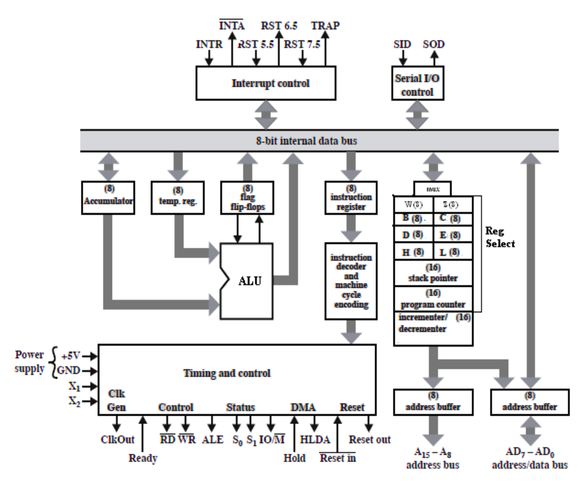
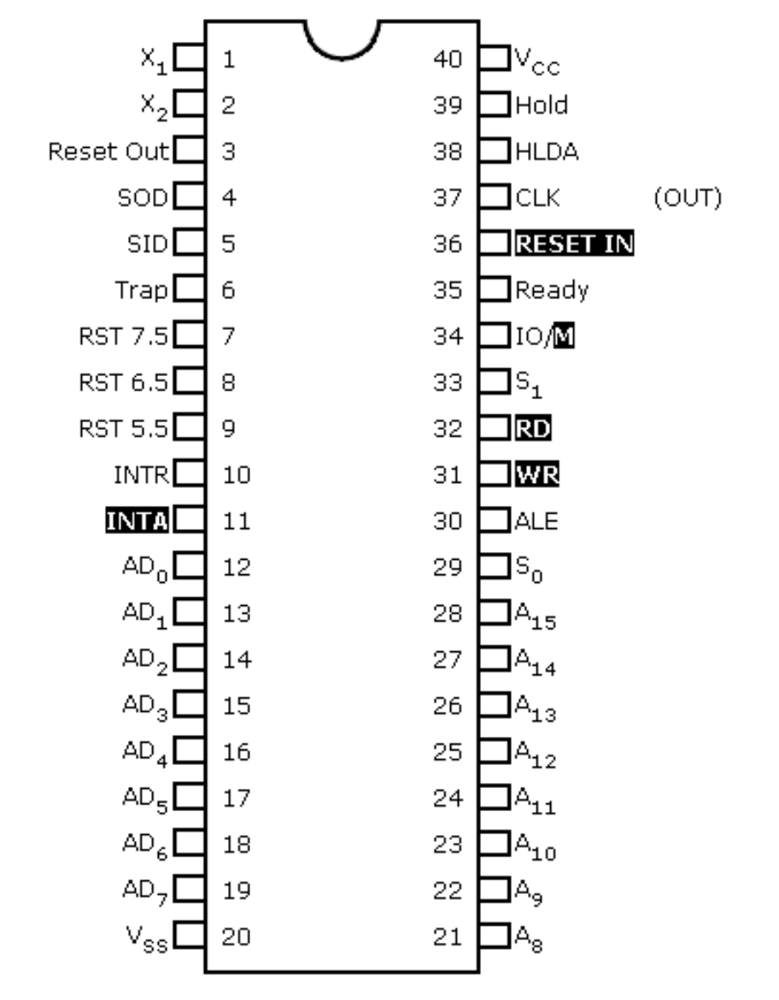
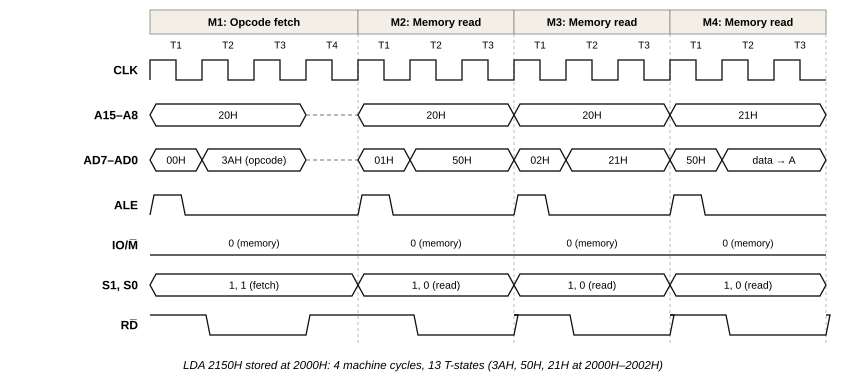
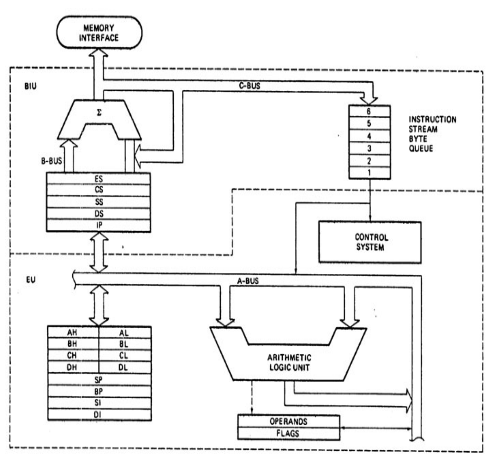

# MP Unit 1: Architecture of the 8085 and 8086, Pins and Timing Diagrams

*Endsem RUN · about 70 minutes*

**The whole unit in one breath:** a microprocessor is a CPU on one chip. This unit is about what's **inside** it (the block diagram of the 8085 and the 8086), what comes **out** of it (the 40 pins), and how it talks to memory **in time** (machine cycles and timing diagrams), plus a quick tour of other 8-, 16- and 32-bit processors.

**What the endsem asks from here:** Q1 every year: the 8085 pin diagram, the 8086 block diagram, and a timing diagram. 2025 asked exactly those three. Draw the figures here until you can sketch them from memory.

---

## 1. What a microprocessor system is · Quick

A **microprocessor** is a programmable chip that fetches instructions from memory, decodes them and executes them. Add **memory** (ROM for the program, RAM for data) and **I/O devices** (keyboard, display), connect them with **buses**, and you have a **microcomputer**.

Three buses, like three kinds of road:

- **Address bus** (16 lines on the 8085, one-way out of the CPU): *which* memory location or port. 16 lines → $2^{16}$ = 64 KB.
- **Data bus** (8 lines on the 8085, two-way): the actual byte.
- **Control bus:** *what* to do and when: RD̅ (read), WR̅ (write), IO/M̅, ALE.

**Machine language vs assembly language.** The CPU only understands **machine language**: binary opcodes like `3A 50 20`. **Assembly language** writes the same instruction as a readable **mnemonic**: `LDA 2050H`. An **assembler** translates assembly into machine code, one instruction to one instruction.

| Machine language | Assembly language |
| --- | --- |
| Binary/hex codes | Mnemonics (MOV, ADD) and labels |
| Directly executed | Needs an assembler |
| Very hard to write, read, debug | Easier; still close to the hardware |
| Machine-specific | Also machine-specific (unlike C) |

---

## 2. 8085 architecture · Slow down

The **architecture** (functional block diagram) is a map of the blocks inside the chip. They all talk over one **8-bit internal data bus**. Learn the five groups first, then the boxes inside each.

**Figure 1: 8085 functional block diagram** (Bharat Acharya's notes). Draw this one in the exam.



1. **ALU group, where the maths happens.**
   - **ALU** (Arithmetic Logic Unit): adds, subtracts, ANDs, ORs, compares, rotates.
   - **Accumulator (A):** the ALU's main 8-bit register: always one input, and the result lands back in it.
   - **Temporary register:** holds the ALU's second input; programs can't use it.
   - **Flag register:** five 1-bit notes about the last result (Unit 2).
2. **Register array, the scratch storage.**
   - **B, C, D, E, H, L:** 8-bit registers that pair up as **BC, DE, HL** for 16-bit values. HL is also the **memory pointer**: `M` means "the byte at the address in HL".
   - **W, Z:** hidden registers that hold an address mid-instruction.
   - **Program Counter (PC, 16-bit):** address of the next byte to fetch.
   - **Stack Pointer (SP, 16-bit):** address of the top of the stack.
3. **Instruction register, decoder, timing and control.** The fetched **opcode** sits in the instruction register, the decoder works out what it means, and the **timing and control unit** generates RD̅, WR̅, ALE and IO/M̅ in step with the clock.
4. **Interrupt control:** the five interrupt inputs (Unit 4).
5. **Serial I/O control:** one bit at a time on SID and SOD.

**How they work together on** `ADD B`**:** PC sends out the address, the opcode 80H comes into the instruction register, the decoder sees "add B to A", B goes into the temporary register, the ALU adds it to A, the result goes back to A, and the flags update.

---

## 3. 8085 pin diagram · Slow down

The 8085 has 40 pins. Don't memorise 40 names; learn 7 groups, each with a reason to exist.

> **Endsem 2025 · Q1(a) · 4.5 marks**
> Draw and explain the pin diagram of the 8085 microprocessor.

**Answer.**

The 8085 is a 40-pin DIP chip running on a single +5 V supply. Its pins fall into seven groups.

**Figure: 8085 pin diagram** (black boxes mark active-low pins).



| Group | Pins (number) | What they do |
| --- | --- | --- |
| **Power and clock** | Vcc (40) +5 V, Vss (20) ground, X1, X2 (1, 2), CLK OUT (37) | A crystal on X1–X2 sets the clock; the chip runs at **half** the crystal frequency. CLK OUT supplies the clock to other chips |
| **High address** | A15–A8 (21–28) | Upper byte of the address; output only |
| **Multiplexed address/data** | AD7–AD0 (12–19) | The **low address byte first, then the data byte**, on the same 8 wires |
| **Control and status** | ALE (30), RD̅ (32), WR̅ (31), IO/M̅ (34), S1 (33), S0 (29), READY (35) | Say what kind of bus operation is happening |
| **Interrupts** | TRAP (6), RST 7.5 (7), RST 6.5 (8), RST 5.5 (9), INTR (10), INTA̅ (11) | Devices ask for attention; INTA̅ acknowledges INTR |
| **DMA** | HOLD (39), HLDA (38) | Another chip requests the buses; the 8085 grants them |
| **Reset and serial** | RESET IN̅ (36), RESET OUT (3), SID (5), SOD (4) | Restart the chip; serial data in and out |

**The control pins:**

- **ALE** (Address Latch Enable) goes high at the start of every machine cycle: "AD7–AD0 hold an address right now".
- **RD̅** low = the CPU is reading; **WR̅** low = writing.
- **IO/M̅** = 1 for I/O, 0 for memory. With **S1, S0** it names the cycle:

| Operation | IO/M̅ | S1 | S0 |
| --- | --- | --- | --- |
| Opcode fetch | 0 | 1 | 1 |
| Memory read | 0 | 1 | 0 |
| Memory write | 0 | 0 | 1 |
| I/O read | 1 | 1 | 0 |
| I/O write | 1 | 0 | 1 |

- **READY:** a slow device holds it low and the 8085 inserts **wait states**.
- **RESET IN̅:** low → PC = 0000H, interrupts disabled. **RESET OUT** resets other chips.
- **Interrupts:** TRAP is non-maskable and highest priority; RST 7.5, 6.5, 5.5 are maskable and vectored; INTR is maskable and non-vectored.

**Demultiplexing AD7–AD0.** Sharing pins saves pins, but memory needs the low address held for the whole cycle, so a **latch** (74LS373) copies it while ALE is high and keeps it after ALE drops; the same pins then carry data.

```
AD7-AD0 ──┬──> [74LS373 latch] ──> A7-A0  (held all cycle)
          │          ^
ALE ──────┼──────────┘  (latches while ALE is high)
          └──> D7-D0  (data, after ALE drops)
A15-A8  ───────────────────> A15-A8
```

**40 pins in groups: power and clock, A15–A8, multiplexed AD7–AD0 (split by ALE and a latch), control and status (ALE, RD̅, WR̅, IO/M̅, S1, S0, READY), 5 interrupts with INTA̅, HOLD/HLDA, reset, and SID/SOD.**

---

## 4. Timing and control: machine cycles and T-states · Slow down

Every operation is timed by the clock. Three levels of time:

- **T-state:** one clock period. At 3 MHz, 1 T-state = 0.33 µs.
- **Machine cycle:** one complete bus operation (fetch a byte, read memory, write memory, read/write I/O). Takes **3 to 6** T-states.
- **Instruction cycle:** all the machine cycles needed for one instruction (1 to 5 of them).

The **first machine cycle of every instruction is the opcode fetch**, which takes **4 T-states** (T1: put the address out, T2–T3: read the opcode, T4: decode it). Every other read or write cycle takes **3 T-states**.

| Machine cycle | T-states | IO/M̅, S1, S0 |
| --- | --- | --- |
| Opcode fetch | 4 (6 for some, e.g. INX, CALL) | 0, 1, 1 |
| Memory read | 3 | 0, 1, 0 |
| Memory write | 3 | 0, 0, 1 |
| I/O read | 3 | 1, 1, 0 |
| I/O write | 3 | 1, 0, 1 |

**Within any read cycle:** in **T1**, the address goes out (high byte on A15–A8, low byte on AD7–AD0), **ALE** pulses high so the latch grabs the low byte, and IO/M̅, S1, S0 announce the cycle type. In **T2**, AD7–AD0 switch to data, and **RD̅** goes low. In **T3**, the data is read in and RD̅ goes back high. (In a write cycle, WR̅ goes low instead and the CPU drives the data.)

---

## 5. Timing diagram of LDA · Slow down

> **Endsem 2025 · Q1(c) · 4.5 marks**
> Draw and explain the timing diagram of the instruction LDA 2150H of the 8085, stored at address 2000H.

**Answer.**

`LDA 2150H` means "load A with the byte at memory address 2150H". It's a 3-byte instruction, stored **little-endian** (low address byte first):

| Address | Content | Meaning |
| --- | --- | --- |
| 2000H | 3AH | Opcode of LDA |
| 2001H | 50H | Low byte of 2150H |
| 2002H | 21H | High byte of 2150H |

It needs **4 machine cycles = 4 + 3 + 3 + 3 = 13 T-states**:

1. **M1, opcode fetch (4 T)** from 2000H: the CPU reads 3AH and decodes it as LDA. IO/M̅ = 0, S1 S0 = 11.
2. **M2, memory read (3 T)** from 2001H: reads the low address byte 50H (into the internal Z register). S1 S0 = 10.
3. **M3, memory read (3 T)** from 2002H: reads the high address byte 21H (into W).
4. **M4, memory read (3 T)** from **2150H** (the address now in WZ): reads the data and places it in A.



Reading the diagram:

- **A15–A8** carries 20H in M1–M3 (all three bytes of the instruction live in page 20H), then **21H** in M4 (the operand's page). In T4 of M1 it is unspecified.
- **AD7–AD0** carries the low address first (00H, 01H, 02H, then **50H**), and then the data byte (3AH, 50H, 21H, then the content of 2150H).
- **ALE** pulses high in **T1** of every machine cycle, to latch the low address.
- **IO/M̅ = 0** throughout (all memory operations); **S1 S0 = 11** in the opcode fetch and **10** in the three memory reads.
- **RD̅** goes low in **T2 and T3** of each cycle, when data is read in.

Total time at a 3 MHz clock (T = 0.33 µs): 13 × 0.33 = **4.33 µs**.

**LDA 2150H = opcode fetch (2000H) + memory read (2001H → 50H) + memory read (2002H → 21H) + memory read (2150H → data into A): 4 machine cycles, 13 T-states.**

(The same method works for any instruction: list its bytes, then one machine cycle per byte fetched plus one per data read or write. For example, STA = fetch + read + read + **write** (WR̅ low, S1 S0 = 01); OUT = fetch + read + **I/O write** (IO/M̅ = 1); SHLD = fetch + read + read + write + write = 16 T.)

---

## 6. 8086 architecture · Slow down

The 8086 (Intel, 1978) is a **16-bit** processor: its registers, ALU and data bus handle a **word** (2 bytes) at a time, and its **20 address lines** reach **1 MB**. Its big idea: it's split into two halves that work **at the same time**. Think of a restaurant: the **BIU** is the waiter who fetches orders and carries plates, and the **EU** is the chef who cooks.

> **Endsem 2025 · Q1(b) · 4.5 marks**
> Draw and explain the block diagram of the 8086 microprocessor.

**Answer.**

The 8086 is internally divided into two units that work in parallel: the **Bus Interface Unit (BIU)** and the **Execution Unit (EU)**.

**Figure: 8086 architecture** (Bharat Acharya's notes). The top dashed box is the BIU, the bottom one the EU.



**BIU (Bus Interface Unit): handles all bus activity with memory and I/O.**

- **Segment registers CS, DS, SS, ES** (16-bit): the start of the code, data, stack and extra segments.
- **Instruction Pointer (IP):** offset of the next instruction (the 8086's PC).
- **Address adder (Σ):** builds the 20-bit physical address = segment × 10H + offset. E.g. CS = 4321H, IP = 1000H → 43210H + 1000H = **44210H**.
- **6-byte instruction queue:** instruction bytes prefetched in advance, first in, first out.

**EU (Execution Unit): decodes and executes instructions.**

- **General registers AX, BX, CX, DX** (16-bit, each split into high and low bytes: AX = AH + AL). AX: accumulator (MUL/DIV, I/O); BX: base (memory offsets); CX: count (LOOP, REP); DX: data (I/O port, high word of MUL/DIV).
- **Pointer and index registers SP, BP, SI, DI:** offsets for the stack (SP, BP) and for string operations (SI source, DI destination).
- **16-bit ALU** and the **flag register** (9 flags: CF, PF, AF, ZF, SF, OF + TF, IF, DF).
- **Control unit / decoder:** takes the next instruction from the queue, decodes it and drives the ALU and registers.

**Pipelining:** whenever 2 or more bytes of the queue are free, the BIU fetches the next instruction bytes **while** the EU is still executing the current one. So fetch and execute overlap, and the EU rarely waits for memory. On a **jump or call**, the prefetched bytes are useless, so the queue is **flushed** and refilled.

**BIU (segment registers, IP, address adder, 6-byte queue) fetches and addresses; EU (AX–DX, SP/BP/SI/DI, ALU, flags, decoder) executes; they work in parallel through the queue (pipelining).**

**Segmentation** in one paragraph: 1 MB needs 20-bit addresses but every register is 16 bits, so memory is used in **segments** of up to 64 KB. An address is `segment:offset`, and **physical address = segment × 10H + offset**. Segments let programs be relocated just by changing a segment register, and keep code, data and stack apart.

**Memory banks:** 1 MB is split into an **even bank** (A0 = 0, data on D7–D0) and an **odd bank** (BHE̅ = 0, data on D15–D8), so a word at an even address is read in one bus cycle (at an odd address, two).

**Minimum vs maximum mode:** pin **MN/MX̅** = 1 → minimum mode (single processor, the 8086 makes its own control signals); = 0 → maximum mode (multiprocessor with an 8087, an **8288 bus controller** makes the control signals; pins become S2̅–S0̅, RQ̅/GT̅, LOCK̅, QS1–QS0).

---

## 7. Other processors: 8-bit, 16-bit, coprocessor, 32-bit · Quick

**Important 8-bit microprocessors:**

| | Intel 8085 | Zilog Z80 | Motorola 6800 |
| --- | --- | --- | --- |
| Year | 1976 | 1976 | 1974 |
| Address bus | 16-bit (64 KB) | 16-bit (64 KB) | 16-bit (64 KB) |
| Registers | A, B–L | 8085 set + a duplicate set + IX, IY index registers | Two accumulators A, B, index register X |
| Instructions | 74 (246 opcodes) | 158 (superset of 8080) | 72 |
| I/O | Separate I/O space (256 ports) | Separate I/O space | Memory-mapped only |
| Built-in | Serial I/O, interrupts, clock | DRAM refresh | — |

**16-bit processors:**

- **8086:** 16-bit data bus, 20-bit address (1 MB), 6-byte queue (above).
- **8088:** an 8086 inside with an **8-bit external data bus** and a 4-byte queue; slower (a word needs 2 bus cycles) but works with cheap 8-bit support chips; used in the original IBM PC.
- **Motorola 68000:** 32-bit registers (8 data, 8 address), 16-bit data bus, **24-bit address bus (16 MB)** with **linear** memory (no segments), memory-mapped I/O; used in the first Apple Macintosh.

**8087 maths coprocessor:** a second chip that does **floating-point** maths (add, multiply, divide, square root, trig, log) in hardware, ~100× faster than software. Needs the 8086 in **maximum mode**; it watches the queue status pins, executes instructions marked **ESC**, and the 8086 waits for it with `WAIT` (TEST̅ pin). Eight 80-bit registers arranged as a stack.

**32-bit processors:** **80386** (1985): 32-bit registers and buses (4 GB), **protected mode** and **paging** (virtual memory). **80486** (1989): the 8087 built in, 8 KB on-chip **cache**, 5-stage pipeline. **Pentium** (1993): **superscalar** (two pipelines, two instructions per clock), 64-bit data bus, branch prediction.

**8085 vs 8086:**

| Basis | 8085 | 8086 |
| --- | --- | --- |
| Word size / data bus | 8-bit | 16-bit |
| Address bus, memory | 16 lines, 64 KB | 20 lines, 1 MB |
| Memory | Linear | Segmented |
| Pipelining | No | Yes (BIU + EU, 6-byte queue) |
| Flags | 5 | 9 |
| Multiply/divide, strings | No | Yes |
| I/O ports | 256 | 65,536 |
| Interrupts | 5 hardware + RST 0–7 | 256 types via the IVT |
| Modes | One | Minimum and maximum |

---

## 8. Quick recap

- Buses: address (16 lines, 64 KB on the 8085), data (8, two-way), control.
- 8085 blocks: ALU group (A, temp, flags), registers (B–L, W, Z, PC, SP), decoder + timing/control, interrupt control, serial I/O.
- AD7–AD0 multiplexed; ALE + 74LS373 latch separate the low address.
- IO/M̅ S1 S0: fetch 011, memory read 010, memory write 001, I/O read 110, I/O write 101.
- Opcode fetch = 4 T; other cycles = 3 T. LDA = 4 cycles, 13 T.
- 8086: BIU (segments, IP, adder, queue) + EU (AX–DX, SP/BP/SI/DI, ALU, flags); PA = segment × 10H + offset.
- 8088 = 8086 with an 8-bit bus; 68000 = 24-bit linear addresses; 8087 = floating-point coprocessor (max mode).
