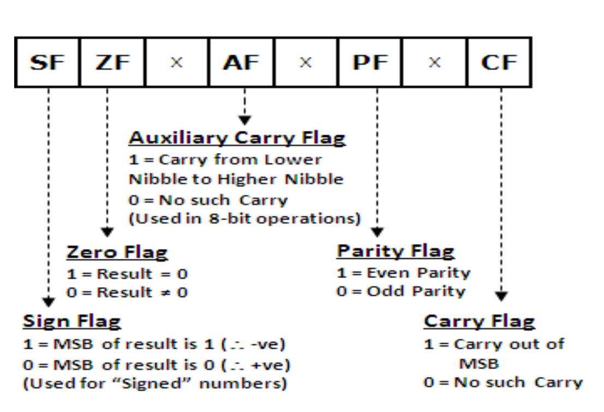
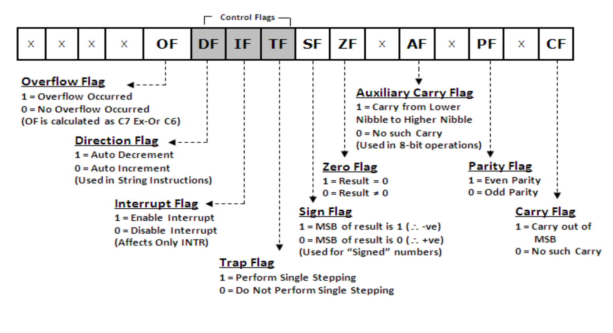

# MP Unit 2: Instruction Sets of the 8085 and 8086

*Endsem RUN · about 60 minutes*

**The whole unit in one breath:** an instruction says *what* to do (opcode) and *where* the data is (addressing mode). The 8085 has five groups (data transfer, arithmetic, logical, branching, machine control) that all revolve around the accumulator and the **flags**; the 8086 has the same families on 16-bit data plus multiply/divide, **LOOP** and **string** instructions.

**What the endsem asks from here:** Q2 every year: the flags, three small programs to read (the same three in 2022, 2024 and 2025!), and "explain these four instructions with syntax and an example". All of it is below.

---

## 1. Instruction format and addressing modes (8085) · Quick

Instructions are 1, 2 or 3 bytes:

| Size | Layout | Example | Bytes in memory |
| --- | --- | --- | --- |
| 1 byte | Opcode only | `MOV B, C` | 41 |
| 2 bytes | Opcode + 8-bit data or port | `MVI A, 32H` | 3E 32 |
| 3 bytes | Opcode + 16-bit address, **low byte first** | `LDA 2050H` | 3A 50 20 |

"Low byte first" (**little-endian**): `LDA 2050H` stored at 2000H puts 3AH at 2000H, 50H at 2001H, 20H at 2002H.

| Mode | Where the operand is | Examples |
| --- | --- | --- |
| **Immediate** | Inside the instruction (an "I" in the name) | `MVI B, 25H`, `LXI H, 2050H`, `ADI 05H` |
| **Register** | In a register | `MOV A, B`, `ADD C` |
| **Direct** | At an address written in the instruction | `LDA 2050H`, `STA 2051H`, `IN 80H` |
| **Register indirect** | At the address held in a register pair | `MOV A, M` (HL), `LDAX B`, `STAX D` |
| **Implied** | Fixed by the instruction, usually A | `CMA`, `RLC`, `DAA` |

Indirect mode is why loops work: keep the address in HL and `INX H` walks through an array.

---

## 2. The flags · Slow down

After an arithmetic or logic operation, the ALU leaves five 1-bit "notes" about the result, the **flags**, so the next instruction can decide something ("jump if the result was zero"). Each is **set** (1) or **reset** (0).

> **Endsem 2025 · Q2(a) · 4.5 marks**
> Explain the various flags of the 8085 microprocessor with their significance, with suitable examples.

**Answer.**

The 8085's **flag register** is an 8-bit register in which five bits are flip-flops set or reset by the ALU according to the result of the last arithmetic/logic operation:

| Bit | D7 | D6 | D5 | D4 | D3 | D2 | D1 | D0 |
| --- | --- | --- | --- | --- | --- | --- | --- | --- |
| Flag | **S** | **Z** | x | **AC** | x | **P** | x | **CY** |



| Flag | Set to 1 when | Significance / used by |
| --- | --- | --- |
| **S**, sign | Bit D7 of the result is 1 (negative in signed form) | Signed arithmetic; `JM`, `JP` |
| **Z**, zero | The result is 00H | Loops and equality tests; `JZ`, `JNZ` |
| **AC**, auxiliary carry | A carry goes from bit D3 to D4 | Only used internally by `DAA` (BCD maths); no jump on AC |
| **P**, parity | The result has an **even** number of 1s | Error checking; `JPE`, `JPO` |
| **CY**, carry | An addition carries out of D7, or a subtraction needs a **borrow** | Multi-byte maths, comparisons; `JC`, `JNC` |

**Example** that sets several at once:

```
MVI A, 9BH     ; A = 1001 1011
MVI B, 75H     ; B = 0111 0101
ADD B          ; A = 9BH + 75H = 110H -> A = 10H, carry out
```

| S | Z | AC | P | CY |
| --- | --- | --- | --- | --- |
| 0 (D7 of 10H is 0) | 0 (not zero) | 1 (BH + 5H = 10H carries out of the low nibble) | 0 (one 1: odd) | 1 (110H doesn't fit in 8 bits) |

Second example: `MVI A, 25H`, `SUI 25H` → A = 00H, so **Z = 1**, P = 1 (zero 1s is even), CY = 0, S = 0.

**Which instructions affect flags** (a classic trap): arithmetic and logic set all five; data transfer (MOV, MVI, LDA, LXI) affects **none**; `INR`/`DCR` affect all **except CY**; `INX`/`DCX` affect **none**; `DAD` and rotates affect **only CY**. **CMP** is a subtraction that keeps only the flags: after `CMP B`, A < B → CY = 1; A = B → Z = 1; A > B → both 0.

**S = sign of the result, Z = result zero, AC = carry from D3 to D4 (for DAA), P = even number of 1s, CY = carry/borrow out of D7; set by arithmetic/logic, tested by conditional jumps, calls and returns.**

**8086 flags** (16-bit register, 9 used): the same five as **CF, PF, AF, ZF, SF**, plus **OF** (overflow: a *signed* result out of range, e.g. 7FH + 01H = 80H gives OF = 1), and three **control** flags set by the programmer: **TF** (trap, single-step), **IF** (interrupt enable: `STI`/`CLI`), **DF** (direction for string instructions: `CLD` up, `STD` down).



---

## 3. 8085 instruction groups · Quick

**Data transfer** (no flags change):

| Instruction | Meaning |
| --- | --- |
| `MOV Rd, Rs` | Rd ← Rs (also `MOV A, M`, `MOV M, A`) |
| `MVI R, data` / `LXI rp, data16` | Load 8-bit / 16-bit immediate |
| `LDA addr` / `STA addr` | A ← [addr] / [addr] ← A |
| `LHLD addr` / `SHLD addr` | L ↔ [addr], H ↔ [addr + 1] |
| `LDAX rp` / `STAX rp` | A ↔ [BC or DE] |
| `XCHG` | Swap HL and DE |
| `IN port` / `OUT port` | A ← port / port ← A |

**Arithmetic:** `ADD/ADI`, `ADC/ACI` (with carry), `SUB/SUI`, `SBB/SBI` (with borrow), `INR/DCR`, `INX/DCX`, `DAD rp` (HL ← HL + rp), `DAA` (BCD adjust). **No multiply or divide**: programs build them from repeated addition/subtraction.

**Logical:** `ANA/ANI` (AND), `ORA/ORI`, `XRA/XRI`, `CMA` (complement), `CMP/CPI` (compare), `STC`/`CMC`, and rotates `RLC`, `RRC`, `RAL`, `RAR`. Tricks: `XRA A` clears A and CY; `ORA A` sets S, Z, P from A without changing it; `CMA` + `ADI 01H` = two's complement (negation).

**Branching:** `JMP`, conditional jumps (`JZ/JNZ`, `JC/JNC`, `JM/JP`, `JPE/JPO`), `CALL`/`RET` and conditional versions, `RST n` (one-byte call to n × 8), `PCHL`.

**Stack** (last in, first out, grows downward): `PUSH rp`, `POP rp`, `PUSH PSW` (A + flags), `XTHL`, `SPHL`, `LXI SP`.

**Machine control:** `HLT`, `NOP`, `EI`, `DI`, `RIM`, `SIM`.

---

## 4. Reading programs · Slow down

The same three programs came in 2022, 2024 and 2025. The method never changes: **trace with one sample value, then say in one line what it does for every value.** (All three were checked on a simulator for every possible input byte.)

> **Endsem 2025 · Q2(b)(i) · 1.5 marks**
> Explain the function of: `MVI A, Byte; ORA A; JM NEXT; OUT 68H; HLT; NEXT: CMA; ADI 01H; OUT 68H; HLT`.

**Answer.**

`ORA A` leaves A unchanged but sets the sign flag from bit 7. If S = 0 (positive), the byte goes straight out to port 68H. If S = 1 (negative), `JM` jumps to NEXT, where `CMA` + `ADI 01H` take the **two's complement**, turning −x into +x, which is then output. E.g. 05H → 05H; FBH (−5) → 04H → **05H**.

**It outputs the absolute value (magnitude) of a signed byte to port 68H.**

> **Endsem 2025 · Q2(b)(ii) · 1.5 marks**
> What is the output at PORT1? `MVI A, 9FH; ADI 82H; JC Display; OUT PORT1; HLT; Display: XRA A; OUT PORT1; HLT`.

**Answer.**

```latex
9F_H + 82_H = 159 + 130 = 289 = 121_H \;\Rightarrow\; A = 21_H,\; CY = 1
```

The sum overflows 8 bits, so CY = 1 and `JC` jumps to Display, where `XRA A` clears A.

**PORT1 shows 00H.**

> **Endsem 2025 · Q2(b)(iii) · 1.5 marks**
> Explain the range of bytes displayed at PORT2: `MVI A, BYTE1; MOV B, A; SUI 60H; JC NEXT1; MOV A, B; SUI 90H; JC NEXT2; NEXT1: XRA A; OUT PORT1; HLT; NEXT2: MOV A, B; OUT PORT2; HLT`.

**Answer.**

B keeps a copy because SUI destroys A. Each `SUI` + `JC` asks "is it smaller?", since a borrow sets CY:

- Byte < 60H → borrow → NEXT1 → 00H to PORT1.
- 60H ≤ byte < 90H → first SUI no borrow, second SUI borrows → NEXT2 → the byte to **PORT2**.
- Byte ≥ 90H → no borrow either time → falls into NEXT1 → 00H to PORT1.

**PORT2 shows bytes from 60H to 8FH (96 to 143 decimal); all other bytes send 00H to PORT1.**

---

## 5. 8086 addressing modes and instruction set · Quick

8086 memory offsets (the **effective address**, EA) can be built from parts:

```latex
\text{EA} = [\,BX \text{ or } BP\,] + [\,SI \text{ or } DI\,] + \text{displacement}, \qquad \text{PA} = \text{Segment} \times 10_H + \text{EA}
```

With DS = 2000H, SS = 3000H, BX = 0100H, BP = 0200H, SI = 0050H:

| Mode | Example | Physical address |
| --- | --- | --- |
| Immediate | `MOV AX, 1234H` | — (data in instruction) |
| Register | `MOV AX, BX` | — |
| Direct | `MOV AX, [5000H]` | 25000H |
| Register indirect | `MOV AX, [BX]` | 20100H |
| Based | `MOV AX, [BX+08H]` / `[BP+08H]` (uses SS) | 20108H / 30208H |
| Indexed | `MOV AX, [SI+08H]` | 20058H |
| Based indexed | `MOV AX, [BX+SI]` | 20150H |
| Based indexed + displacement | `MOV AX, [BX+SI+08H]` | 20158H |
| String | `MOVSB` (DS:SI → ES:DI) | — |
| I/O port | `IN AL, 80H` / `IN AL, DX` | Port space |
| Implied | `CLC`, `STD` | — |

**Instruction groups:** data transfer (`MOV`, `PUSH`, `POP`, `XCHG`, `IN`, `OUT`, `LEA`), arithmetic (`ADD`, `ADC`, `SUB`, `SBB`, `INC`, `DEC`, `CMP`, **`MUL`, `IMUL`, `DIV`, `IDIV`**, `DAA`), logic/shift/rotate (`AND`, `OR`, `XOR`, `NOT`, `TEST`, `SHL`, `SHR`, `SAR`, `ROL`, `ROR`, `RCL`, `RCR`), branch (`JMP`, `JE/JNE`, `JG/JL`, `CALL`, `RET`, **`LOOP`**, `INT`, `IRET`), string (`MOVSB/W`, `CMPSB`, `SCASB`, `LODSB`, `STOSB` with `REP`), processor control (`CLC`, `STC`, `CLD`, `STD`, `CLI`, `STI`, `HLT`, `WAIT`).

`MUL BL`: AX = AL × BL. `MUL BX`: DX:AX = AX × BX. `DIV BL`: AX ÷ BL → quotient AL, remainder AH. `DIV BX`: DX:AX ÷ BX → quotient AX, remainder DX.

---

## 6. Instructions with syntax and example · Slow down

> **Endsem 2025 · Q2(c) · 4.5 marks**
> Explain the meanings of the following instructions of the 8085/8086 after writing their syntax, and illustrate each with an example: (i) XTHL, (ii) SPHL, (iii) LOOP, (iv) MOVSB.

**Answer.**

**(i) XTHL (8085).** Syntax: `XTHL` (1 byte, no operands). **Exchanges HL with the two bytes on top of the stack:** L ↔ [SP], H ↔ [SP + 1]. SP itself doesn't change; no flags change. Used to swap a value with the stack top, e.g. to pass parameters to a subroutine.

```
LXI SP, 2700H     ; stack top at 2700H; suppose [2700H] = 0AH, [2701H] = 20H
LXI H, 1234H
XTHL              ; HL = 200AH, [2700H] = 34H, [2701H] = 12H, SP still 2700H
```

**(ii) SPHL (8085).** Syntax: `SPHL` (1 byte). **Copies HL into the stack pointer:** SP ← HL. No flags change. Used to set up or switch to a new stack area computed at run time.

```
LXI H, 3000H
SPHL              ; SP = 3000H: the stack now starts at 3000H
```

**(iii) LOOP (8086).** Syntax: `LOOP label` (2 bytes, short jump within −128 to +127 bytes). **Decrements CX by 1, and jumps to label if CX ≠ 0**; otherwise continues. No flags change. It replaces the 8085's `DCR C` + `JNZ`. (Variants: `LOOPE/LOOPZ`, `LOOPNE/LOOPNZ` also test ZF.)

```
        MOV CX, 0005H     ; repeat 5 times
        MOV AX, 0000H
AGAIN:  ADD AX, 0002H
        LOOP AGAIN        ; ends with AX = 000AH, CX = 0
```

**(iv) MOVSB (8086).** Syntax: `MOVSB` (often with the prefix: `REP MOVSB`). **Copies one byte from DS:SI to ES:DI**, then updates SI and DI by **+1 if DF = 0** (after `CLD`) or **−1 if DF = 1** (after `STD`). With `REP`, it repeats CX times, copying a whole block in one instruction. (`MOVSW` copies a word and steps by 2.)

```
        CLD               ; DF = 0: move upward
        MOV SI, 0100H     ; source DS:0100H
        MOV DI, 0200H     ; destination ES:0200H
        MOV CX, 0005H     ; 5 bytes
        REP MOVSB         ; copies DS:0100H-0104H to ES:0200H-0204H
```

**XTHL swaps HL with the stack top; SPHL loads SP from HL; LOOP decrements CX and jumps if non-zero; MOVSB copies a byte from DS:SI to ES:DI and steps SI and DI.**

(Other instructions asked in past years: **STAX rp**: [BC or DE] ← A. **SHLD addr**: [addr] ← L, [addr+1] ← H. **LHLD addr**: the reverse. **DAD rp**: HL ← HL + rp, only CY changes. **XCHG**: 8085 swaps HL and DE; 8086 swaps any two operands.)

---

## 7. Quick recap

- 1/2/3-byte instructions, little-endian addresses. Modes: immediate, register, direct, register indirect, implied.
- Flags S Z AC P CY; data transfer affects none; INR/DCR all but CY; DAD and rotates only CY.
- CMP: A < operand → CY = 1; equal → Z = 1.
- Program-reading answers: absolute value; PORT1 = 00H; PORT2 range 60H–8FH.
- 8086: PA = segment × 10H + EA; BP defaults to SS; MUL/DIV; 9 flags (adds OF, TF, IF, DF).
- XTHL (HL ↔ stack top), SPHL (SP ← HL), LOOP (CX−1, jump if ≠ 0), MOVSB (DS:SI → ES:DI, step by DF).
