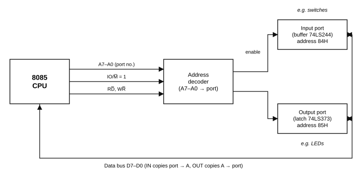

# MP Unit 4: Interfacing, Interrupts and DMA

*Endsem RUN · about 55 minutes*

**The whole unit in one breath:** a CPU alone is useless; it needs memory and I/O devices connected properly (**interfacing**), a way for devices to interrupt it when they need service (**interrupts**), and a way to move bulk data without it (**DMA**).

**What the endsem asks from here:** Q4 every year, all theory with diagrams: 8085 interrupts (and multiple interrupts on INTR), memory-mapped vs I/O-mapped I/O, the 8255, and the 8257 DMA controller. 2025 asked interrupts, I/O-mapped I/O and the 8257.

---

## 1. Minimal system and why interfacing is needed · Quick

A **minimal system** is the smallest working 8085 computer: the CPU, a **latch** (74LS373) to separate the low address from AD7–AD0, **ROM/EPROM** for the program, **RAM** for data, an **address decoder** to select chips, and at least one **input** and one **output** port, plus clock and reset circuits.

**Why interfacing is needed:** devices differ from the CPU in **speed** (a keyboard is slow, a disk is fast), **signal levels and formats** (serial vs parallel, analog vs digital), and **timing**. And each chip must respond only to *its* addresses. The interface (decoders, latches, buffers, programmable chips like the 8255) solves this: it **decodes** the address, **holds** output data (latch), **isolates** input data from the bus until read (tri-state buffer), and **synchronises** the transfer.

---

## 2. Memory-mapped vs I/O-mapped I/O · Slow down

There are two ways to give I/O devices addresses: put them in the **memory** address space, or in a separate **I/O** space. Like a building where the shops either get flat numbers among the residents (memory-mapped) or have their own separate shop numbers (I/O-mapped).

> **Endsem 2025 · Q4(b) · 4.5 marks**
> Explain how I/O devices are interfaced as I/O-mapped I/O, with a suitable diagram and examples.

**Answer.**

In **I/O-mapped I/O** (also called isolated or peripheral-mapped I/O), I/O devices have their own **separate 8-bit address space of 256 ports (00H–FFH)**, distinct from the 64 KB memory space. They're accessed only by the special instructions **`IN port`** and **`OUT port`**, and the CPU tells them apart from memory using **IO/M̅ = 1**.

**How the hardware works:**

1. When `IN 84H` or `OUT 85H` executes, the 8085 puts the **8-bit port address on both A7–A0 and A15–A8** (duplicated), and makes **IO/M̅ = 1**.
2. An **address decoder** (gates or a 74LS138) compares the port address with the device's address. Its output, combined with control signals, gives the device's enable.
3. Control signals are generated from IO/M̅, RD̅ and WR̅: **IOR̅** (I/O read) = active when IO/M̅ = 1 and RD̅ = 0; **IOW̅** (I/O write) = active when IO/M̅ = 1 and WR̅ = 0.
4. **Input port:** a **tri-state buffer** (74LS244) that puts the device's data (e.g. switches) on the data bus only when enabled by decoder + IOR̅. `IN 84H` copies it into A.
5. **Output port:** a **latch** (74LS373) that captures the data bus when enabled by decoder + IOW̅ and holds it for the device (e.g. LEDs). `OUT 85H` sends A to it.



**Decoding example:** an output port at **85H** = 1000 0101. A NAND gate gives a low output only when A7…A0 = 10000101 (feed it A7, A2, A0 directly and A6, A5, A4, A3, A1 through inverters); combine with IOW̅ in an OR/NOR gate to enable the latch.

```
A7 ───────────┐
A6 ─[NOT]─────┤
A5 ─[NOT]─────┤
A4 ─[NOT]─────┤    8-input
A3 ─[NOT]─────┤──  NAND  ──┐
A2 ───────────┤            ├─ OR ── enable (low) ──> 74LS373 latch ──> LEDs
A1 ─[NOT]─────┤            │
A0 ───────────┘   IOW̅ ─────┘           D7-D0 ──────────^
```

**Program examples:**

```
IN 84H        ; read the switches into A           (I/O read cycle, IO/M̅ = 1)
OUT 85H       ; show A on the LEDs                  (I/O write cycle, IO/M̅ = 1)
```

**I/O-mapped I/O uses a separate 256-port space, IN/OUT instructions, IO/M̅ = 1, an 8-bit port address decoded by gates, a buffer for input and a latch for output.**

**Comparison with memory-mapped I/O:**

| Basis | Memory-mapped I/O | I/O-mapped I/O |
| --- | --- | --- |
| Address space | Shares the 64 KB memory space | Separate 256 ports |
| Address size | 16-bit | 8-bit |
| Instructions | Any memory instruction: `STA`, `LDA`, `MOV M, A`, arithmetic on M | Only `IN` and `OUT` (data only via A) |
| Control signals | MEMR̅, MEMW̅ (IO/M̅ = 0) | IOR̅, IOW̅ (IO/M̅ = 1) |
| Devices possible | Up to 64 K (minus memory) | 256 input + 256 output |
| Decoding hardware | More (16 lines) | Less (8 lines) |
| Advantage | Powerful instructions; data in any register | Full memory space kept for memory; simple decoding |
| Disadvantage | Uses up memory addresses | Fewer, less flexible instructions |

---

## 3. I/O ports and the 8255 PPI · Quick

The **8255 Programmable Peripheral Interface** is a 40-pin chip giving **three 8-bit ports: A, B and C** (C split into C-upper and C-lower). Programming it with a **control word** decides which ports are inputs or outputs and the mode. **A1, A0** select the register: 00 = port A, 01 = port B, 10 = port C, 11 = control register.

**Modes:** **Mode 0**: simple I/O (no handshaking). **Mode 1**: strobed I/O with handshaking (port C lines become handshake signals). **Mode 2**: bidirectional bus on port A only. Plus **BSR mode** (bit set/reset) to set or clear individual port C bits.

**I/O mode control word** (D7 = 1):

| D7 | D6 D5 | D4 | D3 | D2 | D1 | D0 |
| --- | --- | --- | --- | --- | --- | --- |
| 1 = I/O mode | Group A mode (00 = 0, 01 = 1, 1x = 2) | Port A (1 = in, 0 = out) | Port C upper | Group B mode (0 = mode 0, 1 = mode 1) | Port B | Port C lower |

Example: all ports output, mode 0 → 1000 0000 = **80H**. Port A input, B and C output → 1001 0000 = **90H**.

```
MVI A, 90H     ; control word: A in, B out, C out, mode 0
OUT 83H        ; control register (8255 at 80H-83H)
IN 80H         ; read port A (e.g. switches)
OUT 81H        ; copy to port B (e.g. LEDs)
```

---

## 4. Interrupts of the 8085 · Slow down

An **interrupt** is a signal from a device saying "stop what you're doing and serve me now". The CPU finishes its current instruction, saves where it was (pushes PC on the stack), jumps to the **interrupt service routine (ISR)**, and returns with `RET`. It's like answering a doorbell mid-study, then going back to the same page. The alternative, **polling** (the CPU keeps checking each device), wastes time.

**Classifications:** hardware vs software; **maskable** (can be disabled) vs **non-maskable**; **vectored** (fixed ISR address) vs **non-vectored** (the device supplies the address); **edge-triggered** vs **level-triggered**.

> **Endsem 2025 · Q4(a) · 4.5 marks**
> Explain the interrupts available in the 8085 microprocessor with a suitable diagram. Also explain how multiple interrupts can be implemented using INTR.

**Answer.**

The 8085 has **five hardware interrupt pins** and **eight software interrupts** (RST 0–7).

| Interrupt | Priority | Maskable? | Vectored? (address) | Triggering |
| --- | --- | --- | --- | --- |
| **TRAP** | 1 (highest) | **No** | Yes, **0024H** | Edge **and** level (must go high and stay high) |
| **RST 7.5** | 2 | Yes | Yes, **003CH** | Rising **edge** (latched in a flip-flop) |
| **RST 6.5** | 3 | Yes | Yes, **0034H** | **Level** (high) |
| **RST 5.5** | 4 | Yes | Yes, **002CH** | **Level** (high) |
| **INTR** | 5 (lowest) | Yes | **No** (device supplies an instruction) | Level |

(Vector of RST n.5 = n.5 × 8: 7.5 × 8 = 60 = 3CH, and TRAP behaves like RST 4.5 = 36 = 24H.)

```
           TRAP ────────────────────────────────────────────┐ (non-maskable)
           RST 7.5 ──[edge FF]──[mask M7.5]──┐               │
           RST 6.5 ──────────────[mask M6.5]──┤  priority    ├──> interrupt
           RST 5.5 ──────────────[mask M5.5]──┤  logic       │    control ──> CPU
           INTR ──────────────────────────────┘               │
                     all except TRAP gated by IE flip-flop (EI / DI)
           INTA̅ <── acknowledge for INTR only
```

**Enabling, disabling and masking:**

- `EI` sets the interrupt-enable (IE) flip-flop; `DI` clears it. All interrupts except TRAP need IE = 1. IE is automatically cleared when any interrupt is accepted (so the ISR must re-enable with `EI`), and on reset.
- `SIM` (set interrupt mask) masks RST 7.5, 6.5, 5.5 individually. Bits of A: D3 = MSE (mask set enable), D2/D1/D0 = mask 7.5/6.5/5.5 (1 = masked), D4 = reset the RST 7.5 flip-flop; D7/D6 = serial output. E.g. `MVI A, 0DH` (0000 1101: MSE = 1, M7.5 = 1, M6.5 = 0, M5.5 = 1) + `SIM` masks 7.5 and 5.5 and enables 6.5.
- `RIM` (read interrupt mask) loads A with the masks (D2–D0), IE (D3), pending interrupts (D6–D4) and serial input (D7).

**Software interrupts:** `RST 0` to `RST 7`, one-byte CALLs to n × 8 (0000H, 0008H … 0038H).

**Multiple interrupts using INTR.** INTR is **non-vectored**: when it's accepted, the 8085 sends **INTA̅** and expects the **device to put an instruction on the data bus**, usually an `RST n` opcode (one byte) or a `CALL addr` (three bytes, three INTA̅ pulses). Since one INTR pin can only carry one request, many devices share it like this:

1. Each device's request goes to a **priority encoder** (74LS148), which outputs the 3-bit code of the highest-priority device requesting, and also drives INTR high.
2. On INTA̅, a **tri-state buffer** puts the opcode **11 XXX 111** on the data bus, where XXX is the encoder's 3-bit code. That's exactly the opcode of **RST XXX** (RST 0 = C7H, RST 1 = CFH … RST 7 = FFH).
3. The 8085 executes that RST, jumping to XXX × 8, the routine for that device.

```
 Device 0 ─┐                       ┌──────────── INTR ──────────> 8085
 Device 1 ─┤   74LS148             │
   ...     ├─ priority ── XXX ──> [74LS244 buffer: 1 1 X X X 1 1 1] ──> D7-D0
 Device 7 ─┘   encoder             ^ enabled by INTA̅ <─────────── 8085
```

So up to **8 devices** share INTR, each getting its own vector (0000H to 0038H), and simultaneous requests are resolved by the encoder's priority. A cleaner, programmable solution is the **8259 Programmable Interrupt Controller**, which handles 8 devices (64 when cascaded), priorities, masking, and supplies a CALL to any address.

**The 8085 has TRAP (non-maskable, 0024H), RST 7.5 (003CH, edge), 6.5 (0034H) and 5.5 (002CH) (maskable, vectored, masked with SIM), and INTR (maskable, non-vectored); multiple devices share INTR through a priority encoder that places an RST n opcode on the bus during INTA̅, or through an 8259.**

---

## 5. DMA and the 8257 · Slow down

**The problem:** moving data from a device to memory through the CPU costs about 37 T-states per byte (`IN` into A, `MOV M, A`, loop instructions). A fast disk would lose data waiting.

**DMA (Direct Memory Access):** the CPU steps aside, and a separate chip, the **DMA controller**, moves bytes **directly between the device and memory** over the buses. The 8085 supports it with **HOLD** ("may I have the buses?") and **HLDA** ("they're yours").

> **Endsem 2025 · Q4(c) · 4.5 marks**
> What is the 8257 DMA controller? Explain with a suitable example and diagrams.

**Answer.**

The **8257** is Intel's **programmable DMA controller** for the 8085: a 40-pin chip that, once programmed, takes control of the system buses through HOLD/HLDA and transfers blocks of data directly between I/O devices and memory, without the CPU executing any instructions.

**Features:**

- **4 independent channels** (0–3), each with a **DRQ** (DMA request) input and a **DACK̅** (DMA acknowledge) output.
- Each channel has a 16-bit **address register** (memory start) and a 16-bit **terminal count register**: the low **14 bits** hold (number of bytes − 1), so up to **16 KB** per transfer, and the **top 2 bits** select the operation: **01 = DMA write** (I/O → memory), **10 = DMA read** (memory → I/O), 00 = verify, 11 = illegal.
- A **mode set register** enables channels and options: D7 auto-load, **D6 TC stop**, D5 extended write, D4 rotating priority, **D3–D0 enable channels 3–0**.
- A **status register** shows which channels have reached terminal count.
- Signals: **HRQ** (to 8085 HOLD), **HLDA** (from 8085), MEMR̅, MEMW̅, IOR̅, IOW̅, **TC** (terminal count), **MARK** (every 128 bytes), AEN (address enable).

```
             HOLD <───────── HRQ                    DRQ0 <─── Disk controller
   8085      HLDA ─────────> HLDA     8257         DACK̅0 ───> Disk controller
                                                    DRQ1..3, DACK̅1..3 (other devices)
   system buses <════════════> A15-A0, D7-D0, MEMR̅, MEMW̅, IOR̅, IOW̅, TC
```

**Sequence of a DMA transfer:**

1. The CPU programs the 8257: the memory start address, the byte count + direction, and the mode word.
2. The device raises **DRQ**.
3. The 8257 raises **HRQ** → the 8085's **HOLD** pin.
4. The 8085 finishes the current machine cycle, floats its buses and raises **HLDA**.
5. The 8257 sends **DACK̅** to the device and drives the address and control lines, so each byte moves between the device and memory in one bus cycle.
6. It increments the address and decrements the count, repeating while DRQ stays high (**burst mode**), or one byte at a time (**cycle stealing**).
7. When the count is exhausted it raises **TC** and drops HRQ; the 8085 takes the buses back.

**Example:** read **1024 bytes from a disk on channel 0 into memory starting at 4000H**, with the 8257 at ports 50H–58H (channel 0 address = 50H, channel 0 count = 51H, mode set = 58H). Device → memory is a **DMA write (01)**.

```latex
\begin{aligned}
\text{Count} &= 1024 - 1 = 03FF_H \\
\text{Count register} &= 01\ 00\,0011\,1111\,1111_2 = 43FF_H \\
\text{Mode set} &= 0100\,0001_2 = 41_H \quad (\text{TC stop} + \text{channel 0 enabled})
\end{aligned}
```

```
MVI A, 00H     ; channel 0 address, low byte of 4000H
OUT 50H
MVI A, 40H     ; high byte
OUT 50H
MVI A, FFH     ; count, low byte of 43FFH
OUT 51H
MVI A, 43H     ; high byte: DMA write (01) + count bits
OUT 51H
MVI A, 41H     ; mode: TC stop, enable channel 0
OUT 58H        ; from here the hardware does the transfer
```

**The 8257 is a 4-channel programmable DMA controller: programmed with an address, a count (top 2 bits = read/write) and a mode word, it takes the buses via HOLD/HLDA and moves data directly between device and memory, signalling the end with TC.**

---

## 6. Quick recap

- Minimal system: CPU, latch, ROM, RAM, decoder, I/O ports, clock, reset.
- Memory-mapped I/O: 16-bit addresses, memory instructions, IO/M̅ = 0. I/O-mapped: 256 ports, IN/OUT, IO/M̅ = 1.
- Input port = tri-state buffer; output port = latch; decoder + IOR̅/IOW̅ enable them.
- 8255: ports A, B, C; modes 0, 1, 2, BSR; control word 80H = all output.
- 8085 interrupts: TRAP 0024H (NMI), RST 7.5 003CH (edge), 6.5 0034H, 5.5 002CH, INTR (non-vectored); EI/DI, SIM/RIM.
- Multiple INTR devices: priority encoder → RST opcode 11XXX111 on INTA̅; or the 8259.
- 8257: 4 channels; count = bytes − 1 with top bits 01 write / 10 read; HRQ→HOLD, HLDA, DACK̅, TC.
