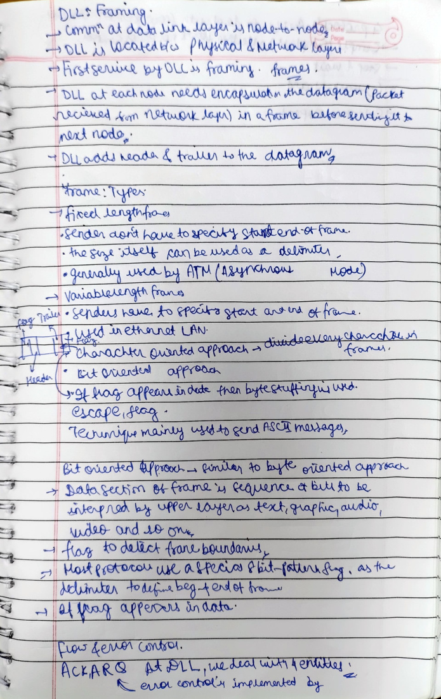
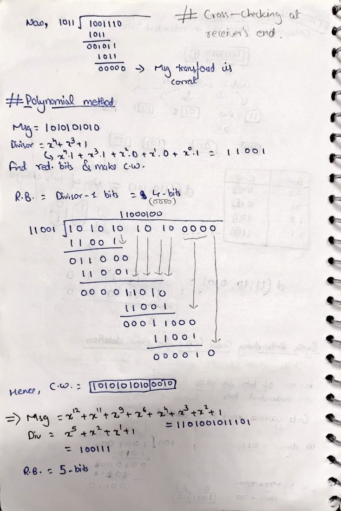
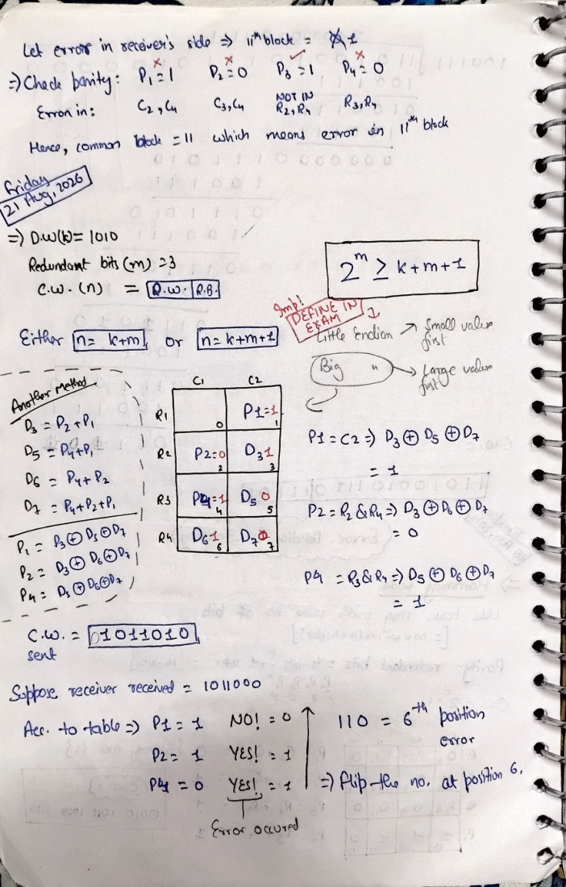
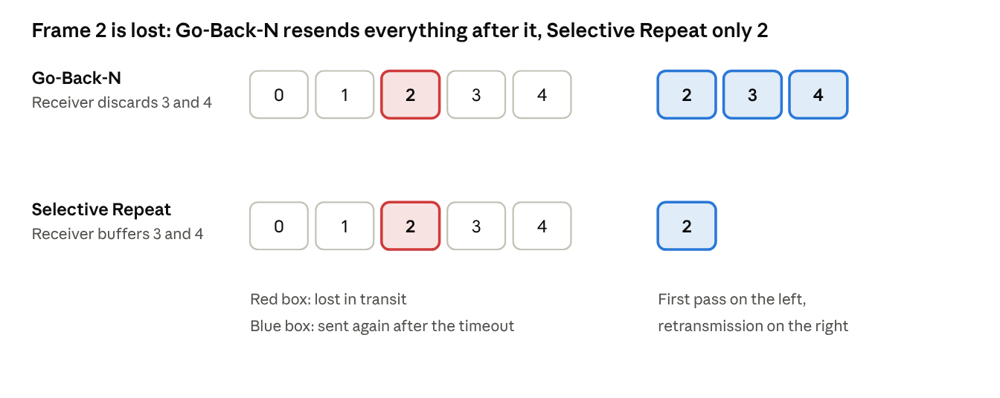

# RUN: CN Unit 2, Data Link Layer

Nov 5, 2026 · @shahan

All of Unit 2, with every recent Sessional-2 and endsem question solved at the spot it belongs. Allow about two relaxed hours. This unit is mostly arithmetic in a trench coat pretending to be networking, which is great news, because arithmetic can't surprise you.

## How this run works

Read the idea, try the **PYQ** below it, then check the solution right under it. All answers were recomputed, and I've flagged the two places where the paper itself has a problem.

**What the paper likes:** ARQ numericals, Hamming, CRC, framing and GBN window logic turn up every single year. HDLC barely shows up, so give it five minutes and move on.

**Videos**, all short:

- [Neso Academy, Computer Networks playlist](https://www.youtube.com/playlist?list=PLBlnK6fEyqRgMCUAG0XRw78UA8qnv6jEx): Framing, Stop-and-Wait ARQ, Go-Back-N ARQ plus its solved problems, Selective Repeat ARQ, HDLC.
- Gate Smashers, in Hindi: [Error detection intro](https://www.youtube.com/watch?v=U7-h2hyM1Dc), [CRC](https://www.youtube.com/watch?v=5Q-Yv6_0Qcw), [Hamming code](https://www.youtube.com/watch?v=V5Iu52tbZEQ).

Slides for extra reading are in `Computer Networks/Notes/Unit 2/`.

## Stop 1: Framing

The physical layer delivers a stream of bits with no idea where anything starts. Framing puts the boundaries back in. Think of it as punctuation for people who speak only in 0s and 1s.

| Method | How it works | The catch |
| --- | --- | --- |
| Character count | First byte says how many bytes are in the frame, counting itself | One corrupted count and every later frame is lost |
| Flag bytes with byte stuffing | Frame starts and ends with FLAG. Any FLAG or ESC in the data gets an ESC placed before it | Tied to 8-bit characters |
| Flag bits with bit stuffing | Frame starts and ends with `01111110`. After five 1s in the data, insert a 0 | The receiver must remove it again |

> **PYQ, Endsem 2025 Q2(b), 4.5 marks.** Encoding: A: 01000111, B: 11100011, FLAG: 01111110, ESC: 11100000. Show the bit sequence for the frame A ESC D FLAG using (i) character count, (ii) flag bytes with byte stuffing, (iii) starting and ending flag bytes with bit stuffing.

**Answer:** The paper has two typos. D has no encoding, so B was clearly meant. ESC is printed with an extra 0, so use the 8-bit `11100000`. State both assumptions in your answer. The frame is A ESC B FLAG.

**(i) Character count.** Four characters plus the count byte itself makes 5, so the count is `00000101`.

```
00000101  01000111  11100000  11100011  01111110
 count       A        ESC        B        FLAG
```

**(ii) Byte stuffing.** Put FLAG at each end, and an ESC in front of the data's ESC and in front of the data's FLAG.

```
01111110 | 01000111 | 11100000 11100000 | 11100011 | 11100000 01111110 | 01111110
  FLAG   |    A     |  ESC    + ESC     |    B     |  ESC    + FLAG    |   FLAG
```

**(iii) Bit stuffing.** The raw data is `01000111 11100000 11100011 01111110`. After every five 1s in a row, insert a 0. There are two such runs: `11111` across A and ESC, and `11111` inside the data's FLAG.

```
raw:     01000111 11100000 11100011 01111110
stuffed: 0100011111 0 100000111000110 11111 0 10
```

```
01111110 | 0100011111010000011100011011111010 | 01111110
```

**Stuffed data is 34 bits, so 2 bits were added.**

> **PYQ, Endsem 2021 Q3(a), 6 marks.** Same idea with A: 01001111, B: 11000011, FLAG: 01111110, ESC: 11111000, and the frame A B FLAG ESC FLAG.

**Answer:**

**(i) Character count.** Five characters plus the count byte gives 6.

```
00000110 01001111 11000011 01111110 11111000 01111110
```

**(ii) Byte stuffing.** Each FLAG and ESC in the data gets an ESC in front.

```
01111110 01001111 11000011 11111000 01111110 11111000 11111000 11111000 01111110 01111110
```

**(iii) Bit stuffing.**

```
01111110 01001111101000011011111010111110000011111010 01111110
```

**4 bits are stuffed.**

> **PYQ, Sessional-2 2024 Q1, 3 marks.** Explain framing techniques. A bit-stuffing method uses the flag `0111110`. If the data is `0111100111101110`, how many additional bits are transmitted?

**Answer:** For the techniques, use the table above. This flag has five 1s, so the data must never show five 1s in a row. That means stuffing a 0 after every **four** 1s. The data has `1111` twice, then only `111`.

```
0 1111 [0] 00 1111 [0] 01110
```

**2 additional bits.** The trap is using the standard after-five rule out of habit, which gives 0.

> **PYQ, Endsem 2022 Q3(b)(i), 3 marks.** A protocol uses the 5-bit delimiter `01110`. If the output after stuffing is `01100110`, find the input.

**Answer:** To stop `01110` appearing in the data, the sender inserts a 0 after every `011`. So the receiver removes the 0 that follows each `011`.

```
011 (0) 011 (0)
```

**The input is** `011011`**.**



## Stop 2: Error detection basics

**Hamming distance** is how many bits differ between two codewords. To detect d errors you need a minimum distance of d + 1. To correct d errors you need 2d + 1.

**Parity** adds one bit to make the count of 1s even or odd. It catches any odd number of flipped bits, and is blind to any even number.

**Checksum:** split into 16-bit words, add with wraparound of carries, and send the complement. The receiver adds everything including the checksum. If the complement of that is 0, it's clean.

> **PYQ, Endsem 2023 Q3(b), 6 marks.** Data items 0x4365, 0xABD1, 0x02BC, 0x35FE. (a) Find the checksum at the sender. (b) Find it at the receiver if there's no error. (c) Find it at the receiver if the third item changes to 0x02DC.

**Answer:** Add in 16 bits, and wrap any carry out of the top back into the bottom.

```
  4365
+ ABD1
+ 02BC
+ 35FE
------
 127F0   -> carry 1 wraps round: 27F0 + 1 = 27F1
```

**(a)** The sum is 0x27F1, and the checksum is its complement.

**Sender checksum = 0xD80E.**

**(b)** The receiver adds everything, checksum included: 0x27F1 + 0xD80E = 0xFFFF. Its complement is 0x0000.

**Receiver checksum = 0x0000, so no error.**

**(c)** 0x02DC is 0x20 more than 0x02BC, so the receiver's sum becomes 0xFFFF + 0x20, which wraps to 0x0020. Its complement is 0xFFDF.

**Receiver checksum = 0xFFDF. It isn't zero, so the error is detected.**

> **PYQ, Sessional-1 2026 Q2, CSDS paper, 4 marks.** Text "Binomial" in 16-bit words, ASCII. (a) Find the sum and checksum at the sender and receiver. (b) If 'B' changes to 'D', find the receiver's checksum.

**Answer:** Two characters make one word.

| Word | Characters | Hex |
| --- | --- | --- |
| 1 | B i | 4269 |
| 2 | n o | 6E6F |
| 3 | m i | 6D69 |
| 4 | a l | 616C |

**(a)** The wrapped sum is 0x7FAE, so the checksum is its complement. The receiver's sum is 0x7FAE + 0x8051 = 0xFFFF, whose complement is 0.

**Sum = 0x7FAE, checksum = 0x8051, and the receiver gets 0x0000, so the data is clean.**

**(b)** 'D' is 0x44, which is 0x02 more than 'B' in the high byte, so word 1 grows by 0x0200. The receiver's sum becomes 0xFFFF + 0x0200, which wraps to 0x0200, and the complement is 0xFDFF.

**Receiver checksum = 0xFDFF, not zero, so the error is detected.**

## Stop 3: CRC

Append r zeros, where r is the degree of the generator. Divide using XOR, with no borrows. The remainder is the check bits, which replace the zeros. The receiver divides the whole thing by the same generator: remainder 0 means clean. It's long division with all the fun removed, and it's also the most reliable marks in the paper.



> **PYQ, Sessional-2 2025 Q1, 4 marks; Endsem 2022 Q3(b)(ii).** Generator x³ + x + 1. Message 11000. Find the transmitted bits, and show how the receiver detects an error.

**Answer:** The generator's coefficients give `1011`, and its degree is r = 3. So append three 0s and divide `11000000` by `1011`, using XOR.

```
1 1 0 0 0 0 0 0
1 0 1 1
-------
0 1 1 1 0
  1 0 1 1
  -------
  0 1 0 1 0
    1 0 1 1
    -------
    0 0 0 1 0 0   remainder = 100
```

The remainder replaces the three 0s.

**Transmitted:** `11000100`**.**

At the receiver, `11000100` divided by `1011` gives remainder `000`, so it's accepted. Now flip one bit in transit, so `11010100` arrives. Dividing gives remainder `110`, which isn't zero.

**A non-zero remainder at the receiver means the error is detected.**

> **PYQ, Endsem 2024 Q3(a), 6 marks.** Generator x³ + x + 1. Message 01011011. Find the transmitted string and show detection.

**Answer:** Divide `01011011000` by `1011`. Each step takes 4 bits, XORs with `1011` if the first bit is 1 (otherwise with `0000`), then brings down the next bit.

| Step | Bits | XOR with | Result |
| --- | --- | --- | --- |
| 1 | 0101 | 0000 | 101 |
| 2 | 1011 | 1011 | 000 |
| 3 | 0000 | 0000 | 000 |
| 4 | 0001 | 0000 | 001 |
| 5 | 0011 | 0000 | 011 |
| 6 | 0110 | 0000 | 110 |
| 7 | 1100 | 1011 | 111 |
| 8 | 1110 | 1011 | **101** |

**Remainder** `101`**, so the transmitted string is** `01011011101`**.**

For detection, suppose the third bit flips, giving `01111011101`. Dividing by `1011` leaves `010`.

**Remainder** `010` **is non-zero, so the error is detected.**

## Stop 4: Hamming code

Check bits sit at positions 1, 2, 4, 8. Each one covers the positions whose binary number includes that power of 2. At the receiver, add up the positions of the failing checks: that total is the position of the wrong bit. It's a snitch system with an address.

For m data bits, the number of check bits r is the smallest that satisfies:

```latex
2^r \ge m + r + 1
```



> **PYQ, Sessional-2 2022 Q2, 4 marks.** A 12-bit Hamming code whose hex value is 0xE4F arrives at a receiver. What was the original value in hex, assuming not more than 1 bit is in error?

**Answer:** 0xE4F = `1110 0100 1111`. Number the positions 1 to 12 from the left, and use even parity. Each check is the XOR of every position it covers, its own check bit included.

| Check | Positions | Bits | Result |
| --- | --- | --- | --- |
| P1 | 1, 3, 5, 7, 9, 11 | 1, 1, 0, 0, 1, 1 | 0, passes |
| P2 | 2, 3, 6, 7, 10, 11 | 1, 1, 1, 0, 1, 1 | 1, fails |
| P4 | 4, 5, 6, 7, 12 | 0, 0, 1, 0, 1 | 0, passes |
| P8 | 8, 9, 10, 11, 12 | 0, 1, 1, 1, 1 | 0, passes |

Only P2 fails, so the error is at position 2. Flip it to get `1010 0100 1111`.

**Original value = 0xA4F.**

> **PYQ, Endsem 2021 Q3(b'), 6 marks.** Data arrives as FC6. Using an error-detecting technique, check whether it's error-free, and if not, find the original.

**Answer:** Treat it as 12-bit Hamming code: FC6 = `1111 1100 0110`. Checking the same way, P2 and P4 fail, while P1 and P8 pass.

```latex
\text{error position} = 2 + 4 = 6
```

Flip bit 6 to get `1111 1000 0110`. Dropping the check bits at positions 1, 2, 4 and 8 leaves the data `11000110`.

**There's an error at bit 6. The corrected codeword is 0xF86, and the data is** `11000110`**.**

## Stop 5: Stop-and-Wait

Send one frame, then wait for its ACK. It's like texting someone who won't read your next message until they've replied to the last one.

**The two delays, which everything else is built from:**

- Transmission time Tt = frame size / bandwidth. How long it takes to push the bits out.
- Propagation time Tp = distance / speed. How long a bit takes to travel.

```latex
a = \frac{T_p}{T_t}
\qquad
\eta = \frac{T_t}{T_t + 2T_p} = \frac{1}{1 + 2a}
\qquad
\text{Throughput} = \eta \times B
```

> **PYQ, Sessional-2 2024 Q3, 4 marks.** Stop-and-Wait: bit rate 1 Mbps, propagation delay 0.75 ms, time to process a frame 0.25 ms, information frame 1980 bytes, ACK 20 bytes, overhead in the information frame 20 bytes. No errors. Find the efficiency.

**Answer:** Only the data after overhead counts as useful, which is 1980 − 20 = 1960 bytes. One full cycle is frame out, ACK back, two propagations and two processing times.

```latex
\begin{aligned}
T_{\text{useful}} &= \frac{1960 \times 8}{10^6} = 15.68 \text{ ms} \\
T_{\text{frame}} &= \frac{1980 \times 8}{10^6} = 15.84 \text{ ms} \\
T_{\text{ack}} &= \frac{20 \times 8}{10^6} = 0.16 \text{ ms} \\
T_{\text{cycle}} &= 15.84 + 0.16 + 2(0.75) + 2(0.25) = 18 \text{ ms} \\
\eta &= \frac{15.68}{18} = 0.8711
\end{aligned}
```

**Efficiency = 87.11%.**

> **PYQ, Sessional-2 2022 Q4, 3 marks; Endsem 2021 Q3(b).** A sender generates frames at 80 Mbps, while the receiver sends acknowledgements at 8 Mbps. Frame 500 bytes, ACK 50 bytes, round-trip delay 100 µs. Find the Stop-and-Wait throughput.

**Answer:** The ACK goes out at the receiver's slower rate, and that's the whole trick.

```latex
\begin{aligned}
T_{\text{frame}} &= \frac{4000 \text{ bits}}{80 \text{ Mbps}} = 50\ \mu\text{s} \\
T_{\text{ack}} &= \frac{400 \text{ bits}}{8 \text{ Mbps}} = 50\ \mu\text{s} \\
T_{\text{cycle}} &= 50 + 100 + 50 = 200\ \mu\text{s} \\
\text{Throughput} &= \frac{4000 \text{ bits}}{200\ \mu\text{s}} = 20 \text{ Mbps}
\end{aligned}
```

**Throughput = 20 Mbps.**

> **PYQ, Endsem 2024 Q3(b)(i), 3 marks.** In Stop-and-Wait, when is utilization lowest? (a) longer link, lower rate (b) longer link, higher rate (c) shorter link, lower rate (d) shorter link, higher rate.

**Answer:** Utilization falls as a = Tp / Tt rises. A longer link raises Tp, and a higher rate shrinks Tt, so both push a up. You finish sending fast, then sit there waiting for ages, like after sending a risky text.

**Answer: (b), longer link and higher rate.**

## Stop 6: Sliding window basics

Send W frames without waiting. With window W:

```latex
\eta = \min\left(1,\ \frac{W}{1 + 2a}\right)
```

For full utilization you need W = 1 + 2a. With n sequence bits there are 2ⁿ numbers, and they wrap around:

```latex
\text{sequence number of frame } k = k \bmod 2^n
```

With n = 5, numbers run 0 to 31, so the 68th frame, counting from frame 0, gets 67 mod 32 = 3.

> **PYQ, Sessional-2 2023 Q1, 5 marks.** Transmission delay 1 ms, propagation delay 99.5 ms. (a) What sender window gives maximum efficiency? (b) What's the minimum number of sequence bits? (c) If only 7 bits are reserved, what's the efficiency?

**Answer:**

```latex
\begin{aligned}
a &= \frac{T_p}{T_t} = \frac{99.5}{1} = 99.5 \\
\text{(a)}\quad W &= 1 + 2a = 1 + 199 = 200 \\
\text{(b)}\quad n &= \lceil \log_2 200 \rceil = 8 \\
\text{(c)}\quad W &= 2^7 = 128, \quad \eta = \frac{128}{200} = 0.64
\end{aligned}
```

**(a) W = 200, (b) 8 bits, (c) 64%.** The paper doesn't name a protocol. If it's Go-Back-N, W is capped at 2⁷ − 1 = 127, giving 63.5%, so mention that case in one line.

> **PYQ, Sessional-2 2023 Q2, 5 marks.** Two systems are 8000 km apart, bandwidth 500 × 10⁶ bps, propagation speed 4 × 10⁶ m/s, packet size 10⁷ bits. Go-Back-N is used at full capacity, with negligible processing. Find the minimum size of the sequence number field.

**Answer:**

```latex
\begin{aligned}
T_p &= \frac{8 \times 10^6 \text{ m}}{4 \times 10^6 \text{ m/s}} = 2 \text{ s} \\
T_t &= \frac{10^7}{5 \times 10^8} = 0.02 \text{ s} \\
W &= 1 + 2\left(\frac{2}{0.02}\right) = 201 \\
2^n - 1 &\ge 201 \ \Rightarrow\ 2^n \ge 202 \ \Rightarrow\ n = 8
\end{aligned}
```

**Minimum sequence number field = 8 bits.**

> **PYQ, Sessional-2 2025 Q2, 4 marks; Endsem 2022 Q3(a)(i).** A 1 Mbps satellite link connects two ground stations. Altitude 36,504 km, signal speed 3 × 10⁸ m/s. What packet size gives 25% utilization with Go-Back-127?

**Answer:** Take the altitude as the distance, as the numbers clearly intend.

```latex
\begin{aligned}
T_p &= \frac{36504 \times 10^3}{3 \times 10^8} = 121.68 \text{ ms} \\
0.25 &= \frac{127\,T_t}{T_t + 2T_p} \\
0.25\,T_t + 0.5\,T_p &= 127\,T_t \\
126.75\,T_t &= 0.5 \times 121.68 = 60.84 \text{ ms} \\
T_t &= 0.48 \text{ ms} \\
L &= 0.48 \text{ ms} \times 1 \text{ Mbps} = 480 \text{ bits}
\end{aligned}
```

**Packet size = 480 bits, which is 60 bytes.** A clean number usually means you read the question the way the setter did.

> **PYQ, Endsem 2025 Q2(b'), 4.5 marks.** Sliding window, full duplex, error-free. Processing negligible, infinite frames ready. Data frame 2000 bits, ACK 10 bits, link 1 Mbps, one-way propagation 100 ms. Find the minimum sender window for 50% utilization.

**Answer:**

```latex
\begin{aligned}
T_t &= \frac{2000}{10^6} = 2 \text{ ms}, \qquad T_{\text{ack}} = \frac{10}{10^6} = 0.01 \text{ ms} \\
T_{\text{cycle}} &= 2 + 2(100) + 0.01 = 202.01 \text{ ms} \\
\frac{W \times 2}{202.01} &\ge 0.5 \ \Rightarrow\ W \ge 50.5
\end{aligned}
```

Windows come in whole frames, so round up.

**Minimum window W = 51.** Round down and you get 49.5%, which loses the mark and your will to live.

> **PYQ, Endsem 2023 Q3(b'), 6 marks.** Host A sends to host B over full duplex, with send and receive windows of 5 packets. Data packets are 1000 bytes, transmission time 50 ms. ACKs are negligible. Propagation delay 200 ms. Find the maximum throughput.

**Answer:** Five packets take 5 × 50 = 250 ms, which is less than one cycle, so all five fit in each cycle.

```latex
\begin{aligned}
T_{\text{cycle}} &= 50 + 2(200) = 450 \text{ ms} \\
\text{Throughput} &= \frac{5 \times 8000 \text{ bits}}{450 \text{ ms}} = 88.9 \text{ kbps}
\end{aligned}
```

**Maximum throughput = 88.9 kbps.**

## Stop 7: Go-Back-N vs Selective Repeat

Go-Back-N is the teacher who makes you redo everything after your first mistake. Selective Repeat just circles the one you got wrong.



*Go-Back-N vs Selective Repeat after one lost frame*

> **PYQ, Endsem 2025 Q2(a), 4.5 marks; Sessional-2 2024 Q2, 4 marks.** In Go-Back-N, explain why the sender's window is 2ⁿ − 1 while the receiver's is limited to 1. Describe how it handles (i) duplicate frames, (ii) lost frames, (iii) lost acknowledgements.

**Answer:**

**Why the sender's window is 2ⁿ − 1.** Take n = 2, so the numbers are 0 to 3. If the window were 4, the sender sends 0, 1, 2, 3 and every ACK is lost. The receiver now expects 0, the next new frame after wrapping around. The sender times out and resends the old 0, and the receiver wrongly accepts it as new. With W = 3, the sender sends 0, 1, 2 and the receiver expects 3, so the resent 0 is correctly rejected.

**Why the receiver's window is 1.** It accepts frames only in order, so there's nothing to buffer. Anything out of order is discarded.

- **(i) Duplicate frames:** the sequence number isn't the one expected, so the receiver discards the frame and re-sends the ACK for the last in-order frame.
- **(ii) Lost frames:** the receiver discards everything after the gap. The sender's timer expires, and it resends from the lost frame onwards.
- **(iii) Lost ACKs:** ACKs are cumulative, so a later ACK confirms the earlier frames too, and nothing is resent. If no later ACK arrives, the timer expires and the sender resends. The receiver discards the duplicates and ACKs again.

**Sender window 2ⁿ − 1 stops an old frame passing as new; receiver window 1 because it only accepts in order.**

> **PYQ, Endsem 2022 Q3(b'), 6 marks.** Discuss why the sending window in Go-Back-N is 2ⁿ − 1, while in Selective Repeat it is 2ⁿ⁻¹. Justify with an example.

**Answer:** Go-Back-N is justified above. For **Selective Repeat**, take n = 2 with a window of 3, which is too big. The receiver's window is {0, 1, 2}. It receives all three, and its window moves to {3, 0, 1}. All the ACKs are lost, so the sender resends the old 0. The receiver accepts it as a new 0, because 0 is inside its window. That's wrong data, delivered confidently.

With W = 2 = 2ⁿ⁻¹, the windows {0, 1} and {2, 3} never overlap, so a duplicate can't pass as new.

**Selective Repeat needs the sender and receiver windows to never overlap across a wrap, which caps each at half the sequence space.**

> **PYQ, Sessional-2 2022 Q3, 4 marks.** Show how Selective-Repeat ARQ handles a lost frame, a lost acknowledgement and a duplicate frame.

**Answer:**

- **Lost frame:** the receiver gets the later frames and buffers them. It sends a NAK for the missing one, or the sender's timer for that frame expires. Only that frame is resent, then the buffered frames are delivered in order.
- **Lost ACK:** the sender's timer for that frame expires, and it resends only that frame. The receiver sees it's a duplicate, discards it and re-sends the ACK.
- **Duplicate frame:** its number is outside the receive window, or the frame is already buffered. It's discarded and re-ACKed.

**Only the missing frame is ever resent. That's the whole point of Selective Repeat.**

> **PYQ, Endsem 2023 Q3'(a), 6 marks.** Compare Stop-and-Wait, Go-Back-N and Selective Repeat.

**Answer:**

| Basis | Stop-and-Wait | Go-Back-N | Selective Repeat |
| --- | --- | --- | --- |
| Sender window | 1 | 2ⁿ − 1 | 2ⁿ⁻¹ |
| Receiver window | 1 | 1 | 2ⁿ⁻¹ |
| On error, resends | That frame | The lost frame and all after it | Only the lost frame |
| Receiver buffering | None | None | Needed |
| ACK type | Individual | Cumulative | Individual |
| Bandwidth wasted | Lots, sits idle | Some, on resends | Least |
| Complexity | Lowest | Medium | Highest |

> **PYQ, Sessional-1 2026 Q3, CSDS paper, 4 marks.** Using 6-bit sequence numbers, find the maximum send and receive windows for each protocol. Give the advantages and disadvantages of GBN compared with SR.

**Answer:** With n = 6 there are 2⁶ = 64 sequence numbers.

| Protocol | Send window | Receive window |
| --- | --- | --- |
| Stop-and-Wait | 1 | 1 |
| Go-Back-N | 2⁶ − 1 = **63** | 1 |
| Selective Repeat | 2⁵ = **32** | **32** |

GBN's advantages: a simple receiver with no buffer, and cumulative ACKs. Its disadvantage: one lost frame forces many resends, which wastes bandwidth on noisy links.

> **PYQ, Endsem 2022 Q3(a)(ii), 3 marks.** Selective Repeat, frame 1 KB, link 1.5 Mbps, one-way latency 50 ms. For 60% utilization, find the minimum number of sequence number bits.

**Answer:**

```latex
\begin{aligned}
T_t &= \frac{8192}{1.5 \times 10^6} = 5.46 \text{ ms} \\
\frac{W \times 5.46}{5.46 + 100} &= 0.6 \ \Rightarrow\ W = 11.59 \to 12 \\
2^{n-1} &\ge 12 \ \Rightarrow\ 2^n \ge 24 \ \Rightarrow\ n = 5
\end{aligned}
```

**Minimum 5 sequence number bits.**

> **PYQ, Endsem 2024 Q3(b'); Endsem 2023 Q3(a), 6 marks.** A 128 × 10³ bps satellite link, one-way delay 150 ms, Selective Repeat, frame 1 KB. Neglect ACK transmission time. Find the minimum number of sequence number bits for 100% utilization.

**Answer:**

```latex
\begin{aligned}
T_t &= \frac{8192}{128000} = 64 \text{ ms} \\
W &= 1 + 2\left(\frac{150}{64}\right) = 5.69 \to 6 \\
2^{n-1} &\ge 6 \ \Rightarrow\ 2^n \ge 12 \ \Rightarrow\ n = 4
\end{aligned}
```

**Minimum 4 sequence number bits.**

> **PYQ, Endsem 2024 Q3(b)(ii), 3 marks.** In a Go-Back-3 protocol, every 6th packet is lost. If you need to send 15 packets, how many retransmissions are required?

**Answer:** Number every transmission, and lose each one that lands on a multiple of 6. After a loss, the sender finishes its window, then goes back to the lost packet.

```
transmission:  1 2 3 4 5 6  7 8 | 9 10 11 12 13 14 | 15 16 17 18 19 20 | 21 22 23 24 | 25
packet sent:   1 2 3 4 5 6x 7 8 | 6  7  8  9x 10 11 | 9 10 11 12x 13 14 | 12 13 14 15x | 15
```

The lost transmissions are numbers 6, 12, 18 and 24, carrying packets 6, 9, 12 and 15. That's 25 transmissions in total for 15 packets.

```latex
\text{retransmissions} = 25 - 15 = 10
```

**10 retransmissions.**

> **PYQ, Sessional-2 2021 Q2, 3 marks.** Station A sends 12 packets using Go-Back-N with window 4. Every 4th packet A transmits is lost, and no ACKs are lost. How many packets does A transmit?

**Answer, with a warning about the paper:** counted strictly, this question never finishes. Packet 4 is the 4th transmission, so it's lost. Then 5, 6, 7 go out as the 5th to 7th. Going back, packet 4 is now the 8th transmission, so it's lost again, forever. It's the networking version of being stuck on hold.

If the examiner meant the count to restart each round, the sender loses the 4th packet in every window:

```
1 2 3 4x | 4 5 6 7x | 7 8 9 10x | 10 11 12
```

**15 transmissions.** In the exam, write the assumption in one line, then give 15.

The standard version of this question is 9 packets, window 3, every 5th lost. That one behaves properly: `1 2 3 4 5x 6 7 | 5 6 7x 8 9 | 7 8 9x | 9`, which gives **16 transmissions**.

## Stop 8: HDLC, quickly

HDLC is a bit-oriented protocol using the flag `01111110`. The frame has flag, address, control, information, FCS, flag.

| Frame type | Used for |
| --- | --- |
| I-frame (information) | User data and piggybacked control |
| S-frame (supervisory) | Flow and error control only: RR, RNR, REJ, SREJ |
| U-frame (unnumbered) | Link management |

That's Unit 2. If you can do the three Stop 6 window problems without looking, you're ahead of most of the hall. Refill the tea, and the MAC layer can wait until the cat moves.
