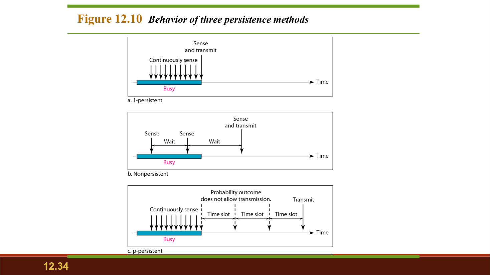
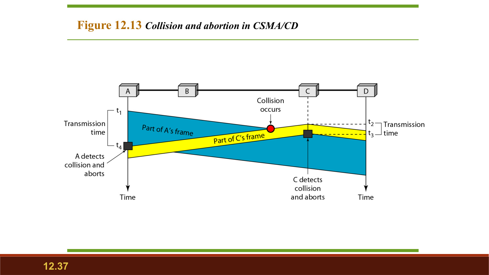
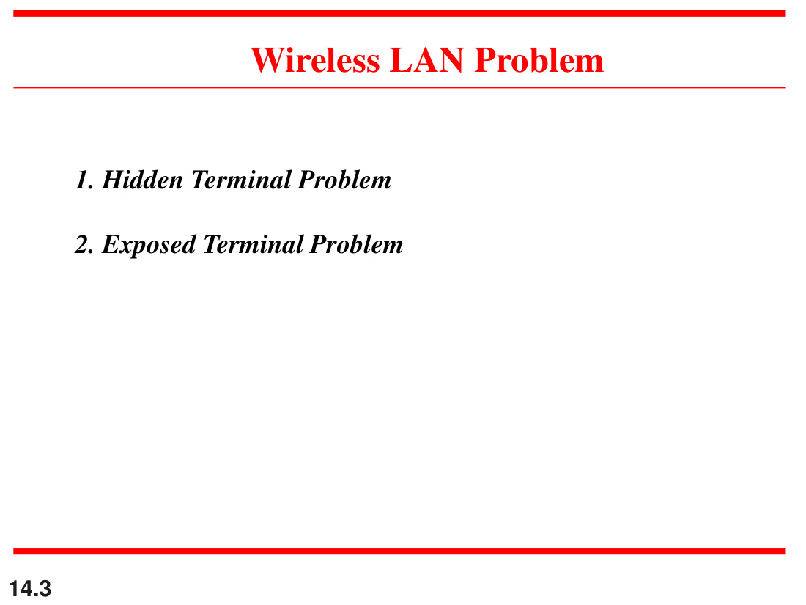
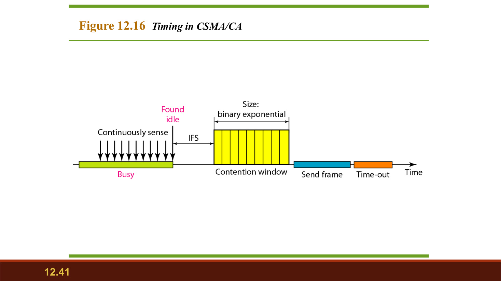
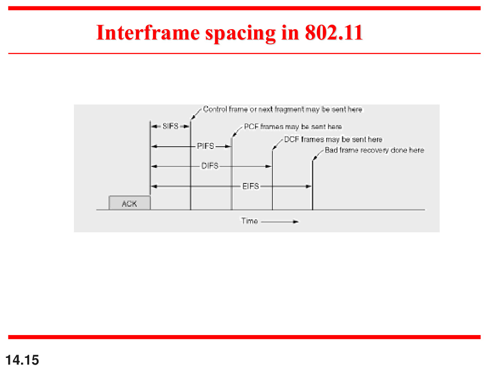
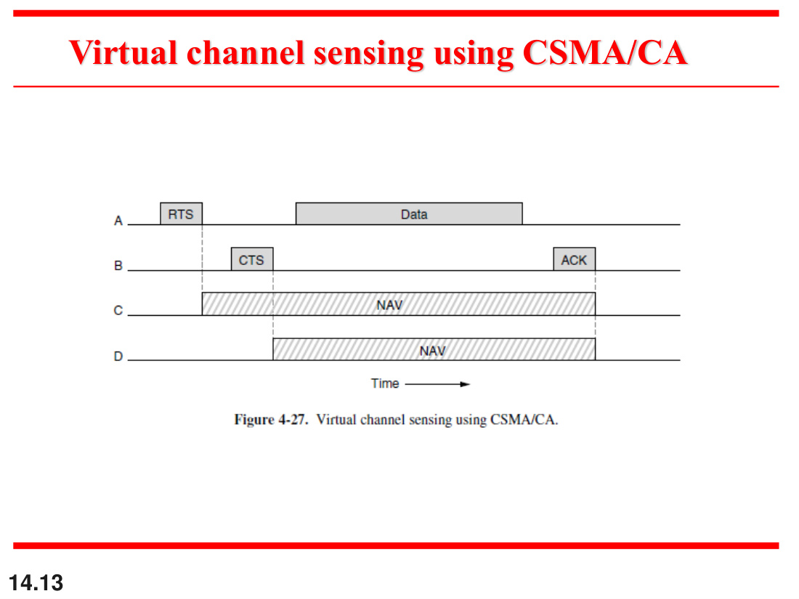

# RUN: CN Unit 3, MAC Sublayer

Nov 5, 2026 · @shahan

All of Unit 3, with every recent paper's MAC questions solved in place. Allow about 90 minutes. The whole unit answers one question: when everyone shares one wire, who gets to talk? Humanity has failed at this in every family dinner on record, so it's nice that networks manage it.

## How this run works

Read the idea, try the **PYQ**, then check the solution below it. All numericals were recomputed.

**What the paper likes:** ALOHA throughput, CSMA/CD minimum frame size, and hidden and exposed terminals with RTS/CTS. Those three appear almost every year.

**Videos:**

- [Gate Smashers: MAC protocols overview](https://www.youtube.com/watch?v=G0h0dC4Zycs), then Lec-33 Pure Aloha, Lec-34 Pure vs Slotted, Lec-35 CSMA and Lec-36 CSMA/CD in the [series](https://www.youtube.com/playlist?list=PLc5rXIqickU1fJkB1vmgedDQa3QOHNPxY).
- [Neso Academy, Computer Networks playlist](https://www.youtube.com/playlist?list=PLBlnK6fEyqRgMCUAG0XRw78UA8qnv6jEx), for Multiple Access Protocols, Pure Aloha and Ethernet.

Slides are in `Computer Networks/Notes/Unit 3/`.

**A slide bug to ignore:** the MAC slides' slotted ALOHA example writes 1000 × 0.0368 = 368 and 500 × 0.0303 = 151. The fractions are really 0.368 and 0.303. The answers are right; the multiplications are typos.

## Stop 1: The map

| Family | Idea | Protocols |
| --- | --- | --- |
| Random access | Everyone equal, collisions possible | ALOHA, CSMA, CSMA/CD, CSMA/CA |
| Controlled access | Permission before sending | Reservation, polling, token passing |
| Channelization | Split the channel | FDMA, TDMA, CDMA |

## Stop 2: ALOHA

**Pure ALOHA** sends whenever there's a frame ready, like a family WhatsApp group. If no ACK comes back, it waits a random backoff and tries again. **Slotted ALOHA** allows sending only at the start of a slot, which helps, in the way that a meeting agenda helps.

G is the average number of frames attempted per frame time. S is the throughput, as a fraction of the channel. T\_fr is the time to send one frame.

|  | Pure ALOHA | Slotted ALOHA |
| --- | --- | --- |
| Vulnerable time | 2 × T\_fr | T\_fr |
| Maximum throughput | 18.4%, at G = 0.5 | 36.8%, at G = 1 |

```latex
S_{\text{pure}} = G\,e^{-2G}
\qquad\qquad
S_{\text{slotted}} = G\,e^{-G}
```

Every ALOHA numerical uses the same three lines, so learn this recipe:

```latex
\begin{aligned}
T_{fr} &= \frac{\text{frame size}}{\text{bandwidth}} \\[6pt]
G &= \text{attempts per second} \times T_{fr} \\[6pt]
\text{Throughput} &= \frac{S}{T_{fr}} \text{ frames per second}
\end{aligned}
```

> **PYQ · Endsem 2021 Q4(b)(i) and Makeup 2022 Q2**
>
> What is vulnerable time? Show that slotted ALOHA's is half of pure ALOHA's.

Vulnerable time is the window during which another station starting to send will collide with your frame.

**Pure ALOHA.** Say your frame starts at t and lasts T\_fr. A frame that started up to T\_fr earlier is still running when you begin. A frame starting any time before you finish also overlaps you.

```latex
\text{Window: } (t - T_{fr}) \text{ to } (t + T_{fr}) \quad\Rightarrow\quad V_{\text{pure}} = 2\,T_{fr}
```

**Slotted ALOHA.** Everyone starts only on slot boundaries, so only frames that begin in your own slot can collide.

```latex
V_{\text{slotted}} = T_{fr} = \frac{1}{2}\,V_{\text{pure}}
```

**Pure ALOHA's vulnerable time is 2 × T\_fr, and slotted ALOHA's is T\_fr, exactly half.**

> **PYQ · Sessional-2 2024 Q4 · 4 marks**
>
> In slotted ALOHA, if the probability of collision for a frame is 0.5, find the efficiency and throughput.

A frame succeeds only if nobody else sends in its slot, which has probability e^(−G).

```latex
\begin{aligned}
P(\text{collision}) &= 1 - e^{-G} = 0.5 \\[4pt]
e^{-G} &= 0.5 \\[4pt]
G &= \ln 2 = 0.693 \\[4pt]
S &= G\,e^{-G} = 0.693 \times 0.5 = 0.3466
\end{aligned}
```

**Answer: efficiency is 34.66%.** Throughput is 0.3466 frames per slot, or 0.3466 × the channel bandwidth.

> **PYQ · Endsem 2025 Q3(b') · 4.5 marks**
>
> Pure ALOHA, frame 1000 bits, channel 2 Mbps, total attempts modelled as Poisson with 600 per second. Find the throughput in frames per second.

```latex
\begin{aligned}
T_{fr} &= \frac{1000}{2 \times 10^{6}} = 0.5 \text{ ms} \\[6pt]
G &= 600 \times 0.0005 = 0.3 \\[6pt]
S &= G\,e^{-2G} = 0.3\,e^{-0.6} = 0.3 \times 0.5488 = 0.1646 \\[6pt]
\text{Throughput} &= \frac{0.1646}{0.0005} \approx 329
\end{aligned}
```

**Answer: 329 frames per second.**

> **PYQ · Endsem 2024 Q4(b') · 6 marks**
>
> Pure ALOHA, frame 1000 bits, channel 1 Mbps, 1000 attempts per second. Find the throughput.

```latex
\begin{aligned}
T_{fr} &= \frac{1000}{10^{6}} = 1 \text{ ms} \\[6pt]
G &= 1000 \times 0.001 = 1 \\[6pt]
S &= 1 \times e^{-2} = 0.1353 \\[6pt]
\text{Throughput} &= \frac{0.1353}{0.001} \approx 135
\end{aligned}
```

**Answer: 135 frames per second**, or about 135 kbps. G = 1 is twice pure ALOHA's sweet spot, so it's well past the peak.

> **PYQ · Endsem 2021 Q4(b)(ii) · 3 marks**
>
> Pure ALOHA, frame 500 bits, 1 Mbps, 500 attempts per second. Find the throughput.

```latex
\begin{aligned}
T_{fr} &= \frac{500}{10^{6}} = 0.5 \text{ ms} \\[6pt]
G &= 500 \times 0.0005 = 0.25 \\[6pt]
S &= 0.25\,e^{-0.5} = 0.1516 \\[6pt]
\text{Throughput} &= \frac{0.1516}{0.0005} \approx 303
\end{aligned}
```

**Answer: 303 frames per second**, or about 151.6 kbps.

> **PYQ · Endsem 2022 Q4(b')(ii) and Makeup 2022 Q2**
>
> N stations share a 50 kbps slotted ALOHA channel. Each outputs a 500-bit frame on average once every 5000 ms, even if the previous one hasn't been sent. Find the maximum N.

```latex
\begin{aligned}
\text{Usable rate} &= 0.368 \times 50 \text{ kbps} = 18.4 \text{ kbps} \\[6pt]
\text{Each station} &= \frac{500 \text{ bits}}{5 \text{ s}} = 100 \text{ bps} \\[6pt]
N &= \frac{18400}{100} = 184
\end{aligned}
```

**Answer: N = 184 stations.**

## Stop 3: CSMA and persistence

CSMA means listen first, then talk. It can't eliminate collisions, because of propagation delay: someone may have started and their signal hasn't reached you yet. Its vulnerable time is Tp.



| Method | Channel idle | Channel busy | Trade-off |
| --- | --- | --- | --- |
| 1-persistent | Send immediately | Keep sensing | Most collisions |
| Non-persistent | Send immediately | Wait a random time, then sense again | Fewer collisions, more idle time |
| p-persistent | Send with probability p, else wait for next slot | Keep sensing | A balance, for slotted channels |

## Stop 4: CSMA/CD

Listen before talking, and keep listening while talking. If you hear a collision, stop, send a jam signal, and back off. That's a group call: two people start together, both say "sorry, you go", and the random wait is what prevents them doing it forever.

**The one rule:** the sender must still be sending when news of a collision gets back, so:

```latex
T_t \geq 2T_p
\qquad
\text{Minimum frame} = B \times 2T_p
```

**Backoff:** after the kth collision, wait a random number of slot times:

```latex
T_{\text{wait}} = R \times \text{slot time}, \qquad R \in \{0, 1, \dots, 2^k - 1\}
```



> **PYQ, Sessional-2 2025 Q3, 4 marks; Endsem 2022 Q4(a); Endsem 2024 Q4(b).** Define CSMA/CD. A network transmits at 100 Mbps over a 1 km cable with no repeaters. If the minimum frame size is 1250 bytes, find the signal speed in the cable.

**Answer:** CSMA/CD is a random access method. A station senses the channel before sending and keeps monitoring it while sending. If it detects a collision, it stops, sends a jam signal, and retries after an exponential backoff.

At minimum frame size, the transmission time just equals the round-trip time.

```latex
\begin{aligned}
T_t &= \frac{1250 \times 8}{10^8} = 100\ \mu\text{s} \\
T_t &= 2T_p \ \Rightarrow\ T_p = 50\ \mu\text{s} \\
v &= \frac{1 \text{ km}}{50\ \mu\text{s}} = 20{,}000 \text{ km/s}
\end{aligned}
```

**Signal speed = 20,000 km/s, which is 2 × 10⁷ m/s.**

> **PYQ, Sessional-2 2023 Q3, 5 marks.** Nodes A and B are at opposite ends of a cable with propagation delay 12.5 ms. Both transmit at t = 0. The frames collide, and after the first collision A draws k = 0 and B draws k = 1. Ignore the jam signal. When is A's packet completely delivered at B, if the link is 10 Mbps and the packet is 1000 bits?

**Answer:**

- Each station hears the other's signal at t = 12.5 ms, so both stop then.
- B's last bit, sent at 12.5 ms, reaches A at 25 ms. Only then does A sense the channel idle.
- A has k = 0, so it transmits immediately, at t = 25 ms.

```latex
\begin{aligned}
T_t &= \frac{1000}{10^7} = 0.1 \text{ ms} \\
t_{\text{delivered}} &= 25 + 0.1 + 12.5 = 37.6 \text{ ms}
\end{aligned}
```

**A's packet is fully delivered at B at t = 37.6 ms.** Meanwhile B, with k = 1, is still waiting out its backoff, so A wins.

> **PYQ, Endsem 2021 Q4(b'), 6 marks.** Data rate 10 Mbps, A and C are 2500 m apart, propagation speed 2 × 10⁸ m/s. A starts at t = 0 and C starts at 3 µs. Find when C and A hear the collision, and how many bits each sends before detecting it.

**Answer:**

```latex
\begin{aligned}
T_p &= \frac{2500}{2 \times 10^8} = 12.5\ \mu\text{s} \\
t_C &= 12.5\ \mu\text{s} \quad \text{(A's first bit reaches C)} \\
t_A &= 3 + 12.5 = 15.5\ \mu\text{s} \quad \text{(C's first bit reaches A)} \\
\text{bits}_A &= 15.5\ \mu\text{s} \times 10 \text{ Mbps} = 155 \\
\text{bits}_C &= (12.5 - 3)\ \mu\text{s} \times 10 \text{ Mbps} = 95
\end{aligned}
```

**C hears the collision at 12.5 µs, after sending 95 bits. A hears it at 15.5 µs, after sending 155 bits.**

## Stop 5: Wireless, hidden and exposed terminals

CSMA/CD fails in wireless. A station can't easily listen while it's transmitting, because its own signal drowns everything out, and not everyone can hear everyone. So wireless avoids collisions instead of detecting them: **CSMA/CA**.



- **Hidden terminal:** A and C both reach B but can't hear each other. Both sense idle, both send, and B gets a collision.
- **Exposed terminal:** B is sending to A. C wants to send to D, which wouldn't interfere, but C hears B and needlessly stays quiet.

**How CSMA/CA works:** sense the channel. If it's idle, wait an IFS. Then count down a random contention window, pausing whenever the channel goes busy. Send, then wait for an ACK. No ACK means a collision is assumed.



> **PYQ, Endsem 2025 Q3(a), 4.5 marks.** Describe the RTS/CTS mechanism in the IEEE 802.11 MAC and how it avoids collisions caused by hidden terminals. Why can't it fully eliminate the exposed terminal problem?

**Answer:**

1. The sender sends a short **RTS** (request to send), including how long it needs the channel.
2. The receiver replies with a **CTS** (clear to send), repeating the duration.
3. The sender sends the data, and the receiver sends an **ACK**.

Every station that hears the RTS or the CTS sets its **NAV** timer and stays quiet for that duration. A hidden station can't hear the sender's RTS, but it does hear the receiver's CTS, so it stays silent and the collision is avoided.

**Why exposed terminals remain:** an exposed station hears the RTS and must defer, even if its own transmission wouldn't disturb the receiver. It can't safely send anyway, because its data would interfere with the CTS and ACK coming back to the original sender. RTS/CTS tells you who's busy, not whether you'd actually be harmless.

**RTS/CTS fixes hidden terminals because the receiver's CTS reaches stations the sender can't. Exposed terminals still lose their chance to send.**

> **PYQ, Makeup 2022 Q1, 5 marks; Endsem 2021 Q4(a).** Define CSMA/CD and CSMA/CA. How are the hidden and exposed terminal problems solved using CSMA/CA? What's the role of inter-frame spacing?

**Answer:** CSMA/CD is defined in Stop 4, and is used on wired networks. CSMA/CA is listen-first plus collision avoidance, used on wireless, where IFS, contention windows and ACKs replace collision detection because collisions can't be detected reliably.

Hidden terminals are solved by the CTS, as above. Exposed terminals are helped only partly: a station that hears an RTS but no CTS knows the receiver is out of its range. In the MACA scheme it may then transmit once the CTS window has passed.

**Inter-frame spacing** is the wait before transmitting after the channel goes idle. It sets priority: the shorter the IFS, the higher the priority.

**CTS silences hidden terminals, and "RTS heard, no CTS" frees exposed ones. IFS decides who goes first.**



> **PYQ, Endsem 2024 Q4(a), 6 marks; Sessional-2 2021 Q3.** How does virtual carrier sensing work in CSMA/CA, and why does it matter? What role does inter-frame spacing play?

**Answer:** Virtual sensing doesn't listen to the medium at all. Frames carry a duration field, and each station that hears one sets its **NAV** (network allocation vector), a countdown that says the channel is reserved. Until it hits zero, the station treats the channel as busy. This matters because it protects against stations you can't physically hear, and it saves the energy spent sensing.



IFS gives priority, as above. SIFS, the shortest, covers ACK and CTS, so a conversation already in progress can't be interrupted.

**Virtual sensing = the NAV countdown set from the duration field. IFS = priority by waiting time.**

> **PYQ, Sessional-2 2021 Q3, 4 marks; Endsem 2022 Q4(b)(ii).** In a wireless LAN, the point coordination function and the distributed coordination function coexist in one cell. How can central and distributed control operate at the same time?

**Answer:** They share the cell by time, using inter-frame spacing.

```latex
\text{SIFS} < \text{PIFS} < \text{DIFS}
```

- After the channel goes idle, the access point running PCF waits only **PIFS**, which is shorter than the **DIFS** that DCF stations must wait.
- So the AP always gets the first go, and can run a contention-free period by polling stations.
- It periodically sends a beacon and stops polling, leaving a contention period in which DCF stations compete normally.

**The superframe alternates between a contention-free period (PCF, polled) and a contention period (DCF). PIFS \< DIFS gives the AP first claim.** One cell, two regimes, and no one's fighting about it.

> **PYQ, Endsem 2022 Q4(b)(i), 3 marks.** Draw the frame structure of 802.11.

**Answer:**

| Field | FC | D | Addr 1 | Addr 2 | Addr 3 | SC | Addr 4 | Frame body | FCS |
| --- | --- | --- | --- | --- | --- | --- | --- | --- | --- |
| Bytes | 2 | 2 | 6 | 6 | 6 | 2 | 6 | 0 to 2312 | 4 |

FC is frame control, D is duration (which sets the NAV), SC is sequence control, and FCS is the error check.

**Nine fields: 30 bytes of header, a body of up to 2312 bytes, and a 4-byte FCS.**

> **PYQ, Endsem 2022 Q4(b')(i), 3 marks.** What is a piconet? A Bluetooth device can be in two piconets at once. Why can't it be the master of both?

**Answer:** A piconet is a small Bluetooth network of one primary (master) and up to seven active secondaries. The master's clock and address fix the frequency-hopping sequence and the timing that the whole piconet follows.

**If one device were master of both, both would follow the same hopping sequence and timing, which makes them one piconet, not two.**

## Stop 6: Controlled and collision-free access

- **Reservation:** stations book a slot in a reservation frame before sending.
- **Polling:** a primary asks each station in turn, like a teacher taking attendance. If the primary dies, so does the network.
- **Token passing:** only the token holder talks. It's the talking stick from every school workshop you tried to forget.
- **Bit-map:** each station announces intent in its own bit in a contention period.
- **Binary countdown:** stations broadcast their address bit by bit, and the highest address wins.
- **Adaptive tree walk:** probe a binary tree of stations, splitting only where there's a collision.

> **PYQ, Endsem 2023 Q4(a), 6 marks.** Sixteen stations, numbered 1 to 16, contend for a shared channel using adaptive tree walk. If all stations with prime addresses suddenly become ready at once, how many bit slots are needed to resolve the contention?

**Answer:** The ready stations are the primes up to 16: 2, 3, 5, 7, 11 and 13. Each probed group uses one slot, and only a group with a collision gets split in two.

| Slot | Group | Ready | Result |
| --- | --- | --- | --- |
| 1 | 1-16 | all six | Collision |
| 2 | 1-8 | 2, 3, 5, 7 | Collision |
| 3 | 1-4 | 2, 3 | Collision |
| 4 | 1-2 | 2 | 2 sends |
| 5 | 3-4 | 3 | 3 sends |
| 6 | 5-8 | 5, 7 | Collision |
| 7 | 5-6 | 5 | 5 sends |
| 8 | 7-8 | 7 | 7 sends |
| 9 | 9-16 | 11, 13 | Collision |
| 10 | 9-12 | 11 | 11 sends |
| 11 | 13-16 | 13 | 13 sends |

**11 bit slots.**

## Stop 7: Channelization

- **FDMA:** split the frequency into bands, with guard bands between them.
- **TDMA:** one channel, time-shared in slots.
- **CDMA:** everyone transmits at once, separated by orthogonal codes. It's many conversations in one room, each in a different language.

> **PYQ, Sessional-2 2021 Q1, 3 marks.** A TDM bus LAN. Each slot is the time to transmit 100 bits plus the end-to-end propagation delay. Speed 2 × 10⁸ m/s, length 10 km, bandwidth 1 Mbps. Find the maximum number of stations so that each station's throughput is 1/3 Mbps.

**Answer:** Each station gets one slot in every N, and sends 100 bits in it.

```latex
\begin{aligned}
T_t &= \frac{100}{10^6} = 100\ \mu\text{s} \\
T_p &= \frac{10^4}{2 \times 10^8} = 50\ \mu\text{s} \\
\text{slot} &= 100 + 50 = 150\ \mu\text{s} \\
\text{throughput per station} &= \frac{100 \text{ bits}}{150N\ \mu\text{s}} = \frac{100}{150N} \text{ Mbps} \\
\frac{100}{150N} &= \frac{1}{3} \ \Rightarrow\ N = 2
\end{aligned}
```

**Maximum N = 2 stations.**

> **PYQ, Endsem 2025 Q3(b), 4.5 marks.** The same setup, with LAN length 1 km, bandwidth 10 Mbps, and each station's throughput 2/3 Mbps.

**Answer:**

```latex
\begin{aligned}
T_t &= \frac{100}{10^7} = 10\ \mu\text{s} \\
T_p &= \frac{10^3}{2 \times 10^8} = 5\ \mu\text{s} \\
\text{slot} &= 15\ \mu\text{s} \\
\frac{100}{15N} &= \frac{2}{3} \ \Rightarrow\ N = 10
\end{aligned}
```

**Maximum N = 10 stations.**

> **PYQ, Endsem 2023 Q1(b), 6 marks.** Find the multiplexer output if six stations A, B, C, D, E, F send 1, 0, 0, 1, silent, 1 in CDMA.

**Answer:** The paper gives no codes, so state that you're using the standard 8-chip Walsh codes W1 to W6 for A to F. Code 1 as +1, 0 as −1, and silent as 0.

| Station | Data | Code |
| --- | --- | --- |
| A | +1 | + + + + + + + + |
| B | −1 | + − + − + − + − |
| C | −1 | + + − − + + − − |
| D | +1 | + − − + + − − + |
| E | 0 | + + + + − − − − |
| F | +1 | + − + − − + − + |

Multiply each code by its data, then add chip by chip.

**Multiplexer output = \[1, −1, 1, 3, −1, 1, −1, 5\].**

**Check:** to recover A, multiply the output by A's code and add, then divide by the 8 chips.

```latex
\frac{1 - 1 + 1 + 3 - 1 + 1 - 1 + 5}{8} = \frac{8}{8} = +1 \ \Rightarrow\ \text{bit } 1
```

The same check gives −1, −1, +1, 0 and +1 for B to F, so every station's data comes back out.

## Stop 8: IEEE standards and Ethernet

IEEE 802 splits the data link layer into **LLC** (flow and error control, shared by LANs) and **MAC** (specific to each LAN type). 802.3 is Ethernet and 802.11 is WiFi.

**802.3 MAC frame:** preamble 7, SFD 1, destination 6, source 6, length/type 2, data and padding 46 to 1500, CRC 4. Sizes are in bytes.

- **Frame length:** minimum 64 bytes, maximum 1518 bytes, not counting preamble and SFD.
- **Address:** 48 bits. If the least significant bit of the first byte is 0 it's unicast, 1 means multicast, and all 1s means broadcast. Trick: look at the second hex digit. Even is unicast, odd is multicast.

**Why 64 bytes?** It's the CSMA/CD rule from Stop 4: at 10 Mbps with 2Tp = 51.2 µs, the minimum frame is 512 bits.

| Generation | Speed |
| --- | --- |
| Standard Ethernet | 10 Mbps |
| Fast Ethernet | 100 Mbps |
| Gigabit Ethernet | 1 Gbps |
| Ten-Gigabit Ethernet | 10 Gbps |

Switched and full-duplex Ethernet remove collisions altogether, so CSMA/CD isn't needed there. After all that effort, the winning strategy was giving everyone their own wire.

That's Unit 3. Go check on the cat; it hasn't transmitted in hours and nobody's complained.
