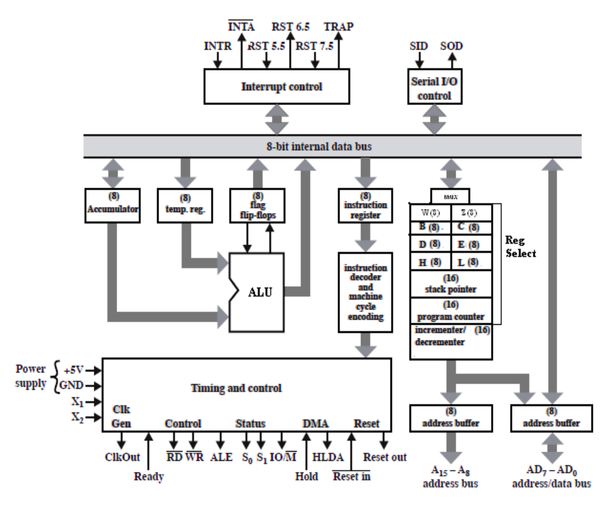
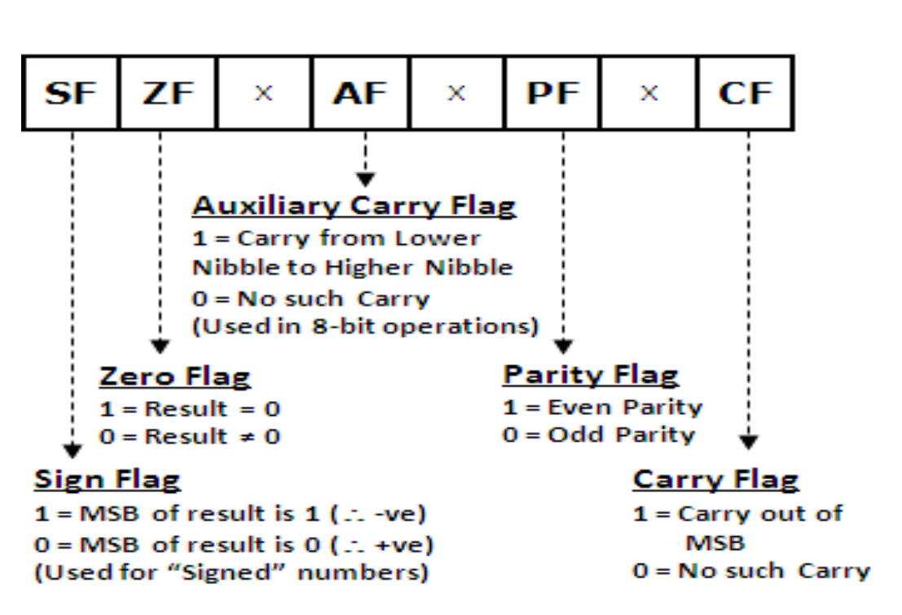
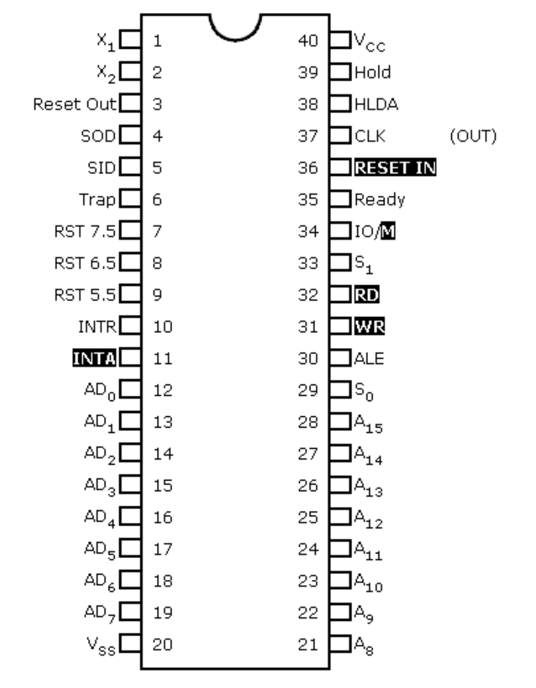

# RUN: Microprocessor 8085 (short)

Nov 17, 2026 · @shahan

The whole 8085 in half the length of the full doc: architecture, flags, pins, addressing modes, the instruction set, timing of SHLD and OUT, and the 8257, with the PYQs solved where they belong.

## How this run works

Read straight through. Guess each PYQ's answer before reading it, and remember the bold line under it. About an hour. Every short program here was checked on an 8085 simulator.

| What the paper likes | Asked in |
| --- | --- |
| Block diagram of the 8085 | Endsems 2022, 2024; Sessional-1 2021 |
| Pin diagram | Endsems 2022, 2023, 2025 |
| Flags | Endsems 2023, 2025 |
| "What does this program do?" | Endsems 2022, 2024, 2025; Sessional-1 2025 |
| LDAX, LHLD, STAX, SHLD | Sessional-1 2021, 2023 |
| Timing diagram of SHLD or OUT | Endsems 2022, 2023 |
| 8257 DMA controller | Endsem 2025 |

The diagrams come from Bharat Acharya's 8085 notes (`Microprocessor/Notes/Bharat Acharya 8085 complete.pdf`), and his [YouTube channel](https://www.youtube.com/@BharatAcharyaEducation/playlists) follows the same order.

## Stop 1: What a microprocessor system is

A **microprocessor** is a single chip that does a computer's thinking. It reads instructions from memory, takes data in, processes it as the instructions say, and sends results out. Three words describe how it works:

- **Programmable:** change the instructions and the same chip does a different job.
- **Clock-driven:** every step happens on a tick of a clock. One tick is called a **T-state**.
- **Register-based:** it keeps the data it's working on in **registers**, tiny and very fast storage boxes inside the chip.

Add memory and input/output devices (keyboard, LEDs, display) and you get a **microcomputer**. Everything is joined by three groups of wires called **buses**:

| Bus | Carries | 8085 width |
| --- | --- | --- |
| **Address bus** | *Which* memory location or device to talk to (CPU out only) | 16 lines, A15 to A0 |
| **Data bus** | The byte being moved (both directions) | 8 lines, D7 to D0 |
| **Control bus** | *What* to do: read or write, memory or I/O | RD̅, WR̅, IO/M̅, ALE and others |

A bar over a name, like RD̅, means **active low**: the signal does its job when the wire is 0.

The 8085 is an **8-bit** processor: its registers and data bus hold one byte. With 16 address lines it can reach this many locations:

```latex
2^{16} = 65536 \text{ locations} = 64 \text{ KB}, \quad \text{addresses } 0000_H \text{ to } FFFF_H
```

**Machine vs assembly language.** The chip only understands bytes such as `3E 05`. People write the same instruction as `MVI A, 05H`, using a short memory-aid word called a **mnemonic**, and a program called an **assembler** turns it into bytes. Assembly is readable and easier to debug, but both are tied to one processor, and both give the same machine code in the end.

**Why the 8085 beat its parent, the 8080:** it needs only one +5 V supply (the 8080 needed three), has the clock generator on the chip, adds more interrupts (5) and serial I/O pins, and still runs every 8080 program.

## Stop 2: 8085 architecture

The **architecture** (functional block diagram) is a map of the blocks inside the chip. They all talk over one **8-bit internal data bus**, the long bar across the middle of Figure 1. Learn the five groups first, then the boxes inside each.

**Figure 1: 8085 functional block diagram** (Bharat Acharya's notes). Draw this one in the exam.



**1. ALU group, where the maths happens.**

- **ALU (Arithmetic Logic Unit):** adds, subtracts, ANDs, ORs, compares, rotates.
- **Accumulator (A):** the ALU's main 8-bit register. It is always one input, and the result always lands back in it.
- **Temporary register:** holds the ALU's second input. Programs can't use it.
- **Flag register:** five 1-bit notes about the last result, such as "it was zero" (Stop 3).

**2. Register array, the scratch storage.**

- **B, C, D, E, H, L:** 8-bit registers for your data. They pair up as **BC, DE, HL** to hold 16-bit values. HL is also the **memory pointer**: `M` in an instruction means "the memory byte whose address is in HL".
- **W and Z:** hidden 8-bit registers that hold an address the CPU is in the middle of using.
- **Program Counter (PC), 16-bit:** the address of the next byte to fetch. It goes up by 1 after each fetch, unless a jump changes it.
- **Stack Pointer (SP), 16-bit:** the address of the top of the stack (Stop 8).

**3. Instruction register, decoder, timing and control.** The fetched **opcode** (the byte that says what to do) sits in the instruction register. The decoder works out what it means, and the timing and control unit sends out the signals that make it happen (RD̅, WR̅, ALE, IO/M̅) in step with the clock.

**4. Interrupt control:** the five interrupt inputs, through which a device says "stop and serve me now".

**5. Serial I/O control:** sends or receives one bit at a time on the SID and SOD pins.

**How they work together on** `ADD B`**:** PC sends out the address and the opcode 80H comes into the instruction register. The decoder sees "add B to A". B goes into the temporary register, the ALU adds it to A, the result goes back into A, and the flags are updated.

> **PYQ, Endsem 2022 Q1(a); Endsem 2024 Q1(a), 4.5 marks each.** Draw and explain the functional block diagram of the 8085.

**Answer:** Draw Figure 1, then explain the five groups above in one or two lines each. Finish with the buffers: A15 to A8 carry the high address byte, and AD7 to AD0 carry the low address byte and then the data (Stop 4).

**Five blocks on one 8-bit internal bus: ALU group, register array, instruction decoding with timing and control, interrupt control, serial I/O control.**

> **PYQ, Sessional-1 2021 Q5, 2 marks.** Draw the block diagram and explain the importance of the temporary registers.

**Answer:** The 8085 has three hidden registers: the **temporary register** beside the ALU, and **W and Z**.

- The ALU needs both inputs held steady at once, but the internal bus carries one byte at a time. So in `ADD B`, B is parked in the temporary register first, then the ALU adds.
- W and Z hold a 16-bit address while it's in transit. In `LDA 2050H` the two address bytes land in Z (50H) and W (20H), then go out together as 2050H. `CALL` and `XCHG` use them the same way.

**They let the CPU juggle operands and addresses without disturbing the registers your program uses.**

## Stop 3: The flag register

After an arithmetic or logic operation, the ALU leaves five 1-bit notes about the result: the **flags**. Each is **set** (1) or **reset** (0), and the next instruction can make a decision from them, such as "jump if the result was zero". They live in an 8-bit **flag register** (Figure 2):

| Bit | D7 | D6 | D5 | D4 | D3 | D2 | D1 | D0 |
| --- | --- | --- | --- | --- | --- | --- | --- | --- |
| Flag | **S** | **Z** | x | **AC** | x | **P** | x | **CY** |

**Figure 2: the flag register** (Bharat Acharya's notes).



| Flag | Set to 1 when | Used by |
| --- | --- | --- |
| **S**, sign | Bit 7 of the result is 1, meaning negative in signed form | `JM`, `JP` |
| **Z**, zero | The result is 00H | `JZ`, `JNZ` (loops, equality) |
| **AC**, auxiliary carry | A carry goes from bit 3 into bit 4 | Only `DAA`, for BCD maths; there is no jump on AC |
| **P**, parity | The result has an **even** number of 1s | `JPE`, `JPO` (error checks) |
| **CY**, carry | An add overflows past bit 7, or a subtract needs a **borrow** | `JC`, `JNC` |

**Which instructions change the flags** (a common trap):

- Arithmetic and logic (ADD, SUB, CMP, ANA and so on) update all five.
- Data transfer (MOV, MVI, LDA, LXI) changes **none**.
- `INR` and `DCR` change everything **except CY**. `INX` and `DCX` change **none**.
- `DAD` and the rotates change **only CY**.

**CMP is a subtraction that throws away the answer** but keeps the flags. After `CMP B`: if A \< B then CY = 1; if A = B then Z = 1; if A > B both are 0.

> **PYQ, Endsem 2023 Q2(a); Endsem 2025 Q2(a), 4.5 marks.** Explain the flags of the 8085 with their significance and how they are set and reset, with examples.

**Answer:** Give the bit layout and the table above, then an example. This one sets three flags at once:

```
MVI A, 9BH     ; A = 1001 1011
MVI B, 75H     ; B = 0111 0101
ADD B          ; A = A + B
```

```latex
9B_H + 75_H = 110_H \;\Rightarrow\; A = 10_H, \text{ and the extra 1 goes into CY}
```

| S | Z | AC | P | CY |
| --- | --- | --- | --- | --- |
| 0 (bit 7 of 10H is 0) | 0 (not zero) | 1 (B + 5 = 16 carries out of the low 4 bits) | 0 (one 1, odd) | 1 (110H doesn't fit in 8 bits) |

A second quick one: `MVI A, 25H` then `SUI 25H` gives A = 00H, so Z = 1 and P = 1 (zero 1s counts as even).

**S = sign of the result, Z = result is zero, AC = carry from bit 3 to bit 4 (for DAA), P = even number of 1s, CY = carry out of bit 7 or a borrow. Arithmetic and logic set them; conditional jumps, calls and returns test them.**

## Stop 4: Pin diagram and demultiplexing the bus

The 8085 has 40 pins (Figure 3). Don't memorise 40 names; learn 7 groups, each with a reason to exist.

**Figure 3: 8085 pin diagram** (Bharat Acharya's notes). Black boxes mark active-low pins.



| Group | Pins (number) | What they do |
| --- | --- | --- |
| **Power and clock** | Vcc (40) +5 V, Vss (20) ground, X1 and X2 (1, 2), CLK OUT (37) | A crystal on X1 and X2 sets the clock; the chip runs at **half** the crystal frequency. CLK OUT shares the clock with other chips. |
| **High address** | A15 to A8 (21 to 28) | The upper byte of the address. Output only. |
| **Multiplexed address/data** | AD7 to AD0 (12 to 19) | The **low address byte first, then the data byte**, on the same 8 wires. |
| **Control and status** | ALE (30), RD̅ (32), WR̅ (31), IO/M̅ (34), S1 (33), S0 (29), READY (35) | Say what kind of bus operation is happening. |
| **Interrupts** | TRAP (6), RST 7.5 (7), RST 6.5 (8), RST 5.5 (9), INTR (10), INTA̅ (11) | Devices ask for attention; INTA̅ answers INTR. |
| **DMA** | HOLD (39), HLDA (38) | Another chip asks for the buses, and the 8085 hands them over (Stop 11). |
| **Reset and serial** | RESET IN̅ (36), RESET OUT (3), SID (5), SOD (4) | Restart the chip; one-bit serial in and out. |

**The control pins:**

- **ALE (Address Latch Enable)** goes high at the start of every bus cycle to say "AD7 to AD0 hold an address right now".
- **RD̅** low = the CPU is reading. **WR̅** low = it is writing.
- **IO/M̅** = 1 for an I/O device, 0 for memory.
- **S1, S0** with IO/M̅ name the kind of cycle:

| Operation | IO/M̅ | S1 | S0 |
| --- | --- | --- | --- |
| Opcode fetch | 0 | 1 | 1 |
| Memory read | 0 | 1 | 0 |
| Memory write | 0 | 0 | 1 |
| I/O read | 1 | 1 | 0 |
| I/O write | 1 | 0 | 1 |

- **READY:** a slow device holds it low, and the 8085 waits extra clock periods (**wait states**).
- **RESET IN̅:** low resets the chip: PC = 0000H and interrupts are disabled.

**Demultiplexing AD7 to AD0.** Sharing 8 pins saves pins, but memory needs the low address byte held steady for the whole cycle. So a **latch** (the 74LS373, eight 1-bit memories) copies the address while ALE is high and keeps it after ALE drops. The same pins then carry the data.

```
AD7-AD0 ──┬──> [74LS373 latch] ──> A7-A0  (held all cycle)
          │          ^
ALE ──────┼──────────┘  (latches while ALE is high)
          └──> D7-D0  (data, after ALE drops)
A15-A8  ───────────────────> A15-A8
```

> **PYQ, Endsem 2022 Q1(b); Endsem 2023 Q1(b); Endsem 2025 Q1(a), 4.5 marks each.** Draw and discuss the pin diagram of the 8085.

**Answer:** Draw Figure 3 with pin numbers. Then go through the 7 groups in the table, give the status table, and draw the small latch figure for AD7 to AD0. Add one line each on the interrupts (TRAP is non-maskable and highest priority; RST 7.5, 6.5, 5.5 are maskable and vectored; INTR is non-vectored).

**40 pins in groups: power and clock, A15 to A8, multiplexed AD7 to AD0 (split by ALE and a latch), control and status, 5 interrupts with INTA̅, HOLD/HLDA, reset, and SID/SOD.**

## Stop 5: Instruction format and addressing modes

Every instruction has an **opcode** (what to do) and maybe an **operand** (what to do it on). Instructions are 1, 2 or 3 bytes long:

| Size | Layout | Example | Bytes in memory |
| --- | --- | --- | --- |
| 1 byte | Opcode only | `MOV B, C` | 41 |
| 2 bytes | Opcode + 8-bit data or port | `MVI A, 32H` | 3E 32 |
| 3 bytes | Opcode + 16-bit address, **low byte first** | `LDA 2050H` | 3A 50 20 |

"Low byte first" (called **little-endian**) means `LDA 2050H` stored at 2000H puts 3AH at 2000H, 50H at 2001H and 20H at 2002H. Exams love asking this.

An **addressing mode** is how an instruction tells the CPU where its operand is. The 8085 has five:

| Mode | Where the operand is | Examples |
| --- | --- | --- |
| **Immediate** | Inside the instruction itself (look for an I in the name) | `MVI B, 25H`, `LXI H, 2050H`, `ADI 05H` |
| **Register** | In a register | `MOV A, B`, `ADD C` |
| **Direct** | At an address written in the instruction | `LDA 2050H`, `STA 2051H`, `IN 80H` |
| **Register indirect** | At the address held in a register pair | `MOV A, M` (HL), `LDAX B`, `STAX D` |
| **Implied** | Fixed by the instruction, usually A | `CMA`, `RLC`, `DAA` |

**Why indirect matters:** direct mode bakes in one fixed address. Indirect mode keeps the address in HL, so `INX H` in a loop walks through a whole array.

**Immediate = data in the instruction, register = data in a register, direct = address in the instruction, register indirect = address in a register pair, implied = operand built into the opcode.**

## Stop 6: Data transfer instructions

The instruction set has five groups: data transfer, arithmetic, logical, branching and machine control. **Data transfer** instructions copy a byte (or two) from one place to another. The source keeps its value, and **no flags change**.

Notation: `R` is a register, `rp` is a register pair (B means BC, D means DE, H means HL), and `[2050H]` means "the byte at address 2050H".

| Instruction | Meaning | Bytes |
| --- | --- | --- |
| `MOV Rd, Rs` | Rd ← Rs (also `MOV A, M` and `MOV M, A`) | 1 |
| `MVI R, data` | R ← an 8-bit number | 2 |
| `LXI rp, data16` | Pair ← a 16-bit number | 3 |
| `LDA addr` / `STA addr` | A ← \[addr\] / \[addr\] ← A | 3 |
| `LHLD addr` | L ← \[addr\], H ← \[addr + 1\] | 3 |
| `SHLD addr` | \[addr\] ← L, \[addr + 1\] ← H | 3 |
| `LDAX rp` / `STAX rp` | A ← \[BC or DE\] / \[BC or DE\] ← A | 1 |
| `XCHG` | Swap HL and DE | 1 |
| `IN port` / `OUT port` | A ← I/O port / I/O port ← A | 2 |

Three traps:

- **No memory-to-memory move.** Go through a register: `MOV A, M` then `STA addr`.
- **LDAX and STAX work only with BC or DE.** For HL, use `MOV A, M` and `MOV M, A`.
- **LHLD and SHLD put L at the lower address**, the same little-endian rule.

> **PYQ, Sessional-1 2021 Q4; Sessional-1 2023 Q4, 2 marks.** Write the syntax and explain LDAX, LHLD, STAX and SHLD.

**Answer:**

| Instruction | Syntax | Operation | Mode, size |
| --- | --- | --- | --- |
| LDAX | `LDAX rp` (B or D) | A ← \[rp\] | Register indirect, 1 byte |
| LHLD | `LHLD addr16` | L ← \[addr\], H ← \[addr + 1\] | Direct, 3 bytes |
| STAX | `STAX rp` (B or D) | \[rp\] ← A | Register indirect, 1 byte |
| SHLD | `SHLD addr16` | \[addr\] ← L, \[addr + 1\] ← H | Direct, 3 bytes |

None affects the flags. One example covering all four, starting with 2050H = 34H and 2051H = 12H:

```
LHLD 2050H     ; HL = 1234H (L = 34H, H = 12H)
SHLD 2060H     ; [2060H] = 34H, [2061H] = 12H
LXI B, 2050H
LDAX B         ; A = [2050H] = 34H
LXI D, 2070H
STAX D         ; [2070H] = 34H
```

**LDAX/STAX move A through the address in BC or DE; LHLD/SHLD move HL to or from two memory bytes, L at the lower address.**

## Stop 7: Arithmetic, logical and rotate instructions

These all work on the **accumulator** and set the flags (exceptions noted). The 8085 has **no multiply or divide** instruction; programs build them from repeated adds and subtracts.

**Arithmetic:**

| Instruction | Meaning | Flags |
| --- | --- | --- |
| `ADD R` / `ADI data` | A ← A + operand | All |
| `ADC R` / `ACI data` | A ← A + operand + CY (for multi-byte sums) | All |
| `SUB R` / `SUI data` | A ← A − operand | All |
| `SBB R` / `SBI data` | A ← A − operand − CY | All |
| `INR R` / `DCR R` | Operand + 1 / − 1 | All except CY |
| `INX rp` / `DCX rp` | 16-bit pair + 1 / − 1 | None |
| `DAD rp` | HL ← HL + rp (16-bit add) | Only CY |
| `DAA` | Fixes A after adding BCD numbers | All |

**BCD and DAA.** **BCD** (Binary Coded Decimal) stores each decimal digit in its own 4 bits, so decimal 83 is stored as 83H. A plain binary add can leave a 4-bit group above 9, which isn't a digit. `DAA` fixes it: add 06H if the low nibble is above 9 (or AC = 1), then add 60H if the high nibble is above 9 (or CY = 1).

```
MVI A, 38H     ; BCD 38
ADI 45H        ; binary sum 7DH, and D isn't a digit
DAA            ; adds 06H: A = 83H, which is BCD 83 (38 + 45 = 83)
```

**Logical:**

| Instruction | Meaning | Flags |
| --- | --- | --- |
| `ANA R` / `ANI data` | A ← A AND operand, bit by bit | CY = 0, AC = 1 |
| `ORA R` / `ORI data` | A ← A OR operand | CY = 0, AC = 0 |
| `XRA R` / `XRI data` | A ← A XOR operand | CY = 0, AC = 0 |
| `CMA` | Flip every bit of A | None |
| `CMP R` / `CPI data` | A − operand, flags only (Stop 3) | All |
| `STC` / `CMC` | CY ← 1 / flip CY | Only CY |

**Rotates** shift every bit of A one place, and the bit that falls off one end comes back at the other. Only CY changes. Starting from A = 85H = 1000 0101 and CY = 0:

| Instruction | How it moves | A after | CY |
| --- | --- | --- | --- |
| `RLC` | Left; bit 7 goes to bit 0 and CY | 0000 1011 = 0BH | 1 |
| `RAL` | Left **through** CY; old CY goes to bit 0 | 0000 1010 = 0AH | 1 |
| `RRC` | Right; bit 0 goes to bit 7 and CY | 1100 0010 = C2H | 1 |
| `RAR` | Right through CY; old CY goes to bit 7 | 0100 0010 = 42H | 1 |

**Tricks programs use all the time:** `XRA A` clears A and CY in one byte. `ORA A` sets S, Z and P from A without changing it, a free sign or zero test. `ANI 0FH` keeps only the low 4 bits (a **mask**). `CMA` then `ADI 01H` makes the **two's complement**, which negates a signed number.

## Stop 8: Branching, the stack, subroutines and machine control

**Jumps** change PC, so the next instruction comes from somewhere else. `JMP addr` always jumps. A conditional jump only jumps when its flag condition holds:

| Jump | Jumps if | Typical use |
| --- | --- | --- |
| `JZ` / `JNZ` | Z = 1 / Z = 0 | Equal after CMP; loop until a counter hits 0 |
| `JC` / `JNC` | CY = 1 / CY = 0 | Smaller after CMP; carry after ADD |
| `JM` / `JP` | S = 1 / S = 0 | Negative or positive |
| `JPE` / `JPO` | P = 1 / P = 0 | Parity checks |

The standard loop: a counter in C, then `DCR C` and `JNZ BACK` at the bottom. DCR sets Z when C reaches 0, which ends the loop.

**The stack** is an area of memory used like a pile of plates: the **last** thing put on is the **first** taken off (**LIFO**). SP holds the address of the top, and the stack **grows downward**. Set it up once with `LXI SP, 2800H`.

| Instruction | What happens |
| --- | --- |
| `PUSH rp` | SP goes down by 2; the pair's high byte is stored at SP + 1 and the low byte at SP |
| `POP rp` | The reverse: low byte from SP, high byte from SP + 1, then SP goes up by 2 |
| `PUSH PSW` / `POP PSW` | Saves or restores A and the flags together (**PSW**, Program Status Word) |
| `XTHL` | Swaps HL with the two bytes on top of the stack; SP doesn't change |
| `SPHL` | SP ← HL |
| `PCHL` | PC ← HL (jump to the address in HL) |

For example, with SP = 2800H and BC = 1234H, `PUSH B` stores 12H at 27FFH and 34H at 27FEH, leaving SP = 27FEH. `POP D` then gives DE = 1234H and SP = 2800H again.

**Subroutines** are reusable blocks of code, like functions in C. `CALL addr` pushes the **return address** (the address of the next instruction) and jumps. `RET` pops it back into PC, so the program continues right after the CALL. Conditional versions exist (`CZ`, `CNC`, `RZ`, `RNC` and so on), and `RST n` is a one-byte CALL to address n × 8. A good subroutine saves the registers it uses with PUSH at the start and restores them with POP before RET.

**Machine control:** `HLT` stops until a reset or interrupt. `NOP` does nothing for 4 T-states (used to pad delays). `EI` and `DI` enable and disable interrupts. `RIM` and `SIM` read and set the interrupt masks and the serial pins.

## Stop 9: Reading programs

Every endsem from 2022 to 2025 asked the same three small programs (1.5 marks each), and Sessional-1 2025 asked two more. The method never changes: **trace it with one sample value, then say in one line what it does for every value.**

> **PYQ, Endsem 2022 Q2(a)(i); 2024 Q2(b)(i); 2025 Q2(b)(i).** Explain the function of this program:

```
       MVI A, Byte
       ORA A
       JM NEXT
       OUT 68H
       HLT
NEXT:  CMA
       ADI 01H
       OUT 68H
       HLT
```

**Answer:** `ORA A` leaves A unchanged but sets S from bit 7, so S = 1 means the byte is negative. A positive byte goes straight out. A negative one goes through `CMA` and `ADI 01H`, the two's complement, which turns −x into +x. For example, 05H outputs 05H, and FBH (−5) becomes 04H, then 05H.

**It outputs the absolute value of a signed byte to port 68H.**

> **PYQ, Endsem 2022 Q2(a)(ii); 2024 Q2(b)(ii); 2025 Q2(b)(ii).** What is the output at PORT1? `MVI A, 9FH; ADI 82H; JC Display; OUT PORT1; HLT; Display: XRA A; OUT PORT1; HLT`

**Answer:**

```latex
9F_H + 82_H = 159 + 130 = 289 = 121_H \;\Rightarrow\; A = 21_H,\ CY = 1
```

The carry makes `JC` jump, and `XRA A` clears A.

**PORT1 shows 00H.**

> **PYQ, Endsem 2022 Q2(a)(iii); 2024 Q2(b)(iii); 2025 Q2(b)(iii).** Explain the range of bytes displayed at PORT2:

```
       MVI A, BYTE1
       MOV B, A
       SUI 60H
       JC NEXT1
       MOV A, B
       SUI 90H
       JC NEXT2
NEXT1: XRA A
       OUT PORT1
       HLT
NEXT2: MOV A, B
       OUT PORT2
       HLT
```

**Answer:** B keeps a copy, because SUI destroys A. Each `SUI` + `JC` asks "is it smaller?", since a borrow sets CY. Below 60H goes to NEXT1 (00H at PORT1). From 60H up, `SUI 90H` borrows only below 90H, and those go to NEXT2. 90H and above fall through to NEXT1.

**PORT2 shows bytes from 60H to 8FH (96 to 143); everything else sends 00H to PORT1.**

> **PYQ, Sessional-1 2025 Q1(i).** What does `MVI A, 07H; RLC; MOV B, A; RLC; RLC; ADD B` do?

**Answer:** When bit 7 is 0, RLC just doubles A. So the steps give 2x (saved in B), then 4x, then 8x, and `ADD B` makes 8x + 2x = 10x. For 7 that's 70 = 46H.

**It multiplies A by 10 (A = 46H).**

> **PYQ, Sessional-1 2025 Q1(ii).** Explain:

```
        MVI A, Byte
        MVI B, 64H
        MVI C, C8H
        CMP B
        JC REJECT
        CMP C
        JNC REJECT
        OUT PORT1
        HLT
REJECT: SUB A
        OUT PORT1
        HLT
```

**Answer:** `CMP B` + `JC` rejects bytes below 64H (100). `CMP C` + `JNC` rejects bytes at or above C8H (200). `SUB A` makes A = 0 for rejects.

**A range filter: bytes from 64H to C7H (100 to 199) go out unchanged; anything else sends 00H.**

## Stop 10: Timing diagrams for SHLD and OUT

Three words first:

- **T-state:** one clock period. At 2 MHz, one T-state is 0.5 µs.
- **Machine cycle:** one trip on the bus, such as fetching an opcode, reading a byte or writing a byte. An opcode fetch takes 4 T-states; a read or write takes 3.
- **Instruction cycle:** all the machine cycles one instruction needs.

A **timing diagram** draws the bus signals T-state by T-state. The recipe: each byte of the instruction is one read (an opcode fetch for the first, memory reads for the rest), then add the cycles that do the actual work. In every cycle, ALE pulses in T1 while AD7 to AD0 hold the low address, then the data travels on the same pins. RD̅ goes low for a read, and WR̅ for a write.

> **PYQ, Endsem 2022 Q1'(a), 4.5 marks.** Draw and explain the timing diagram of SHLD 2060H, stored at 2500H.

**Answer:** SHLD 2060H stores L at 2060H and H at 2061H. It's 3 bytes: 2500H = 22H (opcode), 2501H = 60H, 2502H = 20H. So it needs **5 machine cycles**: an opcode fetch, two reads for the address, and two writes for the data.

| Cycle | T-states | A15-A8 | AD7-AD0 (address, then data) | IO/M̅, S1 S0 | Strobe |
| --- | --- | --- | --- | --- | --- |
| M1: Opcode fetch | 4 | 25H | 00H, then 22H | 0, 1 1 | RD̅ |
| M2: Memory read | 3 | 25H | 01H, then 60H | 0, 1 0 | RD̅ |
| M3: Memory read | 3 | 25H | 02H, then 20H | 0, 1 0 | RD̅ |
| M4: Memory write | 3 | 20H | 60H, then **L** | 0, 0 1 | **WR̅** |
| M5: Memory write | 3 | 20H | 61H, then **H** | 0, 0 1 | **WR̅** |

```
          |<- M1: Opcode fetch ->|<- M2: Read ->|<- M3: Read ->|<- M4: Write ->|<- M5: Write ->|
            T1  T2  T3  T4         T1  T2  T3     T1  T2  T3     T1  T2  T3      T1  T2  T3
A15-A8    = 25H                  = 25H          = 25H          = 20H           = 20H          =
AD7-AD0   =00H=<   22H   >=======01H=<  60H >===02H=<  20H >===60H=<   L   >===61H=<   H   >==
ALE       _/‾\__________________/‾\___________/‾\___________/‾\____________/‾\___________
IO/M̅     ___________________________________ 0 throughout _____________________________
RD̅       ‾‾‾‾\_______/‾‾‾‾‾‾‾‾‾‾‾\_____/‾‾‾‾‾‾‾\_____/‾‾‾‾‾‾‾‾‾‾‾‾‾‾‾‾‾‾‾‾‾‾‾‾‾‾‾‾‾‾
WR̅       ‾‾‾‾‾‾‾‾‾‾‾‾‾‾‾‾‾‾‾‾‾‾‾‾‾‾‾‾‾‾‾‾‾‾‾‾‾‾‾‾‾‾‾‾‾‾‾\______/‾‾‾‾‾‾‾‾\______/‾‾‾
```

```latex
\text{Total} = 4 + 3 + 3 + 3 + 3 = 16 \text{ T-states} = 8\ \mu s \text{ at 2 MHz}
```

**Opcode fetch + 2 memory reads + 2 memory writes = 16 T-states; WR̅ goes low in the last two cycles.**

> **PYQ, Endsem 2023 Q1'(a), 4.5 marks.** Draw and explain the timing diagram of OUT 26H, stored at 2400H.

**Answer:** OUT 26H sends A to port 26H. It's 2 bytes (2400H = D3H, 2401H = 26H), so it needs **3 machine cycles**:

| Cycle | T-states | A15-A8 | AD7-AD0 (address, then data) | IO/M̅, S1 S0 | Strobe |
| --- | --- | --- | --- | --- | --- |
| M1: Opcode fetch | 4 | 24H | 00H, then D3H | 0, 1 1 | RD̅ |
| M2: Memory read | 3 | 24H | 01H, then 26H | 0, 1 0 | RD̅ |
| M3: **I/O write** | 3 | **26H** | **26H**, then A | **1**, 0 1 | **WR̅** |

In an I/O cycle, the 8-bit port number appears on **both** halves of the address bus (2626H), and IO/M̅ goes **high** because the target is a device, not memory.

```
          |<---- M1: Opcode fetch ---->|<-- M2: Mem read -->|<-- M3: I/O write -->|
            T1    T2    T3    T4         T1    T2    T3      T1    T2    T3
A15-A8    =        24H                 =        24H         =        26H         =
AD7-AD0   = 00H =<    D3H     >========= 01H =<  26H  >===== 26H =< data of A >==
ALE       _/‾‾\_______________________/‾‾\________________/‾‾\_________________
IO/M̅     ______________________ 0 ______________________/‾‾‾‾‾‾‾‾‾ 1 ‾‾‾‾‾‾‾‾‾
RD̅       ‾‾‾‾‾‾\________/‾‾‾‾‾‾‾‾‾‾‾‾‾‾\______/‾‾‾‾‾‾‾‾‾‾‾‾‾‾‾‾‾‾‾‾‾‾‾
WR̅       ‾‾‾‾‾‾‾‾‾‾‾‾‾‾‾‾‾‾‾‾‾‾‾‾‾‾‾‾‾‾‾‾‾‾‾‾‾‾‾‾‾‾‾‾‾‾‾‾‾‾‾‾‾‾‾‾\________/‾‾‾‾
```

**Opcode fetch + memory read + I/O write = 4 + 3 + 3 = 10 T-states; in M3, IO/M̅ = 1, the address bus reads 2626H, and A goes out with WR̅ low.**

## Stop 11: DMA and the 8257 DMA controller

**The problem.** Normally every byte from a device to memory goes through the CPU: `IN` into A, `MOV M, A` into memory, plus the loop instructions. That's about 37 T-states per byte, and a fast disk would lose data waiting.

**DMA (Direct Memory Access)** fixes it. The CPU steps aside, and a separate chip, the **DMA controller**, moves bytes **straight between the device and memory** over the buses. No instructions are fetched, and the data never detours through A. The 8085 supports it with two pins: **HOLD** ("may I have the buses?") and **HLDA** ("they're yours").

**The sequence:**

1. The CPU programs the controller with the memory start address, the byte count and the direction.
2. The device raises **DRQ** (DMA request).
3. The controller raises **HRQ**, wired to the 8085's HOLD.
4. The 8085 finishes its current cycle, disconnects from the buses and raises **HLDA**.
5. The controller answers the device with **DACK̅** (DMA acknowledge) and moves a byte between the device and memory in one bus cycle.
6. It steps the address, counts down, and repeats while DRQ stays high.
7. When the count runs out it raises **TC** (terminal count) and drops HRQ, and the 8085 carries on.

In **burst mode** the controller keeps the buses for the whole block (fastest). In **cycle stealing** it takes them one byte at a time, so the CPU keeps running, just slower.

**The 8257** is Intel's DMA controller for the 8085:

- **4 channels** (0 to 3), each with its own DRQ input and DACK̅ output.
- Each channel has a 16-bit **address register** (memory start) and a 16-bit **count register**. The low 14 bits hold (bytes − 1), so up to 16 KB. The top 2 bits pick the operation: 01 = **DMA write** (I/O to memory), 10 = **DMA read** (memory to I/O), 00 = verify, 11 = illegal.
- A **mode set register** enables channels and options: D6 = stop when the count ends (TC stop), D4 = rotating priority, D3 to D0 = enable channels 3 to 0.
- A **status register** shows which channels have finished.
- Each 16-bit register is written as two `OUT`s to the same port, low byte first.

```
          HOLD <──────── HRQ
  8085    HLDA ────────> HLDA      8257      DRQ0  <──── Disk controller
                                           DACK0 ────> Disk controller
  system buses <════════> address, data, MEMR, MEMW, IOR, IOW
```

> **PYQ, Endsem 2025 Q4(c), 4.5 marks.** What is the 8257 DMA controller? Explain with a suitable example and diagrams.

**Answer:** The 8257 is a 4-channel programmable DMA controller. It takes the buses from the 8085 through HOLD/HLDA and moves data directly between I/O devices and memory, with no instructions executed. Write what DMA is and why it's faster, draw the diagram, give the 7-step sequence, and list the registers.

**Example:** read 1024 bytes from a disk on channel 0 into memory from 4000H. The 8257 sits at port 50H, so channel 0's address register is 50H, its count register is 51H and the mode set register is 58H. Device to memory is a DMA write (01):

```latex
\begin{aligned}
\text{Count} &= 1024 - 1 = 03FF_H \\
\text{Count register} &= 01\ 00\,0011\,1111\,1111_2 = 43FF_H \\
\text{Mode set} &= 0100\,0001_2 = 41_H \quad (\text{TC stop} + \text{channel 0 on})
\end{aligned}
```

```
MVI A, 00H    ; channel 0 address, low byte of 4000H
OUT 50H
MVI A, 40H    ; high byte
OUT 50H
MVI A, FFH    ; count, low byte of 43FFH
OUT 51H
MVI A, 43H    ; high byte: DMA write + 03H
OUT 51H
MVI A, 41H    ; mode set
OUT 58H       ; the hardware does the rest
```

**Once programmed with an address, a count (top 2 bits = read or write) and a mode word, the 8257 takes the buses through HOLD/HLDA, moves the data directly, and signals the end with TC.**
