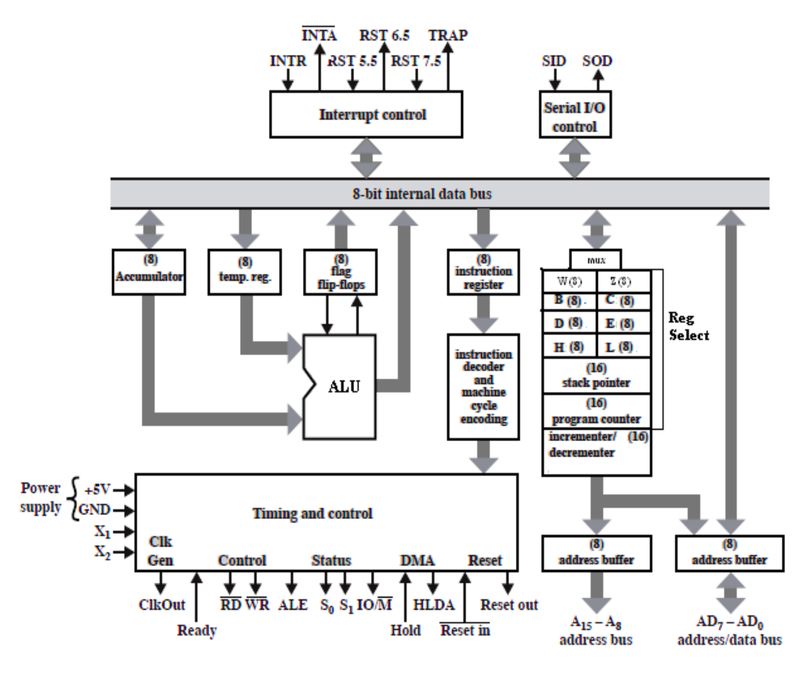
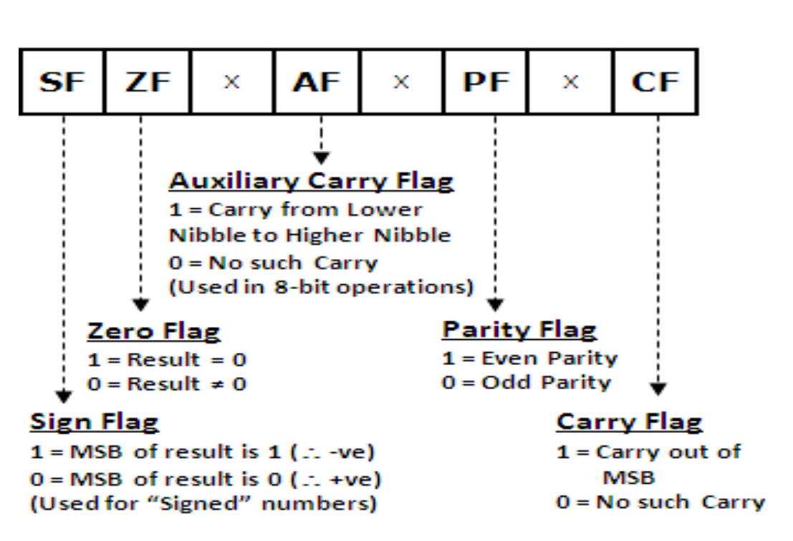
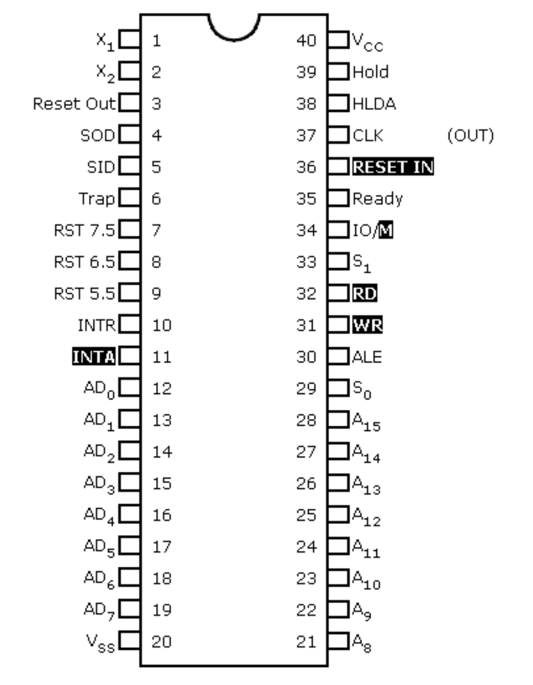

# RUN: Microprocessor 8085 Architecture and Instruction Set

Nov 16, 2026 · @shahan

The whole 8085 from the inside, from what a microprocessor is through every instruction group, written for a first read, with every architecture, flag, pin and instruction PYQ from 2021 to 2025 solved where it belongs.

## How this run works

Read the idea, try the PYQ on paper, then check the answer right under it. Each question sits in a box, and the line you'd circle in the exam is in bold. Allow about 2.5 hours.

**Scope, as you confirmed:** all 8085 concepts, and 8086 theory only (no 8086 programs). The Microprocessor runs are split four ways:

| Doc | Covers | Read it |
| --- | --- | --- |
| **This one** | What a microprocessor is, 8085 architecture, flags, pins, addressing modes, the full instruction set, timing of SHLD and OUT, DMA and the 8257 | 1st |
| Interfacing, Interrupts and Timing | Machine cycles and timing diagrams, interrupts, RIM/SIM, I/O-mapped and memory-mapped I/O, 8255, delay loops | 2nd |
| 8085 Programs | Every program type: sums, multiply, divide, sort, search, HCF, factorial, code conversion, counters | 3rd |
| 8086 Theory | 8086 architecture, segmentation, flags, pins, addressing modes, instructions, interrupts, 8088/8087 | 4th |

**What the paper likes from this doc:**

| Topic | Asked in |
| --- | --- |
| Functional block diagram of 8085 | Endsem 2022, 2024; Sessional-1 2021 |
| Pin diagram of 8085 | Endsem 2022, 2023, 2025 |
| Flags of 8085 | Endsem 2023, 2025 |
| "What does this program do?" | Endsem 2022, 2024, 2025; Sessional-1 2025 |
| LDAX, LHLD, STAX, SHLD | Sessional-1 2021, 2023 |
| Timing diagram of SHLD or OUT | Endsem 2022, 2023 |
| 8257 DMA controller | Endsem 2025 |

Papers used: Sessional-1 2021 to 2025, endsems 2022 to 2025, and the 2022 third minor (saved as `Microprocessor/PYQs/Makeup 2022.pdf`).

**Videos and notes:** the [Bharat Acharya Education](https://www.youtube.com/@BharatAcharyaEducation/playlists) channel has an 8085 playlist that follows this order. His full 8085 book is in `Microprocessor/Notes/Bharat Acharya 8085 complete.pdf`, and the diagrams in this doc are taken from it. Every short program here was run on an 8085 simulator to check the register and flag values shown.

## Stop 1: What a microprocessor system is

A **microprocessor** is a single chip that acts as a computer's CPU. Your class notes define it as a multipurpose, programmable, clock-driven, register-based device that:

1. reads binary instructions from **memory**,
2. takes in binary data as **input**,
3. processes the data as the instructions say, and
4. gives out the results as **output**.

Here's what each of those words means:

- **Programmable:** change the instructions and the same chip does a different job.
- **Clock-driven:** every step happens on a tick of a clock signal. One tick is one **T-state**.
- **Register-based:** it keeps the data it's working on in tiny, very fast storage boxes inside the chip called **registers**.

On its own the chip can't do much. A **microcomputer** is the microprocessor plus memory (where program and data live) plus I/O devices (keyboard, display, LEDs), all joined by three groups of wires called **buses**:

| Bus | Carries | Direction | 8085 width |
| --- | --- | --- | --- |
| **Address bus** | *Which* memory location or device to talk to | CPU out only | 16 lines (A15 to A0) |
| **Data bus** | The actual byte being moved | Both ways | 8 lines (D7 to D0) |
| **Control bus** | *What* to do: read or write, memory or I/O | Mostly CPU out | RD̅, WR̅, IO/M̅, ALE, and so on |

A bar over a signal name, like RD̅, means **active low**: the signal does its job when the wire is at 0, not 1.

**"8-bit" processor** means it handles 8 bits (one byte) at a time: its registers and data bus are 8 bits wide. With 16 address lines it can name 2¹⁶ different locations:

```latex
2^{16} = 65536 \text{ locations} = 64 \text{ KB}, \quad \text{addresses } 0000_H \text{ to } FFFF_H
```

**Hex reminder:** one hex digit is 4 bits, so a byte is 2 hex digits (00H to FFH) and an address is 4 (0000H to FFFFH). The H just means "this number is hex".

**Machine language vs assembly language** (syllabus Unit 1). The chip only understands bytes, like `3E 05`. Humans write `MVI A, 05H` instead. A program called an **assembler** turns each such line into its bytes, one line to one instruction.

|  | Machine language | Assembly language |
| --- | --- | --- |
| Written as | Binary or hex codes: `3E 05` | **Mnemonics** (short memory-aid words): `MVI A, 05H` |
| Understood by | The CPU directly | Needs an assembler to translate |
| Readability | Very poor | Readable, can carry comments |
| Errors | Hard to find | Easier to find and fix |
| Portability | Tied to one processor | Also tied to one processor |
| Speed of the result | Same | Same, since it becomes identical machine code |

A high-level language like C sits above both: one C line becomes many machine instructions, and the same C code can be compiled for different processors.

**Important 8-bit microprocessors compared** (syllabus Unit 1):

|  | Intel 8080 | **Intel 8085** | Zilog Z80 | Motorola 6800 |
| --- | --- | --- | --- | --- |
| Power supply | +5 V, −5 V, +12 V | **Single +5 V** | Single +5 V | Single +5 V |
| Clock | External chip (8224) | **On chip** (just add a crystal) | Single external clock input | External, two-phase |
| Address / data pins | Separate | **Multiplexed** (AD7 to AD0) | Separate | Separate |
| Interrupts | 1 | **5** (TRAP, RST 7.5, 6.5, 5.5, INTR) | 2 (NMI, INT) | 2 (NMI, IRQ) |
| Serial I/O pins | No | **Yes** (SID, SOD) | No | No |
| I/O style | I/O-mapped + memory-mapped | Both | Both | Memory-mapped only |
| Notable extra | The 8085's parent | Runs all 8080 code | Index registers IX, IY, a spare register set, block-move instructions | Two accumulators (A and B) and an index register |

**The 8085 is the 8080 made practical:** one +5 V supply, a built-in clock generator, more interrupts and serial I/O, and it runs every 8080 program.

## Stop 2: 8085 architecture

The **architecture** (or functional block diagram) is a map of the blocks inside the chip and how bytes flow between them. Everything inside talks over one **8-bit internal data bus**, the long horizontal bar across the middle of the figure.

**Figure 1: 8085 functional block diagram** (Bharat Acharya's notes, page 11). Draw this one in the exam.



The blocks fall into five groups. Learn the groups first, then the boxes inside each.

**1. ALU group, where the maths happens**

- **ALU (Arithmetic Logic Unit):** the circuit that adds, subtracts, ANDs, ORs, XORs, compares, rotates and increments. It has two inputs and one output.
- **Accumulator (A), 8-bit:** the ALU's main register. It's always one input of an arithmetic or logic operation, and the result always lands back in it. "Accumulate" just means "collect the running result".
- **Temporary register, 8-bit:** holds the ALU's *second* input while the operation happens. You can't name it in a program; the CPU uses it on its own.
- **Flag flip-flops (flag register):** five 1-bit flags that the ALU sets after an operation, such as "result was zero" or "there was a carry" (Stop 3).

**2. Register array, the CPU's scratch storage**

- **B, C, D, E, H, L, 8-bit each:** general-purpose registers for your data. They pair up as **BC, DE, HL** to hold 16-bit values. **HL** doubles as the **memory pointer**: in an instruction, `M` means "the memory byte whose address is in HL".
- **W and Z, 8-bit:** hidden temporary registers. They hold the two bytes of an address or data the CPU is in the middle of using, for example during `CALL` or `LDA`.
- **Program Counter (PC), 16-bit:** the address of the *next* byte to fetch. After each fetch it moves up by 1, so the program runs in order unless a jump changes PC.
- **Stack Pointer (SP), 16-bit:** the address of the top of the **stack**, an area of memory used as a pile of saved values (Stop 8).
- **Incrementer/decrementer address latch:** adds or subtracts 1 from PC or SP, and holds the address being sent out.

**3. Instruction register, decoder and timing and control**

- **Instruction register (IR):** when an opcode (the first byte of an instruction, which says *what* to do) is fetched, it sits here.
- **Instruction decoder and machine cycle encoder:** works out what the opcode means and which steps (machine cycles) it needs.
- **Timing and control unit:** the conductor of the orchestra. In step with the clock, it sends out the control and status signals RD̅, WR̅, ALE, IO/M̅, S1 and S0. It also listens to READY, HOLD and RESET IN̅, and generates CLK OUT, HLDA and RESET OUT.

**4. Interrupt control:** takes the five interrupt inputs (TRAP, RST 7.5, RST 6.5, RST 5.5, INTR) and gives the acknowledge INTA̅. An **interrupt** is a device's way of saying "stop and serve me now" (details in the Interfacing doc).

**5. Serial I/O control:** sends or receives data **one bit at a time** on two pins, SID (serial in) and SOD (serial out), through the RIM and SIM instructions.

**Buffers to the outside world:** the **address buffer** drives A15 to A8. The **address/data buffer** drives AD7 to AD0, which carry the low address byte first and then the data byte (Stop 4).

**How the blocks work together, on** `ADD B`**:**

1. PC sends the address out, and memory returns the opcode 80H, which goes into the IR.
2. The decoder recognises "add B to A".
3. B's value travels over the internal bus into the temporary register.
4. The ALU adds the accumulator and the temporary register.
5. The result goes back to A, and the flags are updated.

> **PYQ, Endsem 2022 Q1(a), 4.5 marks; Endsem 2024 Q1(a), 4.5 marks.** Draw and explain the functional block diagram of the 8085 microprocessor.

**Answer:** Draw Figure 1, then explain it group by group:

1. **ALU unit:** the ALU does 8-bit arithmetic and logic. The accumulator is one input and receives the result. The temporary register feeds the second input. The flag register (S, Z, AC, P, CY) records the nature of the result.
2. **Register unit:** six 8-bit general-purpose registers B, C, D, E, H, L, usable as the pairs BC, DE, HL (HL is the memory pointer M). There are also the hidden W and Z registers, the 16-bit PC (address of the next instruction) and the 16-bit SP (top of the stack), and the incrementer/decrementer address latch.
3. **Control unit:** the instruction register holds the fetched opcode, and the decoder works out the operation and its machine cycles. The timing and control unit generates RD̅, WR̅, ALE, IO/M̅, S1, S0 and CLK OUT, and handles READY, HOLD/HLDA and RESET.
4. **Interrupt control:** five hardware interrupts (TRAP, RST 7.5, RST 6.5, RST 5.5, INTR) with INTA̅ as the acknowledge.
5. **Serial I/O control:** SID and SOD for bit-by-bit transfer using RIM and SIM.
6. **Bus buffers:** A15 to A8 for the high address byte, and the multiplexed AD7 to AD0 for the low address byte and the data.

**Answer: five blocks on one 8-bit internal bus (ALU unit, register array, instruction decoding with timing and control, interrupt control, serial I/O control), plus the address and address/data buffers.**

> **PYQ, Sessional-1 2021 Q5, 2 marks.** Draw the functional block diagram of the 8085 and explain the importance of the temporary registers.

**Answer:** Draw Figure 1. The 8085 has three temporary registers that the programmer can't use: the **temporary register** next to the ALU, and the **W and Z** pair in the register array.

- **Temporary register (ALU):** the ALU needs both inputs held steady at the same time. The internal data bus can carry only one byte at a time, so the second operand is parked in the temporary register first. In `ADD B`, B is copied into it, and then the ALU adds A and temp together. Without it, the bus would have to carry two values at once.
- **W and Z:** they hold 16-bit values that are only in transit. In `LDA 2050H`, the two address bytes are fetched into Z (50H) and W (20H), then sent out together as the address 2050H. In `CALL`, the target address waits in WZ while the old PC is pushed onto the stack. In `XCHG`, they're the swap space.

Because these registers are hidden, the programmer's registers (A, B to L) aren't disturbed by the CPU's internal juggling.

**Answer: the temporary registers hold operands and addresses in transit (the ALU's second input; W and Z for 16-bit addresses in LDA, CALL, XCHG), so the single internal bus can be reused without corrupting the programmer's registers.**

## Stop 3: The flag register

After an arithmetic or logic operation, the ALU leaves five 1-bit notes about the result. These are the **flags**. Each is a flip-flop (a 1-bit memory) that is **set** (1) or **reset** (0). Their whole purpose is to let the next instruction make a decision, such as "jump if the result was zero".

They sit in an 8-bit **flag register**. Three bit positions are unused:

| Bit | D7 | D6 | D5 | D4 | D3 | D2 | D1 | D0 |
| --- | --- | --- | --- | --- | --- | --- | --- | --- |
| Flag | **S** | **Z** | x | **AC** | x | **P** | x | **CY** |

**Figure 2: the flag register** (Bharat Acharya's notes, page 14).



| Flag | Set to 1 when | Reset to 0 when | Used for |
| --- | --- | --- | --- |
| **S, Sign** (D7) | Bit 7 of the result is 1 | Bit 7 is 0 | In signed numbers bit 7 is the sign, so S = 1 means negative. Tested by `JM` and `JP`. |
| **Z, Zero** (D6) | The result is 00H | The result is not zero | Loops and equality checks. `JZ`, `JNZ`. |
| **AC, Auxiliary carry** (D4) | A carry comes out of bit 3 into bit 4 (the lower 4 bits overflowed) | No such carry | Only the CPU uses it, inside `DAA` for BCD maths. There is no jump on AC. |
| **P, Parity** (D2) | The result has an **even** number of 1s | Odd number of 1s | Error checks in data transfer. `JPE`, `JPO`. |
| **CY, Carry** (D0) | Addition overflows past bit 7, or subtraction needs a **borrow** | No carry or borrow | Multi-byte maths and comparisons. `JC`, `JNC`. |

**Which instructions touch the flags** (a classic trap):

- **Arithmetic and logic** (ADD, SUB, CMP, ANA, ORA, XRA and so on) update all five.
- **Data transfer** (MOV, MVI, LDA, STA, LXI) touch **none**.
- `INR` and `DCR` update everything **except CY**.
- `INX` and `DCX` (16-bit) touch **none**. That's why a 16-bit loop needs an extra test (the Interfacing doc's delay loop).
- `DAD` touches **only CY**.
- Rotates (`RLC`, `RAR` and so on) touch **only CY**.
- `ANA` and `ANI` force CY = 0 and AC = 1. `ORA` and `XRA` force CY = 0 and AC = 0.

**CMP is a subtraction that throws away the answer** but keeps the flags. With `CMP B`:

| If | CY | Z |
| --- | --- | --- |
| A \< B | 1 (a borrow) | 0 |
| A = B | 0 | 1 |
| A > B | 0 | 0 |

> **PYQ, Endsem 2023 Q2(a); Endsem 2025 Q2(a), 4.5 marks.** Explain the various flags available in the 8085 microprocessor with their significance and their setting/resetting, with suitable examples.

**Answer:** The 8085 has five flags in the flag register, at bit positions D7 S, D6 Z, D4 AC, D2 P and D0 CY. Give the table above, then these worked examples, all run on a simulator.

**Example 1: one addition that sets three flags.**

```
MVI A, 9BH     ; A = 1001 1011
MVI B, 75H     ; B = 0111 0101
ADD B          ; A = A + B
```

```latex
\begin{aligned}
9B_H + 75_H &= 110_H \\
A &= 10_H = 0001\,0000_2, \quad \text{the 1 overflows into CY}
\end{aligned}
```

| Flag | Value | Why |
| --- | --- | --- |
| S | 0 | Bit 7 of 10H is 0 |
| Z | 0 | 10H is not zero |
| AC | 1 | Low nibbles B + 5 = 16 > 15, so a carry goes from bit 3 to bit 4 |
| P | 0 | 0001 0000 has one 1, an odd count |
| CY | 1 | The sum 110H doesn't fit in 8 bits |

**Example 2: a result of zero.**

```
MVI A, 25H
SUI 25H        ; A = 25H - 25H = 00H
```

The result is Z = 1, P = 1 (zero 1s counts as even), S = 0, and CY = 0 because no borrow was needed.

**Example 3: a borrow.** `MVI A, 05H` then `SUI 07H` gives A = FEH, which is −2 in two's complement (the usual way to store negative numbers: flip all the bits and add 1). Here CY = 1 because 5 \< 7 needed a borrow, and S = 1 because the result is negative.

**Answer: S = sign of the result (bit 7); Z = result is zero; AC = carry from bit 3 to bit 4 (used by DAA); P = even number of 1s; CY = carry out of bit 7, or a borrow. They are set or reset by arithmetic and logic instructions and tested by conditional jumps, calls and returns.**

## Stop 4: Pin diagram and demultiplexing the bus

The 8085 is a 40-pin chip. Don't memorise 40 random names. They fall into 7 groups, and each group has a reason to exist.

**Figure 3: 8085 pin diagram** (Bharat Acharya's notes, page 12). Black boxes mark active-low pins.



| Group | Pins (number) | What they do |
| --- | --- | --- |
| **Power and clock** | Vcc (40) +5 V, Vss (20) ground, X1 and X2 (1, 2), CLK OUT (37) | X1 and X2 connect a crystal, and the chip runs at **half** the crystal frequency. CLK OUT gives that clock to other chips. |
| **High address** | A15 to A8 (21 to 28) | The upper byte of the 16-bit address. Output only. |
| **Multiplexed address/data** | AD7 to AD0 (12 to 19) | Carry the **low address byte first, then the data byte** on the same 8 wires. |
| **Control and status** | ALE (30), RD̅ (32), WR̅ (31), IO/M̅ (34), S1 (33), S0 (29), READY (35) | Say what kind of bus operation is happening (table below). |
| **Interrupts** | TRAP (6), RST 7.5 (7), RST 6.5 (8), RST 5.5 (9), INTR (10), INTA̅ (11) | Devices ask for attention, and INTA̅ is the reply to INTR. |
| **DMA** | HOLD (39), HLDA (38) | A DMA controller asks for the buses with HOLD, and the 8085 hands them over with HLDA (Stop 11). |
| **Reset and serial** | RESET IN̅ (36), RESET OUT (3), SID (5), SOD (4) | Restart the chip; 1-bit serial in and out. |

**Control pins one by one:**

- **ALE (Address Latch Enable):** goes high in the first clock period of every machine cycle, to say "AD7 to AD0 hold an address right now, latch it".
- **RD̅:** low means the CPU is reading from memory or I/O. **WR̅:** low means it is writing.
- **IO/M̅:** 1 means the operation is with an I/O device, and 0 means with memory.
- **S1, S0:** status bits that, together with IO/M̅, name the current machine cycle:

| Operation | IO/M̅ | S1 | S0 |
| --- | --- | --- | --- |
| Opcode fetch | 0 | 1 | 1 |
| Memory read | 0 | 1 | 0 |
| Memory write | 0 | 0 | 1 |
| I/O read | 1 | 1 | 0 |
| I/O write | 1 | 0 | 1 |
| Interrupt acknowledge | 1 | 1 | 1 |
| Halt | Z | 0 | 0 |

(Z means high impedance: the pin is electrically disconnected, neither 0 nor 1.)

- **READY:** a slow memory or device holds READY low, and the 8085 inserts **wait states** (extra clock periods) until it goes high.
- **RESET IN̅:** low resets the chip. PC becomes 0000H, interrupts are disabled and the buses float. **RESET OUT** tells the other chips to reset too.

**Demultiplexing AD7 to AD0.** Sharing 8 pins between the address and data saves pins, but memory needs the low address byte held steady for the *whole* cycle. So a latch (the 74LS373, eight flip-flops) grabs the address while ALE is high and keeps it after ALE drops. Then the same pins are free to carry data.

```
            AD7-AD0 ──┬──> [74LS373 latch] ──> A7-A0  (held all cycle)
                      │          ^
            ALE ──────┼──────────┘  (G: latch while high)
                      │
                      └──> D7-D0  (data, from T2 on)
            A15-A8  ───────────────────> A15-A8
```

> **PYQ, Endsem 2022 Q1(b), 4.5 marks; Endsem 2023 Q1(b), 4.5 marks; Endsem 2025 Q1(a), 4.5 marks.** Draw and discuss the pin diagram of the 8085 microprocessor.

**Answer:** Draw Figure 3 with the pin numbers, then describe the pins group by group:

1. **Power and frequency:** Vcc (+5 V), Vss (ground), X1 and X2 (crystal; operating frequency = crystal ÷ 2), CLK OUT.
2. **Address bus:** A15 to A8 carry the high-order address byte.
3. **Multiplexed address/data bus:** AD7 to AD0 carry the low-order address in T1, then data. They're separated with ALE and a 74LS373 latch (draw the small figure above).
4. **Control and status signals:** ALE, RD̅, WR̅, IO/M̅, S1, S0 (give the status table), and READY for slow devices.
5. **Interrupt signals:** TRAP (non-maskable, highest priority), RST 7.5, RST 6.5, RST 5.5 (vectored, maskable), INTR (non-vectored) and INTA̅ (acknowledge).
6. **DMA signals:** HOLD (a request for the buses) and HLDA (the 8085 grants them).
7. **Reset signals:** RESET IN̅ (PC = 0000H, interrupts disabled, buses tri-stated) and RESET OUT (resets peripherals).
8. **Serial I/O:** SID (serial input data) and SOD (serial output data), read and written with RIM and SIM.

**Answer: 40 pins in groups: power/clock, A15-A8, multiplexed AD7-AD0 (split by ALE), control/status (RD̅, WR̅, IO/M̅, S1, S0, READY), 5 interrupts + INTA̅, HOLD/HLDA, reset, and SID/SOD.**

## Stop 5: Instruction format and addressing modes

Every instruction has an **opcode** (operation code, the part that says *what* to do) and maybe an **operand** (*what* to do it on). In memory, the 8085 has three instruction sizes:

| Size | Layout | Example | Bytes in memory |
| --- | --- | --- | --- |
| 1 byte | Opcode only; the operands are registers or implied | `MOV B, C` | 41 |
| 2 bytes | Opcode + 8-bit data or port number | `MVI A, 32H` | 3E 32 |
| 3 bytes | Opcode + 16-bit address or data, **low byte first** | `LDA 2050H` | 3A 50 20 |

"Low byte first" is called **little-endian** storage: of the two bytes 20H and 50H, the little end (50H) is stored first. Exams love asking what's at each address, so remember that `LDA 2050H` placed at 2000H means 2000H holds 3AH, 2001H holds 50H, and 2002H holds 20H.

An **addressing mode** is the way an instruction tells the CPU where its operand is. The 8085 has five:

| Mode | Where the operand is | Examples | Clue |
| --- | --- | --- | --- |
| **Immediate** | Inside the instruction itself | `MVI B, 25H`, `LXI H, 2050H`, `ADI 05H`, `CPI 0AH` | The letter I in the mnemonic |
| **Register** | In a register | `MOV A, B`, `ADD C`, `INR D` | Only register names |
| **Direct** | At a memory address (or port) written in the instruction | `LDA 2050H`, `STA 2051H`, `LHLD 2060H`, `IN 80H` | A full address in the instruction |
| **Register indirect** | At the address held in a register pair | `MOV A, M` (pair HL), `LDAX B`, `STAX D`, `ADD M` | M, or LDAX/STAX |
| **Implied (implicit)** | Fixed by the instruction, usually A or the flags | `CMA`, `RLC`, `STC`, `DAA` | No operand written at all |

**Why bother with indirect?** Direct mode bakes one fixed address into the instruction. Indirect mode keeps the address in HL, so you can step it with `INX H` inside a loop and walk through a whole array. That's how every program in the Programs doc works.

```
LDA 2050H       ; direct: one fixed byte (3 bytes, 13 T-states)

LXI H, 2050H    ; indirect: set the pointer once...
MOV A, M        ; ...read the byte HL points at (1 byte, 7 T-states)
INX H           ; ...and move on to the next byte
```

**Answer to remember: immediate = data in the instruction, register = data in a register, direct = address in the instruction, register indirect = address in a register pair, implied = operand built into the opcode.**

## Stop 6: Data transfer instructions

The 8085's 74 instruction types fall into five groups: data transfer, arithmetic, logical, branching, and machine control. This stop covers the first.

**Data transfer** instructions *copy* a byte (or two) from one place to another. The source keeps its value, and **no flags change**.

Notation: `R` is any of A, B, C, D, E, H, L. `rp` is a register pair (B means BC, D means DE, H means HL). `[2050H]` means "the byte stored at memory address 2050H".

| Instruction | Meaning | Bytes | Example |
| --- | --- | --- | --- |
| `MOV Rd, Rs` | Rd ← Rs | 1 | `MOV B, A` |
| `MOV R, M` / `MOV M, R` | Copy between a register and the memory byte at HL | 1 | `MOV A, M` |
| `MVI R, data` | R ← an 8-bit number | 2 | `MVI C, 0AH` |
| `LXI rp, data16` | Pair ← a 16-bit number | 3 | `LXI H, 2050H` |
| `LDA addr` | A ← \[addr\] | 3 | `LDA 2050H` |
| `STA addr` | \[addr\] ← A | 3 | `STA 2051H` |
| `LHLD addr` | L ← \[addr\], H ← \[addr + 1\] | 3 | `LHLD 2050H` |
| `SHLD addr` | \[addr\] ← L, \[addr + 1\] ← H | 3 | `SHLD 2060H` |
| `LDAX rp` | A ← \[address in BC or DE\] | 1 | `LDAX B` |
| `STAX rp` | \[address in BC or DE\] ← A | 1 | `STAX D` |
| `XCHG` | Swap HL and DE | 1 | `XCHG` |
| `IN port` | A ← byte from an I/O port | 2 | `IN 80H` |
| `OUT port` | I/O port ← A | 2 | `OUT 01H` |

Three things that trip people up:

- **There's no memory-to-memory move.** To copy one memory byte to another, go through a register: `MOV A, M` then `STA addr`. (`MOV M, M` doesn't exist; its opcode 76H is actually `HLT`.)
- **LDAX and STAX work only with BC or DE.** For HL you use `MOV A, M` and `MOV M, A`.
- **LHLD and SHLD move two bytes, low byte at the lower address**, which is the same little-endian rule as before.

Two more data-transfer-style instructions, `XTHL` and `SPHL`, deal with the stack, so they're covered in Stop 8.

> **PYQ, Sessional-1 2021 Q4, 2 marks; Sessional-1 2023 Q4, 2 marks.** Write the syntax and then explain the following instructions: LDAX, LHLD, STAX, SHLD.

**Answer:**

| Instruction | Syntax | Operation | Addressing mode | Size |
| --- | --- | --- | --- | --- |
| LDAX | `LDAX rp` (rp = B or D) | A ← \[rp\]: load A from the address in BC or DE | Register indirect | 1 byte |
| LHLD | `LHLD addr16` | L ← \[addr\], H ← \[addr + 1\]: load HL directly from two bytes of memory | Direct | 3 bytes |
| STAX | `STAX rp` (rp = B or D) | \[rp\] ← A: store A at the address in BC or DE | Register indirect | 1 byte |
| SHLD | `SHLD addr16` | \[addr\] ← L, \[addr + 1\] ← H: store HL directly into two bytes of memory | Direct | 3 bytes |

None of them affects the flags.

One example covering all four. Start with 2050H = 34H and 2051H = 12H:

```
LHLD 2050H     ; L = [2050H] = 34H, H = [2051H] = 12H, so HL = 1234H
SHLD 2060H     ; [2060H] = 34H, [2061H] = 12H (HL copied to 2060H-2061H)
LXI B, 2050H   ; BC points at 2050H
LDAX B         ; A = [2050H] = 34H
LXI D, 2070H   ; DE points at 2070H
STAX D         ; [2070H] = 34H
HLT
```

**Answer: LDAX/STAX load/store A through the address in BC or DE (register indirect, 1 byte); LHLD/SHLD load/store HL from/to two consecutive memory bytes, L at the lower address (direct, 3 bytes).**

## Stop 7: Arithmetic, logical and rotate instructions

All of these work on the **accumulator** and set the flags (except where noted). There is no multiply or divide instruction on the 8085, so the Programs doc builds them from adds, subtracts and shifts.

**Arithmetic group:**

| Instruction | Meaning | Flags |
| --- | --- | --- |
| `ADD R` / `ADD M` / `ADI data` | A ← A + operand | All |
| `ADC R` / `ADC M` / `ACI data` | A ← A + operand + CY (add *with carry*, used for multi-byte sums) | All |
| `SUB R` / `SUB M` / `SUI data` | A ← A − operand | All |
| `SBB R` / `SBB M` / `SBI data` | A ← A − operand − CY (subtract *with borrow*) | All |
| `INR R` / `INR M` | Operand ← operand + 1 | All except CY |
| `DCR R` / `DCR M` | Operand ← operand − 1 | All except CY |
| `INX rp` / `DCX rp` | 16-bit pair + 1 / − 1 | **None** |
| `DAD rp` | HL ← HL + rp (a 16-bit add) | Only CY |
| `DAA` | Decimal Adjust Accumulator: fixes A after adding BCD numbers | All |

**BCD and DAA.** **BCD** (Binary Coded Decimal) stores each decimal digit in its own 4 bits, so decimal 83 is stored as 1000 0011, which reads as 83H. Adding two BCD numbers with plain binary `ADD` can give a nibble above 9, which isn't a valid digit. `DAA` repairs it:

1. If the low nibble > 9 or AC = 1, add 06H.
2. Then, if the high nibble > 9 or CY = 1, add 60H and set CY.

```
MVI A, 38H     ; BCD 38
ADI 45H        ; binary sum: A = 7DH, and D isn't a decimal digit
DAA            ; low nibble D > 9, so add 06H: A = 83H, which is BCD 83
```

```latex
38 + 45 = 83 \quad \checkmark
```

**Logical group:**

| Instruction | Meaning | Flags |
| --- | --- | --- |
| `ANA R` / `ANI data` | A ← A AND operand, bit by bit | CY = 0, AC = 1, others by result |
| `ORA R` / `ORI data` | A ← A OR operand | CY = 0, AC = 0, others by result |
| `XRA R` / `XRI data` | A ← A XOR operand | CY = 0, AC = 0, others by result |
| `CMA` | A ← NOT A (flip every bit) | None |
| `CMP R` / `CPI data` | Compute A − operand, set the flags, **discard** the result | All (see Stop 3) |
| `STC` / `CMC` | CY ← 1 / CY ← NOT CY | Only CY |

**Rotate group** (only CY changes). "Rotate" means the bits shift one place and the bit that falls off one end comes back in at the other:

```
RLC:  CY <- D7 <- D6 ... D0 <- (old D7)        rotate left
RRC:  (old D0) -> D7 -> ... D0 -> CY            rotate right
RAL:  CY <- D7 ... D0 <- (old CY)               rotate left THROUGH carry (9-bit loop)
RAR:  (old CY) -> D7 ... D0 -> CY               rotate right THROUGH carry
```

Start each from A = 85H = 1000 0101 with CY = 0:

| Instruction | A after | CY after |
| --- | --- | --- |
| `RLC` | 0000 1011 = 0BH | 1 |
| `RAL` | 0000 1010 = 0AH | 1 |
| `RRC` | 1100 0010 = C2H | 1 |
| `RAR` | 0100 0010 = 42H | 1 |

**Tricks the programs use all the time:**

| Trick | What it does |
| --- | --- |
| `XRA A` | A = 0 and CY = 0 in one byte (anything XOR itself is 0) |
| `ORA A` | Sets S, Z and P from A **without changing A**, so it's a free sign or zero test |
| `ANI 01H` | Keeps only bit 0, so Z = 1 means the number was **even** |
| `ANI 0FH` | Keeps the low nibble (a **mask**: AND with 0 clears a bit, AND with 1 keeps it) |
| `CMA` then `ADI 01H` | Two's complement, which negates a signed number |
| `ADD A` | A × 2 (a true left shift; `RLC` would wrap bit 7 around) |
| `DAD H` | HL × 2 |
| `RAR` or `RRC` after `ANI 01H` | Bit tests and division by 2 |

## Stop 8: Branching, the stack, subroutines and machine control

**Jumps** change PC, so the next instruction comes from somewhere else. `JMP addr` always jumps. A conditional jump jumps only if its flag condition holds, and otherwise falls through to the next line.

| Jump | Jumps if | Typical use |
| --- | --- | --- |
| `JZ` / `JNZ` | Z = 1 / Z = 0 | "Equal?" after CMP; loop until a counter hits 0 |
| `JC` / `JNC` | CY = 1 / CY = 0 | "Smaller?" after CMP; a carry after ADD |
| `JM` / `JP` | S = 1 (minus) / S = 0 (plus) | Sign of a signed number |
| `JPE` / `JPO` | P = 1 (even parity) / P = 0 (odd parity) | Parity checks |

The standard loop: a counter in C, and `DCR C` then `JNZ BACK` at the bottom. DCR sets Z when C reaches 0, which ends the loop.

**The stack.** The stack is an area of RAM used like a pile of plates: the **last** thing put on is the **first** taken off (**LIFO**). SP always holds the address of the top item. The 8085 stack **grows downward**, toward lower addresses. Set it up once at the start with `LXI SP, 2800H` (any free RAM top).

| Instruction | What happens |
| --- | --- |
| `PUSH rp` | SP ← SP − 1, \[SP\] ← high byte; SP ← SP − 1, \[SP\] ← low byte |
| `POP rp` | low byte ← \[SP\], SP ← SP + 1; high byte ← \[SP\], SP ← SP + 1 |
| `PUSH PSW` / `POP PSW` | The same, for A and the flag register together. **PSW** = Program Status Word = A + flags. |
| `XTHL` | Swap HL with the two bytes on top of the stack: L ↔ \[SP\], H ↔ \[SP + 1\]. SP doesn't change. |
| `SPHL` | SP ← HL (move the stack to the address in HL) |
| `PCHL` | PC ← HL (jump to the address in HL) |

Example, with SP = 2800H and BC = 1234H:

```
PUSH B      ; [27FFH] = 12H, [27FEH] = 34H, SP = 27FEH
POP D       ; E = 34H, D = 12H, so DE = 1234H, and SP = 2800H again
```

**Subroutines.** A subroutine is a block of code you can run from many places, like a function in C. It ends with `RET`.

- `CALL addr` pushes the return address (the address of the instruction after the CALL) onto the stack, then jumps to addr.
- `RET` pops that address back into PC, so execution continues right after the CALL.
- There are conditional versions: `CC`, `CNC`, `CZ`, `CNZ`, `CP`, `CM`, `CPE`, `CPO` and `RC`, `RNC`, `RZ`, `RNZ`, and so on, with the same conditions as the jumps.
- `RST n` is a one-byte CALL to address n × 8. Interrupts use these.

A subroutine should **save the registers it uses** with PUSH at the start and restore them with POP before RET (in reverse order), so the caller's values survive.

```
        LXI SP, 2800H   ; set up the stack
        MVI B, 05H      ; the caller cares about B
        MVI A, 03H
        CALL SQUARE     ; pushes the return address 200AH, jumps
        STA 2050H       ; [2050H] = 09H
        HLT
SQUARE: PUSH B          ; save B and C (B = 05H survives)
        MOV B, A        ; B = the number
        MOV C, A        ; C = how many times to add it
        XRA A           ; A = 0
BACK:   ADD B           ; A = A + number
        DCR C
        JNZ BACK        ; repeat C times
        POP B           ; restore B and C
        RET             ; PC = 200AH
```

Run from 2000H, it ends with A = 09H, \[2050H\] = 09H and B = 05H, as intended. While SQUARE runs, the stack holds:

| Address | Byte | Meaning |
| --- | --- | --- |
| 27FFH | 20H | Return address, high byte |
| 27FEH | 0AH | Return address, low byte |
| 27FDH | 05H | Saved B |
| 27FCH | 00H | Saved C (SP points here) |

**Machine control instructions:**

| Instruction | Meaning |
| --- | --- |
| `HLT` | Stop until a reset or an interrupt |
| `NOP` | Do nothing for 4 T-states (padding, or fine-tuning a delay) |
| `EI` / `DI` | Enable / disable the maskable interrupts |
| `RIM` / `SIM` | Read / set the interrupt masks and serial I/O (Interfacing doc, Stop 3) |

The four PYQs that mix 8085 instructions such as SHLD, XCHG, XTHL, SPHL and DAD with 8086 ones (LOOP, MOVSB) are solved in the 8086 Theory doc, after both halves have been taught.

## Stop 9: Reading programs

Every endsem from 2022 to 2025 has asked these same three small programs (1.5 marks each), and Sessional-1 2025 asked two more. The method never changes: **trace it with a sample value, then say in one line what it does for every value.** Every answer below was confirmed on a simulator.

> **PYQ, Endsem 2022 Q2(a)(i); Endsem 2024 Q2(b)(i); Endsem 2025 Q2(b)(i), 1.5 marks.** Explain the function of the following program:

```
       MVI A, Byte
       ORA A
       JM NEXT
       OUT 68H
       HLT
NEXT:  CMA
       ADI 01H
       OUT 68H
       HLT
```

**Answer:** Line by line:

1. `ORA A` ORs A with itself. A doesn't change, but S, Z and P are set from it. So S = 1 exactly when bit 7 is 1, meaning the byte is **negative** in signed form.
2. `JM NEXT`: a positive byte (or 0) skips the jump and goes straight out to port 68H.
3. A negative byte goes to `CMA` then `ADI 01H`. That's the two's complement, which turns −x into +x.

Traces:

| Byte | Signed value | Path | Output at port 68H |
| --- | --- | --- | --- |
| 05H | +5 | Positive | 05H |
| FBH | −5 | NEXT: CMA gives 04H, then ADI 01H gives 05H | 05H |

One edge case worth a line: 80H (−128) comes out as 80H, because +128 doesn't fit in a signed byte.

**Answer: it outputs the absolute value (magnitude) of a signed 8-bit number to port 68H (80H in the 2022 version).**

> **PYQ, Endsem 2022 Q2(a)(ii); Endsem 2024 Q2(b)(ii); Endsem 2025 Q2(b)(ii), 1.5 marks.** What is the output at PORT1 when the following instructions are executed? Explain.

```
         MVI A, 9FH
         ADI 82H
         JC Display
         OUT PORT1
         HLT
Display: XRA A
         OUT PORT1
         HLT
```

**Answer:**

```latex
\begin{aligned}
9F_H + 82_H &= 159 + 130 = 289 = 121_H \\
A &= 21_H, \quad CY = 1
\end{aligned}
```

The sum doesn't fit in 8 bits, so CY = 1 and `JC Display` jumps. `XRA A` clears A to 00H, which is sent out.

**Answer: PORT1 shows 00H, because 9FH + 82H produces a carry, so the program clears A before output.**

> **PYQ, Endsem 2022 Q2(a)(iii); Endsem 2024 Q2(b)(iii); Endsem 2025 Q2(b)(iii), 1.5 marks.** In the following program, explain the range of the bytes that will be displayed at PORT2. (The 2022 paper names the labels DELETE and DISPLAY instead of NEXT1 and NEXT2.)

```
       MVI A, BYTE1
       MOV B, A
       SUI 60H
       JC NEXT1
       MOV A, B
       SUI 90H
       JC NEXT2
NEXT1: XRA A
       OUT PORT1
       HLT
NEXT2: MOV A, B
       OUT PORT2
       HLT
```

**Answer:** B keeps a copy of the byte, because SUI destroys A. Each `SUI` followed by `JC` is a "less than?" test, since a borrow means A was smaller.

1. `SUI 60H` borrows if BYTE1 \< 60H, and those bytes go to NEXT1: 00H at PORT1 (rejected).
2. The rest (≥ 60H) are tested with `SUI 90H`, which borrows if BYTE1 \< 90H. Those go to NEXT2: the original byte at PORT2.
3. Bytes ≥ 90H fall through to NEXT1 and are rejected.

| BYTE1 | Result |
| --- | --- |
| 00H to 5FH | 00H at PORT1 |
| **60H to 8FH** | **The byte itself at PORT2** |
| 90H to FFH | 00H at PORT1 |

**Answer: PORT2 displays bytes from 60H to 8FH (96 to 143 decimal); anything outside that range is rejected and 00H goes to PORT1.**

> **PYQ, Sessional-1 2025 Q1(i), 1.5 marks.** Explain what the following code does when executed: `MVI A, 07H; RLC; MOV B, A; RLC; RLC; ADD B`

**Answer:** RLC shifts every bit left. When bit 7 is 0 nothing wraps around, so RLC is just × 2.

| Step | A | Meaning |
| --- | --- | --- |
| `MVI A, 07H` | 07H | 7 |
| `RLC` | 0EH | 7 × 2 = 14 |
| `MOV B, A` | B = 0EH | Save 2x |
| `RLC` | 1CH | 7 × 4 = 28 |
| `RLC` | 38H | 7 × 8 = 56 |
| `ADD B` | 46H | 8x + 2x = 70 |

```latex
8x + 2x = 10x, \qquad 7 \times 10 = 70 = 46_H
```

**Answer: it multiplies A by 10, leaving 46H (70) in A. It works for any number up to 25, since 250 still fits in a byte.**

> **PYQ, Sessional-1 2025 Q1(ii), 1.5 marks.** Explain what the following code does:

```
        MVI A, Byte
        MVI B, 64H
        MVI C, C8H
        CMP B
        JC REJECT
        CMP C
        JNC REJECT
        OUT PORT1
        HLT
REJECT: SUB A
        OUT PORT1
        HLT
```

**Answer:** CMP sets CY = 1 when A is smaller than the operand.

1. `CMP B` then `JC REJECT` rejects the byte if it's below 64H (100).
2. `CMP C` then `JNC REJECT` rejects it if it's **not** below C8H (200), meaning ≥ 200.
3. Only bytes from 64H to C7H survive to `OUT PORT1`.
4. A rejected byte reaches `SUB A`, which makes A = 0, so 00H goes out.

Traces: 50H gives 00H, 90H gives 90H, and C8H gives 00H.

**Answer: a range filter. Bytes from 64H to C7H (100 to 199) are sent to PORT1 unchanged, and every other byte sends 00H.**

## Stop 10: Timing diagrams for SHLD and OUT

The Interfacing doc (Stop 2) teaches timing diagrams with LDA, STA and IN. Two more instructions have been asked in endsems, so here they are. A quick refresher on the three words first:

- **T-state:** one clock period. At 0.5 µs per clock, 1 T-state = 0.5 µs.
- **Machine cycle:** one trip on the bus, such as fetching an opcode, reading a byte or writing a byte. It takes 3 or 4 T-states, sometimes 6.
- **Instruction cycle:** all the machine cycles one instruction needs.

A **timing diagram** draws the bus signals T-state by T-state. The recipe:

1. Count the bytes of the instruction. Each byte means one read: an opcode fetch for the first byte, memory reads for the rest.
2. Add the cycles the instruction needs to do its job (read or write memory or I/O).
3. For each cycle, write the address on A15 to A8 and AD7 to AD0, the data, IO/M̅, S1 S0 and which strobe goes low.

**A memory write cycle**, the new waveform here (the opcode fetch and memory read were drawn in the Interfacing doc):

```
              T1        T2        T3
CLK         _|‾|_     _|‾|_     _|‾|_
A15-A8      =<     high byte of address     >=
AD7-AD0     =<lowA>==<  data from the CPU   >=
ALE         _/‾‾\______________________________
IO/M̅       ________________0__________________   (1 for an I/O write)
S1 S0       ================0 1================
WR̅         ‾‾‾‾‾‾‾‾\_______________/‾‾‾‾‾‾
RD̅         ‾‾‾‾‾‾‾‾‾‾ stays high ‾‾‾‾‾‾‾‾‾
```

In a write, the CPU itself puts the data on AD7 to AD0 from T2, and WR̅ goes low in T2 and T3.

> **PYQ, Endsem 2022 Q1'(a), 4.5 marks.** Draw and explain the timing diagram of the SHLD 2060H instruction of the 8085, stored at address 2500H.

**Answer:** SHLD 2060H stores L at 2060H and H at 2061H. It's a 3-byte instruction:

| Address | Byte | Meaning |
| --- | --- | --- |
| 2500H | 22H | Opcode of SHLD |
| 2501H | 60H | Low byte of 2060H |
| 2502H | 20H | High byte of 2060H |

It needs **5 machine cycles**: one opcode fetch, two memory reads for the address, and two memory writes for the data.

| Cycle | T-states | A15-A8 | AD7-AD0 (address, then data) | IO/M̅ | S1 S0 | Strobe |
| --- | --- | --- | --- | --- | --- | --- |
| M1: Opcode fetch | 4 | 25H | 00H, then 22H | 0 | 1 1 | RD̅ |
| M2: Memory read | 3 | 25H | 01H, then 60H (goes to Z) | 0 | 1 0 | RD̅ |
| M3: Memory read | 3 | 25H | 02H, then 20H (goes to W) | 0 | 1 0 | RD̅ |
| M4: Memory write | 3 | 20H | 60H, then **L** | 0 | 0 1 | **WR̅** |
| M5: Memory write | 3 | 20H | 61H, then **H** | 0 | 0 1 | **WR̅** |

```
          |<- M1: Opcode fetch ->|<- M2: Read ->|<- M3: Read ->|<- M4: Write ->|<- M5: Write ->|
            T1  T2  T3  T4         T1  T2  T3     T1  T2  T3     T1  T2  T3      T1  T2  T3
A15-A8    = 25H                  = 25H          = 25H          = 20H           = 20H          =
AD7-AD0   =00H=<   22H   >=======01H=<  60H >===02H=<  20H >===60H=<   L   >===61H=<   H   >==
ALE       _/‾\__________________/‾\___________/‾\___________/‾\____________/‾\___________
IO/M̅     ___________________________________ 0 throughout _____________________________
S1 S0     ====== 1 1 ===========|==== 1 0 =====|==== 1 0 =====|==== 0 1 ======|==== 0 1 =====
RD̅       ‾‾‾‾\_______/‾‾‾‾‾‾‾‾‾‾‾\_____/‾‾‾‾‾‾‾\_____/‾‾‾‾‾‾‾‾‾‾‾‾‾‾‾‾‾‾‾‾‾‾‾‾‾‾‾‾‾‾
WR̅       ‾‾‾‾‾‾‾‾‾‾‾‾‾‾‾‾‾‾‾‾‾‾‾‾‾‾‾‾‾‾‾‾‾‾‾‾‾‾‾‾‾‾‾‾‾‾‾\______/‾‾‾‾‾‾‾‾\______/‾‾‾
```

```latex
\text{Total} = 4 + 3 + 3 + 3 + 3 = 16 \text{ T-states} = 16 \times 0.5\ \mu s = 8\ \mu s \text{ (at 2 MHz)}
```

**Answer: SHLD 2060H = opcode fetch + 2 memory reads + 2 memory writes = 16 T-states. L is written to 2060H and H to 2061H, with WR̅ low in the last two cycles.**

> **PYQ, Endsem 2023 Q1'(a), 4.5 marks.** Draw and explain the timing diagram of the OUT 26H instruction of the 8085, stored at address 2400H.

**Answer:** OUT 26H sends A to output port 26H. It's a 2-byte instruction: 2400H holds D3H (the opcode) and 2401H holds 26H (the port). It needs **3 machine cycles**.

| Cycle | T-states | A15-A8 | AD7-AD0 (address, then data) | IO/M̅ | S1 S0 | Strobe |
| --- | --- | --- | --- | --- | --- | --- |
| M1: Opcode fetch | 4 | 24H | 00H, then D3H | 0 | 1 1 | RD̅ |
| M2: Memory read | 3 | 24H | 01H, then 26H | 0 | 1 0 | RD̅ |
| M3: **I/O write** | 3 | **26H** | **26H**, then the contents of A | **1** | 0 1 | **WR̅** |

The telltale feature: in an I/O cycle, the 8-bit port address is copied onto **both** halves of the address bus, so the bus reads 2626H. IO/M̅ goes **high** because the target is an I/O device, not memory.

```
          |<---- M1: Opcode fetch ---->|<-- M2: Mem read -->|<-- M3: I/O write -->|
            T1    T2    T3    T4         T1    T2    T3      T1    T2    T3
A15-A8    =        24H                 =        24H         =        26H         =
AD7-AD0   = 00H =<    D3H     >========= 01H =<  26H  >===== 26H =< data of A >==
ALE       _/‾‾\_______________________/‾‾\________________/‾‾\_________________
IO/M̅     ______________________ 0 ______________________/‾‾‾‾‾‾‾‾‾ 1 ‾‾‾‾‾‾‾‾‾
S1 S0     ========= 1 1 ==============|====== 1 0 =========|======= 0 1 ========
RD̅       ‾‾‾‾‾‾\________/‾‾‾‾‾‾‾‾‾‾‾‾‾‾\______/‾‾‾‾‾‾‾‾‾‾‾‾‾‾‾‾‾‾‾‾‾‾‾
WR̅       ‾‾‾‾‾‾‾‾‾‾‾‾‾‾‾‾‾‾‾‾‾‾‾‾‾‾‾‾‾‾‾‾‾‾‾‾‾‾‾‾‾‾‾‾‾‾‾‾‾‾‾‾‾‾‾\________/‾‾‾‾
```

```latex
\text{Total} = 4 + 3 + 3 = 10 \text{ T-states}
```

**Answer: OUT 26H = opcode fetch + memory read + I/O write = 10 T-states. In M3, IO/M̅ = 1, the address bus carries 2626H, and the accumulator goes out on AD7-AD0 with WR̅ low.**

## Stop 11: DMA and the 8257 DMA controller

**The problem.** Normally every byte from a device to memory passes through the CPU: `IN` brings it into A, `MOV M, A` stores it, and `INX`, `DCR` and `JNZ` run the loop. That's about 37 T-states per byte (10 + 7 + 6 + 4 + 10). A disk that delivers bytes faster than that loses data.

**DMA (Direct Memory Access)** fixes it. The CPU steps aside, and a dedicated chip, the **DMA controller (DMAC)**, moves bytes **directly between the device and memory** over the system buses. It's faster for two reasons:

- No instructions are fetched or decoded. It's pure hardware.
- The data never detours through the accumulator.

The 8085 supports this with two pins: **HOLD** ("may I have the buses?") and **HLDA** (hold acknowledge, "they're yours").

**The DMA sequence:**

1. The CPU first programs the DMAC with the memory start address, the byte count and the direction.
2. The device raises **DRQ** (DMA request) on its channel.
3. The DMAC raises **HRQ**, which is wired to the 8085's HOLD.
4. The 8085 finishes its current machine cycle, floats its buses (puts them in high impedance) and raises **HLDA**.
5. The DMAC is now the **bus master**. It answers the device with **DACK̅** (DMA acknowledge), puts the memory address on the bus, and activates IOR̅ with MEMW̅ (or MEMR̅ with IOW̅) together. The byte goes straight from the device to memory in one bus cycle.
6. It increments the address, decrements the count, and repeats while DRQ stays high.
7. When the count runs out, it raises **TC** (terminal count) and drops HRQ. The 8085 drops HLDA and carries on with its program.

**Two transfer styles:** in **burst (block) mode** the DMAC keeps the buses until the whole block is done, which is fastest. In **cycle stealing** it takes the buses for one byte at a time and gives them back in between, so the CPU keeps running, just slower.

**The 8257** is Intel's programmable DMA controller for the 8085:

- **4 independent channels** (0 to 3), each with its own DRQ input and DACK̅ output.
- Each channel has a **16-bit DMA address register** (the memory start address) and a **16-bit terminal count register**. The low 14 bits hold *(number of bytes − 1)*, so up to 16 KB per transfer. The top 2 bits pick the operation:

| Bit 15, Bit 14 | Operation | Signals used |
| --- | --- | --- |
| 0 0 | Verify (no transfer, just runs the cycles) | None |
| 0 1 | **DMA write**: I/O → memory | IOR̅ + MEMW̅ |
| 1 0 | **DMA read**: memory → I/O | MEMR̅ + IOW̅ |
| 1 1 | Illegal |  |

- A **mode set register** (write-only) enables channels and options. D7 = auto load (channel 2 repeats using channel 3's values), D6 = TC stop (disable the channel when the count ends), D5 = extended write, D4 = rotating priority (otherwise channel 0 is highest), D3 to D0 = enable channels 3 to 0.
- A **status register** (read) shows which channels have reached TC.
- **Register select:** A3 to A0 choose the register. 0000 is channel 0 address, 0001 is channel 0 count, 0010 is channel 1 address, and so on up to 0111, then 1000 is mode set or status. Each 16-bit register is written as two `OUT`s to the same port, **low byte first**.
- **Address output:** the 8257 drives A7 to A0 itself. It puts A15 to A8 on its data pins, and an external latch (8212) grabs them on **ADSTB** (address strobe). **AEN** (address enable) goes high during DMA to disconnect the CPU's address latch. **MARK** pulses every 128 bytes.

```
                     HOLD <───────────────────── HRQ
        8085         HLDA ─────────────────────> HLDA          8257        DRQ0  <──── Disk controller
                                                                         DACK0 ────> Disk controller
   system data bus  <═════════════════════════> D7-D0 ──> [8212 latch, ADSTB] ──> A15-A8
   address bus A7-A0 <═════════════════════════ A7-A0
   control bus  <══════════════════════════════ MEMR, MEMW, IOR, IOW
   address decoder ────────────────────────────> CS
                                                 AEN ──> disables the 8085's address latch during DMA
```

> **PYQ, Endsem 2025 Q4(c), 4.5 marks.** What is the 8257 DMA controller? Explain with the help of a suitable example and diagrams.

**Answer:** The 8257 is a 4-channel programmable DMA controller. It takes over the system buses from the 8085 through HOLD/HLDA and transfers data directly between I/O devices and memory, without the CPU executing any instructions. Write:

1. **What DMA is and why it's faster** (no fetch/decode, no detour through A).
2. **The diagram above** and the **7-step sequence** (DRQ → HRQ/HOLD → HLDA → DACK̅ and the transfer → TC → HOLD released).
3. **Its registers:** per-channel address and count registers (the count's top 2 bits set verify, write or read), the mode set register and the status register.

**Example:** read 1024 bytes from a disk controller on channel 0 into memory starting at 4000H. The 8257 is at base port 50H, so channel 0's address register is 50H, its count register is 51H, and the mode set register is 58H. Device to memory is a **DMA write**.

```latex
\begin{aligned}
\text{Count} &= 1024 - 1 = 1023 = 03FF_H \\
\text{Count register} &= \underbrace{01}_{\text{write}}\ 00\,0011\,1111\,1111_2 = 43FF_H \\
\text{Mode set} &= \underbrace{0}_{\text{auto load}}\ \underbrace{1}_{\text{TC stop}}\ 00\ 000\underbrace{1}_{\text{CH0}} = 41_H
\end{aligned}
```

```
MVI A, 00H    ; channel 0 address, low byte of 4000H
OUT 50H
MVI A, 40H    ; high byte
OUT 50H
MVI A, FFH    ; channel 0 count, low byte of 43FFH
OUT 51H
MVI A, 43H    ; high byte: 01 = DMA write, then 03H
OUT 51H
MVI A, 41H    ; mode set: TC stop + enable channel 0
OUT 58H       ; from here the hardware does the rest
```

Once the disk raises DRQ0, the 8257 grabs the buses and copies the 1024 bytes into 4000H to 43FFH. It then raises TC and hands the buses back.

**Answer: the 8257 is a 4-channel DMA controller that, once programmed with an address, a count (top 2 bits = read/write/verify) and a mode word, takes the buses via HOLD/HLDA and moves data directly between memory and I/O, signalling the end with TC.**
