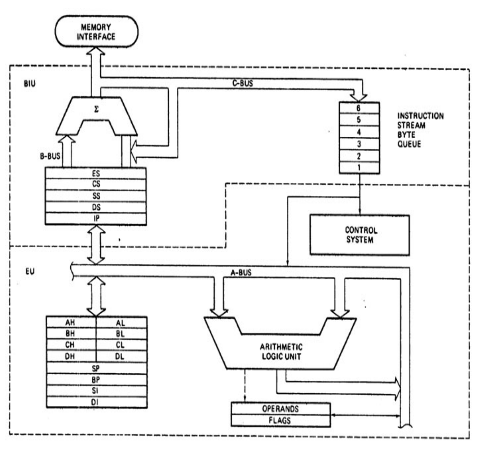
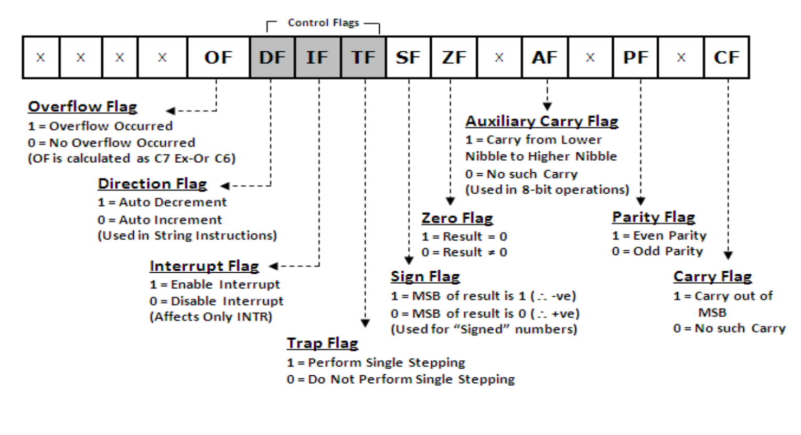
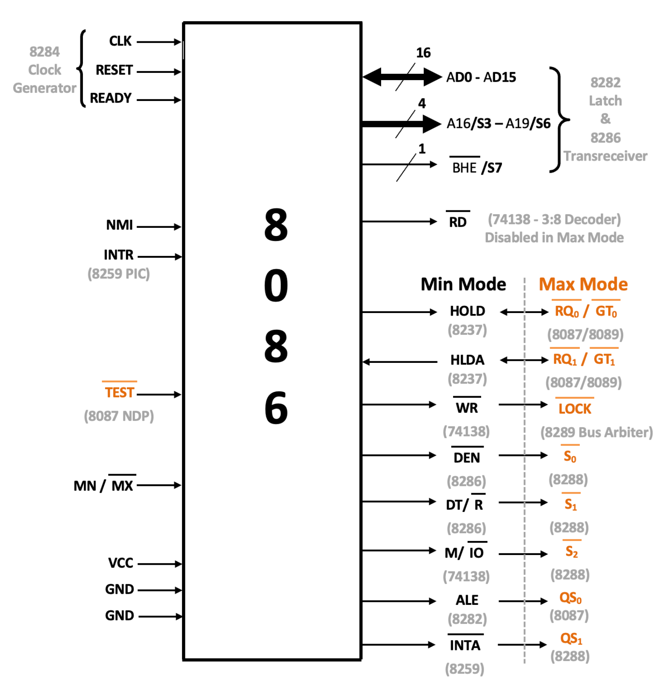

# RUN: Microprocessor 8086 Theory (short)

Nov 17, 2026 · @shahan

The 8086 as theory only (no programs, as confirmed), in half the length of the full doc, built on what you know from the 8085.

## How this run works

Read it after the 8085 doc: the 8086 is explained by what changed, and every new term is defined where it appears. Guess each PYQ's answer first, and remember the bold line. About 45 minutes.

| What the paper likes | Asked in |
| --- | --- |
| 8086 vs 8085 | Sessional-2 2021, 2025; Endsems 2022, 2023, 2024; 2022 third minor |
| Architecture (block diagram) | Endsems 2023, 2025 |
| Addressing modes | Endsems 2023, 2024 |
| Flags | Endsem 2024 |
| LOOP and MOVSB/MOVSW, mixed with 8085 instructions | Endsems 2022 to 2025 |
| Software interrupts and assembly with C | Endsems 2022, 2024, 2025 |

The figures come from Bharat Acharya's 8086 notes (`Microprocessor/Notes/Bharat Acharya 8086 complete (endsem).pdf`).

## Stop 1: From 8085 to 8086

The 8086 (Intel, 1978) is a **16-bit** processor: its registers, ALU and data bus handle a **word** (2 bytes) at a time. Three ideas define it, and the rest of this doc is those ideas in detail:

1. **Bigger memory through segmentation.** 20 address lines reach 1 MB (the 8085 reached 64 KB). The registers are still 16 bits, so each address is built from two 16-bit numbers (Stop 3).
2. **Two units working in parallel:** the **BIU** handles the buses and the **EU** executes instructions (Stop 2).
3. **Pipelining:** while the EU executes one instruction, the BIU already fetches the next bytes into a 6-byte **queue**. Fetching and executing overlap, like an assembly line.

```latex
2^{20} = 1\,048\,576 \text{ bytes} = 1 \text{ MB}, \quad \text{addresses } 00000_H \text{ to } FFFFF_H
```

It also adds hardware **multiply and divide**, **string instructions** that copy or search whole blocks of memory, and two operating modes (Stop 5).

## Stop 2: Architecture: BIU, EU and pipelining

The 8086 is split into two halves that work **at the same time**. Think of a restaurant: the BIU is the waiter who fetches orders and carries plates, and the EU is the chef who cooks. In Figure 1, the top box is the BIU and the bottom one is the EU.

**Figure 1: 8086 architecture** (Bharat Acharya's notes). The top dashed box is the BIU, the bottom one the EU.



**BIU (Bus Interface Unit): talks to memory and I/O.**

- **Segment registers CS, DS, SS, ES:** where the code, data, stack and extra segments start (Stop 3).
- **IP (Instruction Pointer):** the offset of the next instruction, the 8086's version of the PC.
- **Address adder:** builds the 20-bit address from a segment and an offset.
- **6-byte instruction queue:** prefetched instruction bytes, first in first out.

**EU (Execution Unit): decodes and executes.**

- **AX, BX, CX, DX:** 16-bit general registers, each split into two 8-bit halves (AX = AH + AL).
- **SP, BP, SI, DI:** 16-bit pointer and index registers that hold offsets.
- **16-bit ALU**, the **flag register** (Stop 4) and the **decoder**, which takes the next byte from the queue.

| Register | Special job |
| --- | --- |
| AX, accumulator | MUL/DIV results; IN/OUT data |
| BX, base | Holds a memory offset: `MOV AL, [BX]` |
| CX, count | Counter for `LOOP` and `REP` |
| DX, data | Port number in `IN AL, DX`; high word in MUL/DIV |
| SP / BP | Top of the stack / data inside the stack |
| SI / DI | Source / destination offsets for string instructions |

**Pipelining, step by step.** The 8085 fetches, then executes, then fetches, so the bus sits idle while it computes. On the 8086:

1. Whenever 2 or more queue bytes are free, the BIU fetches the next bytes on its own.
2. When the EU finishes an instruction, the next one is usually already waiting in the queue.
3. On a **jump or call**, the prefetched bytes are useless, so the queue is **flushed** (emptied) and refilled. That's pipelining's one cost.

> **PYQ, Endsem 2023 Q1(a); Endsem 2025 Q1(b), 4.5 marks each.** Draw and explain the architecture of the 8086.

**Answer:** Draw Figure 1. Explain that the 8086 is divided into the BIU and EU working in parallel, list each one's parts and jobs as above, then explain the queue: the BIU prefetches while the EU executes, and the queue is flushed on a jump.

**BIU (segment registers, IP, address adder, 6-byte queue) fetches and addresses; EU (AX to DX, SP/BP/SI/DI, ALU, flags, decoder) executes; their overlap through the queue is pipelining.**

## Stop 3: Segmentation and memory banks

**The problem:** 1 MB needs 20-bit addresses, but every register is 16 bits, which only reaches 64 KB.

**The fix, segmentation:** memory is used in blocks called **segments**, each up to 64 KB. An address is written `segment:offset`. The **segment** value says where the block starts, and the **offset** (also called the **effective address**, EA) says how far in. The BIU combines them into the real 20-bit **physical address**; multiplying by 10H just appends a hex 0:

```latex
\begin{aligned}
\text{Physical address} &= \text{Segment} \times 10_H + \text{Offset} \\
\text{CS} = 4321_H,\ \text{IP} = 1000_H &: \; 43210_H + 1000_H = 44210_H
\end{aligned}
```

| Segment | Holds | Default offset from |
| --- | --- | --- |
| CS, code | The program | IP |
| SS, stack | The stack | SP, BP |
| DS, data | Variables | BX, SI, DI, or a direct address |
| ES, extra | A second data area, the string destination | DI in string instructions |

**Why it helps:** 16-bit registers reach 1 MB; a program can be loaded anywhere just by changing its segment register (**relocation**); and code, data and stack stay in separate areas.

**Memory banks.** To read a 16-bit word in one go, the 1 MB is split into two 512 KB **banks**. The **even bank** holds even addresses on D7 to D0 and is picked by **A0 = 0**. The **odd bank** holds odd addresses on D15 to D8 and is picked by **BHE̅ = 0** (Bus High Enable). Both low together moves a whole word. A word at an even address takes **1 bus cycle**; at an odd address it takes **2**, so words are best kept at even addresses.

## Stop 4: The flag register

The 8086 flag register is 16 bits with 9 flags used (Figure 2). **6 status flags** report on the last result, like the 8085's five plus one new one. **3 control flags** are set by the programmer to change how the CPU behaves.

| Bit | 11 | 10 | 9 | 8 | 7 | 6 | 4 | 2 | 0 |
| --- | --- | --- | --- | --- | --- | --- | --- | --- | --- |
| Flag | **OF** | **DF** | **IF** | **TF** | **SF** | **ZF** | **AF** | **PF** | **CF** |

**Figure 2: the 8086 flag register** (Bharat Acharya's notes).



| Status flag | Set to 1 when |
| --- | --- |
| **CF**, carry | An unsigned result carries out of the top bit, or a subtract borrows |
| **PF**, parity | The low 8 bits of the result have an even number of 1s |
| **AF**, auxiliary carry | A carry goes from bit 3 to bit 4 (for BCD) |
| **ZF**, zero | The result is zero |
| **SF**, sign | The top bit of the result is 1 (negative) |
| **OF**, overflow | A **signed** result is too big for its size, so its sign comes out wrong |

**OF vs CF:** CF watches *unsigned* numbers going past the top. OF watches *signed* numbers leaving their range (−128 to +127 for a byte). For example, 127 + 1 = 128 doesn't fit a signed byte and reads as −128, so OF = 1.

| Control flag | When set to 1 | Instructions |
| --- | --- | --- |
| **TF**, trap | The CPU stops after every instruction (single-step, for debuggers) | Through `PUSHF` / `POPF` |
| **IF**, interrupt enable | Interrupts on the INTR pin are accepted | `STI` sets, `CLI` clears |
| **DF**, direction | String instructions step **downward** | `STD` sets, `CLD` clears |

> **PYQ, Endsem 2024 Q2(a), 4.5 marks.** Explain the flags of the 8086 with their significance and examples.

**Answer:** Give the layout and both tables, then an example of signed overflow:

```
MOV AL, 7FH     ; +127
ADD AL, 01H     ; AL = 80H
```

| CF | PF | AF | ZF | SF | OF |
| --- | --- | --- | --- | --- | --- |
| 0 | 0 (one 1) | 1 (F + 1 carries from bit 3) | 0 | 1 (bit 7 = 1) | **1** (+128 doesn't fit; it reads as −128) |

For the control flags: `CLD` before a string copy makes it count upward, and `CLI` blocks interrupts during a critical section.

**6 status flags (CF, PF, AF, ZF, SF, OF) record the result; 3 control flags (TF single step, IF interrupt enable, DF string direction) steer the CPU.**

## Stop 5: Pins, minimum mode and maximum mode

The 8086 is also a 40-pin chip, with a trick: **8 pins change meaning** depending on the **MN/MX̅** pin (Figure 3).

**Figure 3: 8086 signals by group** (Bharat Acharya's notes). The right side shows the minimum and maximum mode meanings of pins 24 to 31.



**Pins common to both modes:**

| Pins | Meaning |
| --- | --- |
| AD15 to AD0 | Low 16 address bits first, then 16 data bits. Split using ALE and latches, as on the 8085. |
| A19/S6 to A16/S3 | Top 4 address bits first, then **status**. S4 and S3 tell which segment is in use. |
| BHE̅/S7 | Picks the odd memory bank (Stop 3) |
| READY, RESET, CLK | From the 8284 clock chip. RESET starts the program at FFFF0H. |
| NMI, INTR | Non-maskable and maskable interrupt inputs |
| TEST̅ | The `WAIT` instruction pauses until it goes low (used with the 8087) |
| MN/MX̅ | 1 = minimum mode, 0 = maximum mode |

**Minimum mode** is a **single-processor** system: the 8086 makes its own bus control signals (M/IO̅, WR̅, ALE, INTA̅, DT/R̅ and DEN̅ for the data buffers, HOLD/HLDA for DMA). Careful: **M/IO̅ = 1 means memory**, the reverse of the 8085's IO/M̅.

**Maximum mode** is a **multiprocessor** system, with an 8087 maths coprocessor sharing the bus. A separate **8288 bus controller** makes the control signals, and the 8 pins are reused:

- **S2̅, S1̅, S0̅:** a status code telling the 8288 what kind of cycle this is.
- **RQ̅/GT̅:** other processors request and are granted the bus.
- **LOCK̅:** keeps others off the bus during one instruction.
- **QS1, QS0:** queue status, so the 8087 can follow the instruction stream.

|  | Minimum mode | Maximum mode |
| --- | --- | --- |
| MN/MX̅ | 1 | 0 |
| System | One processor | 8086 + coprocessors (8087, 8089) |
| Control signals made by | The 8086 itself | The 8288 bus controller |
| Bus sharing | HOLD / HLDA | RQ̅/GT̅, LOCK̅ |
| Hardware | Simpler, cheaper | More chips, more powerful |

## Stop 6: Addressing modes

An **addressing mode** is how an instruction says where its operand is. The 8085 had 5; the 8086 has many more, because a memory offset can be **built from parts**:

```latex
\text{EA} = [\,BX \text{ or } BP\,] + [\,SI \text{ or } DI\,] + \text{displacement}, \qquad \text{PA} = \text{Segment} \times 10_H + \text{EA}
```

Each memory mode is just a different choice of parts. Square brackets mean "the memory at this offset". The segment is DS, except **SS whenever BP is used** (BP is meant for stack data).

> **PYQ, Endsem 2023 Q5(b); Endsem 2024 Q5(c), 4.5 marks each.** Discuss the addressing modes of the 8086 with examples.

**Answer:** Take DS = 2000H, SS = 3000H, BX = 0100H, BP = 0200H, SI = 0050H.

| Mode | Example | Physical address |
| --- | --- | --- |
| **Immediate** | `MOV AX, 1234H` | None, the data is in the instruction |
| **Register** | `MOV AX, BX` | None |
| **Direct** | `MOV AX, [5000H]` | 20000H + 5000H = 25000H |
| **Register indirect** | `MOV AX, [BX]` | 20000H + 0100H = 20100H |
| **Based** | `MOV AX, [BX + 08H]` | 20108H |
|  | `MOV AX, [BP + 08H]` (uses SS) | 30000H + 0208H = 30208H |
| **Indexed** | `MOV AX, [SI + 08H]` | 20058H |
| **Based indexed** | `MOV AX, [BX + SI]` | 20150H |
| **Based indexed + displacement** | `MOV AX, [BX + SI + 08H]` | 20158H |
| **String** | `MOVSB` (source DS:SI, destination ES:DI) | Source 20050H |
| **I/O port** | `IN AL, 80H` or `IN AL, DX` | Port space, not memory |
| **Implied** | `CLC`, `STD` | None |

For jumps and calls there are four **branch modes**: within the same code segment ("intrasegment"), either relative (`JMP NEXT`) or through a register (`JMP BX`); and to another segment ("intersegment"), either with CS and IP written in the instruction (`JMP 5000H:0100H`) or read from memory.

**Immediate, register, direct, register indirect, based, indexed, based indexed (with or without displacement), string, I/O and implied; PA = segment × 10H + EA, with BP defaulting to SS.**

## Stop 7: The instruction set, LOOP and string instructions

The 8086 has the same instruction families as the 8085, but each works on bytes **or** words with any addressing mode. The syntax is `INSTRUCTION destination, source`.

| Group | Main instructions |
| --- | --- |
| Data transfer | `MOV`, `PUSH`, `POP`, `XCHG`, `IN`, `OUT`, `LEA` (loads an address, not data) |
| Arithmetic | `ADD`, `ADC`, `SUB`, `SBB`, `INC`, `DEC`, `CMP`, `MUL`, `IMUL`, `DIV`, `IDIV`, `DAA` (`I` = signed) |
| Logic, shift, rotate | `AND`, `OR`, `XOR`, `NOT`, `TEST`, `SHL`, `SHR`, `SAR`, `ROL`, `ROR`, `RCL`, `RCR` |
| Branch | `JMP`, `JE`, `JNE`, `JC`, `JG`, `JL`, `CALL`, `RET`, `LOOP`, `INT`, `IRET` |
| String | `MOVSB`/`MOVSW`, `CMPSB`, `SCASB`, `LODSB`, `STOSB`, with `REP` prefixes |
| Processor control | `CLC`, `STC`, `CLD`, `STD`, `CLI`, `STI`, `HLT`, `WAIT`, `NOP` |

**MUL and DIV**, which the 8085 never had: `MUL BL` gives AX = AL × BL. `MUL BX` gives a 32-bit result in DX:AX. `DIV BL` divides AX by BL, with the quotient in AL and the remainder in AH.

**LOOP** is a counted loop in one instruction: CX goes down by 1, and it jumps back if CX isn't 0. It replaces the 8085's `DCR C` + `JNZ` pair.

**String instructions** work on blocks of memory with fixed registers: source at **DS:SI**, destination at **ES:DI**. `MOVSB` copies one byte and steps SI and DI by 1 (up if DF = 0, down if DF = 1). `MOVSW` copies a word and steps by 2. The **REP** prefix repeats it CX times, so a whole block copy is one line.

> **PYQ, four endsems, 4.5 marks each.** Explain these instructions of the 8085/8086 after writing their syntax, with an example of each. 2022: STAX, SHLD, LOOP, MOVSB. 2023: LHLD, DAD, LOOP, MOVSB. 2024: SHLD, XCHG, LOOP, MOVSW. 2025: XTHL, SPHL, LOOP, MOVSB.

**Answer:** Pick the four for your paper.

| Instruction | Syntax | Operation | Example |
| --- | --- | --- | --- |
| STAX (8085) | `STAX rp` (B or D) | \[rp\] ← A | `LXI B, 2050H`, `STAX B`: A goes to 2050H |
| SHLD (8085) | `SHLD addr16` | \[addr\] ← L, \[addr + 1\] ← H | HL = 1234H, `SHLD 2060H`: 2060H = 34H, 2061H = 12H |
| LHLD (8085) | `LHLD addr16` | L ← \[addr\], H ← \[addr + 1\] | 2050H = 34H, 2051H = 12H, `LHLD 2050H`: HL = 1234H |
| DAD (8085) | `DAD rp` | HL ← HL + rp; only CY changes | HL = 1234H, DE = 0F0FH, `DAD D`: HL = 2143H |
| XCHG | 8085: `XCHG`; 8086: `XCHG dest, src` | 8085 swaps HL and DE; 8086 swaps any two operands (not two memory ones) | `XCHG AX, BX` |
| XTHL (8085) | `XTHL` | HL swaps with the two bytes on top of the stack; SP unchanged | HL = 1234H, stack top 200AH: HL becomes 200AH |
| SPHL (8085) | `SPHL` | SP ← HL | `LXI H, 3000H`, `SPHL`: the stack now starts at 3000H |
| LOOP (8086) | `LOOP label` | CX ← CX − 1; jump if CX ≠ 0; no flags | Below |
| MOVSB / MOVSW (8086) | `MOVSB`, `REP MOVSB` | ES:\[DI\] ← DS:\[SI\]; SI, DI step by 1 (byte) or 2 (word) | Below |

```
        MOV CX, 0005H   ; LOOP: repeat 5 times
        MOV AX, 0000H
AGAIN:  ADD AX, 0002H
        LOOP AGAIN      ; ends with AX = 000AH, CX = 0

        CLD             ; MOVSB: count upward
        MOV SI, 0100H   ; source DS:0100H
        MOV DI, 0200H   ; destination ES:0200H
        MOV CX, 0005H
        REP MOVSB       ; copies 5 bytes (REP MOVSW would copy 5 words)
```

**Write syntax + operation + one example for each; LOOP = decrement CX and jump if not zero; MOVSB/MOVSW = copy a byte/word from DS:SI to ES:DI and step both.**

## Stop 8: Assemblers, interrupts and assembly with C

**MASM** (Microsoft) and **TASM** (Borland) are 8086 assemblers. The flow is `PROG.ASM` → assemble → `PROG.OBJ` → link → `PROG.EXE`. A source file also has **directives**, notes to the assembler that make no machine code: `SEGMENT`/`ENDS` (start and end a segment), `ASSUME` (which register holds which segment), `DB`/`DW` (define bytes or words of data), `EQU` (name a constant), `PROC`/`ENDP` (a procedure), and `END`.

**Interrupts.** The 8086 has **256 interrupt types** (0 to 255) from three sources: hardware (NMI, and INTR when IF = 1), software (the `INT n` instruction), and exceptions raised by the CPU (type 0 divide error, type 1 single step, type 3 breakpoint, type 4 overflow).

The **Interrupt Vector Table (IVT)** in the first 1 KB of memory holds where each type's service routine is, 4 bytes per type (new IP, then new CS):

```latex
\text{IVT address of type } n = n \times 4, \qquad \text{INT } 21_H \to 21_H \times 4 = 84_H
```

On an interrupt, the CPU pushes the flags, clears IF and TF, pushes CS and IP (the return address), loads the new IP and CS from the IVT, and runs the routine. The routine ends with `IRET`, which pops everything back.

> **PYQ, Endsem 2022 Q5(b); 2024 Q5(b); 2025 Q5(b), 4.5 marks each.** Can assembly language be used with C? If yes, discuss how, with an example. Also discuss how software interrupts are used in programming.

**Answer, part 1: yes.** Assembly is used inside C for speed-critical code and direct hardware access, while the rest stays readable C. Two ways:

**(a) Inline assembly:** assembly written inside a C function with the `asm` keyword (16-bit compilers like Turbo C), using C variables by name.

```c
int main() {
    int a = 10, b = 20, sum;
    asm {
        mov ax, a
        add ax, b
        mov sum, ax
    }
    printf("Sum = %d", sum);   /* prints: Sum = 30 */
    return 0;
}
```

**(b) A separate assembly file**, assembled with MASM or TASM and linked with the C program. The procedure is declared `PUBLIC` in assembly and `extern` in C. C passes the arguments on the stack, and the assembly returns the result in AX.

```
_add2   PROC                ; called from C as add2(10, 20)
        PUSH BP
        MOV BP, SP
        MOV AX, [BP+4]      ; first argument
        ADD AX, [BP+6]      ; second argument
        POP BP
        RET                 ; result goes back in AX
_add2   ENDP
```

**Answer, part 2: software interrupts.** `INT n` is like a CALL through the IVT: the program only needs the type number, not the routine's address. That's how programs ask **DOS** and the **BIOS** (built-in firmware) for services. With `INT 21H`, AH picks the DOS function: 01H reads a key, 02H prints the character in DL, 09H prints the string at DS:DX (ending in `$`), and 4CH ends the program. `INT 10H` gives BIOS video services.

```
MSG     DB 'Hello$'
        MOV AH, 09H       ; DOS: display a string
        LEA DX, MSG       ; DS:DX points at it
        INT 21H           ; prints Hello
        MOV AH, 4CH       ; DOS: terminate
        INT 21H
```

**Yes, through inline asm blocks or separately assembled PUBLIC procedures linked with C; software interrupts call OS and BIOS services through the IVT, such as INT 21H with AH = 09H to print and 4CH to exit.**

## Stop 9: 8086 vs 8085, and the 8088, 68000, 8087 and 32-bit processors

> **PYQ, Endsem 2023 Q1'(b), 4.5 marks; 2022 third minor Q1, 5 marks; also Sessional-2 2021 and 2025, Endsems 2022 and 2024.** Distinguish between the 8085 and the 8086.

**Answer:**

| Basis | 8085 | 8086 |
| --- | --- | --- |
| Word size | 8-bit | 16-bit |
| Data bus | 8 lines | 16 lines |
| Address bus, memory | 16 lines, 64 KB | 20 lines, 1 MB |
| Memory organisation | Linear | Segmented (CS, DS, SS, ES) |
| Internal structure | One unit, no pipelining | BIU + EU in parallel, 6-byte queue |
| General registers | A, B, C, D, E, H, L (8-bit) | AX, BX, CX, DX (16-bit) + SP, BP, SI, DI |
| Flags | 5 | 9 (adds OF, TF, IF, DF) |
| Multiply, divide, strings | None | MUL, DIV, string instructions with REP |
| Addressing modes | 5 | 11 data + 4 branch |
| I/O ports | 256 | 65,536 |
| Interrupts | 5 hardware + RST 0 to 7 | 256 types through the IVT |
| Operating modes | One | Minimum and maximum |
| Memory/IO pin | IO/M̅ (1 = I/O) | M/IO̅ (1 = memory) |

**The 8086 is a 16-bit, pipelined, segmented processor reaching 1 MB, with 9 flags, multiply/divide, string instructions and 256 interrupt types; the 8085 is 8-bit, not pipelined, 64 KB, with 5 flags.**

**The 8088** is an 8086 inside (same registers and instructions) with an **8-bit external data bus**. Its queue is 4 bytes, a word takes 2 bus cycles (so it's slower), and it uses IO/M̅ like the 8085. Its point was cheap 8-bit support chips, which is why the original IBM PC (1981) used it.

**The Motorola 68000 (1979)**, the 8086's rival, has **32-bit** registers (8 data, 8 address), a 16-bit data bus, a **24-bit address bus (16 MB)** with **linear** memory (no segments), and memory-mapped I/O only. It powered the early Apple Macintosh.

**The 8087 maths coprocessor.** A **coprocessor** is a second chip that helps with one kind of job. The 8087 does **floating-point** maths (numbers like 3.14) in hardware, about 100 times faster than software: add, multiply, divide, square root, trig and log. It needs the 8086 in **maximum mode**. It watches the instruction stream using QS1 and QS0, runs instructions marked with the **ESC** prefix while the 8086 carries on, and the 8086 waits for its result with `WAIT` (its TEST̅ pin is wired to the 8087's BUSY pin). It has eight 80-bit registers arranged as a stack.

**32-bit processors:**

| Processor | Year | What it added |
| --- | --- | --- |
| 80386 | 1985 | 32-bit registers and buses (**4 GB**), **protected mode** with **paging** |
| 80486 | 1989 | The 8087 built in, an 8 KB on-chip **cache**, a 5-stage pipeline |
| Pentium | 1993 | **Superscalar** (two pipelines, 2 instructions per clock), 64-bit data bus, branch prediction |

**Protected mode** stops programs overwriting each other's memory. **Paging** splits memory into 4 KB pages that can move to disk and back (**virtual memory**). A **cache** is a small, fast on-chip memory for recently used data. **Superscalar** means more than one instruction finishes per clock.
