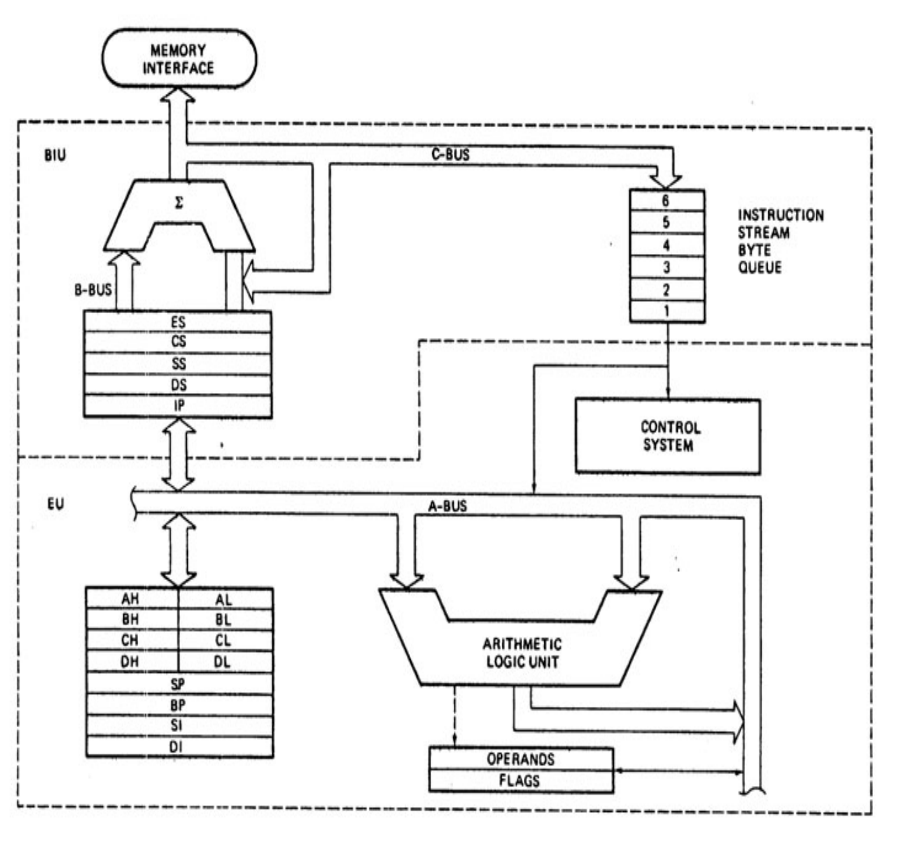
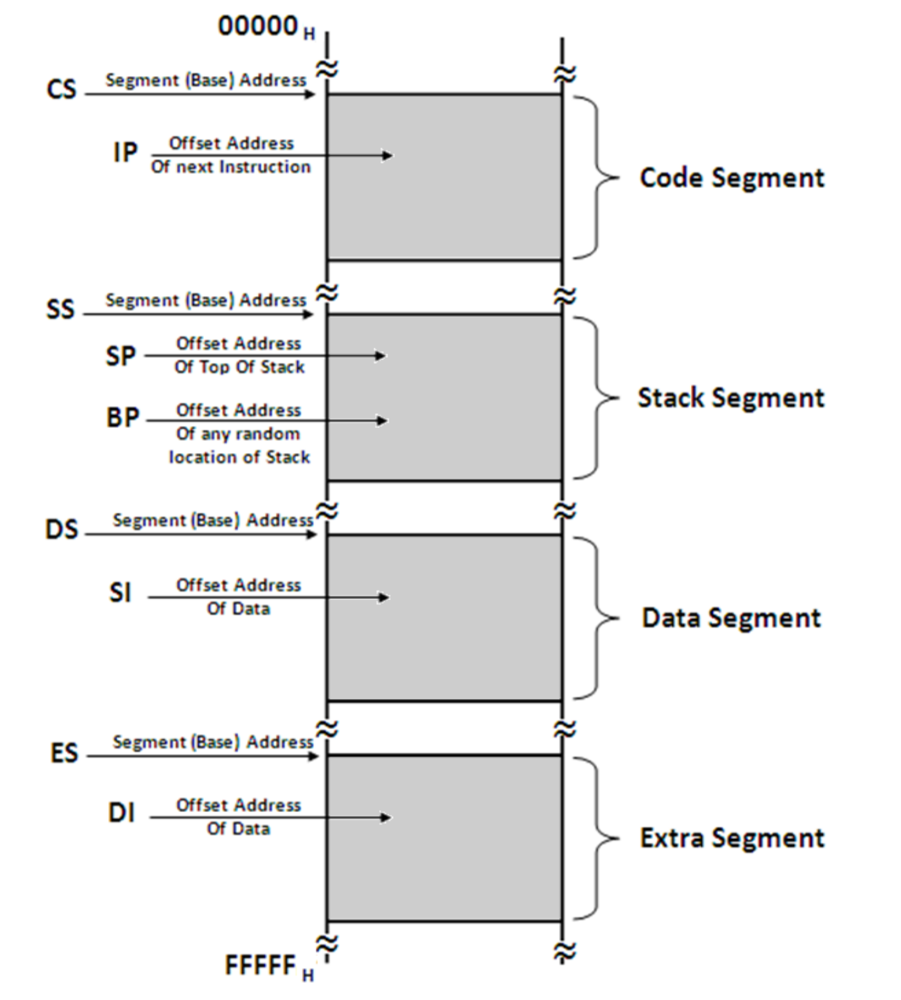
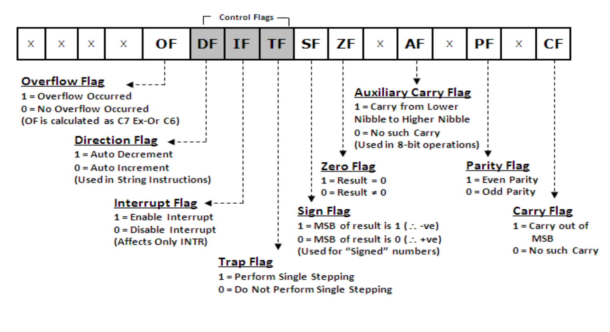
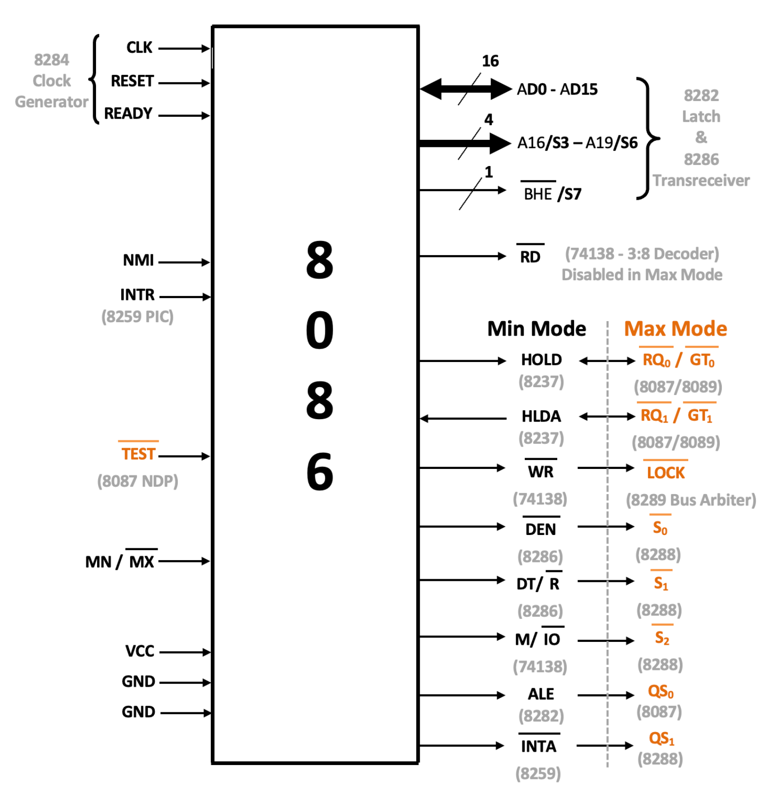

# RUN: Microprocessor 8086 Theory

Nov 16, 2026 · @shahan

The 8086 as theory only (no programs, as you confirmed), built on what you know from the 8085, with every 8086 theory PYQ from 2021 to 2025 solved where it belongs.

## How this run works

Read this last of the four Microprocessor docs, after the 8085 ones. It explains the 8086 by what changed from the 8085, so the 8085 vocabulary (accumulator, flags, ALE, machine cycle) is assumed. Every new term is explained where it first appears. Allow about 2 hours.

**What the paper likes:**

| Topic | Asked in |
| --- | --- |
| 8086 vs 8085 | Sessional-2 2021, 2025; Endsem 2022, 2023, 2024; 2022 third minor |
| Block diagram (architecture) of 8086 | Endsem 2023, 2025 |
| Addressing modes of 8086 | Endsem 2023, 2024 |
| Flags of 8086 | Endsem 2024 |
| Explain LOOP and MOVSB/MOVSW (with 8085 instructions) | Endsem 2022, 2023, 2024, 2025 |
| Software interrupts and assembly with C | Endsem 2022, 2024, 2025 |

**Left out on purpose:** the 8086 *programs* (Endsem Q5(a) every year, the 2025 Q5(c) BCD conversion and the 2022 third-minor Q2), because the scope you confirmed is 8086 theory only.

**Videos and notes:** the 8086 playlist on the [Bharat Acharya Education](https://www.youtube.com/@BharatAcharyaEducation/playlists) channel. His 8086 book is in `Microprocessor/Notes/Bharat Acharya 8086 complete (endsem).pdf`, and the figures here come from it.

## Stop 1: From 8085 to 8086

The 8086 (Intel, 1978) is a **16-bit** processor. Its registers, ALU and data bus are 16 bits wide, so it handles a **word** (2 bytes) in one go, where the 8085 handled one byte. Three design ideas define it, and every later stop is one of them in detail:

1. **Bigger memory through segmentation.** It has 20 address lines, so it can reach 2²⁰ = 1,048,576 bytes = **1 MB** (the 8085 reached 64 KB). But its registers are only 16 bits, so it builds each 20-bit address from two 16-bit numbers: a segment and an offset (Stop 3).
2. **Two units working in parallel.** The **BIU** (Bus Interface Unit) handles everything to do with the buses. The **EU** (Execution Unit) executes instructions (Stop 2).
3. **Pipelining.** While the EU executes one instruction, the BIU already fetches the next bytes into a 6-byte **queue**. Fetching and executing overlap, like an assembly line, so the processor rarely waits for memory.

It also adds hardware **multiply and divide**, **string instructions** that copy or search whole blocks of memory, and two operating modes for small or multiprocessor systems (Stop 5).

```latex
2^{20} = 1\,048\,576 \text{ bytes} = 1 \text{ MB}, \quad \text{addresses } 00000_H \text{ to } FFFFF_H
```

The side-by-side 8086 vs 8085 answer, a favourite question, is in Stop 9, once all the pieces are known.

## Stop 2: Architecture: BIU, EU and pipelining

The 8086 is split into two halves that work **at the same time**. Think of a restaurant: the BIU is the waiter who fetches orders and brings plates, and the EU is the chef who cooks. The chef never walks to the tables, and the waiter never cooks.

**Figure 1: 8086 architecture** (Bharat Acharya's notes, page 7). The top dashed box is the BIU, and the bottom one is the EU.



**BIU (Bus Interface Unit): talks to memory and I/O**

- **Segment registers CS, DS, SS, ES** (16-bit each): the starting points of the code, data, stack and extra segments (Stop 3).
- **IP (Instruction Pointer), 16-bit:** the offset of the next instruction inside the code segment. It's the 8086's version of the PC.
- **Address adder (Σ):** builds the 20-bit physical address from a segment and an offset.
- **6-byte instruction queue:** a small first-in, first-out buffer of prefetched instruction bytes.
- **Bus control logic:** drives the address, data and control buses.

Its jobs: fetch instruction bytes into the queue, read and write the operands the EU asks for, and compute addresses.

**EU (Execution Unit): decodes and executes**

- **General-purpose registers AX, BX, CX, DX** (16-bit). Each splits into two 8-bit halves, for example AX = AH (high) + AL (low).
- **Pointer and index registers SP, BP, SI, DI** (16-bit), which hold offsets.
- **ALU, 16-bit:** arithmetic and logic on bytes or words.
- **Flag register:** 9 flags (Stop 4).
- **Control system (decoder):** takes the next byte from the queue, decodes it and runs it.

| Register | Name | Special job |
| --- | --- | --- |
| AX | Accumulator | MUL/DIV results; IN/OUT data |
| BX | Base | Holds a memory offset, as in `MOV AL, [BX]` |
| CX | Count | Loop counter for `LOOP` and `REP`; CL is the shift count |
| DX | Data | Port address for `IN AL, DX`; the high word in MUL/DIV |
| SP | Stack pointer | Top of the stack (with SS) |
| BP | Base pointer | Data inside the stack (with SS) |
| SI | Source index | Source offset for string instructions (with DS) |
| DI | Destination index | Destination offset for string instructions (with ES) |

**Pipelining, step by step.** On the 8085, fetch then execute then fetch then execute happen strictly in turn, so the bus idles while the CPU computes. On the 8086:

1. Whenever at least 2 bytes of the queue are empty and the bus is free, the BIU fetches the next bytes on its own.
2. When the EU finishes an instruction, the next one is usually already waiting in the queue, so there's no fetch delay.
3. If the instruction is a **jump or call**, the prefetched bytes are useless. The queue is **flushed** (emptied) and refilled from the new address. That's the one cost of pipelining.

This two-stage overlap of fetch and execute is why the 8086 is much faster than the 8085 at similar clock speeds.

> **PYQ, Endsem 2023 Q1(a), 4.5 marks; Endsem 2025 Q1(b), 4.5 marks.** Draw and explain the functional block diagram (architecture) of the 8086 microprocessor.

**Answer:** Draw Figure 1: two dashed boxes, BIU above and EU below, joined by the queue and the internal bus. Then explain:

1. **Division of work:** the 8086 is divided into the BIU and the EU, which operate in parallel. This gives **pipelining**: the BIU fetches the next instructions while the EU executes the current one.
2. **BIU:** it contains the four segment registers (CS, DS, SS, ES), the instruction pointer IP, the address adder that forms the 20-bit physical address (segment × 10H + offset), and the 6-byte instruction queue. It fetches instructions, reads and writes operands, and generates addresses and bus signals.
3. **EU:** it contains the general-purpose registers AX, BX, CX, DX (each usable as two 8-bit halves), the pointer and index registers SP, BP, SI, DI, the 16-bit ALU, the flag register (9 flags), and the control system that decodes instructions taken from the queue. It executes instructions and tells the BIU when it needs data from memory.
4. **Queue operation:** when 2 or more bytes of the queue are free, the BIU prefetches. On a jump or call the queue is flushed.

**Answer: BIU (segment registers, IP, address adder, 6-byte queue, bus control) fetches and addresses; EU (AX-DX, SP/BP/SI/DI, ALU, flags, decoder) executes; their overlap through the queue is pipelining.**

## Stop 3: Segmentation, physical address and memory banking

**The problem.** The memory is 1 MB, which needs 20-bit addresses, but every register is 16 bits. One register can only point anywhere within 64 KB.

**The solution: segmentation.** Memory is used in blocks called **segments**, each up to 64 KB. Any address is given as two 16-bit parts, written `segment:offset`:

- the **segment** value (in CS, DS, SS or ES) says where the block starts. Its start address is segment × 16, so a segment always starts at an address ending in 0H (a 16-byte "paragraph" boundary);
- the **offset** (also called the **effective address**, EA) says how far into the block.

The BIU's adder combines them into the real 20-bit **physical address**. Multiplying by 10H is just shifting left one hex digit (appending a 0):

```latex
\begin{aligned}
\text{Physical address} &= \text{Segment} \times 10_H + \text{Offset} \\
\text{CS} = 4321_H,\ \text{IP} = 1000_H &: \; 43210_H + 1000_H = 44210_H \\
\text{DS} = 2000_H,\ \text{offset} = 0050_H &: \; 20000_H + 0050_H = 20050_H
\end{aligned}
```

**Figure 2: memory segmentation** (Bharat Acharya's notes, page 13). Each segment register marks the base of its segment, and an offset register points inside it.



**The four segments and their default offset registers:**

| Segment | Holds | Default offset from |
| --- | --- | --- |
| CS, code | The program | IP |
| SS, stack | The stack | SP, and BP |
| DS, data | Variables | BX, SI, DI, or a direct address |
| ES, extra | A second data area, the string destination | DI in string instructions |

**Why segmentation is useful:**

- 16-bit registers can reach a 1 MB memory.
- **Relocation:** a program uses only offsets, so it can be loaded anywhere just by changing the segment register.
- Code, data and stack are kept in separate areas, and four of them are active at once.
- Segments may overlap, or sit apart, as the program needs.

**Memory banking: reading a 16-bit word in one go.** The data bus is 16 bits, but memory is addressed in bytes. So the 1 MB is split into two **banks** of 512 KB:

- the **even (low) bank** holds the even addresses and connects to D7 to D0. It's selected by **A0 = 0**.
- the **odd (high) bank** holds the odd addresses and connects to D15 to D8. It's selected by **BHE̅ = 0** (Bus High Enable, active low).

| BHE̅ | A0 | What is transferred |
| --- | --- | --- |
| 0 | 0 | A whole word, from both banks (word at an even address) |
| 0 | 1 | One byte, from the odd bank (D15 to D8) |
| 1 | 0 | One byte, from the even bank (D7 to D0) |
| 1 | 1 | Nothing |

A word at an **even** address (an **aligned** word) moves in **1 bus cycle**. A word at an **odd** address straddles the banks the wrong way round and needs **2 bus cycles**, so good programs keep words at even addresses.

## Stop 4: The flag register

The 8086 flag register is 16 bits wide, and 9 of the bits are used. They come in two kinds:

- **6 status flags** report on the last result, exactly like the 8085's five, plus one new one (OF).
- **3 control flags** are set by the *programmer* to change how the CPU behaves.

| Bit | 15-12 | 11 | 10 | 9 | 8 | 7 | 6 | 5 | 4 | 3 | 2 | 1 | 0 |
| --- | --- | --- | --- | --- | --- | --- | --- | --- | --- | --- | --- | --- | --- |
| Flag | x | **OF** | **DF** | **IF** | **TF** | **SF** | **ZF** | x | **AF** | x | **PF** | x | **CF** |

**Figure 3: the 8086 flag register** (Bharat Acharya's notes, page 11).



**Status flags:**

| Flag | Set to 1 when |
| --- | --- |
| **CF**, carry | An unsigned result carries out of the top bit (bit 7 for a byte, bit 15 for a word), or a subtraction borrows |
| **PF**, parity | The **low 8 bits** of the result have an even number of 1s |
| **AF**, auxiliary carry | A carry goes from bit 3 to bit 4 (used for BCD adjust instructions such as DAA) |
| **ZF**, zero | The result is zero |
| **SF**, sign | The top bit of the result is 1 (negative in signed form) |
| **OF**, overflow | A **signed** result is too big for its size, so the sign comes out wrong |

**OF vs CF, the new idea.** CF is about *unsigned* numbers going past the top. OF is about *signed* numbers going past their range: −128 to +127 for a byte, −32,768 to +32,767 for a word. For example, 127 + 1 should be 128, but in a signed byte that wraps to −128. OF = 1 flags that the answer's sign is wrong.

**Control flags:**

| Flag | When set to 1 | Instructions |
| --- | --- | --- |
| **TF**, trap | The CPU interrupts itself after **every** instruction (single-step mode, used by debuggers) | Set through the stack: `PUSHF`, change the bit, `POPF` |
| **IF**, interrupt enable | Maskable interrupts on the INTR pin are accepted | `STI` sets, `CLI` clears |
| **DF**, direction | String instructions move **downward** (SI, DI decrease). DF = 0 means upward. | `STD` sets, `CLD` clears |

> **PYQ, Endsem 2024 Q2(a), 4.5 marks.** Explain the various flags available in the 8086 microprocessor with their significance, with suitable examples.

**Answer:** The 8086 has a 16-bit flag register with 9 flags: 6 status flags (CF, PF, AF, ZF, SF, OF) that record the result of arithmetic and logic operations, and 3 control flags (TF, IF, DF) that control the processor. Give the bit layout and both tables above, then these examples.

**Example 1: signed overflow.**

```
MOV AL, 7FH     ; AL = 0111 1111 = +127
ADD AL, 01H     ; AL = 1000 0000 = 80H
```

| CF | PF | AF | ZF | SF | OF |
| --- | --- | --- | --- | --- | --- |
| 0 (no unsigned carry out of bit 7) | 0 (one 1, odd) | 1 (F + 1 carries from bit 3) | 0 | 1 (bit 7 = 1) | **1** (+127 + 1 = +128 doesn't fit; it reads as −128) |

**Example 2: a zero with a carry.**

```
MOV AX, FFFFH   ; AX = -1 in signed form
ADD AX, 0001H   ; AX = 0000H
```

| CF | PF | AF | ZF | SF | OF |
| --- | --- | --- | --- | --- | --- |
| **1** (carry out of bit 15) | 1 (low byte 00H: zero 1s, even) | 1 | **1** | 0 | 0 (−1 + 1 = 0 is correct in signed form) |

**Example 3: control flags in use.** `CLD` before a string copy makes SI and DI count upward. `STI` lets INTR interrupts in, and `CLI` blocks them during a critical section.

**Answer: 6 status flags (CF carry/borrow, PF even parity of the low byte, AF carry from bit 3, ZF zero, SF sign, OF signed overflow) and 3 control flags (TF single step, IF interrupt enable, DF string direction).**

## Stop 5: Pins, minimum mode and maximum mode

The 8086 is also a 40-pin chip, but it has more to say than the 8085. Its trick is that **8 pins change meaning** depending on the mode, set by the MN/MX̅ pin.

**Figure 4: 8086 signals by group** (Bharat Acharya's notes, "8086 Pin Diagram"). The right side shows the minimum-mode and maximum-mode meanings of pins 24 to 31, and the grey labels name the helper chip each pin talks to.



**Pins common to both modes:**

| Pins | Meaning |
| --- | --- |
| AD15 to AD0 | Multiplexed: the low 16 address bits in T1, then 16 data bits. Latched with ALE into 8282 latches, as on the 8085. |
| A19/S6 to A16/S3 | The top 4 address bits in T1, then **status**. S4 and S3 tell which segment is in use (00 = ES, 01 = SS, 10 = CS or none, 11 = DS). S5 shows IF, and S6 is always 0. |
| BHE̅/S7 | Bus High Enable: selects the odd bank (Stop 3) |
| RD̅ | Read strobe |
| READY, RESET, CLK | From the 8284 clock generator. READY low adds wait states. RESET starts the program at FFFF0H (CS = FFFFH, IP = 0000H). |
| NMI, INTR | Non-maskable and maskable interrupt inputs |
| TEST̅ | The `WAIT` instruction pauses until TEST̅ goes low. It's used to wait for the 8087 coprocessor. |
| MN/MX̅ | 1 = minimum mode, 0 = maximum mode |
| Vcc, GND | +5 V supply and ground |

**Minimum mode** (MN/MX̅ = 1) is a **single-processor** system. The 8086 makes all the bus control signals itself:

| Pin | Meaning |
| --- | --- |
| M/IO̅ | 1 = memory, 0 = I/O. Careful: this is the **reverse** of the 8085's IO/M̅. |
| WR̅, ALE, INTA̅ | Write strobe, address latch enable, interrupt acknowledge |
| DT/R̅ | Data Transmit/Receive: sets the direction of the 8286 data transceivers (bidirectional buffers) |
| DEN̅ | Data Enable: switches the transceivers on |
| HOLD, HLDA | DMA request and grant, as on the 8085 |

**Maximum mode** (MN/MX̅ = 0) is a **multiprocessor** system, with an 8087 math coprocessor or an 8089 I/O processor sharing the bus. The control signals are generated by a separate **8288 bus controller**, and those 8 pins are reused:

| Pin | Meaning |
| --- | --- |
| S2̅, S1̅, S0̅ | Status code that tells the 8288 what kind of cycle this is. It decodes them into MRDC̅, MWTC̅, IORC̅, IOWC̅, INTA̅, ALE, DEN and DT/R̅. |
| RQ̅/GT̅0, RQ̅/GT̅1 | Request/Grant: other processors ask for the bus and are granted it (instead of HOLD/HLDA) |
| LOCK̅ | Keeps other processors off the bus during one instruction (the `LOCK` prefix) |
| QS1, QS0 | Queue Status: tells the 8087 what the 8086's queue is doing, so it can follow the instruction stream |

**Minimum vs maximum mode at a glance:**

|  | Minimum mode | Maximum mode |
| --- | --- | --- |
| MN/MX̅ | 1 (Vcc) | 0 (ground) |
| System | One processor | 8086 + coprocessors (8087, 8089) |
| Control signals made by | The 8086 itself | The 8288 bus controller, from S2̅ to S0̅ |
| Bus sharing | HOLD / HLDA | RQ̅/GT̅ lines, LOCK̅ |
| Extra pins used | M/IO̅, WR̅, ALE, DT/R̅, DEN̅, INTA̅ | QS1, QS0, S2̅ to S0̅ |
| Hardware | Simpler and cheaper | More chips, more powerful |

## Stop 6: Addressing modes

An **addressing mode** is how an instruction says where its operand is. The 8085 had 5. The 8086 has many more, because a memory offset can be **built from parts**:

```latex
\text{EA (offset)} = \underbrace{[\,BX \text{ or } BP\,]}_{\text{base}} + \underbrace{[\,SI \text{ or } DI\,]}_{\text{index}} + \underbrace{\text{displacement}}_{\text{a constant}}, \qquad \text{PA} = \text{Segment} \times 10_H + \text{EA}
```

Each memory mode is just a different choice of which parts to use. Square brackets `[ ]` mean "the memory at this offset". The segment is DS by default, but **SS whenever BP is used**, because BP is meant for data on the stack.

> **PYQ, Endsem 2023 Q5(b), 4.5 marks; Endsem 2024 Q5(c), 4.5 marks.** Discuss the various addressing modes of the 8086 microprocessor with the help of suitable examples.

**Answer:** The 8086 addressing modes fall into data modes (where an operand is) and branch modes (where a jump goes). For the physical addresses in the table, assume DS = 2000H, SS = 3000H, BX = 0100H, BP = 0200H and SI = 0050H.

**Data addressing modes:**

| # | Mode | Example | Operand is | Physical address |
| --- | --- | --- | --- | --- |
| 1 | **Immediate** | `MOV AX, 1234H` | The constant in the instruction | None (no memory) |
| 2 | **Register** | `MOV AX, BX` | In a register | None |
| 3 | **Direct** | `MOV AX, [5000H]` | At the offset written in the instruction | 20000H + 5000H = **25000H** |
| 4 | **Register indirect** | `MOV AX, [BX]` | At the offset held in BX, SI or DI | 20000H + 0100H = **20100H** |
| 5 | **Based** | `MOV AX, [BX + 08H]` | Base register + displacement | 20000H + 0108H = **20108H** |
|  |  | `MOV AX, [BP + 08H]` | Same, but BP means SS | 30000H + 0208H = **30208H** |
| 6 | **Indexed** | `MOV AX, [SI + 08H]` | Index register + displacement | 20000H + 0058H = **20058H** |
| 7 | **Based indexed** | `MOV AX, [BX + SI]` | Base + index | 20000H + 0150H = **20150H** |
| 8 | **Based indexed with displacement** | `MOV AX, [BX + SI + 08H]` | Base + index + displacement | 20000H + 0158H = **20158H** |
| 9 | **String** | `MOVSB` | Source at DS:SI, destination at ES:DI, both implied | Source = 20050H |
| 10 | **I/O port** | `IN AL, 80H` / `IN AL, DX` | A fixed port (direct) or the port number in DX (indirect, up to FFFFH) | Port space, not memory |
| 11 | **Implied** | `CLC`, `STD`, `CBW` | Built into the instruction | None |

Why so many: based and indexed modes make data structures easy. BX can hold the start of an array, SI the position inside it, and the displacement a field offset in a record, all in one instruction.

**Branch (program memory) addressing modes**, for JMP and CALL:

| Mode | Example | What happens |
| --- | --- | --- |
| Intrasegment direct (relative) | `JMP NEXT` | IP = IP + a signed displacement; stays in the same code segment |
| Intrasegment indirect | `JMP BX` | IP = BX |
| Intersegment direct (far) | `JMP 5000H:0100H` | CS = 5000H and IP = 0100H, both from the instruction |
| Intersegment indirect | `JMP DWORD PTR [BX]` | New IP and CS read from 4 bytes of memory at \[BX\] |

"Intra" means within the same segment, and "inter" means between segments.

**Answer: immediate, register, direct, register indirect, based, indexed, based indexed, based indexed with displacement, string, I/O port and implied for data, plus intrasegment and intersegment, direct and indirect, for branches; PA = segment × 10H + EA, with BP defaulting to SS.**

## Stop 7: The instruction set, string instructions and LOOP

The 8086 has the same instruction families as the 8085, but they work on bytes **or** words and can use any addressing mode from Stop 6. Assembly syntax is `INSTRUCTION destination, source`.

| Group | Main instructions | Notes |
| --- | --- | --- |
| Data transfer | `MOV`, `PUSH`, `POP`, `XCHG`, `IN`, `OUT`, `LEA`, `LDS`, `LES`, `XLAT` | `MOV` can't copy memory to memory or move an immediate into a segment register. `LEA` loads an offset (an address), not data. |
| Arithmetic | `ADD`, `ADC`, `SUB`, `SBB`, `INC`, `DEC`, `NEG`, `CMP`, `MUL`, `IMUL`, `DIV`, `IDIV`, `DAA`, `DAS`, `AAA`, `CBW`, `CWD` | Real multiply and divide. `I` means signed. |
| Logical, shift and rotate | `AND`, `OR`, `XOR`, `NOT`, `TEST`, `SHL`/`SAL`, `SHR`, `SAR`, `ROL`, `ROR`, `RCL`, `RCR` | Shift by 1, or by the count in CL |
| Branch | `JMP`, `Jcc` (`JE`, `JNE`, `JC`, `JG`, `JL` and so on), `CALL`, `RET`, `LOOP`, `LOOPE`, `LOOPNE`, `JCXZ`, `INT`, `IRET` | Signed comparisons get their own jumps (`JG`, `JL`) |
| String | `MOVSB`/`MOVSW`, `CMPSB`/`CMPSW`, `SCASB`/`SCASW`, `LODSB`/`LODSW`, `STOSB`/`STOSW`, prefixes `REP`, `REPE`, `REPNE` | Work on whole blocks of memory |
| Processor control | `CLC`, `STC`, `CMC`, `CLD`, `STD`, `CLI`, `STI`, `HLT`, `WAIT`, `LOCK`, `NOP` | Set or clear flags, synchronise with the 8087 |

**MUL and DIV, the 8085 never had these.** The operand sets the size, and the other number is always in the accumulator:

| Instruction | Does |
| --- | --- |
| `MUL BL` (byte) | AX = AL × BL |
| `MUL BX` (word) | DX:AX = AX × BX, a 32-bit result with the high half in DX |
| `DIV BL` (byte) | AL = AX ÷ BL (quotient), AH = remainder |
| `DIV BX` (word) | AX = DX:AX ÷ BX (quotient), DX = remainder |

**LOOP** is a counted loop in one instruction. `LOOP label` means CX = CX − 1, then jump to label if CX ≠ 0. It replaces the 8085's `DCR C` / `JNZ` pair and doesn't touch the flags. Its cousins also check ZF: `LOOPE`/`LOOPZ` keep looping while CX ≠ 0 **and** ZF = 1, and `LOOPNE`/`LOOPNZ` while CX ≠ 0 **and** ZF = 0.

**String instructions** process memory blocks. They use fixed registers: the source at **DS:SI**, the destination at **ES:DI**, and DF picks the direction (Stop 4). `MOVSB` copies one byte from DS:SI to ES:DI, then moves SI and DI by 1 (up if DF = 0, down if DF = 1). `MOVSW` copies a word and moves them by 2. With the **REP** prefix, the instruction repeats CX times, so a whole block copy is a single line.

> **PYQ, four endsems asking the same format, 4.5 marks each.** Explain the meanings of the following instructions of the 8085/8086 after writing their syntax. Also illustrate their use with the help of a suitable example.

- Endsem 2022 Q2(b): STAX, SHLD, LOOP, MOVSB
- Endsem 2023 Q2(b): LHLD, DAD, LOOP, MOVSB
- Endsem 2024 Q2(c): SHLD, XCHG, LOOP, MOVSW
- Endsem 2025 Q2(c): XTHL, SPHL, LOOP, MOVSB

**Answer:** For each instruction, write the syntax, its meaning and an example. For any one paper, pick its four from below.

**STAX (8085).** Syntax: `STAX rp`, where rp = B or D. It stores the accumulator at the memory address held in BC or DE: \[rp\] ← A. It's 1 byte, uses register indirect addressing, and changes no flags.

```
LXI B, 2050H    ; BC = 2050H
MVI A, 45H
STAX B          ; [2050H] = 45H
```

**SHLD (8085).** Syntax: `SHLD addr16`. It stores HL into two consecutive memory locations: \[addr\] ← L, \[addr + 1\] ← H. It's 3 bytes, uses direct addressing, and changes no flags.

```
LXI H, 1234H
SHLD 2060H      ; [2060H] = 34H, [2061H] = 12H
```

**LHLD (8085).** Syntax: `LHLD addr16`. It loads HL from two consecutive memory locations: L ← \[addr\], H ← \[addr + 1\]. It's 3 bytes, direct addressing, no flags.

```
; [2050H] = 34H, [2051H] = 12H
LHLD 2050H      ; L = 34H, H = 12H, so HL = 1234H
```

**DAD (8085).** Syntax: `DAD rp`, where rp = B, D, H or SP. It's a 16-bit addition: HL ← HL + rp. Only CY is affected, set if the sum exceeds FFFFH. `DAD H` doubles HL.

```
LXI H, 1234H
LXI D, 0F0FH
DAD D           ; HL = 1234H + 0F0FH = 2143H, CY = 0
```

**XCHG (8085 and 8086).** On the 8085, `XCHG` (no operands) swaps HL and DE: H ↔ D, L ↔ E. On the 8086, `XCHG dest, src` swaps any two registers, or a register and memory (never two memory operands).

```
LXI H, 1111H
LXI D, 2222H
XCHG            ; 8085: HL = 2222H, DE = 1111H

XCHG AX, BX     ; 8086: AX and BX swap values
```

**XTHL (8085).** Syntax: `XTHL`. It exchanges HL with the two bytes on top of the stack: L ↔ \[SP\], H ↔ \[SP + 1\]. SP itself doesn't change. It's handy for swapping a value with something saved on the stack.

```
; SP = 27FEH, [27FEH] = 0AH, [27FFH] = 20H, HL = 1234H
XTHL            ; HL = 200AH, [27FEH] = 34H, [27FFH] = 12H
```

**SPHL (8085).** Syntax: `SPHL`. It copies HL into the stack pointer: SP ← HL. It's used to set up or move the stack to an address computed in HL.

```
LXI H, 3000H
SPHL            ; SP = 3000H: the stack now starts at 3000H
```

**LOOP (8086).** Syntax: `LOOP label`. It decrements CX and jumps to label if CX ≠ 0: CX ← CX − 1, then if CX ≠ 0, IP ← label. It's a short jump (within −128 to +127 bytes) and affects no flags.

```
        MOV CX, 0005H   ; repeat 5 times
        MOV AX, 0000H
AGAIN:  ADD AX, 0002H   ; loop body
        LOOP AGAIN      ; CX = CX - 1, jump back while CX != 0
                        ; result: AX = 000AH, CX = 0
```

**MOVSB (8086).** Syntax: `MOVSB` (often `REP MOVSB`). It moves a string byte: ES:\[DI\] ← DS:\[SI\], then SI and DI change by 1 (+1 if DF = 0, −1 if DF = 1). With REP it repeats CX times. It affects no flags.

```
        CLD             ; DF = 0: SI and DI count up
        MOV SI, 0100H   ; source block at DS:0100H
        MOV DI, 0200H   ; destination at ES:0200H
        MOV CX, 0005H   ; 5 bytes
        REP MOVSB       ; copies DS:0100H-0104H to ES:0200H-0204H
```

**MOVSW (8086).** Syntax: `MOVSW`. It's the same as MOVSB, but moves a **word**: ES:\[DI\] ← DS:\[SI\] (2 bytes), and SI and DI change by **2**. `REP MOVSW` with CX = 5 copies 5 words, which is 10 bytes.

**Answer: write syntax + operation + one example per instruction as above; the key lines are STAX \[rp\] ← A, SHLD/LHLD HL ↔ two bytes of memory (L at the lower address), DAD HL ← HL + rp (only CY), XCHG HL ↔ DE (8085) or any two operands (8086), XTHL HL ↔ top of stack, SPHL SP ← HL, LOOP CX − 1 and jump if not zero, MOVSB/MOVSW copy a byte/word from DS:SI to ES:DI and step SI, DI by 1/2.**

## Stop 8: Assemblers, interrupts, software interrupts and assembly with C

**MASM and TASM** (syllabus Unit 5) are assemblers for the 8086 under DOS. MASM is the Microsoft Macro Assembler and TASM is Borland's Turbo Assembler, with nearly identical syntax. The workflow:

```
PROG.ASM --(MASM / TASM)--> PROG.OBJ --(LINK / TLINK)--> PROG.EXE --> run
  source        assemble       object code     link        executable
```

Besides instructions, a source file has **directives**: notes to the assembler that produce no machine code themselves.

| Directive | Meaning |
| --- | --- |
| `SEGMENT` / `ENDS` | Start and end of a segment, such as `DATA SEGMENT` |
| `ASSUME` | Which segment register holds which segment: `ASSUME CS:CODE, DS:DATA` |
| `DB`, `DW`, `DD` | Define a byte, word or doubleword of data: `MSG DB 'Hello$'` |
| `EQU` | Give a constant a name: `COUNT EQU 10` |
| `PROC` / `ENDP` | Start and end of a procedure (subroutine), NEAR or FAR |
| `ORG` | Set the address where the next code or data goes |
| `OFFSET` | The offset of a label: `MOV DX, OFFSET MSG` |
| `PUBLIC` / `EXTRN` | Share names between files that are assembled separately |
| `END` | End of the source file |

**Interrupts on the 8086.** There are **256 interrupt types**, numbered 0 to 255, and they come from three sources:

- **Hardware:** NMI (type 2, can't be masked) and INTR (masked when IF = 0; an 8259 interrupt controller supplies the type number during INTA̅).
- **Software:** the instruction `INT n` triggers type n on purpose.
- **Exceptions** raised by the CPU itself: type 0 divide error, type 1 single step (TF = 1), type 3 breakpoint (`INT 3`), and type 4 overflow (`INTO` when OF = 1).

**The Interrupt Vector Table (IVT)** holds where each type's service routine is. It occupies the first 1 KB of memory, 00000H to 003FFH, with 4 bytes per type (the new IP, then the new CS):

```latex
\text{IVT address of type } n = n \times 4, \qquad \text{INT } 21_H \to 21_H \times 4 = 84_H \;(\text{bytes } 00084_H \text{ to } 00087_H)
```

**What happens on an interrupt:**

1. The flags are pushed onto the stack.
2. IF and TF are cleared, so the service routine isn't interrupted or single-stepped.
3. CS and IP are pushed, which saves the return address.
4. The new IP and CS are loaded from the IVT entry n × 4, and the ISR (interrupt service routine) runs.
5. The ISR ends with `IRET`, which pops IP, CS and the flags, so the program resumes as if nothing happened.

> **PYQ, Endsem 2022 Q5(b); Endsem 2024 Q5(b); Endsem 2025 Q5(b), 4.5 marks each.** Can assembly language be used with C programming? If yes, discuss how it can be done with a suitable example. Also discuss how software interrupts are used in programming, with a suitable example.

**Answer, part 1: yes.** Assembly is used with C for speed-critical code and direct hardware access (ports, interrupts, special registers), while the rest stays in readable C. There are two ways.

**(a) Inline assembly:** assembly written directly inside a C function, using the `asm` keyword of 16-bit compilers such as Turbo C. C variables can be used by name.

```c
#include <stdio.h>
int main() {
    int a = 10, b = 20, sum;
    asm {
        mov ax, a      /* load the C variable a */
        add ax, b      /* add b */
        mov sum, ax    /* store into the C variable sum */
    }
    printf("Sum = %d", sum);   /* prints: Sum = 30 */
    return 0;
}
```

**(b) A separate assembly module**, assembled with MASM or TASM and linked with the compiled C file. The procedure is declared `PUBLIC` in assembly and `extern` in C. C pushes the arguments onto the stack, and the assembly reads them relative to BP and returns the result in AX (C compilers add a leading underscore to names).

```
; ADD2.ASM
.MODEL SMALL
.CODE
PUBLIC _add2
_add2   PROC
        PUSH BP
        MOV BP, SP
        MOV AX, [BP+4]     ; first argument
        ADD AX, [BP+6]     ; second argument
        POP BP
        RET                ; the result goes back to C in AX
_add2   ENDP
        END
```

```c
extern int add2(int, int);         /* C side */
/* ... */ printf("%d", add2(10, 20));   /* prints 30 */
```

**Answer, part 2: software interrupts.** `INT n` is like a CALL that goes through the IVT. The program doesn't need to know where the routine lives, only its type number. That's how programs ask the **operating system (DOS)** and the **BIOS** (the built-in firmware) for services: keyboard, screen, files, ending the program.

| Call | Service |
| --- | --- |
| `INT 21H` with AH = 01H | DOS: read a key into AL |
| `INT 21H` with AH = 02H | DOS: display the character in DL |
| `INT 21H` with AH = 09H | DOS: display the string at DS:DX, ending in `$` |
| `INT 21H` with AH = 4CH | DOS: end the program, return to DOS |
| `INT 10H` | BIOS: video services |
| `INT 3` | Breakpoint, used by debuggers |

Example: print a message, then exit. AH selects the function, and the other registers carry its inputs.

```
MSG     DB 'Hello$'       ; in the data segment

        MOV AH, 09H       ; DOS function 09H: display a string
        LEA DX, MSG       ; DS:DX -> the string
        INT 21H           ; call DOS: prints Hello
        MOV AH, 4CH       ; function 4CH: terminate
        INT 21H           ; back to DOS
```

**Answer: yes, through inline** `asm` **blocks or separately assembled PUBLIC procedures linked with C (arguments on the stack, result in AX); software interrupts** `INT n` **call OS/BIOS services through the IVT, e.g. INT 21H with AH = 09H prints a string and AH = 4CH ends the program.**

## Stop 9: 8086 vs 8085, and the 8088, 68000, 8087 and 32-bit processors

> **PYQ, Endsem 2023 Q1'(b), 4.5 marks; 2022 third minor Q1, 5 marks.** Distinguish between the 8085 and the 8086 microprocessors ("discuss in detail how the 8086 is different from the 8085"). The same question appears in Sessional-2 2021 and 2025 and in Endsems 2022 and 2024, with a shorter answer in the Interfacing doc's Stop 1.

**Answer:**

| Basis | 8085 | 8086 |
| --- | --- | --- |
| Word size (ALU, registers) | 8-bit | 16-bit |
| Data bus | 8 lines | 16 lines |
| Address bus, memory | 16 lines, 64 KB | 20 lines, 1 MB |
| Memory organisation | Linear | Segmented: CS, DS, SS, ES; PA = segment × 10H + offset |
| Internal structure | One unit | BIU and EU working in parallel |
| Pipelining | None | 6-byte instruction queue (fetch overlaps execute) |
| General registers | A, B, C, D, E, H, L (8-bit) | AX, BX, CX, DX (16-bit, each split into two 8-bit halves), plus SP, BP, SI, DI |
| Flags | 5 | 9: 6 status (adds OF) + 3 control (TF, IF, DF) |
| Multiply and divide | No instructions | MUL, IMUL, DIV, IDIV |
| String instructions | None | MOVS, CMPS, SCAS, LODS, STOS, with REP |
| Addressing modes | 5 | 11 data modes plus 4 branch modes |
| Memory access | Bytes only | Bytes or words (even/odd banks, BHE̅ and A0) |
| I/O ports | 256 | 65,536 |
| Interrupts | 5 hardware + RST 0-7 | 256 types through the IVT |
| Operating modes | One | Minimum and maximum (multiprocessor, 8087 support) |
| Clock | About 3 MHz, on-chip generator | 5 to 10 MHz, external 8284 |
| Memory/IO pin | IO/M̅ (1 = I/O) | M/IO̅ (1 = memory) |

**Answer: the 8086 is a 16-bit, pipelined (BIU + EU, 6-byte queue), segmented processor addressing 1 MB, with 9 flags, multiply/divide and string instructions, 256 interrupt types and min/max modes; the 8085 is an 8-bit, non-pipelined, 64 KB processor with 5 flags.**

**The 8088.** Internally it's an 8086 (same EU, same registers and instructions), but its **external data bus is only 8 bits**. So:

- only AD7 to AD0 are multiplexed, and A15 to A8 are plain address lines;
- the queue is 4 bytes instead of 6;
- a word takes 2 bus cycles, so it's slower;
- it has IO/M̅ like the 8085, and SS0̅ replaces BHE̅, since there are no banks.

Why build it? It could use cheap 8-bit memory and peripheral chips, which is why IBM chose it for the original IBM PC (1981).

**The Motorola 68000 (1979)** is the 8086's main rival, with a different philosophy:

|  | Intel 8086 | Intel 8088 | Motorola 68000 |
| --- | --- | --- | --- |
| Internal registers | 16-bit | 16-bit | **32-bit**: 8 data (D0 to D7) and 8 address (A0 to A7) |
| External data bus | 16-bit | 8-bit | 16-bit |
| Address bus, memory | 20-bit, 1 MB | 20-bit, 1 MB | **24-bit, 16 MB** |
| Memory model | Segmented | Segmented | **Linear** (no segments) |
| I/O | Separate I/O ports (IN/OUT) | Separate I/O ports | Memory-mapped only |
| Instruction queue | 6 bytes | 4 bytes | Prefetch of 2 words |
| Famous in | IBM PC compatibles | The original IBM PC | Early Apple Macintosh, Amiga |

**The 8087 math coprocessor.** A **coprocessor** is a second processor that helps the main one with one kind of job. The 8087 **NDP** (Numeric Data Processor) does **floating-point** maths (numbers with decimal points, like 3.14 or 2.5 × 10¹⁰) and large-integer maths in hardware: add, multiply, divide, square root, trigonometric, logarithm and exponential functions. That's around 100 times faster than doing it in software on the 8086.

How it works with the 8086, which must be in **maximum mode**:

1. Both chips sit on the same buses. The 8087 watches the 8086's instruction stream, using the QS1 and QS0 queue status pins to stay in step.
2. 8087 instructions are marked by the **ESC** prefix. When one appears, the 8087 executes it while the 8086 carries on with other work.
3. When the 8086 needs the result, it executes `WAIT`, which pauses until its TEST̅ pin goes low. TEST̅ is wired to the 8087's BUSY output.
4. When the 8087 needs memory, it takes the bus through the RQ̅/GT̅ lines.

It holds eight 80-bit registers arranged as a stack (ST(0) to ST(7)), and handles 16, 32 and 64-bit integers, 18-digit BCD, and 32, 64 and 80-bit real numbers.

**Introduction to 32-bit processors** (syllabus Unit 1):

| Processor | Year | What it added |
| --- | --- | --- |
| **80386** | 1985 | 32-bit registers (EAX, EBX and so on), 32-bit data and address buses (**4 GB**), **protected mode** with **paging**, and virtual 8086 mode |
| **80486** | 1989 | The 8087's job built in (on-chip floating-point unit), an 8 KB on-chip **cache**, and a 5-stage pipeline |
| **Pentium** | 1993 | **Superscalar**: two pipelines (U and V) that can finish 2 instructions per clock; 64-bit data bus; separate code and data caches; branch prediction |

The terms in that table:

- **Protected mode** keeps programs from overwriting each other's memory, which makes multitasking safe.
- **Paging** splits memory into 4 KB pages that can be moved to disk and back. That's **virtual memory**: programs can use more memory than is physically installed.
- A **cache** is a small, very fast memory on the chip that keeps recently used data, so the CPU waits less for slow main memory.
- **Superscalar** means more than one instruction is executed per clock cycle, using parallel pipelines.
