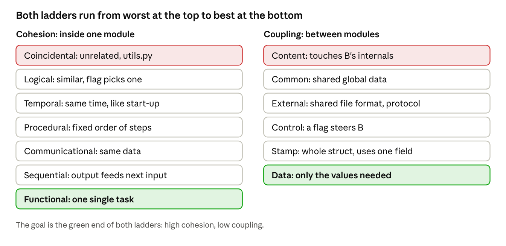
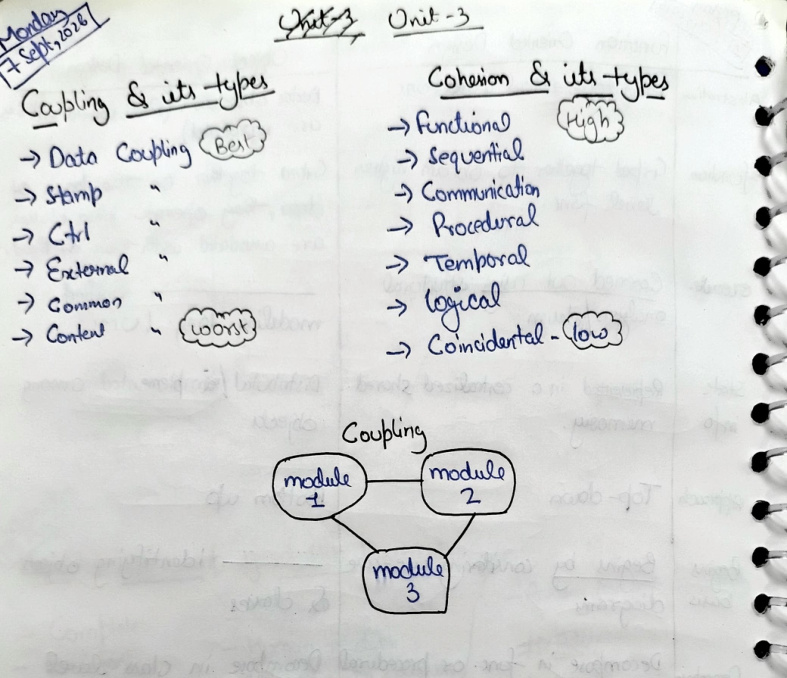
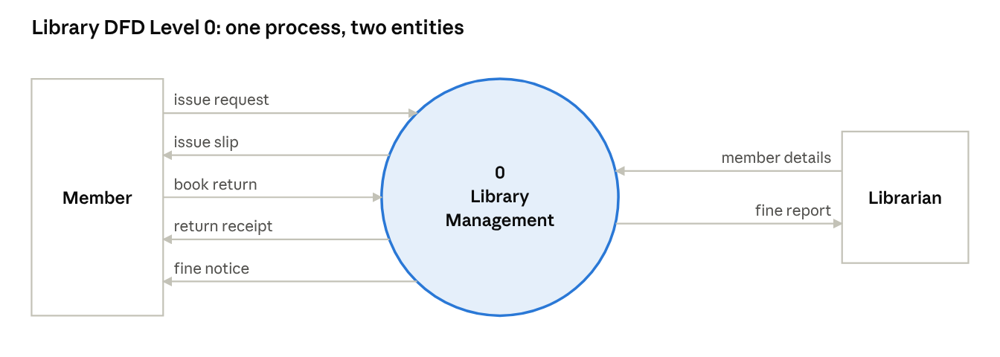
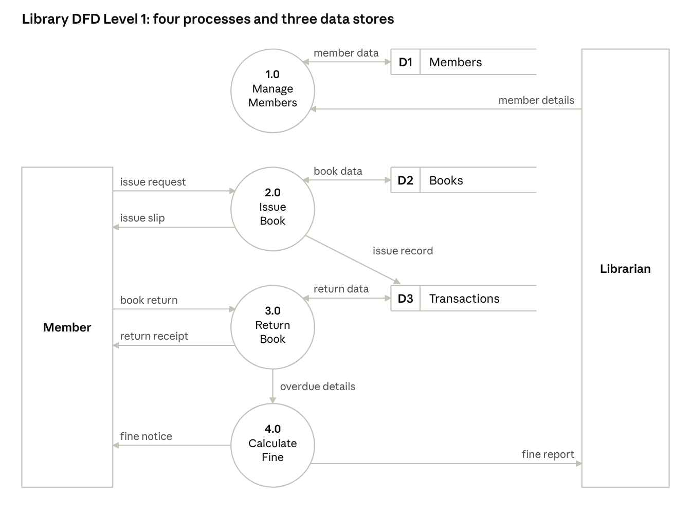
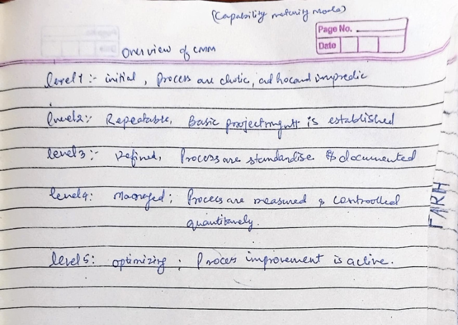

# RUN: SE Design, Cohesion and Reliability

Nov 5, 2026 · @shahan

Parts A, B and C of Assignment 1 are officially on the Sessional-2 syllabus, so you are studying the answer key to a test you've already seen. Enjoy that; it won't happen often. Plan on about an hour.

## How this run works

Go top to bottom. Written answers and all five diagrams are already in your [CSC-504 Assignment doc](https://claude.ai/artifact/KV8fR912rKtDxeN6FQTBZF), so this run is for understanding them well enough to survive a reworded question.

**What the paper likes.** Cohesion is the safest bet in the subject: last year's Sessional-2 asked it as a redesign problem, and last year's endsem asked for all the types. This year's Sessional-1 already went for SRS and COCOMO. So: learn the ladders cold, then practise classifying.

Videos, all from the [Gate Smashers playlist](https://www.youtube.com/playlist?list=PLxCzCOWd7aiEed7SKZBnC6ypFDWYLRvB2), in this order: Cohesion and Coupling (13 min), What is DFD (8 min), Function Oriented vs Object Oriented Design (5 min), MTBF vs MTTR (6 min).

## Stop 1: Cohesion and coupling

**Cohesion** is how closely things inside one module belong together. **Coupling** is how much modules depend on each other. You want high cohesion and low coupling, because changes stay local and modules become easy to test and reuse.



*Cohesion and coupling ladders*

**Two memory hooks:**

- Coupling, worst to best: **C**an **C**ats **E**ver **C**atch **S**leeping **D**ogs (Content, Common, External, Control, Stamp, Data).
- Cohesion, worst to best: **C**offee **L**ets **T**ired **P**eople **C**omplete **S**essional **F**inals (Coincidental, Logical, Temporal, Procedural, Communicational, Sequential, Functional).

**The ones people mix up:**

- **Stamp vs data.** To check someone's age, stamp coupling hands over the whole Aadhaar record. Data coupling hands over the age. Same result, far fewer ways to go wrong.
- **Logical vs functional.** One `print(flag)` that does errors, reports and payslips is logical. A module that only computes a square root is functional.
- **Sequential vs communicational.** Output feeding the next step is sequential. Several tasks reading the same input is communicational.
- **Procedural vs sequential.** Both have an order. Procedural steps don't pass data along; sequential ones do.
- **Common vs content.** Common is two flatmates sharing a fridge. Content is your flatmate going through your bag.

**The classification drill.** Cover the right column and go:

| Situation | Answer |
| --- | --- |
| Reads a record, validates it, updates it, each using the last output | Sequential |
| Initialises variables, opens files, resets counters at start-up | Temporal |
| Computes tax and net salary from the same employee record | Communicational |
| Logs in, shows menu, records activity, in a fixed order | Procedural |
| A passes a flag that decides what B does | Control coupling |
| Two modules modify one global variable | Common coupling |
| A jumps into the middle of B | Content coupling |
| Two modules rely on one file format | External coupling |

> **PYQ, Sessional-2 2025 Q1, 4 marks.** A module in a library management system calculates fines for late book returns, updates member details, and generates monthly usage reports. (a) Identify the type of cohesion this module exhibits. (b) Suggest how you would redesign the module to achieve higher cohesion.

**Answer:**

(a) **Coincidental cohesion.** Check the ladder from the top: the three tasks share no data, have no order, don't run at the same moment, and no flag chooses between them. All they have in common is the word "library", and being in the same building doesn't make you related.

(b) Split it into three modules, each with functional cohesion: `CalculateFine(returnDate, dueDate)`, `UpdateMember(memberId, details)` and `GenerateUsageReport(month)`. A separate controller module calls them as needed. Each now has one reason to change and can be tested alone.

**(a) Coincidental cohesion. (b) Split it into three functionally cohesive modules, called by a controller.**

> **PYQ, Endsem 2025 Q3(b), 4.5 marks.** Define cohesion and explain the different types of cohesion with suitable examples.

**Answer:** Cohesion is the degree to which the elements inside a module belong together. Higher is better. The types, weakest to strongest:

| Type | Elements are grouped because | Example |
| --- | --- | --- |
| Coincidental | No real reason | A module of unrelated functions, added to fill a file |
| Logical | They do similar things, and a flag selects one | `print(flag)` for error, report or payslip |
| Temporal | They run at the same time | Initialise variables, open files, reset counters at start-up |
| Procedural | They run in a fixed order | Log in, display menu, record activity |
| Communicational | They work on the same data | Compute tax and net salary from one employee record |
| Sequential | One's output is the next one's input | Read record, validate it, update it |
| Functional | They all do one single task | Compute a square root |

**Seven types, weakest to strongest: coincidental, logical, temporal, procedural, communicational, sequential, functional. Aim for functional.**

> **Assignment C8, on your sessional syllabus.** A module validates input, sends an email and writes to the database, and shares a global status variable with another module. Name the cohesion and coupling problems, and explain how you would redesign it.

**Answer:** The three unrelated tasks are **coincidental cohesion**. The shared global is **common coupling**. Split it into `validateInput`, `sendEmail` and `saveToDatabase`, each functionally cohesive. Replace the global with parameters and return values, which brings the coupling down to data coupling.

**Coincidental cohesion plus common coupling. Fix it by splitting into functional modules and passing data as parameters.**

Here's how the CSDS section's notes put the two lists on one page, if you like them handwritten:



## Stop 2: Design basics

**Problem analysis** comes before design because design decides *how*, and you can't decide how until you know *what*. Skip it and you build the wrong thing beautifully.

|  | Function-Oriented Design | Object-Oriented Design |
| --- | --- | --- |
| Basic unit | Functions | Objects and classes |
| State | Shared or global | Hidden inside objects |
| Approach | Top-down decomposition | Bottom-up, from real entities |
| Notation | DFD, structure chart | Class and use case diagrams |

**The three principles:**

- **Modularity** splits the system into parts, which makes it easier to build, test and maintain.
- **Abstraction** shows what's essential and hides the rest, which keeps complexity manageable.
- **Information hiding** keeps internals private behind an interface, so changing them doesn't break anyone else.

You can drive without knowing the engine: that's abstraction. The bonnet being closed is information hiding.

**Structure chart:** a hierarchy of modules, their calls and the data passed. Open circle means data couple; filled circle means control flag.

- **Fan-in:** how many modules call this one. High fan-in is what you want for a reusable module.
- **Fan-out:** how many modules this one calls. Keep it moderate, or the module turns into a micromanager.

## Stop 3: The five diagrams

These are all drawn in your [assignment doc](https://claude.ai/artifact/KV8fR912rKtDxeN6FQTBZF). Here's what actually loses marks:

| Diagram | Must have | Classic mistake |
| --- | --- | --- |
| DFD | Circles for processes, open boxes for stores, rectangles for entities, labelled arrows | Levels that don't balance: a flow at Level 0 must appear at Level 1 |
| Use case | Actors outside the boundary, ovals inside, `<<include>>` as a dashed arrow | Arrow direction: it points from the base case to the included one |
| Structure chart | Top module, subordinates, couples marked | Forgetting to mark the control flag |
| ER | Rectangles, diamonds, ovals, underlined keys, cardinality | Leaving cardinality off a relationship |
| Class | Name, attributes, methods, multiplicity on both ends | One-sided multiplicity |

DFD rule worth repeating: a data store never talks directly to an entity or another store. Data only moves through a process.

> **PYQ, Endsem 2025 Q3(a), 4.5 marks.** Draw and explain the Data Flow Diagram (DFD) for a Library Management System, showing both Level 0 and Level 1 diagrams.

**Answer:** A DFD shows how data moves through a system, using processes, data stores, external entities and data flows. Level 0 shows the whole system as one process.



*Library Management System, Level 0*

Level 1 opens that one process into its main sub-processes, and adds the data stores.



*Library Management System, Level 1*

The levels are balanced: all seven flows to Member and Librarian in Level 0 appear in Level 1. Issue Book reads and updates Books, and records the issue in Transactions. Return Book updates Transactions and passes overdue details to Calculate Fine, which notifies the member and reports to the librarian.

**Level 0 is one process with Member and Librarian outside. Level 1 splits it into Issue, Return and Fine, with the Books and Transactions stores, and the flows balance.**

> **PYQ, Endsem 2025 Q3(c), 4.5 marks.** Develop an Activity Diagram for an Online Examination System, showing the flow from student login to result generation.

**Answer:** An activity diagram shows the flow of actions. It uses a filled circle for start, rounded boxes for activities, diamonds for decisions, a thick bar for fork and join, and a ringed circle for end. Swimlanes split the work between Student and System.

```
   STUDENT                              SYSTEM
   (●) start
    |
 [Enter ID and password] -----------> [Validate credentials]
                                              |
                                         <valid?> --no--> [Show error] --> back to login
                                              | yes
 [Select exam]  <------------------- [Show available exams]
    |
 [Start exam]  ----------------------> [Load questions, start timer]
    |
 [Answer question] <------+
    |                     |
 <more questions          |
  and time left?> --yes---+
    | no
 [Submit]  ---------------------------> [Auto-submit if timer ends]
                                              |
                                    ===== fork =====
                                     |              |
                             [Evaluate answers] [Save responses]
                                     |              |
                                    ===== join =====
                                              |
                                     [Generate result]
 [View result] <------------------------------+
    |
   (◉) end
```

Explain it in four lines: login is validated with a loop back on failure, the answer loop runs while questions and time remain, the timer forces submission, and evaluation and saving run in parallel before the result is generated.

**The marks are for the decision diamonds (valid login, more questions), the fork and join, and the start and end nodes. Draw all of them.**

## Stop 4: SRS, prototyping and UI

> **PYQ, Endsem 2025 Q2(b), 4.5 marks; Sessional-1 2025 Q3.** List and explain the features of a good Software Requirements Specification (SRS).

**Answer:**

- **Correct:** every requirement is one the software must actually meet.
- **Complete:** all functions, constraints and inputs are covered, with nothing left for later guessing.
- **Unambiguous:** each requirement has exactly one meaning.
- **Consistent:** no two requirements contradict each other.
- **Verifiable:** each one can be checked by a test. "Fast" fails this, while "responds in under 2 s" passes.
- **Modifiable:** changes can be made easily and without side effects.
- **Traceable:** each requirement links back to its source and forward to design and tests.

**Seven features: correct, complete, unambiguous, consistent, verifiable, modifiable, traceable.**

> **PYQ, Sessional-1 2026 Q2, 4 marks, this year's paper.** After the SRS is prepared and development has started, a client realises that an important requirement was misunderstood, and it's now expensive to fix. Which RE activity should have detected this before development, and what does it check?

**Answer:** **Requirements validation.** It reviews the documented requirements with the stakeholders before development. It checks that they are correct, complete, consistent, realistic and verifiable, and that they reflect what the client actually needs. Reviews and prototyping are the usual methods.

**Prototyping** means building a quick working model so users can react to it. It exposes vague or missing requirements early, because nobody knows what they want until they see what they don't. Every client review in history has confirmed this.

**UI golden rules:** be consistent, give feedback, allow undo, reduce memory load.

## Stop 5: Reliability and quality

**Fault, error, failure** (the assignment's order):

- **Fault:** the defect in code, such as `i < n` instead of `i <= n`.
- **Error:** the wrong internal state when it runs, such as a wrong running total.
- **Failure:** what the user sees, such as a wrong bill.

The testing slides use "error" for the human mistake instead. If the question comes from reliability, use this list. If it comes from testing, use that one, and state your definition so the examiner can't argue.

**The formulas:**

```latex
\text{MTBF} = \text{MTTF} + \text{MTTR}
```

```latex
\text{Availability} = \frac{\text{MTTF}}{\text{MTTF} + \text{MTTR}}
```

**Reliability vs availability:** reliability is how long it runs without failing. Availability is the share of time it's usable. A system that crashes every hour but restarts in a millisecond is unreliable and highly available, which also describes several people you know.

**Worked example:** MTTF is 90 hours and MTTR is 10 hours.

```latex
\begin{aligned}
\text{MTBF} &= 90 + 10 = 100 \text{ hours} \\
\text{Availability} &= \frac{90}{90 + 10} = 0.9
\end{aligned}
```

**MTBF = 100 hours, availability = 90%.**

**CMM levels, in order:** Initial, Repeatable, Defined, Managed, Optimizing. Hook: **I R**eally **D**on't **M**ind **O**vertime.

| Level | What it means |
| --- | --- |
| 1 Initial | Chaotic, ad hoc, relies on heroes |
| 2 Repeatable | Basic project management is established |
| 3 Defined | Process is standardised and documented |
| 4 Managed | Process is measured and controlled |
| 5 Optimizing | Continuous improvement is active |

> **PYQ, Endsem 2025 Q1(c), 4.5 marks.** What is the Capability Maturity Model (CMM) of Software Development? Explain all five levels of the CMM with their key characteristics.

**Answer:** CMM, developed by the SEI (Software Engineering Institute), measures how mature an organisation's software process is, and gives a path for improving it. Its five levels are the table above, in that order. Add that an organisation moves up one level at a time, and that each level builds on the one before it.

**Five levels: Initial, Repeatable, Defined, Managed, Optimizing. An organisation climbs one level at a time.**



**ISO 9001** is an international standard for quality management systems. It supports quality assurance by requiring documented, audited, continually improved processes. **ISO vs CMM:** ISO applies to any organisation and is pass or fail. CMM is software-specific and graded in levels.

That's it. Tea's probably cold by now, and it was worth it.
