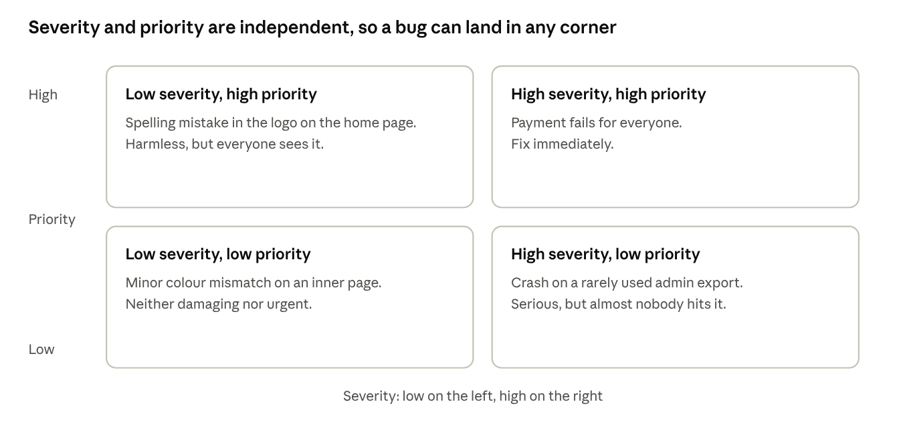
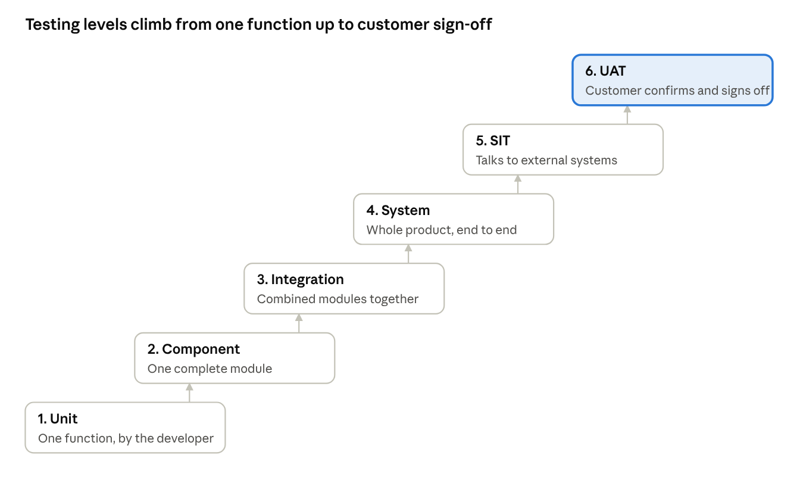
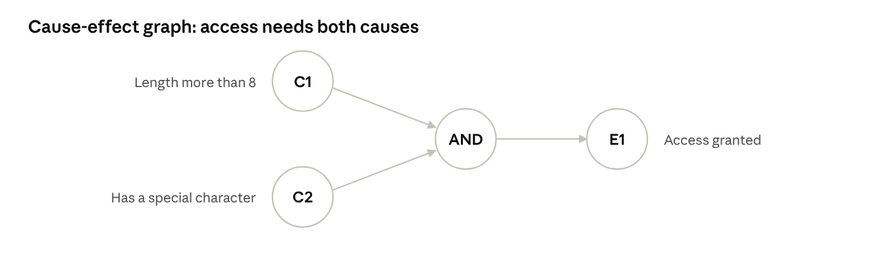
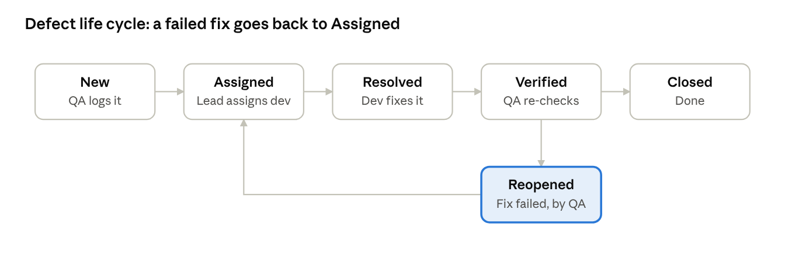

# RUN: Software Testing

Nov 5, 2026 · @shahan

Everything from Dr. Malik's 58 slides, in the order that makes it stick. Plan on about 75 minutes, with tea. The window can stay open; none of this is on fire.

## How this run works

Go top to bottom. Each stop has the idea, then its questions with the solutions right below them. Questions tagged **PYQ** come from real papers. Try each one before you scroll, because the only person you'd be fooling is you, and you already know.

**What the paper likes.** Sessional-2 is 12 marks in an hour. Last year's asked for functional vs non-functional, plus a cause-effect graph with a decision table. Last year's endsem asked for testing levels, BVA with EP on an age field, and black vs white box.

**Heads up:** cause-effect graphs and decision tables are not in the Part 1 slides, yet they appeared last year. Stop 7 covers them anyway, because "it wasn't in the slides" has never once earned a grace mark.

Full series if you'd rather be talked at: [Gate Smashers, Software Engineering playlist](https://www.youtube.com/playlist?list=PLxCzCOWd7aiEed7SKZBnC6ypFDWYLRvB2). It's in Hindi, with short videos. The source for all of this is `Software Engineering/Notes/Software Testing Part 1 (slides).pdf`.

## Stop 1: The mindset

Testing is a **destructive** process. You run the program deliberately trying to make it fail, so the defect shows up in the lab and not in front of a customer. It's the one job where breaking things earns you a good appraisal.

Testing hunts for failure. It doesn't merely confirm success. Entering only correct data to "confirm it works" is the wrong mindset, and it's also how "works on my machine" gets shipped.

**Why bugs exist:** miscommunication, complexity, programming errors, changing requirements, time pressure, egos, poorly documented code. Yes, egos made the official list.

**The chain to memorise:**

| Term | What it is | Example |
| --- | --- | --- |
| Error | The human mistake | Dev types `>` instead of `>=` |
| Defect (bug) | The flaw sitting in the code | The wrong comparison stays in the source |
| Failure | The visible wrong behaviour | A valid age of 18 gets rejected |

**Exam line:** Error → Defect → Failure means mistake, then flaw, then visible misbehaviour.

> **Quick check.** A dev writes the wrong loop condition and the report shows wrong totals. Name the error, defect and failure.

**Answer:** Writing the wrong condition is the error. The wrong condition sitting in the code is the defect. The wrong totals on the report are the failure.

## Stop 2: Priority vs severity

This is the favourite trap, because the two sound identical and are not.

- **Severity** is how badly it hurts. It's a technical call. Levels run Blocker → Critical → Major → Normal → Minor → Suggestion.
- **Priority** is how urgently it gets fixed. It's a business call. Levels run P1 (first) to P5 (last).

They're independent, so a bug can sit in any corner of the grid below. The spelling-mistake corner is the classic: technically nothing, but the CEO saw it, so it's now everyone's problem by lunch.



*Priority and severity grid*

> **Quick check.** The app crashes, but only on a screen one admin opens once a year. Classify it.

**Answer:** High severity, because a crash is serious technical damage. Low priority, because almost nobody hits it, so it can wait.

## Stop 3: Black, white and grey box

Watch: [White Box vs Black Box Testing](https://www.youtube.com/watch?v=89VOHd8F8Ao) (Gate Smashers, 6 min).

|  | Black box | White box | Grey box |
| --- | --- | --- | --- |
| Also called | Behavioural | Structural, glass box, clear box | Hybrid |
| Tester knows | Inputs and expected outputs only | Internal code, logic, paths | Partial: DB structure, APIs, algorithms |
| Based on | The specification | The code | Spec, guided by inside knowledge |
| Needs coding skill | No | Yes | Some |
| Usual level | Functional, system | Unit | Web, database, integration |
| Example | Try valid and invalid logins | Force both paths of `if (marks >= 40)` | Enter 31-02-2026 because you know how dates are stored |

**Exam line:** black box judges behaviour from outside against the spec. White box inspects the internal machinery.

> **Quick check.** A tester has no code access and works only from the requirements document. Which methodology is that, and what's its other name?

**Answer:** Black box testing, also called behavioural testing.

> **PYQ, Endsem 2025 Q4(c), 4.5 marks.** Explain black box and white box testing with a suitable example.

**Answer:**

**Black box testing** treats the software as a sealed box. The tester knows only the inputs and expected outputs, and builds test cases from the specification. No programming knowledge is needed, and it covers functional and non-functional behaviour. *Example:* testing a login screen with valid and invalid username and password pairs, without seeing the source. Techniques include equivalence partitioning and boundary value analysis.

**White box testing**, also called structural or glass box testing, looks inside. The tester studies the code, logic and paths, then designs tests to exercise them. It needs programming knowledge and is usually done at the unit level. *Example:* for `if (marks >= 40)`, write one test with marks 50 and one with marks 30, so both the true and false paths run.

**Key difference:** black box checks what the system does against the spec, while white box checks how the code does it. A good answer draws the two boxes, one solid and one see-through, because examiners are also people who like pictures.

**Black box tests behaviour against the spec, without the code. White box tests the code's paths from inside.**

## Stop 4: Types of testing

Watch: Types of Testing and Levels of Testing, in the [same playlist](https://www.youtube.com/playlist?list=PLxCzCOWd7aiEed7SKZBnC6ypFDWYLRvB2) (8 min).

Functional asks whether it does the thing. Non-functional asks how well it does the thing. A site can have a perfect checkout and still die during a sale, which is why both exist.

| Type | Question it answers | Kind | Example |
| --- | --- | --- | --- |
| Functional | Does each feature do its job? | Functional | Does Add to Cart add the item? |
| Performance | Is it fast and steady? | Non-functional | Search under 2 s with 5,000 users |
| Compatibility | Does it work everywhere? | Non-functional | Chrome, Safari, Android, desktop |
| Usability | Is it easy to use? | Non-functional | First-time user finishes unaided |
| Negative | Does it refuse bad input gracefully? | Functional | Letters in a salary field |
| Ad-hoc | What do hunches find? | Informal | No plan, a skilled tester exploring |
| Exhaustive | Does every input combination work? | Automated | Combinations explode, so a machine does it |

The slide list doesn't sort negative, ad-hoc and exhaustive as functional or non-functional, so treat those three labels as my reading, not gospel.

**Three performance sub-types, asked constantly:**

- **Load:** many users at the expected level.
- **Stress:** beyond the limit until it breaks, checking it fails gracefully.
- **Volume:** huge amounts of data.

The memory hook is users, limit, data. Load is a normal Monday, stress is Big Billion Days, and volume is that one uncle's WhatsApp storage.

> **Quick check.** Login works, but the team wants to know if the site survives 10,000 users. Functional or performance?

**Answer:** Performance, because the feature already works and the question is how well it holds up under load. Specifically, it's load testing.

> **PYQ, Sessional-2 2025 Q3, 4 marks.** Define and differentiate between Functional Testing and Non-Functional Testing.

**Answer:**

**Functional testing** checks whether each feature does what the requirements say. **Non-functional testing** checks how well the system does it, covering qualities like speed, security and usability.

| Basis | Functional | Non-functional |
| --- | --- | --- |
| Question | What does the system do? | How well does it do it? |
| Based on | Functional requirements | Quality requirements |
| Checks | Features and business actions | Performance, reliability, usability, compatibility |
| Example | Does Add to Cart add the item? | Does search respond in under 2 s with 5,000 users? |
| Types | Unit, integration, system, UAT | Load, stress, volume, usability, compatibility |

**Functional testing checks what the system does. Non-functional testing checks how well it does it.**

## Stop 5: Levels of testing

Watch: [Unit Testing](https://www.youtube.com/watch?v=9gu4BsqjQrA), then Integration and System Testing in the [playlist](https://www.youtube.com/playlist?list=PLxCzCOWd7aiEed7SKZBnC6ypFDWYLRvB2) (about 15 min total).

The staircase below is worth drawing in the exam. It climbs from smallest to largest scope, and the person doing the work changes on the way up.



*The six levels of testing*

The slides' ballpoint pen is the example to steal: test the ink cartridge alone (unit), test the assembled parts together (integration), then check that the finished pen actually writes (system).

**Alpha vs beta:**

|  | Alpha | Beta |
| --- | --- | --- |
| Who | Independent test team, or users | Real end users |
| Where | Developer's site, controlled | User's own site, real world |
| When | Before public release | Beta version released publicly |

Alpha is your friend reading the essay. Beta is posting it and reading the replies.

> **Quick check.** Order these from smallest to largest: System, Unit, Integration, Component. Who performs unit testing, and who performs UAT?

**Answer:** Unit → Component → Integration → System. Developers do unit testing because it needs code knowledge. End users or the customer do UAT because they're the ones confirming it's what they agreed to.

> **PYQ, Endsem 2025 Q4(a), 4.5 marks.** Explain different levels of software testing (Unit, Integration, System and Validation Testing) with suitable examples.

**Answer:**

- **Unit testing** tests one function or module alone, and the developer does it. *Example:* testing `calculateTax(amount)` with sample amounts before it joins the billing screen.
- **Integration testing** tests combined modules working together, using big bang, top-down, bottom-up or sandwich approaches. *Example:* checking that logging in carries the user's cart to the next screen.
- **System testing** tests the complete integrated system end to end against requirements, functional and non-functional. *Example:* running a full order on the finished shopping site, from search to payment.
- **Validation testing** confirms the software meets the customer's actual needs: are we building the right product? It's done through acceptance testing, with alpha at the developer's site and beta at the user's. *Example:* the client's staff use the new billing system on real tasks for a week.

The slides call this last level UAT, so write "Validation (acceptance/UAT) testing" and collect the mark either way. Draw the staircase above to finish.

**Unit (one module, by the developer), then integration (modules together), system (the whole thing against requirements), validation (the customer accepts it).**

## Stop 6: Integration approaches and build tests

| Approach | How | Helper | Advantage | Catch |
| --- | --- | --- | --- | --- |
| Big Bang | Everything combined at once | None | Saves setup | Very hard to isolate the fault |
| Bottom-up | Lowest modules first, going up | **Drivers** | Bugs are easier to find | Top-level flow shows up late |
| Top-down | Main modules first, going down | **Stubs** | Missing links spotted early | Needs stubs written |
| Sandwich | Both at once, meeting in the middle | Both | Best of both | More complex |

Big Bang is every group project on the night before submission: twelve branches, one merge, and a silence nobody wants to break.

**Stub vs driver**, which always gets a mark:

- A **stub** is a dummy *lower* module, called by the code you're testing.
- A **driver** is a dummy *upper* module, which calls the code you're testing.

**Build-readiness tests:**

- **BVT:** short tests on each new build. Fail, and the build is rejected.
- **Smoke:** wide and shallow, scripted, whole app. Switch it on and see if it catches fire.
- **Sanity:** narrow and deep, usually unscripted. Did this one fix work?

**After a fix:**

- **Re-testing:** re-run only the failed test, with the same data. Is that bug gone?
- **Regression:** re-run a broader set around the change. Did the fix break something else? It usually has.

> **Quick check.** After a login bug fix, which test re-checks only login, and which checks the rest of the app?

**Answer:** Re-testing checks only login, with the same data that exposed the bug. Regression testing checks that the rest of the app still works.

## Stop 7: Designing test cases

Watch: [Boundary Value Testing](https://www.youtube.com/watch?v=l239yuyq9xQ) (Gate Smashers, 6 min), then [Equivalence Partitioning and BVA](https://www.youtube.com/watch?v=uydAyjqTSiw).

**Equivalence Partitioning (EP).** Split inputs into classes the program treats alike, then test one value per class. One spoon represents the pot of dal.

Slide example, marks 0 to 100: 0-39 is D, 40-59 is C, 60-70 is B, 71-100 is A. Invalid classes are below 0, above 100, and non-numeric. Picking 20, 50, 65, 85, -12, 150, "abc" gives 7 tests and full coverage.

**Boundary Value Analysis (BVA).** Bugs live at the edges, because that's where `>` and `>=` get confused. For a boundary n, test n-1, n and n+1.

> **PYQ, Endsem 2025 Q4(b), 4.5 marks.** A system accepts age input between 18 and 60. Valid inputs: 18 to 60. Invalid inputs: less than 18 or greater than 60. Explain Boundary Value Analysis and Equivalence Class Partitioning with scenario-based test cases.

**Answer:** EP divides the inputs into three classes, and we test one value from each. BVA tests right around each edge of the valid range, because that's where off-by-one errors live.

| Technique | Test values | Why |
| --- | --- | --- |
| EP, valid class | 35 | Any value from 18-60 |
| EP, invalid low | 10 | Below 18 |
| EP, invalid high | 70 | Above 60 |
| BVA, lower edge | 17, 18, 19 | n-1, n, n+1 around 18 |
| BVA, upper edge | 59, 60, 61 | n-1, n, n+1 around 60 |

The slides' month example tests only 0, 1, 12, 13, so that's the minimum. Their stated rule gives the longer list above, and writing it costs you nothing.

**EP gives 3 tests (35, 10, 70). BVA gives 6 (17, 18, 19, 59, 60, 61). Expect 18, 19, 35, 59 and 60 to be accepted, and 10, 17, 61 and 70 rejected.**

**Cause-effect graph and decision table.** These turn logical conditions into test cases: causes are inputs, effects are outputs, joined by AND, OR, NOT.

> **PYQ, Sessional-2 2025 Q2, 4 marks.** A system accepts a password only if its length is greater than 8 characters and it contains at least one special character. If both are satisfied, access is granted; otherwise, access is denied. Explain the process step by step, draw the cause-effect graph, and prepare the decision table followed by the test cases.

**Answer, step by step:** Identify the causes and the effect, link them with logic in a graph, turn every combination into a table column, then write one test case per column.

- Cause C1: length > 8
- Cause C2: has a special character
- Effect E1: access granted, where E1 = C1 AND C2

Draw C1 and C2 as two nodes on the left, both feeding an AND into E1 on the right.



*Cause-effect graph for the password example*

| Rule | R1 | R2 | R3 | R4 |
| --- | --- | --- | --- | --- |
| C1: length > 8 | T | T | F | F |
| C2: special char | T | F | T | F |
| Access granted | Yes | No | No | No |
| Test input | `Summer#2026` | `Summer2026` | `ab#c` | `abc` |

**E1 = C1 AND C2, so access is granted only in R1. Four rules give four test cases.**

> **Quick check.** A shop gives a discount only if the bill is over 1000 **and** the customer is a member. How many decision table rules are there, and how many give the discount?

**Answer:** n binary conditions give 2ⁿ rules.

```latex
2^2 = 4 \text{ rules}
```

**4 rules, and only 1 gives the discount: the one where both conditions are true.**

## Stop 8: V&V, reviews and life cycles

Watch: Verification vs Validation, in the [playlist](https://www.youtube.com/playlist?list=PLxCzCOWd7aiEed7SKZBnC6ypFDWYLRvB2) (9 min).

|  | Verification | Validation |
| --- | --- | --- |
| Question | Have we built it **right**? | Have we built the **right** thing? |
| Checks against | The specification | What the customer wants |
| How | Static, no code run: reviews, checks | Dynamic, running the software |
| Cake version | Followed the recipe exactly | It's the cake they actually ordered |

**Reviews are static testing.** They catch defects when they're cheapest. Informal types are peer review, walkthrough and SME review. Formal types are inspection and group review.

**Debugging is not testing.** Testing finds the failure. Debugging locates and fixes the cause.

**Test case vs test scenario:** a scenario is the situation, such as "search a bank customer". A test case is the concrete steps, data and expected result.

**Test plan:** made by the Test Manager or Test Lead. It covers scope, environment, schedule, risks, resources, execution approach, reporting, automation and exit criteria.

**Manual vs automation:** automate the repetitive, high-volume checks like regression and exhaustive. Keep humans for usability and exploration, because a script will never say "this feels weird".

**STLC, in order:** requirements analysis, test planning, test development, test execution, test reporting, defect analysis, re-testing, regression testing, test closure. Testing starts at requirements, not after coding, which surprises exactly the people who wrote the deadline.

The defect life cycle is drawn below. Learn the Reopened loop, because that's the part they ask about.



*Defect life cycle*

> **Quick check.** A tester verifies a fixed bug and it still fails. What status does it move to, and who moves it?

**Answer:** Reopened, moved by QA, and it goes back to Assigned.

That's the whole of Part 1. Go stretch; the cat has not moved in an hour and is winning at this.
