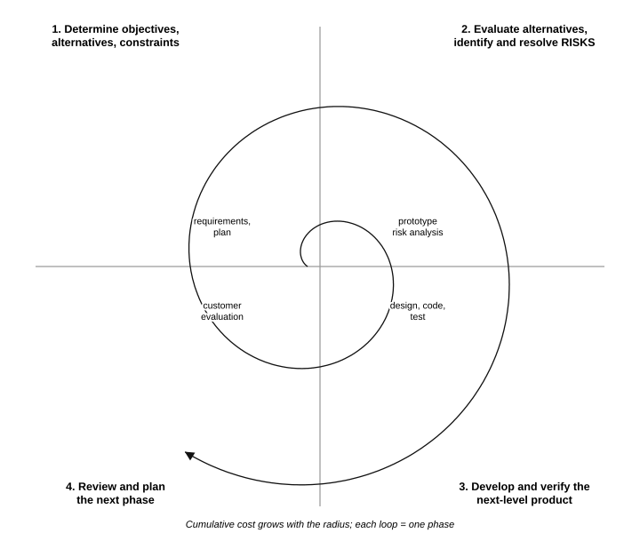
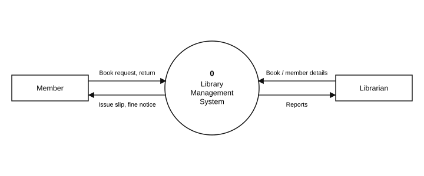
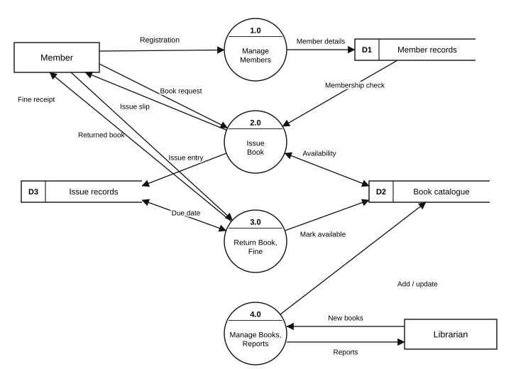
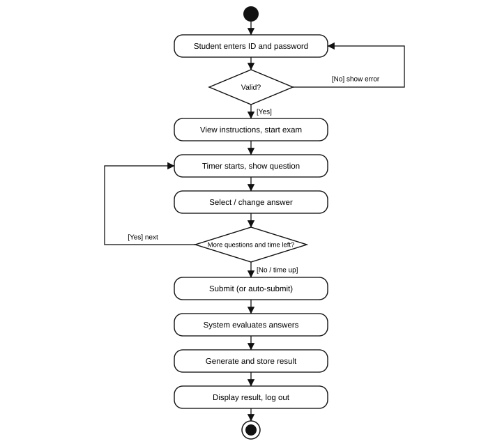
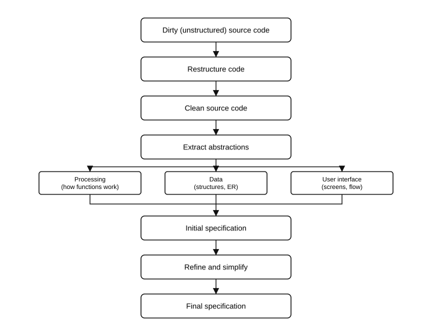
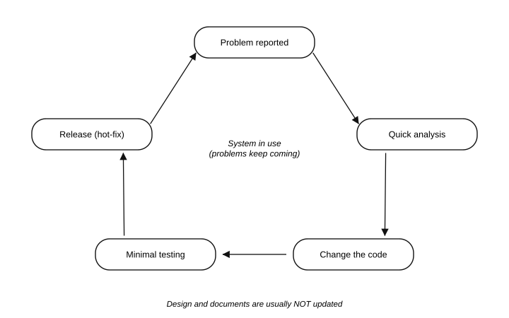

# Software Engineering Endsem 2025, Solved

**Paper:** B.Tech (CE) Sem V, Software Engineering (CSC-504), Session 2025-26, 3 hours, 45 marks. Attempt any two parts from each question; all parts carry 4.5 marks. All 15 parts are solved here.

Every question of the 2025 endsem paper, solved. The same answers sit inside the unit docs at the topic they belong to; the unit is named under each question so you can jump there for the explanation.

---

## Question 1

> **Endsem 2025 · Q1(a) · 4.5 marks**
> Write down the difference between program and software with a suitable example.

**Answer.**

**Program:** a set of instructions written to perform a specific task, usually by one person for personal use.
**Software:** a program (or a set of programs) **together with** its documentation and operating procedures, developed systematically for other users. In short, *Software = Programs + Documentation + Operating procedures*.

| Basis | Program | Software |
| --- | --- | --- |
| Made of | Only code | Code + documentation (SRS, design, test reports, user manual) + operating procedures (install, setup) |
| Developed by | Usually one person | A team, following a process |
| Users | The developer themself | Many users, often non-programmers |
| Size | Small | Large, many modules |
| User interface | Minimal or none | Well designed |
| Testing | Informal, by the author | Systematic, planned |
| Documentation | Little or none | Complete |
| Life | Short; written and done | Long; maintained for years |
| Example | A C program to find the factorial of a number for a lab | MS Word, a railway reservation system, the JMI ERP portal |

**A program is just code for a task; software is that code plus documentation and operating procedures, built by a process for real users.**

**Software characteristics** (1-mark points): software is *developed*, not manufactured; it doesn't *wear out* (but it deteriorates as changes pile up); most software is still custom-built.

**Software crisis:** in the 1960s–70s projects ran late, over budget and full of bugs. **Software engineering** was the response: *the systematic, disciplined, quantifiable approach to the development, operation and maintenance of software* (IEEE).

*Taught in Unit 1.*

> **Endsem 2025 · Q1(b) · 4.5 marks**
> Explain the Spiral Model of software development. What are the major phases in each spiral cycle?

**Answer.**

The **Spiral model** is a **risk-driven, iterative** life cycle model that combines the step-by-step nature of the waterfall with prototyping. Development proceeds in loops; each loop builds a more complete version of the product, and the **radius** of the spiral shows the **cumulative cost** so far. Its distinguishing feature is **explicit risk analysis in every cycle**; it's called a **meta-model** because it can include other models (waterfall, prototyping) inside its loops.



**Each cycle passes through four phases (quadrants):**

1. **Determine objectives, alternatives and constraints:** what this loop must achieve (e.g. performance, functionality), the alternative ways of doing it (buy vs build, different designs), and the constraints (cost, schedule, technology).
2. **Evaluate alternatives; identify and resolve risks:** analyse each alternative for risk (unclear requirements, new technology, performance), and reduce the biggest risks, typically by **building a prototype**, simulation or benchmarking. This quadrant is what makes the spiral special.
3. **Develop and verify the next-level product:** do the engineering for this loop: requirements, design, code and test, much like a mini waterfall.
4. **Review and plan the next phase:** the customer evaluates the result; the team reviews it and plans the next loop (or stops if the project isn't worth continuing).

The number of loops isn't fixed: it depends on the risks. Typical loops: concept of operation → requirements → design → code and test.

| Advantages | Disadvantages |
| --- | --- |
| Risks handled early, before they become expensive | Needs real expertise in risk assessment |
| Good for large, complex, high-risk projects | Costly; overkill for small projects |
| Customer feedback every loop; changes absorbed easily | Hard to know when to stop; documentation-heavy |
| Combines the best of waterfall and prototyping | |

**The Spiral model is a risk-driven iterative model; every loop goes through: set objectives → analyse and resolve risks (prototype) → develop and test → review and plan the next loop.**

*Taught in Unit 1.*

> **Endsem 2025 · Q1(c) · 4.5 marks**
> What is the Capability Maturity Model (CMM) of software development? Explain all five levels of the CMM with their key characteristics.

**Answer.**

The **Capability Maturity Model (CMM)**, developed by the **Software Engineering Institute (SEI)** at Carnegie Mellon University, is a framework that measures the **maturity of an organisation's software development process** on five levels, and shows the path to improve it. Each level (except the first) is defined by **Key Process Areas (KPAs)** that must be in place. Higher maturity means more predictable cost, schedule and quality.

Think of it as how a kitchen runs: from a chaotic home kitchen where it depends on who's cooking (level 1), to a restaurant chain with recipes, measurements and continuous improvement (level 5).

| Level | Name | Key characteristics | Key process areas |
| --- | --- | --- | --- |
| **1** | **Initial** | Ad hoc, chaotic; success depends on individual heroes; no stable process; budgets and schedules usually overrun | None |
| **2** | **Repeatable** | Basic **project management**: cost, schedule and functionality are tracked; earlier successes on similar projects can be repeated | Requirements management, project planning, project tracking, subcontract management, SQA, configuration management |
| **3** | **Defined** | A **standard, documented process** for the whole organisation, both management and engineering; every project follows a tailored version of it | Organisation process definition and focus, training, peer reviews, integrated software management |
| **4** | **Managed** | The process and products are **measured quantitatively** (metrics on quality and productivity); quality goals are set and tracked statistically | Quantitative process management, software quality management |
| **5** | **Optimizing** | **Continuous process improvement** using the measurements, defect prevention, and adopting new technology | Defect prevention, technology change management, process change management |

Mnemonic: **I Rarely Do Math On Sundays** (Initial, Repeatable, Defined, Managed, Optimizing).

An organisation can't skip levels: each builds on the one below. (CMM has since evolved into CMMI, where level 2 is called "Managed" and level 4 "Quantitatively Managed".)

**CMM grades process maturity in five levels: Initial (chaos) → Repeatable (project management) → Defined (standard process) → Managed (measured) → Optimizing (continuous improvement).**

| ISO 9001 | SEI-CMM |
| --- | --- |
| Generic, any industry | Specific to software |
| Certification: pass or fail | Five graded maturity levels |
| Minimum quality system | Roadmap for gradual improvement |

*Taught in Unit 3.*

---

## Question 2

> **Endsem 2025 · Q2(a) · 4.5 marks**
> A project is estimated at 55 KLOC. Using COCOMO in the Embedded mode, with Effort Adjustment Factor EAF = 1.25, calculate (1) Effort, (2) Development time, (3) Team size, (4) Productivity.

**Answer.**

An EAF is given, so this is **Intermediate COCOMO**, embedded mode: a = 2.8, b = 1.20, c = 2.5, d = 0.32.

```latex
\begin{aligned}
55^{1.20} &= e^{1.20 \ln 55} = e^{1.20 \times 4.0073} = e^{4.8088} = 122.58 \\
E_{nominal} &= 2.8 \times 122.58 = 343.24 \text{ PM} \\
E &= 343.24 \times 1.25 = 429.05 \text{ person-months} \\
D &= 2.5 \times 429.05^{0.32} = 2.5 \times 6.957 = 17.39 \text{ months} \\
\text{Team size} &= \frac{429.05}{17.39} = 24.67 \approx 25 \text{ persons} \\
\text{Productivity} &= \frac{55{,}000}{429.05} = 128.2 \text{ LOC per person-month}
\end{aligned}
```

**Effort ≈ 429 PM, time ≈ 17.4 months, team ≈ 25 people, productivity ≈ 128 LOC/PM.**

(If a teacher treats it as Basic COCOMO scaled by EAF, a = 3.6 gives E ≈ 551.6 PM, D ≈ 18.8 months, team ≈ 29, productivity ≈ 99.7. Say which model you used; with an EAF, intermediate is the correct one.)

*Taught in Unit 2.*

> **Endsem 2025 · Q2(b) · 4.5 marks**
> List and explain the features of a good Software Requirements Specification (SRS).

**Answer.**

A good SRS (per IEEE 830) has these characteristics:

1. **Correct:** every requirement stated is one the software really must meet. Checked by review with the customer.
2. **Unambiguous:** every requirement has exactly **one** interpretation. "The system should be fast" is ambiguous; "search results in under 2 seconds" isn't.
3. **Complete:** includes *all* requirements (functional, performance, interfaces, constraints) and defines the response to *all* inputs, valid and invalid. No "TBD" left.
4. **Consistent:** no two requirements conflict (e.g. one says dates are DD/MM/YYYY, another MM/DD/YYYY).
5. **Ranked for importance and stability:** each requirement is marked essential / desirable / optional, and how likely it is to change, so effort goes to what matters.
6. **Verifiable:** every requirement can be tested by some finite, cost-effective method. "Easy to use" isn't verifiable; "a new user completes checkout in under 3 minutes" is.
7. **Modifiable:** organised (numbered, indexed, no redundancy) so changes can be made easily and consistently.
8. **Traceable:** each requirement's origin is clear (backward traceability) and it can be referenced by later design, code and tests (forward traceability), via unique IDs like FR-12.

Also good to mention: **concise** and **design-independent** (it says *what*, not *how*).

**Correct, unambiguous, complete, consistent, ranked, verifiable, modifiable and traceable.**

*Taught in Unit 2.*

> **Endsem 2025 · Q2(c) · 4.5 marks**
> What is risk management in software engineering? Write down the steps of risk management.

**Answer.**

**Risk management** is the systematic process of identifying, analysing and controlling the uncertain events that could threaten a software project's schedule, cost or quality, so that their probability or impact is reduced before they turn into problems.

Following Boehm, it has two parts, each with three steps:

**A. Risk assessment**

1. **Risk identification:** list everything that could go wrong, using checklists, brainstorming and past project data. E.g. "key developer may leave", "requirements may change", "new framework may be too slow".
2. **Risk analysis:** estimate each risk's **probability** and **impact** (and so its exposure = probability × loss).
3. **Risk prioritisation:** rank the risks by exposure and focus on the top ones (e.g. the top 10).

**B. Risk control**

4. **Risk management planning:** for each major risk, decide a strategy: **avoid** it (change the plan), **reduce/mitigate** it (e.g. cross-train staff), **transfer** it (insurance, outsourcing) or **accept** it with a contingency plan.
5. **Risk resolution (monitoring and mitigation):** carry out the plans and act when a risk occurs.
6. **Risk monitoring:** keep tracking risks throughout the project, re-assess them, and watch for new ones.

| Risk | Probability | Impact | Plan |
| --- | --- | --- | --- |
| Key developer leaves | Medium | High | Pair programming, documentation, cross-training |
| Requirements change late | High | Medium | Iterative model, change control |
| New library too slow | Low | High | Prototype early, keep a fallback |

**Risk management = assessment (identify, analyse, prioritise) + control (plan, resolve, monitor).**

*Taught in Unit 2.*

---

## Question 3

> **Endsem 2025 · Q3(a) · 4.5 marks**
> Draw and explain the Data Flow Diagram (DFD) for a Library Management System, showing both Level 0 and Level 1 diagrams.

**Answer.**

**Level 0 (context diagram).** The whole library system is a single process. Two external entities: the **Member** (borrows and returns books) and the **Librarian** (maintains books and members, wants reports).



- Member → system: book request, return, registration details.
- System → Member: issue slip, fine notice.
- Librarian → system: book and member details.
- System → Librarian: reports (books issued, overdue list, fines).

**Level 1.** The single bubble is exploded into four processes and three data stores.



| Process | What it does | Reads / writes |
| --- | --- | --- |
| 1.0 Manage Members | Registers new members, updates their details | Writes D1 Member records |
| 2.0 Issue Book | Checks membership (D1) and availability (D2), records the loan (D3), gives an issue slip | D1, D2, D3 |
| 3.0 Return Book, Fine | Reads the due date (D3), calculates any fine, marks the book available (D2), gives a receipt | D2, D3 |
| 4.0 Manage Books, Reports | Librarian adds/updates books (D2) and gets reports | D2 |

Data stores: **D1 Member records**, **D2 Book catalogue**, **D3 Issue records**.

The diagrams are balanced: every flow at level 0 (requests, returns, slips, fines, details, reports) appears in level 1.

**Level 0: one bubble with Member and Librarian; level 1: Manage Members, Issue Book, Return Book/Fine, Manage Books/Reports, with Member, Book and Issue stores.**

*Taught in Unit 3.*

> **Endsem 2025 · Q3(b) · 4.5 marks**
> Define cohesion and explain the different types of cohesion with suitable examples.

**Answer.**

**Cohesion** is the measure of how closely the functions inside one module are related to each other. A module with high cohesion does one well-defined job, which makes it easier to understand, test, reuse and maintain.

The seven types, from **worst (lowest) to best (highest)**:

| # | Type | Elements are grouped because… | Example |
| --- | --- | --- | --- |
| 1 | **Coincidental** (worst) | No meaningful relation at all; random | A "Utilities" module with `printReport()`, `sqrt()`, `readKeyboard()` |
| 2 | **Logical** | They do the same *kind* of thing; one is picked by a flag | An `inputAll(flag)` module that reads from keyboard, file or network depending on the flag |
| 3 | **Temporal** | They run at the same *time* | `initialise()`: open files, reset counters, clear screen at startup |
| 4 | **Procedural** | They follow a fixed *order* of steps, but on different data | "Read a record, then print header, then update a counter" |
| 5 | **Communicational** | They work on the *same data* | `processStudent()`: update the student's marks and print the same student's report card |
| 6 | **Sequential** | The *output of one is the input of the next* | Read raw data → validate it → compute the result |
| 7 | **Functional** (best) | All elements contribute to **one single function** | `calculateSalary()`, `computeSquareRoot()` |

Mnemonic for worst to best: **"Can Lazy Teachers Prepare Classes Surely Fast?"** (Coincidental, Logical, Temporal, Procedural, Communicational, Sequential, Functional).

**Cohesion = how related a module's internals are; aim for functional cohesion, avoid coincidental.**

*Taught in Unit 3.*

> **Endsem 2025 · Q3(c) · 4.5 marks**
> Develop an Activity Diagram for an Online Examination System, showing the flow from student login to result generation.

**Answer.**



Explanation of the flow:

1. The student enters ID and password; the system validates them. **[No]** → error shown, back to login. **[Yes]** → continue.
2. The student reads the instructions and starts the exam; the **timer** starts and the first question is shown.
3. The student selects or changes an answer. Decision: **more questions and time left?** **[Yes]** → next question (loop). **[No / time up]** → leave the loop.
4. The answers are submitted (manually, or automatically when the timer runs out).
5. The system evaluates the answers, generates the result and stores it.
6. The result is displayed, the student logs out, and the flow ends.

**Start → login (validated loop) → instructions → question loop with timer → submit → evaluate → generate and store result → display → end.**

*Taught in Unit 3.*

---

## Question 4

> **Endsem 2025 · Q4(a) · 4.5 marks**
> Explain the different levels of software testing (Unit, Integration, System and Validation testing) with suitable examples.

**Answer.**

Testing is done in levels, from the smallest piece to the whole system, like checking every brick, then each wall, then the whole house, then letting the owner inspect it.

**1. Unit testing:** testing **individual modules/functions** in isolation, usually by the developer, mostly white box. Missing callers and callees are simulated: a **driver** calls the unit, and **stubs** stand in for the modules it calls.
*Example:* testing a `calculateInterest(principal, rate, years)` function alone with several inputs, including 0 years and a negative rate.

**2. Integration testing:** combining tested units and testing their **interfaces**, to find errors in how modules talk (wrong parameters, data format mismatches). Approaches:

- **Big bang:** integrate everything at once (hard to locate faults).
- **Top-down:** start from the main module, add lower ones gradually, using **stubs** for missing ones.
- **Bottom-up:** start from the lowest modules, using **drivers**, and move up.
- **Sandwich (hybrid):** both at once.

*Example:* after the login and dashboard modules pass unit tests, check that a successful login really passes the user's ID to the dashboard and shows their data.

**3. System testing:** testing the **complete integrated system** against the SRS, functional and non-functional, by an independent test team (black box). Types: functional, **performance**, **stress/load** (beyond normal limits), **security**, **recovery** (does it recover after a crash?), usability and compatibility testing.
*Example:* for an online shopping site: the whole flow from search to payment, plus 10,000 simultaneous users (load) and SQL-injection attempts (security).

**4. Validation (acceptance) testing:** checking the software meets the **customer's real needs**, by or with the customer, before it's accepted.

- **Alpha testing:** by users at the **developer's site**, with developers watching.
- **Beta testing:** by real users at **their own sites**, in the real environment, reporting problems back.

*Example:* a bank's staff use the new loan system on real-looking cases and sign off (acceptance); a beta version of an app is released to 1,000 users.

| Level | Tests | Done by | Box |
| --- | --- | --- | --- |
| Unit | One module | Developer | White |
| Integration | Interfaces between modules | Developers / testers | Both |
| System | Whole system vs SRS | Independent testers | Black |
| Validation | Fit to user needs | Customer | Black |

**Unit → integration → system → validation: from one module, to modules together, to the whole system against the SRS, to the customer accepting it (alpha, beta).**

**Regression testing:** re-running old tests after a change, to make sure nothing that worked before is broken. Needed at every level, especially in maintenance.

*Taught in Unit 4.*

> **Endsem 2025 · Q4(b) · 4.5 marks**
> A system accepts an age between 18 and 60 (valid: 18–60; invalid: less than 18 or greater than 60). Explain (a) Boundary Value Analysis and (b) Equivalence Class Partitioning with test cases for this scenario.

**Answer.**

**(a) Boundary Value Analysis.** Errors are most likely at the edges of the valid range, so we test values **at, just inside and just outside** each boundary. One variable (age), range [18, 60], nominal value ≈ 39.

Normal BVA uses 4n + 1 = **5** cases; robust BVA adds the two outside values for **7**:

| Test case | Age | Why | Expected output |
| --- | --- | --- | --- |
| TC1 | 17 | min − 1 (robust) | Invalid: rejected |
| TC2 | 18 | min | Valid: accepted |
| TC3 | 19 | min + 1 | Valid |
| TC4 | 39 | nominal | Valid |
| TC5 | 59 | max − 1 | Valid |
| TC6 | 60 | max | Valid |
| TC7 | 61 | max + 1 (robust) | Invalid: rejected |

If the code wrongly says `age > 18` instead of `age >= 18`, TC2 catches it.

**(b) Equivalence Class Partitioning.** The input domain is divided into classes whose members are treated the same:

| Class | Range | Type | Representative test | Expected |
| --- | --- | --- | --- | --- |
| EC1 | age < 18 | Invalid | 10 | Rejected |
| EC2 | 18 ≤ age ≤ 60 | Valid | 35 | Accepted |
| EC3 | age > 60 | Invalid | 75 | Rejected |
| EC4 (extra) | non-numeric / empty | Invalid | "abc", blank | Rejected with an error message |

One test per class covers the whole domain: **3 test cases** (4 with the non-numeric class) instead of testing every possible age.

**BVA tests the edges 17, 18, 19, 39, 59, 60, 61; ECP tests one value per class: 10 (invalid), 35 (valid), 75 (invalid).**

*Taught in Unit 4.*

> **Endsem 2025 · Q4(c) · 4.5 marks**
> Explain black box and white box testing with suitable examples.

**Answer.**

**Black box testing (functional / behavioural testing):** the tester treats the program as a **closed box**: they don't look at the code, only at the **specification**. Test cases are designed from the requirements: give inputs, compare outputs with the expected outputs. Like testing a calculator app by pressing buttons, without reading its code.

- Techniques: boundary value analysis, equivalence class partitioning, cause-effect graphing, decision tables.
- Finds: missing or wrong functions, interface errors, behaviour and performance errors.
- Example: for a login screen, test a valid username/password, a wrong password, an empty field and a 100-character username, and check the messages.

**White box testing (structural / glass box testing):** the tester **looks inside the code** and designs test cases to exercise its **structure**: every statement, every branch, every path and loop. Like a mechanic checking every pipe of an engine.

- Techniques: statement/branch/path coverage, basis path testing (cyclomatic complexity), data flow testing, mutation testing.
- Finds: logic errors, unreachable code, wrong conditions, loop-boundary errors.
- Example: for `if (marks >= 40) pass(); else fail();` write two tests, marks = 50 and marks = 30, so **both branches** run.

| Basis | Black box | White box |
| --- | --- | --- |
| Based on | Specification (SRS) | Code structure |
| Code knowledge needed | No | Yes |
| Done by | Testers, users | Developers |
| Level mostly | System, acceptance | Unit, integration |
| Also called | Functional, behavioural | Structural, glass box, clear box |
| Misses | Untested hidden paths | Missing features (code can't show what isn't there) |

**Black box tests what the system does from the spec; white box tests how it does it from the code.**

*Taught in Unit 4.*

---

## Question 5

> **Endsem 2025 · Q5(a) · 4.5 marks**
> Describe various types of software maintenance with suitable examples for each.

**Answer.**

**1. Corrective maintenance:** fixing **faults** (bugs) discovered after delivery, i.e. errors in design, logic or code that users report. It's **reactive** and usually the most urgent.
*Example:* a banking app crashes when the balance is ₹0; a patch is released to fix the crash.
*Analogy:* fixing a leaking tap.

**2. Adaptive maintenance:** changing the software so it keeps working in a **changed environment**: new OS, hardware, browser, database, law or business rule. No new feature for the user; it just stays compatible.
*Example:* updating an app to run on a new Android version; updating a billing system when GST rates change.
*Analogy:* using a travel adapter abroad: the phone is fine, the surroundings changed.

**3. Perfective maintenance:** **enhancing** working software: new features, better performance, better usability, usually because users asked. It is the **largest share** of maintenance (about 50%).
*Example:* adding dark mode, UPI payments or a faster search to an existing app.
*Analogy:* renovating a working kitchen to add a dishwasher.

**4. Preventive maintenance:** changing the software **now** to prevent **future** problems and make later changes easier: refactoring, restructuring code, updating documentation, removing latent faults. It's **proactive**.
*Example:* fixing the Y2K date bug before the year 2000; cleaning up tangled code before it breaks.
*Analogy:* servicing your car before a long trip.

| Type | Trigger | Share of effort (Lientz & Swanson) |
| --- | --- | --- |
| Perfective | User requests for improvements | ~50% |
| Adaptive | Environment changes | ~25% |
| Corrective | Bugs found in use | ~21% |
| Preventive | Future maintainability | ~4% |

So about **75%** of maintenance isn't bug fixing at all; it's evolving the software.

**Corrective fixes bugs, adaptive keeps it working in a new environment, perfective adds improvements (the biggest share), preventive restructures it to avoid future problems.**

*Taught in Unit 5.*

> **Endsem 2025 · Q5(b) · 4.5 marks**
> Explain the process of reverse engineering in software engineering. Illustrate the steps involved with a neat labelled diagram.

**Answer.**

**Reverse engineering** recovers design and specification information from an existing system, typically an old ("legacy") system whose documents are missing or outdated, so that it can be understood, maintained or re-engineered. It moves **up** levels of abstraction (code → design → specification) and does **not** change the system's functionality.



**Steps (Pressman's process):**

1. **Dirty source code:** start from the existing, often unstructured and undocumented code.
2. **Restructure the code:** clean it up without changing behaviour (remove goto-spaghetti, rename variables, split huge functions) so it can be read. This gives **clean source code**.
3. **Extract abstractions:** analyse the clean code to recover three kinds of abstraction:
   - **Processing:** what each function/module does and how control flows (call graphs, flowcharts).
   - **Data:** internal data structures and the database model (e.g. an ER diagram).
   - **User interface:** screens and the interaction flow.
4. **Initial specification:** write down the recovered design and requirements.
5. **Refine and simplify:** remove redundancy, check with domain experts, fill gaps.
6. **Final specification:** a usable high-level description of the system, ready for maintenance or forward engineering.

**Related terms:** **redocumentation** (re-creating documents at the same level of abstraction), **design recovery** (rebuilding design from code + domain knowledge), and **restructuring** (transforming code at the *same* level of abstraction, behaviour unchanged).

*Example:* a company has a 20-year-old system with no design documents; engineers study its code to reconstruct its flowcharts, data model and design before modernising it.

**Reverse engineering = restructure the dirty code, extract processing, data and UI abstractions, and refine them into a specification, without changing the system.**

*Taught in Unit 5.*

> **Endsem 2025 · Q5(c) · 4.5 marks**
> Explain the working process of the Quick-Fix Model with a diagram. List any two advantages and disadvantages of this model.

**Answer.**

The **Quick-Fix model** is an ad hoc, "fire-fighting" approach to maintenance: when a problem is reported, the developers **find it and change the code as quickly as possible**, with minimal analysis and little regard for the overall design or long-term effects. The code is fixed first; design documents are usually left un-updated.



**Working process:**

1. A **problem is reported** by a user (often urgent, e.g. production is down).
2. **Quick analysis:** the developer locates the faulty code, without studying the wider design.
3. **Change the code** directly to remove the symptom.
4. **Minimal testing:** just enough to check the problem has gone.
5. **Release** the fix (a hot-fix). The system goes back into use, and the cycle repeats with the next problem.

*Real example:* a payment page crashes in production at 2 AM; a developer pushes an immediate hotfix to stop the damage, planning to clean it up properly later.

*Analogy:* plugging a flat tyre by the roadside to get home. It works for now, but it isn't a proper repair, and doing it repeatedly damages the tyre.

**Advantages:**

1. **Fast and cheap** in the short term: a fix reaches users almost immediately.
2. **Ideal for emergencies**, critical bugs and hard deadlines; needs little planning or documentation effort.

**Disadvantages:**

1. **Code structure degrades:** fixes pile up as patches (technical debt), so each later change becomes harder and riskier.
2. **Documentation falls out of date** and the design is ignored, so the system becomes hard to understand; the ripple effect of unanalysed changes can introduce new bugs.

**Quick-fix = find the problem and patch the code immediately, with minimal analysis and testing; fast and good for emergencies, but it degrades the code and documentation over time.**

### The other two models

- **Iterative Enhancement model:** assumes the system is documented and understood. Each change goes through full **analysis** of the existing system, **classification** of the proposed changes, then **redesign and implementation**, with the documents updated every iteration. Slower and costlier, but the system stays healthy. Best for long-lived systems. *Analogy:* renovating a house room by room with proper plans.
- **Reuse-Oriented model:** maintain by **reusing existing components**: identify reusable parts of the old system (or a library), understand them, adapt them, and integrate them into the new system. Fast and reliable when good components exist. *Example:* reusing one well-tested login module across a company's products.

| Model | Approach | Analysis | Best for | Risk |
| --- | --- | --- | --- | --- |
| Quick-Fix | Patch fast | Minimal | Emergencies | Code and docs decay |
| Iterative Enhancement | Analyse fully, improve in iterations | Thorough | Long-lived documented systems | Slower, costlier |
| Reuse-Oriented | Reuse and adapt components | Moderate | When reusable parts exist | Needs good reusable assets |

*Taught in Unit 5.*

