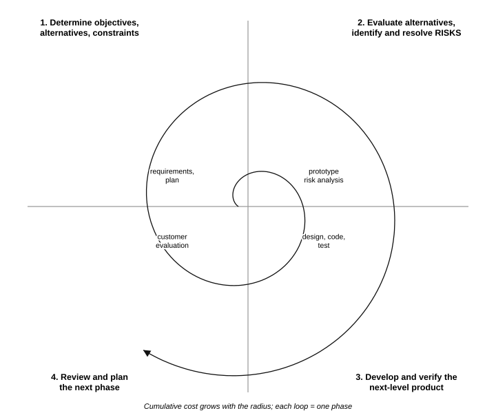

# SE Unit 1: Introduction and Software Life Cycle Models

*Endsem RUN · about 40 minutes*

**The whole unit in one breath:** software is more than code, building it needs a **process**, and a **life cycle model** is the recipe that orders the steps (requirements, design, code, test, maintain). The models differ in one thing: how they handle changing requirements and risk.

**What the endsem asks from here:** "explain model X with a diagram" and "compare models" (4.5 marks each). 2025 asked program vs software, and the Spiral model. Waterfall, Prototype, Spiral, V and RAD are the ones to draw confidently.

---

## 1. Program vs software · Quick

A **program** is code you wrote for yourself, like a C file that adds two matrices for your lab. **Software** is a product that strangers use for years: code *plus* documentation, manuals, installation, testing and support.

> **Endsem 2025 · Q1(a) · 4.5 marks**
> Write down the difference between program and software with a suitable example.

**Answer.**

**Program:** a set of instructions written to perform a specific task, usually by one person for personal use.
**Software:** a program (or a set of programs) **together with** its documentation and operating procedures, developed systematically for other users. In short, *Software = Programs + Documentation + Operating procedures*.

| Basis | Program | Software |
| --- | --- | --- |
| Made of | Only code | Code + documentation (SRS, design, test reports, user manual) + operating procedures (install, setup) |
| Developed by | Usually one person | A team, following a process |
| Users | The developer themself | Many users, often non-programmers |
| Size | Small | Large, many modules |
| User interface | Minimal or none | Well designed |
| Testing | Informal, by the author | Systematic, planned |
| Documentation | Little or none | Complete |
| Life | Short; written and done | Long; maintained for years |
| Example | A C program to find the factorial of a number for a lab | MS Word, a railway reservation system, the JMI ERP portal |

**A program is just code for a task; software is that code plus documentation and operating procedures, built by a process for real users.**

**Software characteristics** (1-mark points): software is *developed*, not manufactured; it doesn't *wear out* (but it deteriorates as changes pile up); most software is still custom-built.

**Software crisis:** in the 1960s–70s projects ran late, over budget and full of bugs. **Software engineering** was the response: *the systematic, disciplined, quantifiable approach to the development, operation and maintenance of software* (IEEE).

---

## 2. Software process and life cycle · Quick

A **software process** is the set of activities that produce software: specification, design and implementation, validation (testing), and evolution (maintenance).

A **software life cycle model (SDLC model)** is a descriptive picture of that process: which phases, in what order, and how you move between them. The basic phases every model contains:

**Requirements → Design → Implementation (coding) → Testing → Deployment → Maintenance**

---

## 3. Build and Fix · Quick

Write code, show it to the customer, fix what they complain about, repeat until they're happy. No requirements, no design.

Fine for a 200-line toy; a disaster at scale: no documentation, code becomes unmaintainable spaghetti, and cost explodes. Mentioned mostly as the "what not to do" baseline.

---

## 4. Waterfall model · Slow down

The classic: phases in a **strict sequence**, each finished and signed off before the next begins, with output flowing down like water over steps. You can't go back up (in the pure version).

```
Requirements analysis and specification
          ↓
        Design
          ↓
 Implementation and unit testing
          ↓
 Integration and system testing
          ↓
 Operation and maintenance
```

**Use when** requirements are clear, fixed and well understood (e.g. a payroll system for a government office).

| Advantages | Disadvantages |
| --- | --- |
| Simple and easy to manage | Requirements must be frozen at the start: real customers change their minds |
| Clear milestones and documents per phase | Working software appears only at the very end |
| Good for small, well-understood projects | Errors found late are very expensive to fix |
| | No feedback loop (the "iterative waterfall" adds feedback paths) |

---

## 5. Prototype model · Quick

When the customer can't say exactly what they want, build a quick, rough **prototype** (a throwaway model of the UI and main features), let them play with it, refine the requirements, and repeat. Then build the real system properly.

Like a tailor making a cheap muslin trial dress before cutting the expensive fabric.

**Steps:** gather initial requirements → quick design → build prototype → customer evaluates → refine requirements → (repeat) → engineer the final product.

**Plus:** requirements become clear, users are involved early, misunderstandings are caught cheaply. **Minus:** customers may think the prototype *is* the product; extra cost; temptation to ship hacky prototype code.

---

## 6. Iterative enhancement and evolutionary models · Quick

- **Iterative enhancement model:** requirements are known up front, but the product is delivered in **increments**. Each increment goes through analysis, design, code and test, and adds features to the previous one. The core features ship first. Like building a house floor by floor while people already live on the ground floor.
- **Evolutionary model:** requirements are *not* fully known. Build a working version from what's known, get feedback, and **evolve** the product version by version. Each version is a real (not throwaway) product. Popular for products whose needs emerge with use.

Both give early working software and customer feedback; the risk is that the architecture must be good enough to keep extending.

---

## 7. Spiral model · Slow down

Proposed by Barry Boehm (1986). The big idea is **risk-driven** development: before each step, ask "what could go wrong?" and deal with the biggest risk first. The project goes round and round a spiral; each loop is one phase (concept, requirements, design, …), and the spiral gets bigger as the cost so far grows.

> **Endsem 2025 · Q1(b) · 4.5 marks**
> Explain the Spiral Model of software development. What are the major phases in each spiral cycle?

**Answer.**

The **Spiral model** is a **risk-driven, iterative** life cycle model that combines the step-by-step nature of the waterfall with prototyping. Development proceeds in loops; each loop builds a more complete version of the product, and the **radius** of the spiral shows the **cumulative cost** so far. Its distinguishing feature is **explicit risk analysis in every cycle**; it's called a **meta-model** because it can include other models (waterfall, prototyping) inside its loops.



**Each cycle passes through four phases (quadrants):**

1. **Determine objectives, alternatives and constraints:** what this loop must achieve (e.g. performance, functionality), the alternative ways of doing it (buy vs build, different designs), and the constraints (cost, schedule, technology).
2. **Evaluate alternatives; identify and resolve risks:** analyse each alternative for risk (unclear requirements, new technology, performance), and reduce the biggest risks, typically by **building a prototype**, simulation or benchmarking. This quadrant is what makes the spiral special.
3. **Develop and verify the next-level product:** do the engineering for this loop: requirements, design, code and test, much like a mini waterfall.
4. **Review and plan the next phase:** the customer evaluates the result; the team reviews it and plans the next loop (or stops if the project isn't worth continuing).

The number of loops isn't fixed: it depends on the risks. Typical loops: concept of operation → requirements → design → code and test.

| Advantages | Disadvantages |
| --- | --- |
| Risks handled early, before they become expensive | Needs real expertise in risk assessment |
| Good for large, complex, high-risk projects | Costly; overkill for small projects |
| Customer feedback every loop; changes absorbed easily | Hard to know when to stop; documentation-heavy |
| Combines the best of waterfall and prototyping | |

**The Spiral model is a risk-driven iterative model; every loop goes through: set objectives → analyse and resolve risks (prototype) → develop and test → review and plan the next loop.**

---

## 8. V model · Quick

The **V model** (verification and validation model) is waterfall bent into a V: each development phase on the left has a matching **testing phase** on the right, and the tests are *planned* while developing.

```
Requirements ─────────────────────── Acceptance testing
   System design ──────────────── System testing
      Architecture design ──── Integration testing
         Module design ──── Unit testing
                    \   Coding   /
```

The left arm is **verification** ("are we building the product right?"), the right arm is **validation** ("are we building the right product?"). **Plus:** testing is planned early, so defects are found sooner; great for safety-critical systems (medical, aviation). **Minus:** as rigid as waterfall; no early prototype.

---

## 9. RAD model · Quick

**RAD (Rapid Application Development):** build the system very fast (60–90 days) using **reusable components, code generators and CASE tools**, with intense user involvement. Phases: **business modelling → data modelling → process modelling → application generation → testing and turnover**. Several teams build modules in parallel.

**Plus:** very fast delivery, reuse, user feedback throughout. **Minus:** needs skilled developers and committed users; only works if the system can be split into modules; not for high-performance or high-risk technical systems.

---

## 10. Comparing the models · Quick

| Model | Best when | Key feature |
| --- | --- | --- |
| Waterfall | Requirements clear and stable | Strict sequence |
| Prototype | Requirements unclear | Throwaway model for feedback |
| Iterative enhancement | Requirements known, early partial delivery wanted | Increments |
| Evolutionary | Requirements emerge over time | Versions evolve |
| Spiral | Large, high-risk | Risk analysis each loop |
| V model | Safety-critical, testing matters most | Test phase for each dev phase |
| RAD | Tight deadline, modular system | Reuse and parallel teams |

---

## 11. Quick recap

- Software = programs + documentation + operating procedures.
- Waterfall: sequential, frozen requirements, late working product.
- Prototype: throwaway model to clarify requirements.
- Iterative: increments of a known design; evolutionary: versions of emerging requirements.
- Spiral: objectives → risk analysis (prototype) → develop and test → plan; radius = cost.
- V model: each dev phase paired with a test phase (verification vs validation).
- RAD: 60–90 days, reuse, CASE tools, parallel teams.
