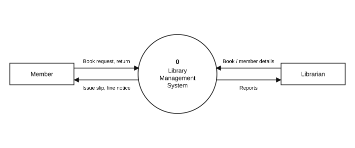
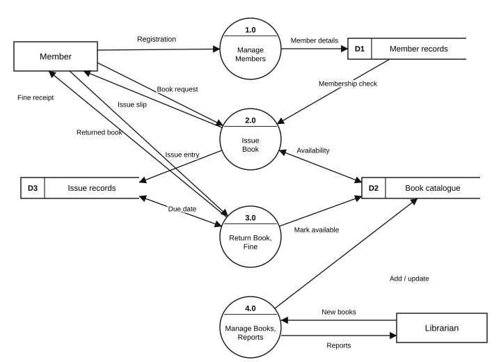
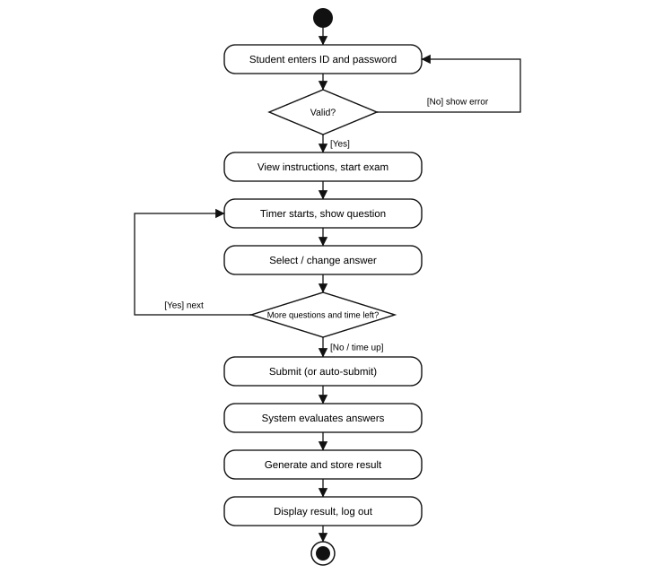

# SE Unit 3: Requirement Analysis, Design and Software Reliability

*Endsem RUN · about 55 minutes*

**The whole unit in one breath:** analysis turns requirements into **models** (DFDs, use cases, activity diagrams); design splits the system into **modules** that should be internally tight (**high cohesion**) and loosely tied to each other (**low coupling**); and reliability/quality standards (**ISO 9001, SEI-CMM**) judge how well an organisation builds software.

**What the endsem asks from here:** drawing questions (DFD level 0 and 1, activity diagram, use case), cohesion/coupling types, and CMM levels. 2025 asked all of these: Q1(c) and the whole of Q3.

---

## 1. Data Flow Diagrams · Slow down

A **DFD** shows how **data moves** through a system: where it comes from, what processes transform it, where it's stored and where it goes. It shows **no** control logic (no loops, no if-else, no timing). Think of it as a map of the system's "plumbing" for data.

| Symbol | Name | Meaning |
| --- | --- | --- |
| Circle (bubble) | **Process** | Transforms data; named with a verb phrase ("Issue Book"); numbered 1.0, 2.0 … |
| Rectangle | **External entity** | Source or sink of data outside the system (Member, Librarian) |
| Arrow | **Data flow** | Data moving between elements; labelled with a noun ("Book request") |
| Open box (two parallel lines) | **Data store** | Data at rest (a file or table), named D1, D2 … |

**Levels:**

- **Level 0 (context diagram):** the whole system as **one** bubble, with all external entities and the flows to/from them.
- **Level 1:** that bubble exploded into the main processes (1.0, 2.0 …), with the data stores.
- **Level 2:** one level-1 process exploded further (2.1, 2.2 …).

**Rules (marks!):** inputs and outputs must **balance** between levels (a flow into the level-0 bubble must appear in level 1); data can't flow directly between two entities or two stores, or from entity to store, without passing through a process; every process has at least one input and one output; no control flow.

> **Endsem 2025 · Q3(a) · 4.5 marks**
> Draw and explain the Data Flow Diagram (DFD) for a Library Management System, showing both Level 0 and Level 1 diagrams.

**Answer.**

**Level 0 (context diagram).** The whole library system is a single process. Two external entities: the **Member** (borrows and returns books) and the **Librarian** (maintains books and members, wants reports).

- Member → system: book request, return, registration details.
- System → Member: issue slip, fine notice.
- Librarian → system: book and member details.
- System → Librarian: reports (books issued, overdue list, fines).

**Level 1.** The single bubble is exploded into four processes and three data stores.

| Process | What it does | Reads / writes |
| --- | --- | --- |
| 1.0 Manage Members | Registers new members, updates their details | Writes D1 Member records |
| 2.0 Issue Book | Checks membership (D1) and availability (D2), records the loan (D3), gives an issue slip | D1, D2, D3 |
| 3.0 Return Book, Fine | Reads the due date (D3), calculates any fine, marks the book available (D2), gives a receipt | D2, D3 |
| 4.0 Manage Books, Reports | Librarian adds/updates books (D2) and gets reports | D2 |

Data stores: **D1 Member records**, **D2 Book catalogue**, **D3 Issue records**.

The diagrams are balanced: every flow at level 0 (requests, returns, slips, fines, details, reports) appears in level 1.

**Level 0: one bubble with Member and Librarian; level 1: Manage Members, Issue Book, Return Book/Fine, Manage Books/Reports, with Member, Book and Issue stores.**

---

## 2. Use case diagrams and activity diagrams · Quick

**Use case diagram** (UML): shows *who* (actors, stick figures outside the system box) can do *what* (use cases, ovals inside). Relationships: plain line (actor takes part), **«include»** (always uses another use case: Place Order includes Make Payment), **«extend»** (optional extra behaviour: Apply Coupon extends Place Order), and generalisation.

**Activity diagram** (UML): shows the **flow of activities**, like a flowchart. Symbols: filled circle (start), rounded rectangle (activity), diamond (decision/merge, with guard conditions in brackets), thick bar (fork/join for parallel activities), ringed circle (end).

> **Endsem 2025 · Q3(c) · 4.5 marks**
> Develop an Activity Diagram for an Online Examination System, showing the flow from student login to result generation.

**Answer.**

Explanation of the flow:

1. The student enters ID and password; the system validates them. **[No]** → error shown, back to login. **[Yes]** → continue.
2. The student reads the instructions and starts the exam; the **timer** starts and the first question is shown.
3. The student selects or changes an answer. Decision: **more questions and time left?** **[Yes]** → next question (loop). **[No / time up]** → leave the loop.
4. The answers are submitted (manually, or automatically when the timer runs out).
5. The system evaluates the answers, generates the result and stores it.
6. The result is displayed, the student logs out, and the flow ends.

**Start → login (validated loop) → instructions → question loop with timer → submit → evaluate → generate and store result → display → end.**

---

## 3. Software prototyping · Quick

Building a quick partial model of the system to clarify requirements. **Throwaway** (rapid) prototyping discards the model once requirements are clear; **evolutionary** prototyping keeps refining it into the final product. Helps users see the system early and catches misunderstood requirements cheaply.

---

## 4. Cohesion · Slow down

**Exam line:** *Cohesion is the degree to which the elements inside a single module belong together, i.e. how strongly related the module's internal tasks are. Good design aims for high cohesion.*

Think of a module as a kitchen drawer. A **cutlery drawer** (only spoons, forks, knives) is highly cohesive: you know exactly what's in it and why. A **"junk drawer"** with batteries, rubber bands and old keys is coincidentally cohesive: things are together for no reason.

> **Endsem 2025 · Q3(b) · 4.5 marks**
> Define cohesion and explain the different types of cohesion with suitable examples.

**Answer.**

**Cohesion** is the measure of how closely the functions inside one module are related to each other. A module with high cohesion does one well-defined job, which makes it easier to understand, test, reuse and maintain.

The seven types, from **worst (lowest) to best (highest)**:

| # | Type | Elements are grouped because… | Example |
| --- | --- | --- | --- |
| 1 | **Coincidental** (worst) | No meaningful relation at all; random | A "Utilities" module with `printReport()`, `sqrt()`, `readKeyboard()` |
| 2 | **Logical** | They do the same *kind* of thing; one is picked by a flag | An `inputAll(flag)` module that reads from keyboard, file or network depending on the flag |
| 3 | **Temporal** | They run at the same *time* | `initialise()`: open files, reset counters, clear screen at startup |
| 4 | **Procedural** | They follow a fixed *order* of steps, but on different data | "Read a record, then print header, then update a counter" |
| 5 | **Communicational** | They work on the *same data* | `processStudent()`: update the student's marks and print the same student's report card |
| 6 | **Sequential** | The *output of one is the input of the next* | Read raw data → validate it → compute the result |
| 7 | **Functional** (best) | All elements contribute to **one single function** | `calculateSalary()`, `computeSquareRoot()` |

Mnemonic for worst to best: **"Can Lazy Teachers Prepare Classes Surely Fast?"** (Coincidental, Logical, Temporal, Procedural, Communicational, Sequential, Functional).

**Cohesion = how related a module's internals are; aim for functional cohesion, avoid coincidental.**

---

## 5. Coupling · Slow down

**Exam line:** *Coupling is the degree of interdependence between two modules. Good design aims for low (loose) coupling, so that changing one module rarely forces changes in another.*

Types, from **best (lowest) to worst (highest)**:

| Type | How modules depend on each other | Example |
| --- | --- | --- |
| **No coupling** (best) | Independent | Two separate utilities |
| **Data** | Pass only the simple data they need, as parameters | `area(length, breadth)` |
| **Stamp** | Pass a whole structure when only part is used | Passing the whole `Student` record just to read the roll number |
| **Control** | One passes a flag that decides what the other does | `process(data, mode)` where mode picks the logic |
| **External** | Share an externally imposed format, device or protocol | Both depend on the same file format or hardware interface |
| **Common** | Share global data | Both read and write a global variable |
| **Content** (worst) | One changes or jumps into the other's internals | Module A modifies B's local data or branches into B's code |

**The golden rule: high cohesion, low coupling.** Like good flatmates: each keeps their own room tidy (cohesion) and doesn't constantly need the others' stuff (coupling).

---

## 6. Function-oriented, object-oriented and UI design · Quick

| Function-oriented design | Object-oriented design |
| --- | --- |
| System seen as a set of **functions** | System seen as interacting **objects** |
| Top-down decomposition (structured design, DFD → structure chart) | Identify classes, attributes, methods, relationships (UML class diagrams) |
| Data is shared/global | Data is encapsulated in objects |
| Example: a payroll system split into calculate, deduct, print | Example: `Employee`, `Payslip`, `Department` classes |

**User interface design** principles: consistency, familiarity (use what users know), minimal surprise, recoverability (undo), user guidance (help, clear error messages), and catering to different users (novice and expert). Interfaces may be command-line, menu-based, form-based or graphical (GUI).

---

## 7. Software reliability · Quick

**Software reliability** = the probability that the software works **without failure** for a specified time in a specified environment.

| Term | Meaning | Example |
| --- | --- | --- |
| **Error** (mistake) | A human action that produces a wrong result | Developer misreads the requirement |
| **Fault** (defect, bug) | The resulting wrong code in the program | `<` written instead of `<=` |
| **Failure** | The system's observed behaviour differs from what's expected, when the fault is executed | The report shows the wrong total |

A fault causes a failure **only when that code runs** with triggering input, so a program can contain faults and still seem reliable. Reliability measures include **MTTF** (mean time to failure), **MTTR** (mean time to repair), **MTBF** = MTTF + MTTR, and ROCOF (rate of occurrence of failures).

---

## 8. Quality standards: ISO 9001 and SEI-CMM · Slow down

**ISO 9001** is an international standard for a **quality management system**, applicable to any industry (ISO 9000-3 guides its use for software). It certifies that an organisation has documented, followed and audited processes: management responsibility, document control, design control, inspection and testing, corrective action, internal audits, training. ISO 9001:2015 adds risk-based thinking and a process approach. It's **pass/fail certification**, not graded levels.

**SEI-CMM**, developed by the Software Engineering Institute (Carnegie Mellon), *grades* how mature an organisation's software process is, on **5 levels**.

> **Endsem 2025 · Q1(c) · 4.5 marks**
> What is the Capability Maturity Model (CMM) of software development? Explain all five levels of the CMM with their key characteristics.

**Answer.**

The **Capability Maturity Model (CMM)**, developed by the **Software Engineering Institute (SEI)** at Carnegie Mellon University, is a framework that measures the **maturity of an organisation's software development process** on five levels, and shows the path to improve it. Each level (except the first) is defined by **Key Process Areas (KPAs)** that must be in place. Higher maturity means more predictable cost, schedule and quality.

Think of it as how a kitchen runs: from a chaotic home kitchen where it depends on who's cooking (level 1), to a restaurant chain with recipes, measurements and continuous improvement (level 5).

| Level | Name | Key characteristics | Key process areas |
| --- | --- | --- | --- |
| **1** | **Initial** | Ad hoc, chaotic; success depends on individual heroes; no stable process; budgets and schedules usually overrun | None |
| **2** | **Repeatable** | Basic **project management**: cost, schedule and functionality are tracked; earlier successes on similar projects can be repeated | Requirements management, project planning, project tracking, subcontract management, SQA, configuration management |
| **3** | **Defined** | A **standard, documented process** for the whole organisation, both management and engineering; every project follows a tailored version of it | Organisation process definition and focus, training, peer reviews, integrated software management |
| **4** | **Managed** | The process and products are **measured quantitatively** (metrics on quality and productivity); quality goals are set and tracked statistically | Quantitative process management, software quality management |
| **5** | **Optimizing** | **Continuous process improvement** using the measurements, defect prevention, and adopting new technology | Defect prevention, technology change management, process change management |

Mnemonic: **I Rarely Do Math On Sundays** (Initial, Repeatable, Defined, Managed, Optimizing).

An organisation can't skip levels: each builds on the one below. (CMM has since evolved into CMMI, where level 2 is called "Managed" and level 4 "Quantitatively Managed".)

**CMM grades process maturity in five levels: Initial (chaos) → Repeatable (project management) → Defined (standard process) → Managed (measured) → Optimizing (continuous improvement).**

| ISO 9001 | SEI-CMM |
| --- | --- |
| Generic, any industry | Specific to software |
| Certification: pass or fail | Five graded maturity levels |
| Minimum quality system | Roadmap for gradual improvement |

---

## 9. Quick recap

- DFD: process (bubble), entity (rectangle), flow (arrow), store (open box); level 0 → 1 → 2, balanced, no control flow.
- Activity diagram: start, activities, decisions with guards, fork/join, end.
- Cohesion worst → best: coincidental, logical, temporal, procedural, communicational, sequential, functional.
- Coupling best → worst: data, stamp, control, external, common, content.
- High cohesion + low coupling = good design.
- Error (human) → fault (code) → failure (behaviour).
- CMM: Initial, Repeatable, Defined, Managed, Optimizing. ISO 9001: pass/fail certification.
