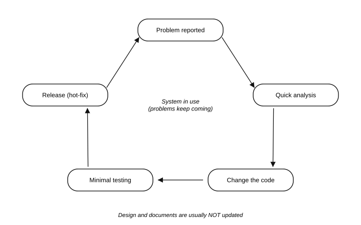
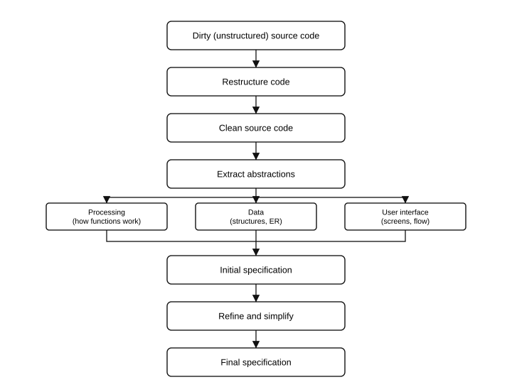

# SE Unit 5: Software Maintenance, Re-engineering and Configuration Management

*Endsem RUN · about 40 minutes*

**The whole unit in one breath:** once software is delivered, it keeps changing for its whole life (bugs, new OS versions, new features). That's **maintenance**, and it costs more than building the software did. This unit covers the **types** of maintenance, the **process** and **models** for doing it, **reverse engineering** (recovering the design from old code), **re-engineering** (rebuilding it better) and **configuration management** (keeping all the changes under control).

**What the endsem asks from here:** types of maintenance with examples, reverse engineering with a diagram, and the Quick-Fix model. 2025's whole Q5. This unit is based on sir's Unit 5 slides (Dr. Faisal Malik), which weren't in the folder before.

---

## 1. What maintenance is · Quick

**Exam line (IEEE):** *Software maintenance is the modification of a software product after delivery to correct faults, to improve performance or other attributes, or to adapt the product to a changed environment.*

Software doesn't wear out like a car's tyres, but its world keeps changing (new Android versions, new GST rules, new user demands), so it must keep changing too. **Lehman's law of continuing change:** a system in real use must keep being adapted, or it becomes progressively less useful. Other Lehman laws: increasing complexity (it gets messier unless you clean it), continuing growth, declining quality.

**Maintenance takes 60–80% of the total lifetime cost.** Development is the tip of the iceberg; maintenance is the hidden bulk. Like buying a car: the purchase is cheaper than years of fuel, servicing and repairs.

---

## 2. Types of maintenance · Slow down

> **Endsem 2025 · Q5(a) · 4.5 marks**
> Describe various types of software maintenance with suitable examples for each.

**Answer.**

**1. Corrective maintenance:** fixing **faults** (bugs) discovered after delivery, i.e. errors in design, logic or code that users report. It's **reactive** and usually the most urgent.
*Example:* a banking app crashes when the balance is ₹0; a patch is released to fix the crash.
*Analogy:* fixing a leaking tap.

**2. Adaptive maintenance:** changing the software so it keeps working in a **changed environment**: new OS, hardware, browser, database, law or business rule. No new feature for the user; it just stays compatible.
*Example:* updating an app to run on a new Android version; updating a billing system when GST rates change.
*Analogy:* using a travel adapter abroad: the phone is fine, the surroundings changed.

**3. Perfective maintenance:** **enhancing** working software: new features, better performance, better usability, usually because users asked. It is the **largest share** of maintenance (about 50%).
*Example:* adding dark mode, UPI payments or a faster search to an existing app.
*Analogy:* renovating a working kitchen to add a dishwasher.

**4. Preventive maintenance:** changing the software **now** to prevent **future** problems and make later changes easier: refactoring, restructuring code, updating documentation, removing latent faults. It's **proactive**.
*Example:* fixing the Y2K date bug before the year 2000; cleaning up tangled code before it breaks.
*Analogy:* servicing your car before a long trip.

| Type | Trigger | Share of effort (Lientz & Swanson) |
| --- | --- | --- |
| Perfective | User requests for improvements | ~50% |
| Adaptive | Environment changes | ~25% |
| Corrective | Bugs found in use | ~21% |
| Preventive | Future maintainability | ~4% |

So about **75%** of maintenance isn't bug fixing at all; it's evolving the software.

**Corrective fixes bugs, adaptive keeps it working in a new environment, perfective adds improvements (the biggest share), preventive restructures it to avoid future problems.**

---

## 3. Managing maintenance, and why it's hard · Quick

**Management issues:** who maintains (the original developers, who know the code but are expensive, or a separate maintenance team, cheaper but must learn the system first); staff motivation (maintenance feels unglamorous, so turnover is high); handling **change requests**: log them, prioritise (P1 critical / system down → P4 enhancement), estimate effort, schedule releases.

**Why it's hard:** poor or missing documentation; "spaghetti" code after years of quick fixes (technical debt); the **ripple effect** (one change breaks something elsewhere); original developers gone; old technology.

**Estimating maintenance effort**, Boehm's model:

```latex
\text{ACT} = \frac{\text{KLOC added} + \text{KLOC modified (per year)}}{\text{total KLOC}}, \qquad \text{AME} = \text{ACT} \times \text{SDE}
```

(ACT = annual change traffic, AME = annual maintenance effort, SDE = software development effort.) Example: a 50,000-LOC system with 5,000 LOC changed per year → ACT = 0.1; if development took 100 PM, AME = 10 person-months per year.

**Belady–Lehman model:** $M = P + K e^{(c - d)}$: maintenance effort grows exponentially with complexity c and falls with the team's familiarity d.

---

## 4. The maintenance process · Quick

Every change request is handled like a mini project, so it doesn't break the running system:

1. **Request and classify:** log the change request; decide its type (corrective, adaptive …) and priority.
2. **Impact analysis:** find which modules are affected; estimate effort, cost and risk; decide whether to go ahead.
3. **Design and implement:** design the modification, change the code, update design documents.
4. **Regression testing:** retest the changed parts **and** the existing features, so nothing that worked is now broken.
5. **Release and document:** ship the new version under version control; update manuals and the change history.

*Example:* "Add a UPI payment option" → perfective, medium priority → analyse the checkout modules → design and code the UPI flow → regression-test all existing payment methods → release v2.3 and update the user guide.

---

## 5. Maintenance models · Slow down

A **maintenance model** is the overall strategy for making changes. The syllabus has three: Quick-Fix, Iterative Enhancement and Reuse-Oriented.

> **Endsem 2025 · Q5(c) · 4.5 marks**
> Explain the working process of the Quick-Fix Model with a diagram. List any two advantages and disadvantages of this model.

**Answer.**

The **Quick-Fix model** is an ad hoc, "fire-fighting" approach to maintenance: when a problem is reported, the developers **find it and change the code as quickly as possible**, with minimal analysis and little regard for the overall design or long-term effects. The code is fixed first; design documents are usually left un-updated.



**Working process:**

1. A **problem is reported** by a user (often urgent, e.g. production is down).
2. **Quick analysis:** the developer locates the faulty code, without studying the wider design.
3. **Change the code** directly to remove the symptom.
4. **Minimal testing:** just enough to check the problem has gone.
5. **Release** the fix (a hot-fix). The system goes back into use, and the cycle repeats with the next problem.

*Real example:* a payment page crashes in production at 2 AM; a developer pushes an immediate hotfix to stop the damage, planning to clean it up properly later.

*Analogy:* plugging a flat tyre by the roadside to get home. It works for now, but it isn't a proper repair, and doing it repeatedly damages the tyre.

**Advantages:**

1. **Fast and cheap** in the short term: a fix reaches users almost immediately.
2. **Ideal for emergencies**, critical bugs and hard deadlines; needs little planning or documentation effort.

**Disadvantages:**

1. **Code structure degrades:** fixes pile up as patches (technical debt), so each later change becomes harder and riskier.
2. **Documentation falls out of date** and the design is ignored, so the system becomes hard to understand; the ripple effect of unanalysed changes can introduce new bugs.

**Quick-fix = find the problem and patch the code immediately, with minimal analysis and testing; fast and good for emergencies, but it degrades the code and documentation over time.**

### The other two models

- **Iterative Enhancement model:** assumes the system is documented and understood. Each change goes through full **analysis** of the existing system, **classification** of the proposed changes, then **redesign and implementation**, with the documents updated every iteration. Slower and costlier, but the system stays healthy. Best for long-lived systems. *Analogy:* renovating a house room by room with proper plans.
- **Reuse-Oriented model:** maintain by **reusing existing components**: identify reusable parts of the old system (or a library), understand them, adapt them, and integrate them into the new system. Fast and reliable when good components exist. *Example:* reusing one well-tested login module across a company's products.

| Model | Approach | Analysis | Best for | Risk |
| --- | --- | --- | --- | --- |
| Quick-Fix | Patch fast | Minimal | Emergencies | Code and docs decay |
| Iterative Enhancement | Analyse fully, improve in iterations | Thorough | Long-lived documented systems | Slower, costlier |
| Reuse-Oriented | Reuse and adapt components | Moderate | When reusable parts exist | Needs good reusable assets |

---

## 6. Reverse engineering · Slow down

**Exam line:** *Reverse engineering is the process of analysing a software system to identify its components and their relationships, and to create representations of it at a higher level of abstraction (design, specifications), usually from its source code.*

It's normal (forward) engineering run backwards: **code → design → requirements**. It only **extracts information**; the system itself is not changed. Like dismantling a mechanical watch to see how it works, or working out a dish's recipe by tasting it.

> **Endsem 2025 · Q5(b) · 4.5 marks**
> Explain the process of reverse engineering in software engineering. Illustrate the steps involved with a neat labelled diagram.

**Answer.**

**Reverse engineering** recovers design and specification information from an existing system, typically an old ("legacy") system whose documents are missing or outdated, so that it can be understood, maintained or re-engineered. It moves **up** levels of abstraction (code → design → specification) and does **not** change the system's functionality.



**Steps (Pressman's process):**

1. **Dirty source code:** start from the existing, often unstructured and undocumented code.
2. **Restructure the code:** clean it up without changing behaviour (remove goto-spaghetti, rename variables, split huge functions) so it can be read. This gives **clean source code**.
3. **Extract abstractions:** analyse the clean code to recover three kinds of abstraction:
   - **Processing:** what each function/module does and how control flows (call graphs, flowcharts).
   - **Data:** internal data structures and the database model (e.g. an ER diagram).
   - **User interface:** screens and the interaction flow.
4. **Initial specification:** write down the recovered design and requirements.
5. **Refine and simplify:** remove redundancy, check with domain experts, fill gaps.
6. **Final specification:** a usable high-level description of the system, ready for maintenance or forward engineering.

**Related terms:** **redocumentation** (re-creating documents at the same level of abstraction), **design recovery** (rebuilding design from code + domain knowledge), and **restructuring** (transforming code at the *same* level of abstraction, behaviour unchanged).

*Example:* a company has a 20-year-old system with no design documents; engineers study its code to reconstruct its flowcharts, data model and design before modernising it.

**Reverse engineering = restructure the dirty code, extract processing, data and UI abstractions, and refine them into a specification, without changing the system.**

---

## 7. Software re-engineering · Quick

**Re-engineering** = examining and altering an existing system to rebuild it in a **new, improved form, without changing its functionality**.

**Re-engineering = reverse engineering + restructuring/redesign + forward engineering.** First understand the old system, then rebuild it better.

**Pressman's re-engineering process:** inventory analysis (which applications are worth it) → document restructuring → reverse engineering → code restructuring → data restructuring → forward engineering.

*Example:* migrating a 1980s COBOL banking system to Java, with the same business rules but now maintainable. Done when the system still has business value but is too costly to maintain as it is.

| | Reverse engineering | Re-engineering |
| --- | --- | --- |
| Goal | Understand | Rebuild and improve |
| Changes the system? | No | Yes, a new version |
| Direction | Code → design (upwards) | Up, then down again (round trip) |
| Output | Documents, models | Modernised system |

---

## 8. Software Configuration Management (SCM) · Quick

With 20 developers changing hundreds of files and several versions live (dev, test, production), chaos is guaranteed without control: lost changes, the wrong version shipped, "it works on my machine". **SCM** is the discipline of identifying, organising and **controlling changes** to all software artefacts throughout the life cycle. It answers: what changed, who changed it, when, why, and which version is where.

- **Configuration item (CI):** anything put under control: code, SRS, design documents, test cases, manuals, build files.
- **Baseline:** a reviewed, approved version of CIs that can be changed **only through formal change control**, like a saved checkpoint in a game.

**The five SCM activities:**

1. **Configuration identification:** decide the CIs and give each a unique ID and version.
2. **Version control:** store every version; check-in/check-out, branching, merging, rollback (Git, SVN).
3. **Change control:** request → impact analysis → **Change Control Board (CCB)** approves/rejects → controlled change → review/test → update baseline.
4. **Status accounting:** record and report the state of every CI and change request.
5. **Configuration audit:** verify the built system matches its approved configuration.

*Example:* a team on GitHub: branches, commits and pull requests track every change, and a tagged release shows exactly what runs in production.

---

## 9. Quick recap

- Maintenance = changes after delivery; 60–80% of lifetime cost; Lehman: continuing change.
- Types: corrective (bugs), adaptive (environment), perfective (improvements, ~50%), preventive (future-proofing).
- Process: request/classify → impact analysis → design/implement → regression test → release/document.
- Models: Quick-Fix (fast patch, decays code), Iterative Enhancement (analyse and redesign), Reuse-Oriented (reuse components).
- Reverse engineering: dirty code → restructure → extract processing/data/UI → specification; no change to the system.
- Re-engineering = reverse + restructure + forward; same functionality, better form.
- SCM: CIs, baselines, identification, version control, change control (CCB), status accounting, audit.
